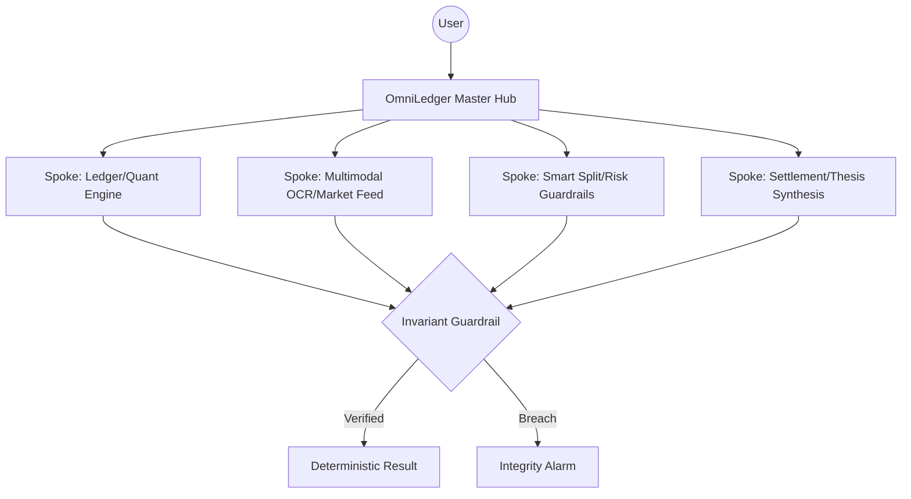

# 🌐 OmniLedger AI
### The High-Precision Financial Invariant Suite

**OmniLedger AI** is a production-grade suite of autonomous AI agents designed to eliminate "financial drift" and hallucinations in complex accounting and quantitative equity research. By combining **Google ADK Hub-and-Spoke Architecture** with deterministic mathematical invariants, OmniLedger ensures that every penny is accounted for and every price target is grounded in certified quant matrices.

---

## 🏛️ The OmniLedger Ecosystem

The suite is divided into two specialized domains, both sharing the same commitment to **Zero-Drift Precision**:

### 1. ⚖️ OmniLedger Audit (Consumer Finance)
*Formerly Bharat Dues*
An autonomous agent for shared group bill splitting and multimodal auditing.
- **Core Invariant**: $\sum \text{NetBalances} \equiv 0.00$
- **Capabilities**: Multimodal Receipt OCR (Gemini 2.5 Flash), Smart-Split Penny Allocation, Double-Entry Invariant Verification, and 1-tap NPCI UPI settlements.
- **Path**: `agents/gemini-audit-agent/`

### 2. 📈 OmniLedger Quant (Institutional Finance)
*Formerly Arthaniti*
A quantitative equity research hub for NSE/BSE analysis and risk guardrails.
- **Core Invariant**: SEBI Prudential Concentration Caps ($\le 25\%$).
- **Capabilities**: Certified Camarilla & Classic Pivot Engine, Real-time Market Feeds, Gemma-2 Institutional Thesis Synthesis, and MCP Server integration for IDEs.
- **Path**: `tools/gemma-quant-mcp/`

---

## 🧬 Technical Architecture: The Hub-and-Spoke Pattern

OmniLedger utilizes the **Google Agent Development Kit (ADK)** to decouple orchestration from execution.



---

## 🛠️ Production-Grade Features

- **$\sum \Delta \equiv 0.00$ Enforcement**: No floating-point drift. Every transaction is balanced to the nearest penny.
- **PrivacyGuard PII Masking**: Built-in scrubbing of emails, phone numbers, and UPI IDs before data reaches the LLM.
- **Zero-Key Resilience**: Operates in "Deterministic Fast-Path" mode using heuristic parsers when API keys are absent.
- **Enterprise Versioning**: All endpoints follow `/api/v1/` for stable downstream integration.
- **Local Persistence**: SQLite-backed ledger and portfolio history for stateful auditing.

---

---

## 🎥 Media & Video Demonstrations (Brag Skills)

### 🎥 Final Render Paths (Post-Render)
- **Bharat Dues Video**: `/Users/shikhar/Projects/open-source-agents/brag-audit/brag.mp4` (also synced at `agents/gemini-audit-agent/brag/brag.mp4`)
- **Arthaniti Video**: `/Users/shikhar/Projects/open-source-agents/brag-quant/brag.mp4` (also synced at `tools/gemma-quant-mcp/brag/brag.mp4`)

### 🛠️ Current Composition Paths (The Source)
If you want to preview or edit the scenes before rendering:
- **Bharat Dues Composition**: `/Users/shikhar/Projects/open-source-agents/brag-audit/composition/index.html`
- **Arthaniti Composition**: `/Users/shikhar/Projects/open-source-agents/brag-quant/composition/index.html`

## 🚀 Quick Start

### Launch Audit Agent
```bash
cd agents/gemini-audit-agent
docker compose up --build
# Access at http://localhost:8000
```

### Launch Quant Tool
```bash
cd tools/gemma-quant-mcp
docker compose up --build
# Access at http://localhost:8002
```

---

## 📜 License
MIT License © 2026 GDG Cloud Bengaluru Community.
