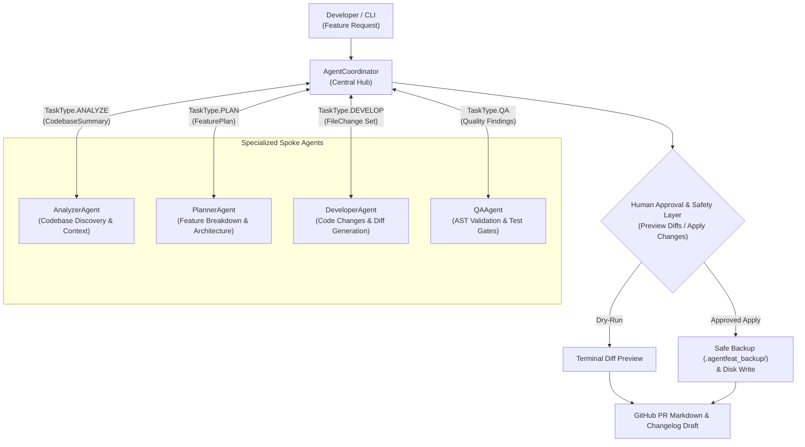

# AgentFeat ⚡

> **From feature request to working code, with AI.**

[](https://opensource.org/licenses/MIT)
[](https://www.python.org/)
[](#-hub-and-spoke-multi-agent-architecture)
[](https://ai.google.dev/)
[](https://github.com/gdgcblr)

**AgentFeat** is an autonomous feature-engineering multi-agent system built on a **Hub-and-Spoke architecture**. It orchestrates specialized AI agents through a centralized coordinator, transforming natural language feature requests into architectural blueprints, production-grade code implementations, automated tests, line-by-line diffs, and GitHub-ready Pull Request documentation.

Built for the **GDG Cloud Bengaluru** open-source AI ecosystem (*Road to DevFest 2026: FORK. BUILD. MERGE.*), AgentFeat is grounded in software engineering best practices: context awareness, AST syntax validation, dry-run previews, automated safety backups, bounded retries, and structured LLM outputs via the official Google GenAI SDK and Gemini 2.5.

---

## 🏛️ Hub-and-Spoke Multi-Agent Architecture

Instead of unstructured peer-to-peer agent chatter, AgentFeat uses a **Hub-and-Spoke model** with a standardized **Agent-to-Agent (A2A-ready) message protocol**. The central Hub (`AgentCoordinator`) routes tasks, validates payloads, enforces bounded retries, tracks immutable audit logs, and aggregates final deliverables.



### Agent Roles & Responsibilities

| Role | Agent / Component | Responsibility |
| :--- | :--- | :--- |
| **Central Hub** | `AgentCoordinator` | Single coordination point. Dispatches tasks, maintains shared `TaskState`, bounds retries, logs audit trail, and aggregates results. |
| **Spoke 1** | `AnalyzerAgent` | Discovers project structure, detects languages and frameworks (FastAPI, Flask, React, etc.), parses dependency manifests. |
| **Spoke 2** | `PlannerAgent` | Uses Gemini 2.5 structured outputs (`response_schema=FeaturePlan`) to produce an ordered implementation plan with dependencies and test strategy. |
| **Spoke 3** | `DeveloperAgent` | Generates full proposed file changes, test files, and unified diffs. **Never directly modifies the target project.** |
| **Spoke 4** | `QAAgent` | Reviews code, validates Python AST and JSON syntax, verifies path boundaries, checks secret leaks, and checks test coverage. |
| **Safety Gate** | Human Approval Layer | Enforces explicit user confirmation before any file write, and creates automated safety backups in `.agentfeat_backup/`. |

---

## 📡 Message Protocol & Task Lifecycle

Every interaction between the Hub and Spoke agents passes through a validated Pydantic message envelope ([`AgentMessage`](file:///Users/purushotham/Downloads/AgentFeat/agentfeat/orchestration/messages.py)):

```python
class AgentMessage(BaseModel):
    message_id: str             # Unique UUID
    task_id: str                # Global feature run ID
    sender: str                 # "hub", "analyzer", "planner", "developer", "qa"
    recipient: str              # Target spoke agent
    task_type: TaskType         # ANALYZE, PLAN, DEVELOP, QA
    status: TaskStatus          # PENDING, IN_PROGRESS, SUCCESS, FAILURE, RETRYING
    payload: Dict[str, Any]     # Validated schema payload (CodebaseSummary, FeaturePlan, etc.)
    error: Optional[str]        # Structured error message if task failed
    timestamp: float            # Monotonic creation timestamp
```

### Bounded Retries & Loop Prevention
- The Hub tracks retries per agent in [`TaskState`](file:///Users/purushotham/Downloads/AgentFeat/agentfeat/orchestration/task_state.py).
- Spoke failures are retried up to a bounded quota (default: 2 retries per agent).
- Infinite agent loops are strictly prevented by linear stage transitions (`init` $\rightarrow$ `analyzing` $\rightarrow$ `planning` $\rightarrow$ `developing` $\rightarrow$ `qa` $\rightarrow$ `review`).

---

## 📋 Prerequisites

- **Python**: `>= 3.9`
- **Google Gemini API Key**: Get a free API key from [Google AI Studio](https://aistudio.google.com/app/apikey)
- *(Optional)* Can also run in **offline demonstration mode** (`--offline` or without API key) for testing and CI pipelines.

---

## ⚡ Quickstart

### 1. Installation

```bash
# Clone repository
git clone https://github.com/gdgcblr/open-source-agents.git
cd open-source-agents/agents/agentfeat # (or cd AgentFeat)

# Create and activate virtual environment
python3 -m venv .venv
source .venv/bin/activate

# Install dependencies
pip install -r requirements.txt
```

### 2. Configure Environment

Copy `.env.example` to `.env` and insert your Gemini API Key:

```bash
cp .env.example .env
```

Edit `.env`:
```env
GEMINI_API_KEY=your_gemini_api_key_here
GEMINI_MODEL=gemini-2.5-flash
AGENTFEAT_OFFLINE_MODE=false
```

---

## 💻 Usage & CLI Guide

AgentFeat provides three primary commands: `scan`, `plan`, and `run`.

### 1. Scan Repository Architecture
Inspect any codebase to view detected languages, frameworks, manifests, and file hierarchy:

```bash
python -m agentfeat scan --target-dir .
```

### 2. Generate a Feature Plan
Generate a structured implementation plan without generating code:

```bash
python -m agentfeat plan "Add Google OAuth login to my application"
```

### 3. Full Feature Pipeline (Dry-run by default)
Run the coordinated Hub-and-Spoke workflow (Analyzer $\rightarrow$ Planner $\rightarrow$ Developer $\rightarrow$ QA $\rightarrow$ Hub Review):

```bash
# Preview diffs safely in terminal without modifying disk
python -m agentfeat run "Add rate limiting middleware to our API" --dry-run
```

### 4. Apply Changes to Workspace
Apply validated changes directly to your repository with automated backup:

```bash
python -m agentfeat run "Add health check endpoint with uptime metrics" --apply --save-pr PR_DRAFT.md
```

### 5. Run in Offline / Demo Mode
Test AgentFeat without making remote Gemini API calls:

```bash
python -m agentfeat run "Add JWT authentication" --offline --dry-run
```

---

## ⚙️ Configuration Reference

| Variable | Default | Description |
| :--- | :--- | :--- |
| `GEMINI_API_KEY` | *(empty)* | Your Google Gemini API Key from Google AI Studio. |
| `GEMINI_MODEL` | `gemini-2.5-flash` | Target Gemini model (`gemini-2.5-flash` or `gemini-2.5-pro`). |
| `AGENTFEAT_OFFLINE_MODE` | `false` | Enable deterministic offline mock mode for CI/CD or local testing. |
| `AGENTFEAT_VERBOSE` | `false` | Enable detailed debug logs. |

---

## 🧪 Running Tests

The test suite covers Hub routing, bounded retries, Spoke agents, AST validation, diff generation, and security boundaries:

```bash
# Run all tests (31 passing tests)
pytest -v
```

---

## 🛡️ Safety & Reliability Principles

- **Developer Agent Isolation**: The `DeveloperAgent` strictly generates proposed `FileChange`s and diffs; it has **no disk write permissions**.
- **Human Approval Barrier**: By default, AgentFeat previews unified diffs (`--dry-run`). It only writes to disk when explicitly confirmed or invoked with `--apply`.
- **Automatic Backups**: Whenever files are modified, pre-change copies are stored in `.agentfeat_backup/<timestamp>/`.
- **AST Integrity Check**: Python files are compiled through `ast.parse` before writing. If syntax errors occur, the changes are flagged and aborted.
- **Path Traversal & Protected Files**: Enforces strict root directory containment and blocks writes to `.env*`, `.git*`, `id_rsa*`, `*.pem`, `*.key`.
- **Zero Committed Secrets**: `.env` and `.agentfeat_backup/` are strictly ignored by `.gitignore`.

---

## 🤝 Contributing

Contributions to AgentFeat are welcome! This project follows the [GDG Cloud Bengaluru open-source-agents contributing guidelines](https://github.com/gdgcblr/open-source-agents/blob/main/CONTRIBUTING.md).

1. Fork the repository.
2. Create a feature branch: `git checkout -b feat/agentfeat`.
3. Ensure all tests pass: `pytest`.
4. Submit a Pull Request.

---

## 📜 License

This project is licensed under the **MIT License** — see the [LICENSE](LICENSE) file for details. Built with ❤️ for the **GDG Cloud Bengaluru Community** (*Road to DevFest 2026*).
