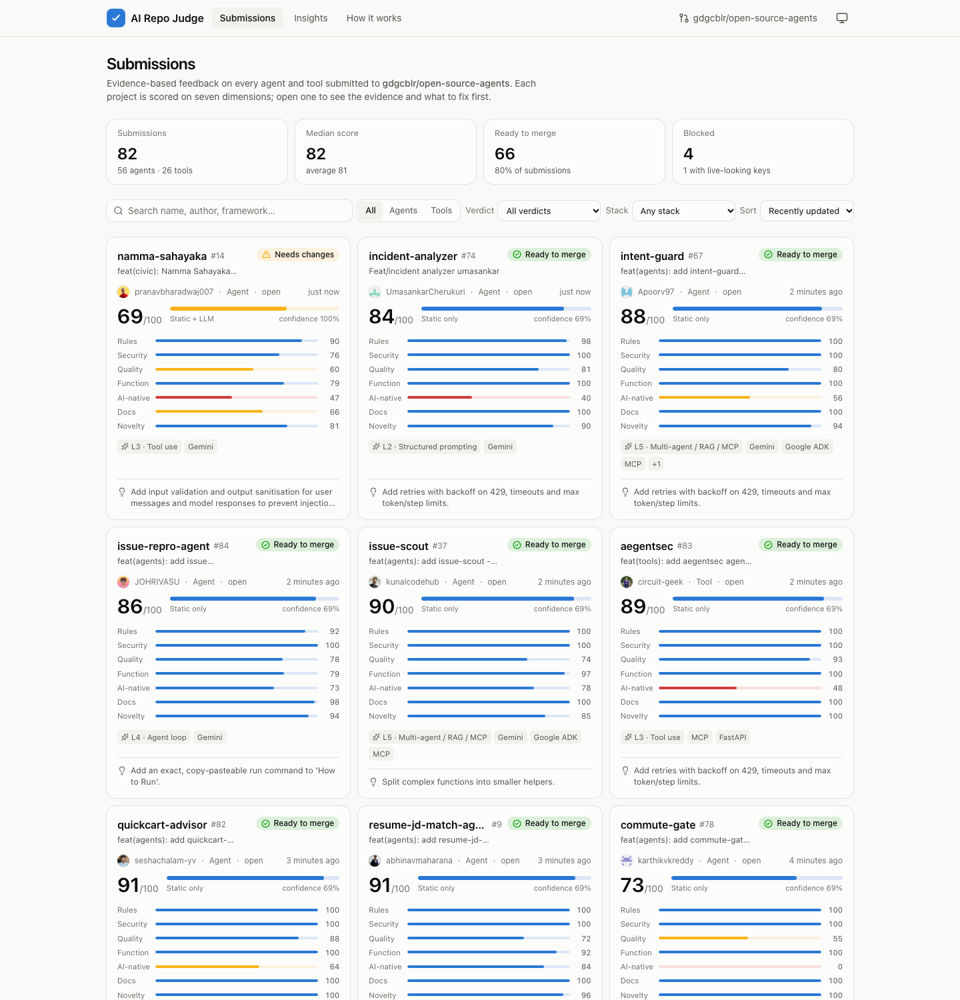
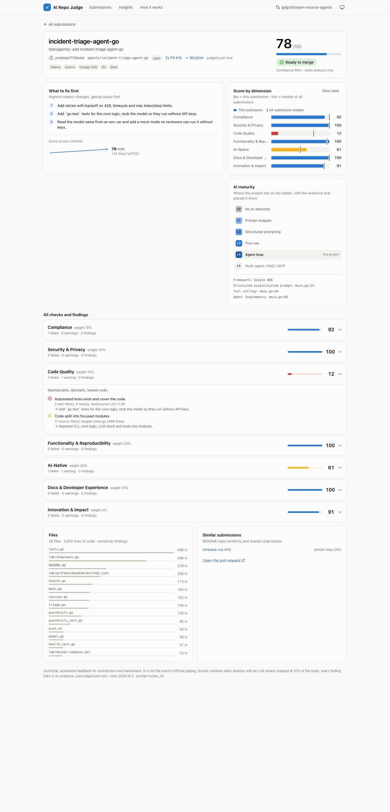
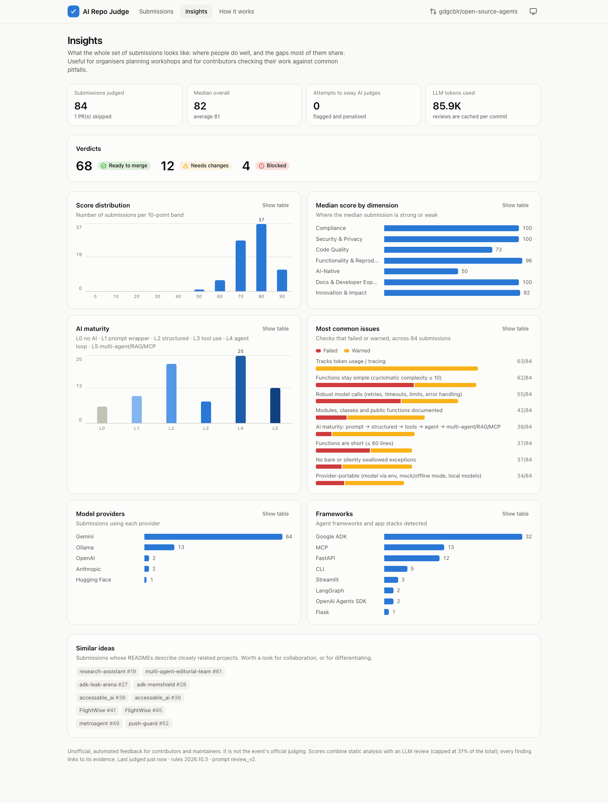
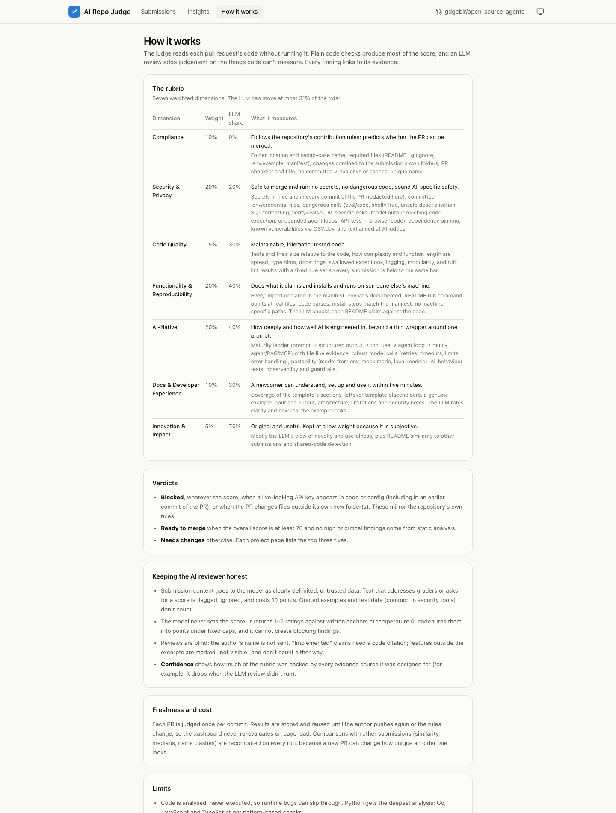

# AI Repo Judge

> Evidence-based, explainable scoring for every agent and tool submitted to this repository, with a responsive dashboard that tells each contributor exactly what to fix first.



---

## Overview

### Problem Statement & Intended Users
- **Problem**: Dozens of pull requests arrive within hours during community events like FORK. BUILD. MERGE. Maintainers can't review each one deeply and quickly. Contributors wait days to learn they leaked a key, forgot a dependency, or left the template example in their README.
- **Intended Users**: repository maintainers and event organisers who need a quick view of every submission, and contributors who want concrete, actionable feedback before a human reviews their PR.

### Key Features
- **Seven-dimension rubric** (Compliance, Security, Code Quality, Functionality, AI-Native, Docs, Innovation). Every score breaks down into named checks, and every finding links to `file:line` at the exact commit that was judged.
- **Static analysis first, LLM second.** Code checks drive most of the score. A structured LLM review (free Groq or Gemini tiers) adds judgement about code structure, whether README claims match the code, prompt quality and novelty. Its influence is capped at **31%** of the total.
- **Security that understands git history.** Secrets are scanned across *every commit* in the PR, so a key that was committed and then deleted is still caught. Keys are redacted before anything is published.
- **AI-native maturity ladder**: prompt wrapper → structured prompting → tool use → agent loop → multi-agent / RAG / MCP, plus checks for retries, timeouts, token and step limits, mock mode, evals and guardrails. Python, Go and JS/TS are supported.
- **Resistant to gaming.** Text addressed to AI graders is detected, ignored and penalised. The prompt treats all submission content as untrusted data, reviews are blind (no author names), and the LLM cannot create blocking findings.
- **Judges once per commit.** Results are stored by head commit (as local JSON or in **Firestore**), so a PR is only re-evaluated when its author pushes again. Comparisons across submissions (similar ideas, copied code, name clashes, medians) are recomputed on every run.
- **Feedback first, not a leaderboard**: no rank numbers, a "What to fix first" list on every page, and an *unofficial* disclaimer.

| Detail page | Insights | Methodology |
| --- | --- | --- |
|  |  |  |

Dark mode and phone layouts: [overview (dark)](docs/screenshots/overview-dark.png) · [detail (dark)](docs/screenshots/detail-dark.png) · [phone](docs/screenshots/mobile.png).

---

## Technical Stack

- **Language & Runtime**: Python 3.11+ (judging engine), Node.js 20+ (dashboard build only)
- **Agent Framework / Core Library**: a custom multi-step pipeline. Python `ast` plus `ruff` for static analysis, `pydantic` for schema-validated LLM output, and an OpenAI-compatible client with client-side rate limiting and provider fallback.
- **Models**: `openai/gpt-oss-120b` on **Groq** (free tier) by default; **Gemini** (`gemini-flash-latest`) as fallback; OpenRouter, Ollama (local) or any OpenAI-compatible endpoint by configuration; a deterministic mock for tests.
- **External APIs / Tools**: git (PR refs, no API quota), GitHub REST (PR metadata, ETag-cached), [OSV.dev](https://osv.dev) (known-vulnerable dependencies), optional Firebase Firestore.
- **Dashboard**: React 19 + Vite + Tailwind CSS 4, hand-built accessible charts, a static build that is deployable to GitHub Pages.

---

## Architecture & Data Flow

```
                 ┌────────────── judge run ──────────────────────────────────────────────┐
GitHub repo ──►  │ sources.py   git mirror of refs/pull/*/head + REST metadata (ETag cache)  │
                 │      │ untrusted tree extracted read-only (tarfile "data" filter)        │
                 │      ▼                                                                    │
                 │ analyzers/   compliance · security (secrets, code safety, integrity)      │
                 │              quality (ast + ruff) · reproducibility · ai_native · docs    │
                 │      │  facts + checks + findings (file:line)                             │
                 │      ▼                                                                    │
                 │ llm/review   compact, line-numbered, delimited context ──► Groq / Gemini  │
                 │              (rate limited, cached per commit + prompt version)           │
                 │      ▼                                                                    │
                 │ store.py     evaluation records keyed by head commit (local JSON/Firestore)│
                 │      ▼                                                                    │
                 │ pipeline     cohort pass: similarity, name clashes, medians, insights     │
                 │      ▼                                                                    │
                 │ scoring.py   weights · LLM cap · gates · verdict · confidence             │
                 └──────┬────────────────────────────────────────────────────────────────────┘
                        ▼
      data/results.json + data/pr/<id>.json   (or Firestore: meta/index, details/<id>)
                        ▼
      web/ (React)  Submissions ─► Detail page · Insights · How it works
```

The judge **never executes submitted code**. A plain `pip install` can run arbitrary `setup.py` code, so everything is read and parsed as text.

---

## Prerequisites

- Python 3.11+ and `pip` (or [`uv`](https://docs.astral.sh/uv/))
- `git`
- Node.js 20+ and `npm` (only to build or serve the dashboard)
- Optional: a free [Groq API key](https://console.groq.com) and/or [Gemini API key](https://aistudio.google.com/apikey) for the LLM review, and a GitHub token for higher API limits

---

## Installation & Setup

1. **Navigate to the project directory:**
   ```bash
   cd agents/ai-repo-judge
   ```

2. **Install the judging engine:**
   ```bash
   python3 -m venv .venv
   source .venv/bin/activate          # Windows: .venv\Scripts\activate
   pip install -e ".[dev]"            # add ",firebase" for Firestore support
   ```

3. **Configure environment variables** (all optional):
   ```bash
   cp .env.example .env
   ```

4. **Install the dashboard:**
   ```bash
   cd web && npm install && cd ..
   ```

---

## Configuration & Environment Variables

| Variable Name | Required | Default | Description |
| :--- | :--- | :--- | :--- |
| `GROQ_API_KEY` | No | *None* | Enables the LLM review on Groq's free tier |
| `GEMINI_API_KEY` | No | *None* | Gemini fallback (also reads `GOOGLE_API_KEY`) |
| `LLM_PROVIDER` / `LLM_FALLBACK_PROVIDERS` | No | `groq` / *none* | Provider order: `groq`, `gemini`, `openrouter`, `ollama`, `custom` |
| `GROQ_MODEL`, `GEMINI_MODEL`, … | No | see `.env.example` | Model per provider |
| `GROQ_TPM`, `GROQ_RPM`, … | No | free-tier limits | Client-side rate limits per provider |
| `GITHUB_TOKEN` | No | *None* | Raises the GitHub API limit (PR metadata) from 60 to 5,000/hour |
| `JUDGE_REPO` | No | `gdgcblr/open-source-agents` | Repository to judge |
| `JUDGE_STORE` | No | `local` | `local` JSON files or `firestore` |
| `FIREBASE_PROJECT_ID`, `GOOGLE_APPLICATION_CREDENTIALS` | Firestore only | *None* | Firestore project and service-account file |
| `JUDGE_LLM` / `JUDGE_OUT` / `JUDGE_CACHE` | No | `auto` / `./data` / `./.cache` | Run defaults |
| `VITE_DATA_SOURCE` (in `web/.env`) | No | `static` | Set to `firestore` (plus `VITE_FIREBASE_*`) to read results live from Firestore |

---

## How to Run

```bash
# Judge every PR (open and closed). Unchanged PRs are skipped.
python -m judge run

# A few PRs, static analysis only (no API keys needed)
python -m judge run --pr 2 --pr 16 --llm off

# Check your own folder before opening a PR
python -m judge run --local ../my-agent --out .cache/preview

# Print one result in the terminal
python -m judge show 2

# Open the dashboard (uses ./data from your last run; the bundled data/sample has the overview only,
# so project detail pages need a local `judge run`)
cd web && npm run dev            # or: npm run build && npm run preview
```

Data source: run with `--store firestore` to write records and dashboard documents to Firestore. To publish the static dashboard, `npm run build` produces `web/dist/`, which you can host on GitHub Pages or any static host.

---

## Example Input & Output

### Example Input
```bash
python -m judge run --pr 2 --pr 16 --llm on
```

### Example Output
Real runs against this repository (copied from the terminal, trimmed with `…`). The first LLM review of two PRs:
```
2 pull request(s) from gdgcblr/open-source-agents
[1/2] #2 judging agents/pdf-qa-agent @ 30c5492…
[1/2] #2 done (LLM groq, 4441 tokens)
[2/2] #16 judging agents/incident-triage-agent-go @ c8e7f61…
[2/2] #16 done (LLM groq, 6368 tokens)
```
A later run, after #16's author pushed a new commit. Unchanged PRs are skipped:
```
AI Repo Judge 0.1.0 (rules 2026.10.3) · store=local · llm=off
2 pull request(s) from gdgcblr/open-source-agents
[1/2] #2 unchanged since 30c5492; skipped
[2/2] #16 unchanged since 091d2d4; skipped
Published 84 submission(s) → …/agents/ai-repo-judge/data/results.json
…
         #16   78/100  ✅ ready           incident-triage-agent-go
         #14   69/100  🟡 needs changes   namma-sahayaka
          #2   68/100  🟡 needs changes   pdf-qa-agent
  #       13  skipped: No agents/<slug>/ or tools/<slug>/ folder in this PR
```

`python -m judge show 2` (excerpt):
```
feat(agents): add pdf-qa-agent — Ask questions about any PDF using Gemini API  (agents/pdf-qa-agent)
Overall 68/100 · 🟡 needs changes · confidence 100% · AI level 1 (Prompt wrapper)

Compliance                         100   (weight 10%)
   ✓ Changes confined to the submission's own folder(s): Only project files
   ✓ PR template checklist completed: 8/8 checklist items ticked
Top fixes:
  1. Refactor main.py: split PDF loading, prompt building, and API call into separate functions to reduce the 97-line main function.
  2. Add input validation for the PDF path (existence, size limits) and enforce a hard token limit before sending to the model.
  3. Implement a proper conversation loop that stores and passes chat history, and add a graceful shutdown on 'quit'.
```

Things this run caught across 84 submissions:
- A Google API key committed in a `.env.example`. It was blocked, and the key is redacted in the output.
- Workflows added outside the project folder.
- A PR whose score rose from 66 to 78 across two commits.
- Groups of near-duplicate ideas.

It also caught one of its own bugs: invisible bidirectional control characters that had slipped into this project's source (Trojan Source). They are fixed now.

---

## How to Test

```bash
pytest                      # 48 tests, offline, no API keys
ruff check judge tests      # lint
cd web && npm run build     # type-checks (tsc) and builds the dashboard
```

The tests build fixture projects at runtime: a well-built project, one with a leaked key (only in history, or committed), one with hidden instructions for graders, one with out-of-scope changes, copied code, a Go ADK agent and an MCP server. Fake keys and injection phrases are assembled from fragments, so this repository never contains strings that trip secret scanners. The LLM client is tested against mocked HTTP transports for 429 retries, daily-quota fallback and bad keys.

The judge also scores itself: `python -m judge run --local . --out .cache/self`.

---

## Known Limitations

- **Static only.** Code is parsed, never run, so runtime bugs pass unnoticed. A Docker sandbox for install and test runs is the next step.
- **Python is analysed most deeply.** Go and JS/TS get pattern-based checks, and other languages only get the generic checks.
- **Free-tier throughput.** Groq's free tier allows about one review per minute (8K tokens/minute) and roughly 35 reviews per day (200K tokens/day); after that the judge falls back to Gemini. Each review is stored per commit, so this cost is paid once. Mixing models adds a little model bias to the LLM-weighted 31%; every page shows which model reviewed it.
- **Secrets in docs and tests** can't be told apart from realistic fakes. They are flagged for the author to confirm rather than blocking.
- **Self-similar patterns.** Scanner-style projects whose source *defines* detection patterns (this one included) can match some AI-native signals in their own pattern strings. The LLM review counterbalances this.
- This is unofficial feedback, not the event's judging.

---

## Security & Privacy Considerations

- **Secrets Handling**: API keys are read from a git-ignored `.env` (see `.env.example`). Secrets found in submissions are redacted to their type plus the first 4 characters before they are stored or published.
- **Data Privacy**: only code excerpts, the README and analysis summaries are sent to the LLM provider. Author names and PR descriptions are not sent. Everything judged is already public on GitHub.
- **Safety**: submitted code is never executed. PR trees are extracted with tarfile's `data` filter, which rejects absolute paths and links that escape the extraction folder. All PR text goes to the model inside delimiters as untrusted data, the model's output is schema-validated and clamped, and it cannot raise blocking findings.
- **Least privilege**: a GitHub token is optional. If you use one, a fine-grained token with no extra permissions (public read-only) is enough.

---

## Future Improvements

- [ ] Optional Docker sandbox (`--sandbox`) to install dependencies and run each submission's tests with no network.
- [ ] GitHub Action mode that posts the "What to fix first" summary as a PR comment, opt-in by maintainers.
- [ ] Run several workers per provider in parallel, and calibrate across models when reviews mix providers.
- [ ] Deeper JS/TS and Go analysis using their own parsers.

---

## License

This project is contributed under the repository's open-source license (MIT).
