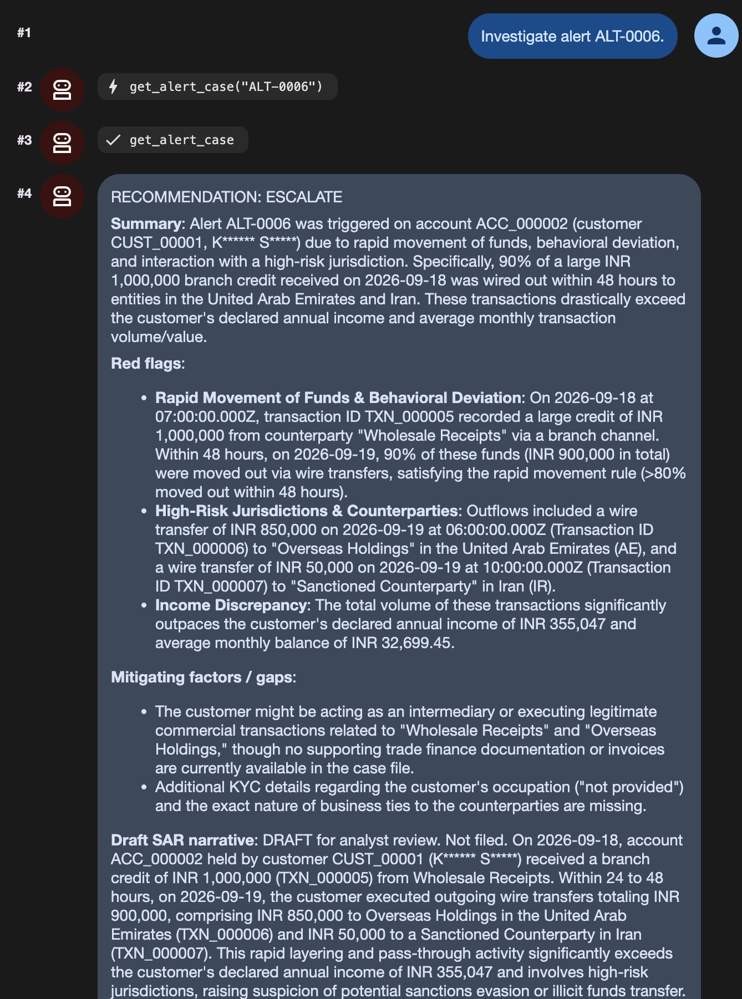
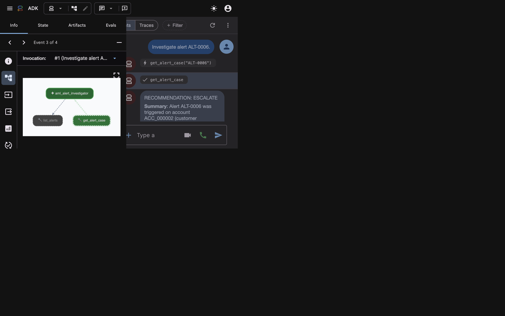
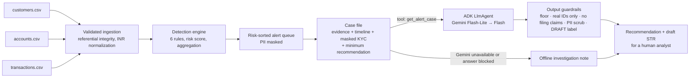

# AML Alert Investigator

> A transaction-monitoring engine that flags money-laundering patterns in bank data, plus a Google ADK agent that investigates each alert and drafts a Suspicious Transaction Report narrative for a human analyst to review.

---

## Demo

Screenshots from a live run of `npm run web` (ADK dev UI, `gemini-flash-lite-latest`) on the sample data.

**Investigating alert ALT-0006.** The agent calls `get_alert_case`, recommends `ESCALATE`, and cites only real transaction IDs:
- a ₹10 lakh deposit, 90% of which was wired to the UAE and Iran within 48 hours
- a DRAFT STR narrative that uses the masked customer name only



**The case file the model receives** (shown by clicking the tool call):
- the rule explanation and the enforced `minimumRecommendation: "ESCALATE"`
- KYC context with the name masked (`K****** S*****`)
- no email, phone number or date of birth



---

## Overview

### Problem Statement & Intended Users
- **Problem**:
  - Bank compliance teams must spot laundering typologies (structuring, rapid movement of funds, transfers to sanctioned jurisdictions, unusual spikes in activity) and explain *why* each alert fired.
  - Rule engines produce alerts quickly, but analysts then spend most of their time on the write-up: pulling the account timeline, comparing activity against the customer's profile, and drafting a Suspicious Transaction Report (STR) for FIU-IND.
  - When this is done by hand, alerts are reviewed days after the activity, when the funds can no longer be frozen.
- **Intended Users**:
  - AML / compliance analysts and investigators at banks and fintechs.
  - Developers building transaction-monitoring prototypes.

### Key Features
- **Detection engine ported from a working Spring Boot system** (see *Origin*):
  - 6 configurable rules: CTR threshold, structuring, rapid movement (layering), high-risk jurisdiction or counterparty, behavioural deviation from a 90-day baseline, and repeated round numbers
  - INR normalization, a 0–100 risk score, and alert grouping so one pattern on one account per day produces one alert
- **Validated CSV ingestion**:
  - required fields, referential integrity (customer → account → transaction), currency and type checks
  - row-numbered rejections, and idempotent re-imports
- **Investigation agent (Google ADK + Gemini)**:
  - reads the case file (evidence, full account timeline, account profile, masked KYC context)
  - returns a recommendation (`ESCALATE` / `INVESTIGATE` / `CLOSE_FALSE_POSITIVE`), red flags citing exact transaction IDs, gaps, a **draft STR narrative**, and follow-up questions
- **Guardrails from the original brief's business rules**: PII masked before anything reaches the model; the agent can only recommend, never close or file; a recommendation can't be weaker than the rule-based minimum; answers citing records that don't exist are rejected.
- **Works offline**: `--no-llm` produces a factual investigation note and draft narrative from the case file alone.

---

## Origin

The detection logic is ported from **Sentinel AML**, my hackathon project (Java 17, Spring Boot, PostgreSQL, React) built for the "Sentinel AML: Real-Time Money Laundering Detection" brief. The [original engine](https://github.com/abhisekmishra1709/hackathon) is `DetectionEngine.java`.

| Kept from the original | Changed for this repository |
| :--- | :--- |
| Rule codes, scores (70/90/85/95/80/45), thresholds, windows and explanations | Rewritten in TypeScript so it runs with `npm install`, without a JDK, Maven or PostgreSQL |
| Scoring: max rule score + 5 per extra rule, capped at 100 | In-memory store instead of JPA repositories |
| Alert grouping key `account:rules:UTC-day`, keeping the highest score | Behavioural-deviation multiplier and baseline days made configurable (defaults unchanged: 3× and 90 days) |
| INR normalization with a configurable exchange-rate table | Rules overridable from a JSON file validated by `zod`, instead of Spring `application.yml` |
| The sample CSVs in `data/` | New: the Gemini investigation agent, the recommendation floor and the output guardrails |
| The original JUnit rule tests | Ported one-for-one to Vitest ([tests/detection.test.ts](tests/detection.test.ts)) |

Not ported:
- case management, role-based access and the audit trail (they need a database and authentication)
- the React dashboard

---

## Technical Stack

- **Language & Runtime**: TypeScript on Node.js 20.19+, run with `tsx` (no build step)
- **Agent Framework**: Google Agent Development Kit for TypeScript (`@google/adk`), with tool parameters defined in `zod`
- **Models**: `gemini-flash-lite-latest`, falling back to `gemini-flash-latest` (configurable through `MODEL_NAME`)
- **External APIs / Tools**: none apart from Gemini. All data is read from local CSV files.
- **Testing**: `vitest`

---

## Architecture & Data Flow



1. **Ingestion** ([src/csv.ts](src/csv.ts)): loads customers, then accounts, then transactions, so each record's parent exists before it is loaded. Bad rows are rejected with their row number. Amounts are converted to INR.
2. **Detection** ([src/detection.ts](src/detection.ts)): transactions are evaluated in time order. Each rule sees only activity up to the current transaction, matching the original, which saved each transaction before evaluating it.
3. **Case file** ([src/investigation.ts](src/investigation.ts)): builds everything an investigator needs for one alert. Full name, email, phone and date of birth are deliberately left out. It also sets the **minimum recommendation**:
   - a sanctions/high-risk hit, or a score of 90 or more, must be `ESCALATE`
   - a score of 70 or more must be at least `INVESTIGATE`
4. **Agent** ([src/agent.ts](src/agent.ts)): Gemini calls `list_alerts` and `get_alert_case`, then writes the investigation.
5. **Guardrails** ([src/guardrails.ts](src/guardrails.ts)): the answer is checked before display; if it fails, the offline note ([src/fallback.ts](src/fallback.ts)) is shown instead.

---

## Prerequisites

- Node.js **20.19+** and npm
- A **Gemini API key** from [Google AI Studio](https://aistudio.google.com/app/apikey). This is only needed for the AI investigation.

---

## Installation & Setup

1. **Navigate to the project directory:**
   ```bash
   cd agents/aml-alert-investigator
   ```

2. **Install dependencies:**
   ```bash
   npm install
   ```

3. **Configure environment variables** (only for the AI investigation):
   ```bash
   cp .env.example .env
   # then set GEMINI_API_KEY
   ```

---

## Configuration & Environment Variables

| Variable Name | Required | Default | Description |
| :--- | :--- | :--- | :--- |
| `GEMINI_API_KEY` | For AI investigation | *None* | Gemini API key. Not needed for `detect` or `--no-llm`. |
| `MODEL_NAME` | No | `gemini-flash-lite-latest,gemini-flash-latest` | Comma-separated models, tried in order. |
| `GEMINI_TIMEOUT_MS` | No | `45000` | Per-model time limit before moving to the next model. |
| `AML_DATA_DIR` | No | `data` | Data folder for `npm run chat` / `npm run web`. |
| `AML_RULES_FILE` | No | *None* | Rule-override JSON for `npm run chat` / `npm run web`. |

### Rule configuration

Every threshold and toggle can be changed without code changes. Pass a JSON file with `--rules`. Unknown keys and wrong types are rejected.

```json
{
  "structuringCount": 4,
  "highRiskJurisdictions": ["IR", "KP", "SY", "MM"],
  "highRiskCounterparties": ["Blocked Entity Ltd"],
  "exchangeRatesToInr": {"INR": 1, "USD": 83.5, "EUR": 90, "AED": 22.7},
  "roundNumberEnabled": false
}
```

Available keys, with their defaults, are in [src/config.ts](src/config.ts):
- **Thresholds:** `reportThresholdInr` (8,30,000), `structuringMinimumInr` (7,47,000)
- **Structuring:** `structuringCount` (3), `structuringWindowHours` (24)
- **Rapid movement:** `rapidMovementHours` (48), `rapidMovementRatio` (0.8)
- **Behavioural deviation:** `behavioralBaselineDays` (90), `behavioralMultiplier` (3)
- **Round numbers:** `roundAmountUnitInr` (1,00,000), `roundNumberCount` (2)
- **Lists:** `highRiskJurisdictions`, `highRiskCounterparties`, `exchangeRatesToInr`
- **Toggles:** one `*Enabled` switch per rule

---

## How to Run

```bash
# 1. Load the CSVs, run detection, print the risk-sorted alert queue (offline)
npm run detect
npm run detect -- --data ./my-data --rules ./rules.json

# 2. Investigate the highest-risk alert, or a specific one
npm run investigate                       # with Gemini (needs GEMINI_API_KEY)
npm run investigate -- --alert ALT-0006
npm run investigate -- --no-llm           # offline note + draft narrative

# JSON for integrations
npm run investigate -- --alert ALT-0006 --json

# Explore interactively (ADK dev tools)
npm run chat    # terminal
npm run web     # browser UI at http://localhost:8000, shows each tool call
```

Each CSV file needs the following columns (extra columns are ignored):
- `customers.csv`: `customer_id, first_name, last_name, date_of_birth, country, risk_rating`
- `accounts.csv`: `account_id, customer_id, account_type, account_status, currency, open_date`
- `transactions.csv`: `transaction_id, account_id, transaction_type, amount, currency, counterparty, channel, timestamp, jurisdiction`

---

## Example Input & Output

The input is the sample data in [data/](data/): 2 synthetic customers, 2 accounts and 7 transactions, carried over from the original project. All outputs below are from real runs.

### `npm run detect`

```
Loaded 2 customers, 2 accounts, 7 transactions (0 rejected, 0 duplicates skipped).
Evaluated 7 transactions in 7 ms → 6 alert(s).

| Alert | Risk | Rules | Account | Customer | Evidence |
| :--- | ---: | :--- | :--- | :--- | ---: |
| ALT-0005 | 100 | BEHAVIORAL_DEVIATION, CTR_THRESHOLD, ROUND_NUMBER, STRUCTURING | ACC_000001 | CUST_00001 (K****** S*****) | 4 |
| ALT-0006 | 100 | BEHAVIORAL_DEVIATION, HIGH_RISK_JURISDICTION, RAPID_MOVEMENT | ACC_000002 | CUST_00001 (K****** S*****) | 3 |
| ALT-0003 | 95 | ROUND_NUMBER, STRUCTURING | ACC_000001 | CUST_00001 (K****** S*****) | 3 |
| ALT-0004 | 95 | BEHAVIORAL_DEVIATION, CTR_THRESHOLD, RAPID_MOVEMENT | ACC_000002 | CUST_00001 (K****** S*****) | 2 |
| ALT-0001 | 70 | CTR_THRESHOLD | ACC_000002 | CUST_00001 (K****** S*****) | 1 |
| ALT-0002 | 45 | ROUND_NUMBER | ACC_000001 | CUST_00001 (K****** S*****) | 2 |
```

All six typologies fire. Behavioural deviation is customer-level: `CUST_00001` owns both accounts, so activity on one account counts towards the baseline for the other.

### `npm run investigate -- --alert ALT-0006` (Gemini, about 8 s)

```
# Investigation: ALT-0006  (risk 100/100, BEHAVIORAL_DEVIATION, HIGH_RISK_JURISDICTION, RAPID_MOVEMENT)
Account ACC_000002 · Customer CUST_00001 (K****** S*****) · minimum recommendation ESCALATE

## Recommendation: ESCALATE  (Gemini gemini-flash-lite-latest, checked by guardrails)

**Summary**: Alert ALT-0006 was triggered on savings account ACC_000002 (customer CUST_00001, K****** S*****) due to
rapid movement of funds, behavioral deviation, and high-risk jurisdiction transactions. [...] 90% of the funds were wired
out to overseas counterparties in jurisdictions including the United Arab Emirates and Iran. These transactions heavily
exceed the customer's average monthly balance of INR 32,699.45 and declared annual income of INR 355,047.

**Red flags**:
- Rapid movement of funds: On 2026-09-18T07:00:00.000Z, transaction TXN_000005 credited INR 1,000,000 via branch channel
  from counterparty Wholesale Receipts. Within 48 hours, specifically on 2026-09-19, 90% of this inflow (INR 900,000 total)
  was transferred out.
- High-risk jurisdiction and counterparty: Transaction TXN_000006 (INR 850,000 debit via wire on 2026-09-19T06:00:00.000Z)
  involved counterparty Overseas Holdings in the United Arab Emirates (AE). Transaction TXN_000007 (INR 50,000 debit via
  wire on 2026-09-19T10:00:00.000Z) involved counterparty Sanctioned Counterparty in Iran (IR).
[...]

**Draft SAR narrative**:
DRAFT for analyst review. Not filed. On 2026-09-18, account ACC_000002 held by CUST_00001 (masked name K****** S*****)
received a cash/branch credit of INR 1,000,000 (TXN_000005) from Wholesale Receipts. Immediately following this deposit,
on 2026-09-19, the account engaged in rapid outbound wire transfers totaling INR 900,000. [...]

**Questions for the analyst**:
1. What is the documented source of wealth and business justification for the INR 1,000,000 credit received from
   Wholesale Receipts (TXN_000005)?
[...]

_A human analyst must review and record the disposition. Alerts are never closed by this tool._
```

`[...]` marks lines cut for length. Wording varies between runs. The guardrails check every run in the same way.

### `npm run investigate -- --no-llm` (offline)

```
## Recommendation: ESCALATE  (offline)

**Evidence**
- TXN_000001 · 2026-09-18 09:00 UTC · CREDIT · INR 8,00,000 · Local Trading Co · BRANCH · IN
- TXN_000002 · 2026-09-18 12:00 UTC · CREDIT · INR 8,00,000 · Local Trading Co · BRANCH · IN
- TXN_000003 · 2026-09-18 16:00 UTC · CREDIT · INR 8,00,000 · Local Trading Co · BRANCH · IN
- TXN_000004 · 2026-09-19 08:00 UTC · CREDIT · INR 9,00,000 · Meridian Exports · WIRE · IN

**Draft SAR narrative** (DRAFT for analyst review. Not filed.)

Account ACC_000001 (NRE), held by customer CUST_00001 (K****** S*****; KYC VERIFIED, risk rating MEDIUM, declared annual
income INR 3,55,047), recorded 4 flagged transaction(s) totalling INR 33,00,000 between 2026-09-18 and 2026-09-19. [...]
For comparison, the account's six-month average monthly balance is INR 22,831.7. Jurisdictions involved: IN.
```

---

## Stakeholders, Failure Modes & Guardrails

| Stakeholder | Needs | Worst failure |
| :--- | :--- | :--- |
| Compliance analyst | Fast, accurate, explainable case write-ups | A real laundering case recommended for closure |
| Customer under review | Privacy; no unfounded accusations | PII sent to a third-party model; invented evidence in a report |
| Regulator / FIU-IND | Truthful, evidence-backed STRs, filed on time | A narrative citing transactions that don't exist |
| The bank | Audit-ready decisions made by accountable people | An AI that appears to have filed, closed or frozen something |

| What can fail | Guardrail / fallback |
| :--- | :--- |
| Malformed or inconsistent data | Rows are rejected with row-numbered errors. Unknown currencies, types and parent records are refused, never guessed. |
| The model recommends closing a serious alert | **Recommendation floor**, enforced in code: a sanctions hit or score of 90+ must be `ESCALATE`, and 70+ must be at least `INVESTIGATE`. A weaker answer is rejected and the offline note is shown. |
| The model invents a transaction or account | Every record ID in the answer must exist in the case file; otherwise the answer is rejected. |
| The model claims something was filed | Rejected. The agent only drafts and recommends. |
| PII exposure (business rule 8) | Tools never return full names, emails, phones or dates of birth. Output is scrubbed again, and the narrative uses the customer ID and masked name. |
| Instructions hidden in counterparty names | The data is marked as untrusted in the prompt. Even if the model is fooled, the floor and ID checks still apply. |
| Gemini is down, slow, rate-limited or retired | Model fallback chain (Flash-Lite, then Flash) with a timeout per model; then the deterministic offline note. A rejected key stops immediately, and the key is scrubbed from error text. |
| Runaway tool loops | `maxLlmCalls: 6` per run, temperature 0.2, low thinking level. |

---

## How to Test

```bash
npm test          # 30 vitest tests
npm run typecheck # TypeScript strict mode
```

The tests cover:
- the 8 original JUnit rule tests, ported one-for-one
- scoring, aggregation and time ordering
- a **10,000-transaction benchmark**: under 60 ms locally, against the original brief's 2-minute target
- the CSV parser and row validation
- INR normalization and rule-file validation
- the exact expected alert queue for the sample data
- PII never appearing in tool output
- the recommendation floor and every output guardrail
- the offline fallback passing its own guardrails

---

## Known Limitations

- **Tiny sample dataset.** The 7 sample transactions were built to trigger each typology. They don't represent real alert volumes or false-positive rates.
- **Rules only.** There is no machine-learning anomaly scoring, and no detection of networks across many accounts (e.g. mule rings).
- **The model's wording can be imprecise.** In one live run it said "within 24 hours" for a 27-hour gap, and compared an amount with a transaction count. The guardrails catch invented records, weak recommendations and filing claims, but not every inaccurate phrase, which is why the output is a draft for human review.
- **Lost in porting:** case management, role-based access, the immutable audit trail and PostgreSQL persistence from the original. Each run is in-memory.
- **Not ported to the web UI:** `npm run web` / `npm run chat` call the agent directly. Tool outputs are PII-masked by design, but the output guardrails (floor, ID check, filing check) run only in the `investigate` CLI.
- **The default rule values match the original project.** They are not regulatory advice; tune them to your institution's policy.
- Tested on macOS with Node.js 24.

---

## Security & Privacy Considerations

- **Secrets handling:** the Gemini key is read only from the environment or a git-ignored `.env`, and is scrubbed from error messages.
- **Data privacy:**
  - The sample data is **synthetic**: the original brief required that no real PII be used.
  - Gemini receives only the case file: IDs, amounts, counterparties, masked name and KYC attributes. It never receives full names, emails, phone numbers or dates of birth.
  - `npm run detect` and `--no-llm` run fully offline.
- **Safety:**
  - The agent has two read-only tools.
  - It cannot modify data, close alerts or file reports. Every output ends with a reminder that a human must record the disposition.

---

## Future Improvements

- [ ] Port case management and an append-only audit log (e.g. SQLite) so analyst dispositions are recorded.
- [ ] Apply the output guardrails inside ADK model callbacks, so the web and chat interfaces are guarded too.
- [ ] A larger synthetic generator with labelled typologies, to measure precision and recall.
- [ ] A network view linking accounts that share counterparties, devices or beneficiaries.

---

## License

This project is contributed under the repository's open-source license (MIT). The ported detection logic comes from the author's own Sentinel AML hackathon project.
