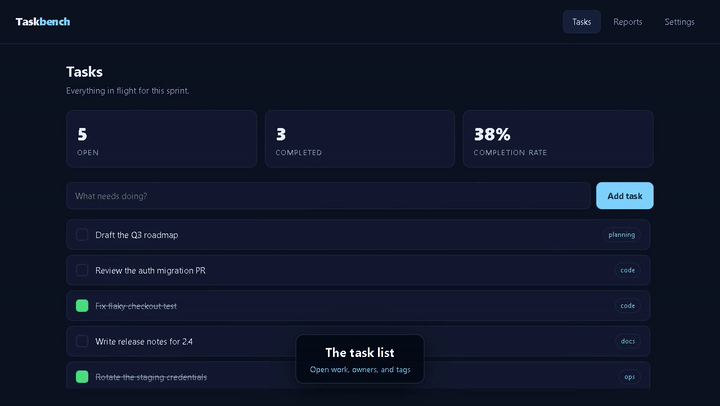

# autodemo

> Point it at a running web app and get back a narrated, captioned demo video — the agent explores the app, writes the script itself, and cuts the MP4.



---

## Overview

### Problem Statement & Intended Users

- **Problem**: Recording a demo video is the boring part of shipping. You write
  a script, rehearse it, fumble a click, re-record, discover your voice is
  inconsistent between takes, and lose an afternoon. Then the UI changes and
  you do it again. The work is mechanical — drive the app, say the words, cut
  the file — but it has stayed manual because it needs a browser, a voice and a
  video encoder to agree with each other.
- **Intended Users**: developers and teams shipping a web app who need a demo
  for a launch, a README, a hackathon submission, a pull request, or a customer
  call. Also anyone maintaining a demo video that goes stale every release — a
  scene file is a text file, so re-rendering is a one-line command.

### Key Features

- **The agent writes the script.** The `demo-scripter` subagent opens your app,
  reads its accessibility tree route by route, works out the eight to fifteen
  most demo-worthy things it does, and emits a config with selectors that
  actually exist — then dry-runs it and repairs its own failed steps.
- **Deterministic renderer.** Given a scene file, the engine produces the same
  video every time, with no LLM in the loop. The agent layer is optional; the
  engine works on its own.
- **One continuous take.** The whole walkthrough is recorded as a single
  Playwright video with per-scene timestamps, then narration is mixed in at
  those offsets. No stitching, so no seams between scenes.
- **Scenes hold for their narration.** After a scene's steps finish, the engine
  waits out the rest of the voice clip. You never hand-tune `wait` values to
  match a voiceover.
- **`probeClick` makes canvas apps demoable.** A pipe on a WebGL map has no DOM
  node to target. `probeClick` clicks outward in an expanding spiral until an
  inspector panel's text matches a pattern, then remembers what it found so a
  later scene can pick a different one. See `examples/map-app/`.
- **Individually fault-tolerant steps.** A renamed button is logged as
  `(skipped: …)` and the render continues. A missing selector never kills a
  five-minute render twelve scenes in.
- **Ships as a Claude Code plugin and an MCP server**, so both Claude Code and
  other agent frameworks can drive it.

---

## Technical Stack

- **Language & Runtime**: Node.js 20+, ESM. No build step.
- **Agent Framework / Core Library**: Claude Code plugin — a skill
  (`skills/autodemo/`), a subagent (`agents/demo-scripter.md`) and a `/demo`
  slash command. Also exposed over the **Model Context Protocol**
  (`src/mcp/server.mjs`) for non-Claude-Code frameworks.
- **Models**: none required by the engine. The agent layer runs on whatever
  model your Claude Code session uses; **no API key is needed by this project**.
- **External APIs / Tools**: Playwright (browser automation and recording),
  ffmpeg + ffprobe (mixing and encoding), `edge-tts` or Windows SAPI (speech).
  All local. Nothing is uploaded anywhere.

---

## Architecture & Data Flow

```
                   autodemo.config.yaml  (scenes: narration + steps)
                             │
        ┌────────────────────┼────────────────────┐
        │                    │                    │
   [1] TTS               [2] Playwright       [3] ffmpeg
   edge-tts / SAPI       one continuous        adelay per clip
        │                recording             at its mark
   one clip per scene         │                    │
        │                step dispatcher      amix → libx264
   ffprobe each clip ───▶ drives the app      ───▶  demo.mp4
   (durations known          │
    before recording)   caption overlay
                        injected into the page
                             │
                        marks[] — the wall-clock
                        offset of each scene
```

Durations are measured **before** recording, so each scene can hold for exactly
as long as its narration. The marks captured during recording are what the
mixer uses to place each clip. That ordering is the whole design.

**The agent layer**, when used, sits in front of stage 1:

```
/demo <url> ──▶ preflight ──▶ demo-scripter subagent
                                   │  opens the app, snapshots each route,
                                   │  writes the config, dry-runs it,
                                   │  repairs its own failed steps (≤3 loops)
                                   ▼
                        narration shown to the user for approval
                                   ▼
                             autodemo render
```

---

## Prerequisites

- **Node.js 20+** and npm.
- **ffmpeg and ffprobe** on `PATH` (they ship together):
  - Windows: `winget install Gyan.FFmpeg`
  - macOS: `brew install ffmpeg`
  - Linux: `sudo apt-get install -y ffmpeg`
- **A Chromium browser.** System Chrome or Edge is detected automatically; if
  there is none, run `npx playwright install chromium`.
- **A voice engine** (optional): `pip install -U edge-tts` for neural voices on
  any OS. Windows falls back to built-in SAPI. With neither, `voice.engine:
  none` still renders a correctly-paced silent video.
- **Your app must already be running.** autodemo does not start dev servers.
- **No API keys.** This project needs none; `.env.example` is empty of required
  values for that reason.

---

## Installation & Setup

1. **Navigate to the project directory:**
   ```bash
   cd agents/autodemo
   ```

2. **Install dependencies:**
   ```bash
   npm install
   npx playwright install chromium   # only if you have no system Chrome
   ```

3. **Configure Environment Variables:**
   Optional — autodemo runs with no `.env` at all.
   ```bash
   cp .env.example .env
   ```

---

## Configuration & Environment Variables

autodemo is configured by `autodemo.config.yaml`, not by environment variables.
These three exist only as overrides:

| Variable Name | Required | Default | Description |
| :--- | :--- | :--- | :--- |
| `CHROME_PATH` | No | *auto-detected* | Browser executable to record with. Overrides `app.chromePath`. |
| `APP_URL` | No | *from config* | Not read by the engine; use `app.url`. Listed because dev servers commonly set it. |
| `AUTODEMO_LOG` | No | `info` | Reserved for future verbosity control. |

The real configuration surface is the config file. Full reference:
[`skills/autodemo/references/step-types.md`](skills/autodemo/references/step-types.md).

```yaml
app:
  url: http://localhost:5173/
  viewport: { width: 1600, height: 900 }
  waitForSelector: "#root"
voice:
  engine: edge-tts        # edge-tts | sapi | none
  voice: en-US-AriaNeural
theme:
  accent: "#7dd3fc"
  position: bottom        # where the caption sits
output:
  dir: ./autodemo-out
  file: demo.mp4
  crf: 20
scenes:
  - id: intro
    layout: title         # title | caption | none
    title: "Taskbench"
    subtitle: "Sprint tracking without the ceremony"
    narration: "This is Taskbench, a small task tracker. Let me show you what it does."
    steps: []
  - id: reports
    layout: caption
    title: "Throughput report"
    narration: "The reports tab charts throughput over the last four weeks."
    steps:
      - { do: navClick, name: "Reports" }
      - { do: waitForText, text: "Total shipped this month" }
```

### Step types

| `do` | Fields | What it does |
| :--- | :--- | :--- |
| `click` | `role`, `name`, `exact`, `selector`, `text`, `within`, `timeout` | Clicks one element. Prefer `role`+`name`. |
| `navClick` | `name`, `within` (default `nav`), `exact` | Clicks a named button inside the nav. |
| `toggle` | `name`, `role` (default `switch`) | Flips a switch by accessible name. |
| `type` | `text`, `delay` | Types key by key, so it reads as typing on camera. |
| `press` | `key` | `Enter`, `Control+k`, `Escape`. |
| `hover` | targeting | Opens a menu or tooltip. |
| `wait` | `ms` | Dead time. Rarely needed — scenes already hold for their narration. |
| `waitForText` | `text`, `timeout` | Waits for content. The right way to wait for data. |
| `waitForSelector` | `selector`, `timeout` | Waits for an element. |
| `wheel` | `dy`, `dx`, `times`, `pauseMs`, `at` | Repeated mouse wheel — zooms a map. |
| `drag` | `button`, `path: [[dx,dy],…]`, `stepMs`, `from` | Press, move in small hops, release. A right-button drag pitches and orbits a 3D map. |
| `scrollPanel` | `selector`, `to`: `bottom`\|`top`\|`<px>` | Scrolls a specific scroll container. |
| `screenshot` | `name` | Writes `<name>.png` — useful for README images. |
| `probeClick` | `pattern`, `panel`, `region`, `saveAs`, `excludeMatch`, `spiral` | Clicks in an expanding spiral until a panel matches. **For canvas and map apps.** |
| `js` | `code` | `page.evaluate`. The escape hatch. |
| `goto` | `url`, `waitUntil` | Navigates. |

---

## How to Run

### The 60-second quickstart

```bash
cd agents/autodemo
npm install

# serve the bundled example app on :5173 in another terminal
npx serve examples/todo-app -l 5173

node bin/autodemo.mjs render --config examples/todo-app/autodemo.config.yaml
```

That renders `examples/todo-app/out/taskbench-demo.mp4` — a real 57-second
captioned walkthrough. It uses `voice.engine: none`, so it works with no TTS
installed; set it to `edge-tts` for an actually-voiced video.

### CLI

```
autodemo preflight  [--config <file>]
autodemo render     [--config <file>] [--out <dir>] [--dry-run] [--scene <id>]...
autodemo thumbnail  [--config <file>] [--at <seconds>]
autodemo init       [--dir <dir>] [--url <url>]
```

Install it as a command with `npm link`, or call `node bin/autodemo.mjs`.

### As a Claude Code plugin

Add this directory as a plugin, then:

```
/demo http://localhost:5173 --scenes 10 --voice en-IN-NeerjaNeural
```

That preflights, spawns `demo-scripter` to explore the app and write the config,
**shows you the proposed narration and waits for your approval**, and renders
only once you say yes.

### As an MCP server

```json
{ "mcpServers": { "autodemo": { "command": "node", "args": ["src/mcp/server.mjs"] } } }
```

Exposes `autodemo_preflight`, `autodemo_describe_app`, `autodemo_dry_run` and
`autodemo_render`.

---

## Example Input & Output

### Example Input

`examples/todo-app/autodemo.config.yaml`, abbreviated:

```yaml
app:
  url: http://localhost:5173/
  viewport: { width: 1280, height: 720 }
  waitForSelector: "#root"
voice: { engine: none, tailMs: 500 }
output: { dir: ./out, file: taskbench-demo.mp4, crf: 23, thumbnail: true }
scenes:
  - id: intro
    layout: title
    title: "Taskbench"
    subtitle: "Sprint tracking without the ceremony"
    narration: >-
      This is Taskbench, a small task tracker. In the next minute I will walk
      through adding work, completing it, and reading the throughput report.
    steps: []
  - id: add_task
    layout: caption
    title: "Adding work"
    narration: >-
      Adding work is one field and one key press. The new task lands at the
      bottom of the list and the open counter moves immediately.
    steps:
      - { do: click, selector: "#new-task" }
      - { do: type, text: "Ship the demo video", delay: 60 }
      - { do: press, key: "Enter" }
      - { do: scrollPanel, selector: "#list-scroll", to: bottom }
  # …4 more scenes
```

### Example Output

A real run, verbatim — Windows 11, Node 24.20, ffmpeg 8.0.1:

```
$ node bin/autodemo.mjs render --config examples/todo-app/autodemo.config.yaml

  ✓ ffmpeg     on PATH
  ✓ ffprobe    on PATH
  ✓ browser    C:/Program Files/Google/Chrome/Application/chrome.exe
  ✓ app URL    http://localhost:5173/ -> 200
  ✓ voice      engine: none — silent clips sized to the narration text
  ✓ scenes     6 scene(s), 25 step(s)

  Preflight passed.

[1/3] Synthesizing narration (none)...
  silent: intro (8.727s estimated)
  silent: tasks (10.182s estimated)
  silent: add_task (9.091s estimated)
  silent: complete (8.364s estimated)
  silent: reports (7.273s estimated)
  silent: settings (6.909s estimated)

[2/3] Recording the walkthrough...
 · intro  @0.1s  (narration 8.7s)
 · tasks  @9.4s  (narration 10.2s)
     ✓ waitForText "Everything in flight"
     ✓ wait "900ms"
     ✓ scrollPanel "#list-scroll"
     ✓ wait "900ms"
     ✓ scrollPanel "#list-scroll"
 · add_task  @20.1s  (narration 9.1s)
     ✓ click "#new-task"
     ✓ type "Ship the demo video"
     ✓ press "Enter"
     ✓ wait "1200ms"
     ✓ scrollPanel "#list-scroll"
     ✓ wait "800ms"
 · complete  @29.7s  (narration 8.4s)
     ✓ click "Complete Draft the Q3 roadmap"
     ✓ wait "1000ms"
     ✓ click "Complete Write release notes for 2.4"
     ✓ wait "1200ms"
 · reports  @38.6s  (narration 7.3s)
     ✓ navClick "Reports"
     ✓ waitForText "Total shipped this month"
     ✓ wait "1800ms"
 · settings  @46.4s  (narration 6.9s)
     ✓ navClick "Settings"
     ✓ wait "700ms"
     ✓ toggle "Group tasks by project"
     ✓ wait "700ms"
     ✓ toggle "Email me a weekly digest"
     ✓ wait "900ms"
     ✓ screenshot "settings"

[3/3] Mixing narration and encoding MP4...

✅ ...\examples\todo-app\out\taskbench-demo.mp4
   57.5s · 1280x720 · 6 scenes · 0 skipped step(s)
   thumbnail: ...\examples\todo-app\out\thumbnail.jpg
```

Verified with ffprobe:

```
$ ffprobe -v error -show_entries stream=codec_type,codec_name -show_entries format=duration taskbench-demo.mp4
codec_name=h264   codec_type=video   width=1280  height=720
codec_name=aac    codec_type=audio
duration=57.520000
```

A dry run of the same config reports per-step results and encodes nothing:

```
$ node bin/autodemo.mjs render --config examples/todo-app/autodemo.config.yaml --dry-run
...
Dry run complete: 6 scene(s), 0 failed step(s).
Report: examples\todo-app\out\dry-run.json
```

---

## How to Test

```bash
cd agents/autodemo
npm install
npx playwright install chromium
npm test
```

52 tests, all passing on Windows 11 / Node 24.20 / ffmpeg 8.0.1:

```
ℹ tests 52
ℹ pass 52
ℹ fail 0
ℹ duration_ms 15503.8542
```

What they cover:

- **`test/mix.test.mjs`** — the ffmpeg filter-string builder: audio inputs
  indexed from 1 (input 0 is the video), every clip chained into one `amix`,
  `normalize=0`, `dropout_transition=0`, the trailing `apad`, marks rounded and
  clamped, and a loud failure on a clip/mark count mismatch.
- **`test/timing.test.mjs`** — the scene padding maths and the spoken-length
  estimator, including a scene whose steps out-run its narration.
- **`test/config.test.mjs`** — schema validation against good and bad fixtures:
  missing `app.url`, unknown step types, misspelled top-level keys, a `click`
  with nothing to click, duplicate scene ids, and the defaults/merge rules.
- **`test/steps.test.mjs`** — the step dispatcher against a mocked page object:
  role-over-selector preference, `probeClick` spiral behaviour (finds a match,
  honours `excludeMatch`, stays inside `region`, gives up cleanly), that a
  failed `drag` still releases the mouse button, and that a failed step is
  skipped while the rest of the scene runs.
- **`test/integration.test.mjs`** — renders a real three-scene MP4 of the
  bundled example app with `voice.engine: none` and asserts the file exists,
  carries exactly one h264 video stream and one aac audio stream, runs within
  the expected bounds, and has strictly increasing scene marks. A second case
  asserts a dry run reports per-step failures and encodes nothing.

The integration tests skip themselves with a message if ffmpeg or ffprobe is
missing, rather than failing.

**Manual verification**, if you prefer to see it yourself: run the quickstart
above and open `examples/todo-app/out/taskbench-demo.mp4`.

A ready-to-use GitHub Actions workflow is included at
[`ci.example.yml`](ci.example.yml) — it is not installed as an active workflow,
because contributions here are scoped to their own directory.

---

## Known Limitations

Honest ones, from building and running this:

- **Your app must already be running.** autodemo does not start dev servers,
  seed databases, or log in. An app behind auth records its login page unless
  you point it at an unauthenticated route.
- **The audio is TTS, not a human.** `edge-tts` neural voices are good; they are
  not a voice actor. Prosody on long sentences and unusual proper nouns is the
  usual giveaway. Acronyms must be spelled phonetically (`B W S S B`, not
  `BWSSB`) — see `references/writing-narration.md`.
- **Renders take real time.** A five-minute video takes a bit over five minutes
  to record, plus encoding. There is no way around this: the walkthrough runs at
  human pace because that is what is being filmed.
- **Selectors drift.** A scene file is coupled to your UI's accessible names.
  Redesign the app and steps start getting skipped. Role-and-name targeting
  survives restyling far better than CSS, and `--dry-run` tells you what broke
  in about a minute, but this is maintenance, not magic.
- **`probeClick` is a heuristic.** It is probabilistic by nature: it clicks
  until something matches. On a sparse map it can exhaust its spiral and find
  nothing, and it may select a different feature between runs — which makes
  canvas demos not quite bit-identical across renders.
- **The caption overlay can be covered.** It sits at `z-index: 2147483000`; an
  app using a higher value will paint over it.
- **Software rendering on CI is slow** for WebGL-heavy apps — expect a map demo
  to take several times longer on a runner than on a laptop with a GPU.
- **The agent layer has been exercised far less than the engine.** The engine is
  covered by 52 tests and verified end to end on two apps. `demo-scripter` is a
  prompt: it is only as good as the accessibility tree your app exposes, and an
  app with unlabelled icon buttons gives it very little to work with.
- **Tested on Windows 11.** The cross-platform paths (macOS/Linux Chrome
  detection, per-platform GPU flags, the non-Windows TTS fallbacks) are written
  and reasoned through but have not been run on those platforms.

---

## Security & Privacy Considerations

- **Secrets Handling**: autodemo requires no API keys and reads no credentials.
  `.env.example` ships with no required values. `CHROME_PATH` is the only
  environment variable the engine reads.
- **Data Privacy**: everything runs locally. The browser, the encoder and the
  recording never leave your machine. The one exception is the TTS engine:
  `edge-tts` sends your **narration text** (not your app, not your data) to
  Microsoft's public Edge voice endpoint to synthesize it. If that matters, use
  `voice.engine: sapi` on Windows or `none`, both fully offline.
- **Your video will contain whatever is on screen.** This is the real privacy
  consideration. If you record against production data, the customer names, email
  addresses and record IDs visible during the walkthrough are in the MP4. Record
  against seeded data.
- **Safety**: the engine executes no shell commands. It does run two things you
  control: the `js` step type (`page.evaluate`) and `probeClick`'s regex, both
  taken from your own config file — treat a config from an untrusted source the
  way you would treat a script from one. The config is schema-validated before
  anything runs.
- **The map example targets a live third-party site** (`bwssb.vijaykumarkk.in`,
  a deployment by this project's author). It only reads and clicks a public
  page. It needs a Mapbox token — but that token belongs to *that app*, not to
  autodemo; none is read or committed here.

---

## Future Improvements

- [ ] Cut background music under the narration, with ducking.
- [ ] Zoom-and-pan ("Ken Burns") on a named element, for detail shots.
- [ ] Emit WebVTT captions alongside the MP4, from the narration text.
- [ ] A `--watch` mode that re-renders only the scenes whose narration changed.
- [ ] Record multiple viewports in one pass, for a mobile cut.
- [ ] Run `demo-scripter` against the two example apps as a scored eval, so the
      agent layer gets the same regression safety net the engine has.

---

## License

MIT — see [LICENSE](LICENSE). Contributed under the repository's open-source
license.

The three-stage pipeline (TTS → Playwright `recordVideo` → ffmpeg `adelay`/`amix`)
was first built by the same author as a one-off generator for the water-network
project linked in `examples/map-app/`, and generalised here. No third-party code
is vendored.
