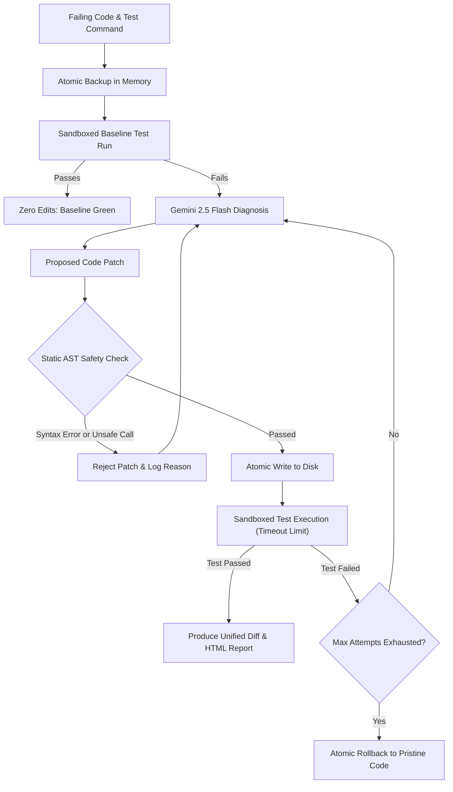

# Autonomous Code Healer

> An enterprise-grade, test-driven self-healing agent that diagnoses test failures, generates surgical code patches via Gemini 2.5 Flash, validates syntax and security via static AST analysis, executes verification in sandboxed subprocesses, and guarantees atomic rollback on failure.

---

## Overview

### Problem Statement & Intended Users
- **Problem**: Autonomous coding agents often introduce syntax errors, hallucinate dangerous system calls (`os.system`, `eval()`), or corrupt working code when multi-cycle reasoning fails. Unconstrained agent loops can also hang indefinitely during test execution.
- **Intended Users**: Software Engineers, DevOps/SRE teams, Open-source maintainers, and CI/CD pipeline automation bots seeking safe, deterministic, self-healing code remediation.

### Key Features
- **Deterministic Recursive Reasoning Loop**: Analyzes pytest execution logs, pinpointing root failure causes and applying surgical repairs.
- **Static AST Safety Guardrails**: Statically analyzes code abstract syntax trees prior to filesystem writes, rejecting syntax errors and blocking unsafe calls (`eval()`, `exec()`, `os.system()`, `subprocess`, `shutil.rmtree`).
- **Sandboxed Execution with Hard Timeout**: Executes verification test suites in isolated subprocesses with configurable timeout limits (preventing infinite loops or deadlocks).
- **Atomic File Rollback**: Takes an in-memory snapshot of target code prior to repair; if all healing attempts fail verification, the file is automatically reverted to its pristine state.
- **Interactive Glassmorphism HTML Dashboard**: Generates self-contained reports displaying unified diffs, attempt timelines, execution metrics, and original vs healed code tabs with OWASP-compliant XSS sanitization.
- **Model Context Protocol (FastMCP) Server**: Exposes `heal_code`, `audit_ast_safety`, and `run_sandboxed_command_tool` directly to IDEs and LLM tool chains.
- **Offline Mock Engine**: Supports zero-key clean-room verification and testing without requiring live Gemini API credits.

---

## Technical Stack

- **Language & Runtime**: Python 3.10+ (Tested on Python 3.13)
- **Agent Framework / Protocol**: Google GenAI SDK (`google-genai`), Model Context Protocol (`mcp` FastMCP)
- **Validation & Sandboxing**: Python `ast` module, `subprocess`, `pydantic`
- **Models**: Gemini 2.5 Flash (`gemini-2.5-flash`) / Deterministic Mock Engine
- **Test Suite**: Pytest (17 clean-room unit and integration tests)

---

## Architecture & Data Flow



---

## Prerequisites

- Python 3.10 or higher
- `pip` or virtual environment manager
- (Optional) Google Gemini API Key (offline mock engine works out-of-the-box without keys)

---

## Installation & Setup

1. **Navigate to the agent directory:**
   ```bash
   cd agents/autonomous-code-healer
   ```

2. **Create and activate a virtual environment (optional but recommended):**
   ```bash
   python -m venv .venv
   # Windows:
   .venv\Scripts\activate
   # Linux/macOS:
   source .venv/bin/activate
   ```

3. **Install dependencies:**
   ```bash
   pip install -r requirements.txt
   ```

4. **Configure environment variables (optional for live model runs):**
   ```bash
   cp .env.example .env
   # Edit .env and set GEMINI_API_KEY=your_actual_key
   ```

---

## Usage Instructions

### 1. Autonomous Healing with Mock Engine (Zero-Key Demo)
Repair the bundled broken example (`examples/broken_math.py`) verified against `examples/test_math.py`:
```bash
python main.py --file examples/broken_math.py --test-cmd "python -m pytest test_math.py" --mock --output-html healing_report.html
```

### 2. Live Autonomous Healing with Gemini 2.5 Flash
```bash
python main.py --file path/to/failing_module.py --test-cmd "pytest tests/test_module.py" --max-attempts 3 --output-html report.html
```

### 3. Model Context Protocol (FastMCP) Server
Launch the MCP server to integrate with Cursor, Claude Desktop, or Antigravity IDE:
```bash
# Verify FastMCP tool registrations:
python mcp_server.py --test

# Run stdio MCP server:
python mcp_server.py
```

---

## Run Inputs & Outputs

### Sample Command
```bash
python main.py --file examples/broken_math.py --test-cmd "python -m pytest test_math.py" --mock
```

### Sample Terminal Output
```
======================================================================
   AUTONOMOUS CODE HEALER - SELF-HEALING AGENTIC WORKFLOW
======================================================================
 Target File       : examples/broken_math.py
 Test Command      : python -m pytest test_math.py
 Max Cycles        : 3
 Sandbox Timeout   : 10s
 Auto Rollback     : True
 Mode              : Offline Mock
======================================================================
[14:10:30] [START] Backed up broken_math.py (296 chars).
[14:10:30] [TEST_BASELINE] Running baseline verification: 'python -m pytest test_math.py'
[14:10:34] [ATTEMPT_START] Cycle 1/3: Analyzing failure traceback.
[14:10:34] [TEST_RUN] Cycle 1: Re-testing patch with 'python -m pytest test_math.py'
[14:10:38] [SUCCESS] Patch verified on attempt 1! All tests green.

======================================================================
 HEALING RESULT: HEALED_SUCCESSFULLY
======================================================================

Unified Diff Applied:
--- a/broken_math.py
+++ b/broken_math.py
@@ -3,9 +3,10 @@
 
 def add(a, b):
     """Adds two numbers (currently has an off-by-one bug)."""
-    return a + b + 1
+    return a + b
 
 
 def divide(a, b):
-    """Divides a by b (currently crashes on 0 instead of raising ValueError)."""
+    if b == 0:
+        raise ValueError("Cannot divide by zero")
     return a / b

[Dashboard] Interactive HTML report generated at: healing_report.html
Duration: 7.57s | Attempts: 1 | Status: healed_successfully
```

---

## Testing & Verification

The agent includes 17 enterprise-grade unit and integration tests covering static AST guardrails, subprocess sandboxing, timeout enforcement, end-to-end self-healing, baseline pass paths, rollback on failure, and HTML XSS escaping:

```bash
python -m pytest tests/ -v
```

**Verification Results:**
```
agents/autonomous-code-healer/tests/test_ast_guard.py::test_ast_guard_valid_safe_code PASSED
agents/autonomous-code-healer/tests/test_ast_guard.py::test_ast_guard_syntax_error PASSED
agents/autonomous-code-healer/tests/test_ast_guard.py::test_ast_guard_blocks_dangerous_calls[os.system] PASSED
agents/autonomous-code-healer/tests/test_ast_guard.py::test_ast_guard_blocks_dangerous_calls[os.popen] PASSED
agents/autonomous-code-healer/tests/test_ast_guard.py::test_ast_guard_blocks_dangerous_calls[subprocess] PASSED
agents/autonomous-code-healer/tests/test_ast_guard.py::test_ast_guard_blocks_dangerous_calls[eval] PASSED
agents/autonomous-code-healer/tests/test_ast_guard.py::test_ast_guard_blocks_dangerous_calls[exec] PASSED
agents/autonomous-code-healer/tests/test_ast_guard.py::test_ast_guard_blocks_dangerous_calls[__import__] PASSED
agents/autonomous-code-healer/tests/test_ast_guard.py::test_ast_guard_blocks_dangerous_calls[shutil] PASSED
agents/autonomous-code-healer/tests/test_healer.py::test_end_to_end_mock_healing PASSED
agents/autonomous-code-healer/tests/test_healer.py::test_already_passing_code PASSED
agents/autonomous-code-healer/tests/test_healer.py::test_rollback_on_failed_attempts PASSED
agents/autonomous-code-healer/tests/test_healer.py::test_html_dashboard_generation PASSED
agents/autonomous-code-healer/tests/test_healer.py::test_html_dashboard_xss_escaping PASSED
agents/autonomous-code-healer/tests/test_sandbox.py::test_sandbox_success PASSED
agents/autonomous-code-healer/tests/test_sandbox.py::test_sandbox_failing_command PASSED
agents/autonomous-code-healer/tests/test_sandbox.py::test_sandbox_timeout_enforcement PASSED
============================= 17 passed in 27.02s =============================
```

---

## Token Considerations & Cost Optimization

- **Targeted Context Prompting**: Only the failing file content and the truncated test failure traceback are provided to the model, eliminating unnecessary project context tokens.
- **Strict Attempt Caps**: `max_attempts` defaults to 3 and is hard-capped at 6 to prevent runaway LLM costs.
- **Baseline Short-Circuiting**: If initial test execution passes, zero LLM calls are made (`attempts_made = 0`).
- **Estimated Consumption**: ~1,500 prompt tokens + ~600 completion tokens per repair cycle using Gemini 2.5 Flash ($0.00015 / cycle).

---

## Known Limitations & Future Work

- **Single-File Scope**: Currently operates on single-file bug fixes. Multi-file refactoring with cross-module import graphs is planned for v2.
- **Subprocess Isolation**: Uses native subprocess timeouts. Containerized Docker / gVisor sandboxing can be added for multi-tenant environments.
- **Git VCS Integration**: Directly leverages atomic file backups; future iterations can produce structured Git branches and draft Pull Requests automatically.

---

## Security & Zero Secrets Compliance

- Adheres strictly to the repository's **Zero Secrets Policy**: `.env` and local credentials are fully ignored by `.gitignore`.
- Does not modify any root build manifests or files outside `agents/autonomous-code-healer/` (other than registration in `agents/README.md`).
- Employs static AST inspection before writing any code generated by LLMs to disk.
