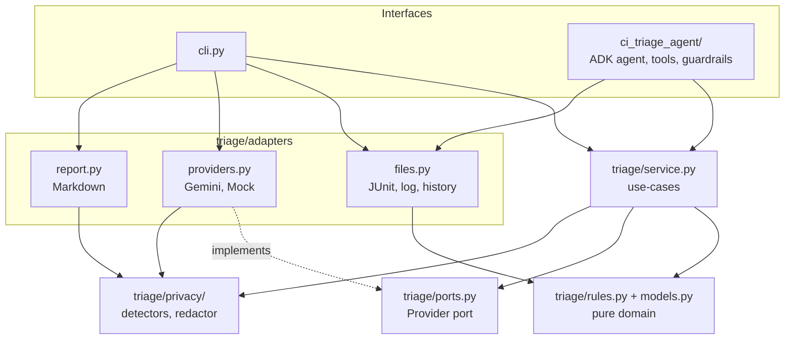

# Architecture

Dependencies point **inward only**. This is enforced by `tests/test_architecture.py`, which fails
if a layer imports something it should not.

| Layer | Knows about | Must not know about |
|---|---|---|
| `models`, `rules`, `ports` | stdlib, pydantic | files, network, Gemini, ADK, privacy |
| `privacy` | stdlib | everything else |
| `service` | domain, ports, privacy | files, Gemini, ADK, CLI |
| `adapters` | domain, ports, privacy, SDKs | CLI, ADK, service |
| Interfaces (`cli.py`, `ci_triage_agent/`) | everything below them | n/a |

Only `adapters/providers.py` and the ADK package import `google.*`.

## Privacy by design

1. **One choke point.** `triage/privacy` is the only place that decides what is sensitive. Everything
   that leaves the process passes through `redact()`: the LLM prompt, the LLM answer, ADK tool output,
   ADK model input and output, and the final report.
2. **Pseudonyms, not blanks.** PII becomes `[EMAIL:3fa91c]`. The same value gets the same token within a
   run, so the model can still tell "same user" from "different user". The token is an HMAC with a random
   per-process salt: it is not reversible and cannot be linked across runs. No mapping table exists, so
   no PII is stored anywhere.
3. **Secrets are removed outright** as `[REDACTED:KIND]`.
4. **Data minimisation.** The model sees one failure's message, at most 4,000 characters of trace and at
   most 40 log lines. Never the whole log. Rules run first, so most failures never reach the model.
5. **Transparency.** Every report ends with an audit line giving kinds and counts only.
6. **Idempotent and false-positive aware.** Redacting twice changes nothing. Timestamps, loopback
   addresses, version strings and non-Luhn digit runs are left alone.
7. **Local first.** `--mock` makes no network calls at all.

### What is detected

Secrets: private keys, GitHub / AWS / Google / Slack tokens, JWTs, Bearer/Basic credentials, credentials
in URLs, `*_SECRET=` / `*_TOKEN=` / `*_PASSWORD=` style assignments.
PII: emails, credit cards (Luhn-checked), US SSN, Indian Aadhaar and PAN, phone numbers (international,
Indian mobile, US), IPv4, IPv6, MAC addresses, usernames in home directories, internal hostnames
(`*.internal`, `*.corp`, `*.local`, `*.lan`).
Custom: anything listed in `TRIAGE_REDACT_TERMS` (names, customers, codenames).

### What is NOT detected (known limits)

Personal names, street addresses and other free-text PII cannot be found by pattern. Add them to
`TRIAGE_REDACT_TERMS`. Detection is regex-based, so unusual formats can slip through, and some
non-sensitive values (e.g. four-part version numbers) may be over-redacted. Treat this as a strong
safety net, not a compliance guarantee. If your logs contain regulated data, use `--mock` or review
the redacted prompt first.
