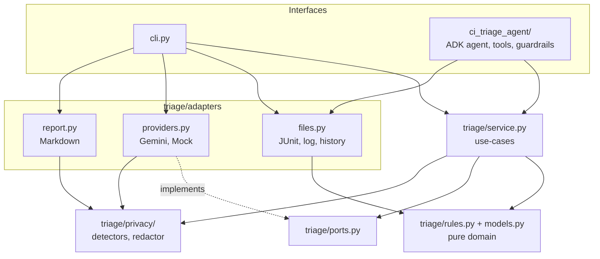

# CI Failure Triage Agent

> A Google ADK agent that triages failing CI tests as flaky, infrastructure or real regressions: deterministic rules first, LLM reasoning only where the rules cannot decide, behind read-only tools and guardrails.

---

## Overview

### Problem Statement & Intended Users
- **Problem**: When a CI build fails, engineers often spend 10-30 minutes deciding whether the failure is a real regression, a flaky test, infrastructure noise, or something else. This delays merges, increases alert fatigue, and creates unnecessary churn.
- **Intended Users**: Developers, QA engineers, release engineers, platform teams, and maintainers who need a fast, explainable first-pass CI failure diagnosis.

### Key Features
- **Deterministic rules first**: classifies failures as FLAKY, INFRA, REGRESSION, or UNKNOWN before any model is involved. Rule verdicts are never overridden by the LLM.
- **Agent with read-only tools**: in ADK mode the model decides which of three read-only tools to call, only for failures the rules could not classify.
- **Bounded execution**: hard caps on model calls (8) and tool calls (12) per request, plus an LLM-call cap in the CLI (default 5).
- **Privacy-first redaction**: secrets and PII are removed or pseudonymised before any model input, tool output or report text. Every report ends with an audit line (counts only).
- **Guardrails**: tool allowlist, path confinement, file-type allowlist, prompt-injection stripping, output size caps (see [Guardrails & Security](#guardrails--security)).
- **Offline mock mode**: `cli.py --mock` runs end-to-end with no API key and no network.
- **Explainable evidence**: each verdict includes confidence, evidence and a suggested action.

### What This Is Not
- Not a CI orchestrator, and it never re-runs, fixes or modifies anything.
- Not a full debugging or root-cause platform.
- Not a replacement for human investigation: verdicts are a first-pass starting point.
- Not a general-purpose test analysis system: it handles JUnit XML plus plain-text logs, using heuristics.

### Why Rules First?
- Rules are deterministic, free, instant and explainable: the same input always gives the same verdict.
- The LLM is reserved for edge cases the rules cannot decide, which keeps cost, latency and data exposure low.
- Rule verdicts are never overridden by the model, and unclear cases are reported as UNKNOWN instead of guessed. A triage tool that optimistically calls regressions "flaky" teaches teams to ignore red builds.

---

## Technical Stack

- **Language & Runtime**: Python 3.12 (tested). See [Known Limitations](#known-limitations).
- **Agent Framework / Core Library**: Google ADK (`google-adk`) + a framework-free Python core (`triage/`)
- **Models**: Gemini via ADK / `google-genai` (default `gemini-2.5-flash`, override with `GEMINI_MODEL`). An offline mock provider is used by the CLI's `--mock` flag.
- **External APIs / Tools**: Gemini API (required for the ADK agent, optional for the CLI); local file reading only
- **Core libraries**: `google-adk`, `google-genai`, `pydantic`, `defusedxml`, `pytest` (all pinned in `requirements.txt`)

---

## Architecture & Data Flow

Two entry points share one core:

- `cli.py`: deterministic pipeline, works fully offline with `--mock`.
- `ci_triage_agent/`: the ADK agent. The model calls read-only tools, wrapped in guardrail callbacks.



Request flow:

```text
JUnit XML + CI log + optional history  ->  loaders (hardened XML parser, size caps)
        ->  deterministic rules  ->  rule matched?  yes: final verdict
                                                    no:  LLM (redacted input, call caps)
        ->  redacted Markdown report with evidence, suggested action and privacy audit line
```

Dependencies point inward only, and `tests/test_architecture.py` enforces it. Details, including the privacy design, are in [ARCHITECTURE.md](ARCHITECTURE.md).

### Project Structure

```text
agents/ci-failure-triage-agent/
├── README.md
├── ARCHITECTURE.md
├── requirements.txt
├── .env.example
├── .gitignore
├── Makefile                  # make test | demo | validate | run-mock
├── scripts/                  # demo_mock.sh, validate_mock.py
├── cli.py                    # CLI interface
├── ci_triage_agent/          # ADK interface: agent.py, tools.py, guardrails.py
├── triage/                   # models, rules, ports, service, privacy/, adapters/
├── samples/                  # flaky, regression, infra, unknown + expected.json + README.md (all secrets are fake)
└── tests/                    # 48 tests
```

---

## Prerequisites

- Python 3.12 (3.10+ is required by ADK; only 3.12 was tested)
- A Gemini API key from https://aistudio.google.com/apikey (free tier available). **Only needed for the ADK agent and for the CLI without `--mock`.**

## Installation

```bash
git clone <your-fork-url>
cd open-source-agents/agents/ci-failure-triage-agent
python -m venv .venv
source .venv/bin/activate          # Windows: .venv\Scripts\activate
pip install -r requirements.txt
```

## Configuration

| Variable | Required | Purpose |
|---|---|---|
| `GEMINI_API_KEY` | For the ADK agent, and the CLI without `--mock` | Gemini API key. ADK reads `GOOGLE_API_KEY`; the agent copies `GEMINI_API_KEY` into it. |
| `GEMINI_MODEL` | No | Model name (default `gemini-2.5-flash`) |
| `TRIAGE_REDACT_TERMS` | No | Comma-separated names, customers or codenames to treat as PII |
| `TRIAGE_ROOT` | No | Directory the agent's tools may read (default: current directory) |
| `TRIAGE_MAX_MODEL_CALLS` / `TRIAGE_MAX_TOOL_CALLS` | No | Per-request budgets (defaults 8 / 12) |

```bash
cp .env.example .env               # then edit .env, never commit it
export GEMINI_API_KEY=your_key     # simplest way to make the key visible to ADK
```

---

## Usage

### Quick demo (offline, about 5 seconds)

```bash
./scripts/demo_mock.sh        # or: make demo        (verdict summary for all four scenarios)
python scripts/validate_mock.py   # or: make validate    (fails if any scenario differs from samples/expected.json)
```

Sample scenarios and why each gets its label are in [samples/README.md](samples/README.md).

### 1. Offline CLI (no API key)

```bash
python cli.py --junit samples/flaky/junit.xml --log samples/flaky/ci.log --mock
python cli.py --junit samples/regression/junit.xml --log samples/regression/ci.log \
              --history samples/regression/history.json --mock
python cli.py --junit samples/infra/junit.xml --log samples/infra/ci.log --mock
python cli.py --junit samples/unknown/junit.xml --log samples/unknown/ci.log --mock
```

```text
$ python cli.py --help
usage: cli.py [-h] --junit JUNIT [--log LOG] [--history HISTORY] [--mock]
              [--max-llm-calls MAX_LLM_CALLS] [--output OUTPUT]

Triage CI test failures: flaky, infra or real regression?

options:
  -h, --help            show this help message and exit
  --junit JUNIT         Path to JUnit XML
  --log LOG             Path to raw CI log (optional)
  --history HISTORY     JSON like {"test_name": ["pass","fail",...]}
                        (optional)
  --mock                Offline mode: no API key or network needed
  --max-llm-calls MAX_LLM_CALLS
                        Hard cap on LLM calls per run
  --output OUTPUT       Write the report to this file instead of stdout
```

Without `--mock`, failures the rules cannot classify are sent (redacted) to Gemini.

### 2. ADK agent (needs `GEMINI_API_KEY`)

Run from the project folder, and use **relative paths** in your message:

```bash
adk run ci_triage_agent
# then type:
# triage samples/unknown/junit.xml with log samples/unknown/ci.log
```

`adk web --port 8000` (run from the parent of `ci_triage_agent/`) gives a browser UI for development only.

### Input formats
- **JUnit XML**: `failure`, `error`, and retry elements `flakyFailure` / `rerunFailure`
- **CI log**: plain text
- **History** (optional): `{"test_name": ["pass", "pass", "fail"], ...}`

---

## Example Inputs & Outputs

All outputs below are from genuine runs of `cli.py --mock` (fresh virtualenv, Python 3.12, Linux).

### Flaky: the CI itself retried the test and it passed

```text
## 🎲 tests.test_checkout.test_payment_confirmation_polls_until_done
- **Verdict:** FLAKY (confidence 0.95, source: rules)
- **Evidence:**
  - JUnit records a failed attempt followed by a passing rerun
- **Suggested action:** Quarantine or stabilise this test; check for timing, ordering or shared-state issues.
```

### Regression: assertion mismatch, test passed 8/8 previous runs

```text
## 🐛 tests.test_pricing.test_discount_applies_to_total
- **Verdict:** REGRESSION (confidence 0.85, source: rules)
- **Evidence:**
  - assertion mismatch; passed 8/8 previous runs
  - message: AssertionError: expected 90.0 but got 100.0
- **Suggested action:** Likely caused by a recent change: bisect commits touching the code under test.
```

### Infrastructure, with privacy audit (`samples/infra`)

The sample log contains a fake secret, Bearer token, IP address, email and internal hostname. None of them appear in the report:

```text
## 🏗️ tests.test_orders.test_fetch_order
- **Verdict:** INFRA (confidence 0.85, source: rules)
- **Evidence:**
  - failure text matches: network connection problem
- **Suggested action:** Re-run the job; if it persists, check runner/network/service health.

## 🏗️ tests.test_orders.test_list_orders
- **Verdict:** INFRA (confidence 0.70, source: rules)
- **Evidence:**
  - log line 4: DNS failure
- **Suggested action:** Environment problem likely; re-run and inspect runner logs.

🔒 **Privacy:** replaced before analysis and in this report: bearer x1, email x1, internal host x2, ipv4 x1, secret assignment x1. Values are never stored or sent.
```

### Unknown: no rule matched

With `--mock` the failure is reported as UNKNOWN (`source: mock`, confidence 0.00) and no model is called. With a Gemini key, this failure is passed to the model.

### Scripted validation (`python scripts/validate_mock.py`)

```text
scenario     expected           actual             result
flaky        {'FLAKY': 1}       {'FLAKY': 1}       PASS
regression   {'REGRESSION': 1}  {'REGRESSION': 1}  PASS
infra        {'INFRA': 2}       {'INFRA': 2}       PASS
unknown      {'UNKNOWN': 1}     {'UNKNOWN': 1}     PASS

All scenarios match.
```

The script exits non-zero if any scenario differs, so it can run in CI.


## Testing

```bash
python -m pytest -q
```

48 tests, no API key or network needed. They cover redaction and PII detection, the rules, tool path confinement, every guardrail, the end-to-end CLI on all samples, egress checks (the LLM prompt, the LLM answer and the report contain no sensitive values), the architecture dependency rules, and a stub model that tries to loop forever and is stopped by the budget cap.

The live Gemini path is not covered by automated tests (it needs a key).

## Cost & Token Usage

- **Paid API**: no paid service is required. Gemini's free tier is enough to try the project; usage beyond it is billed by Google.
- **Model**: `gemini-2.5-flash` by default.
- **Calls**: rules run first, so many failures never reach a model. The ADK agent is capped at 8 model calls per request; the CLI at 5 (`--max-llm-calls`).
- **Measured usage**: <!-- TODO(author): fill with real numbers from your Gemini run, e.g. "about N input / M output tokens for the unknown sample". -->_to be measured._

---

## Guardrails & Security

| Layer | Guardrail |
|---|---|
| Before each model call | Model-call budget (8), user-message cap (2,000 chars), total input cap, secrets and PII redacted |
| After each model call | Output redacted; "heuristic, verify before acting" disclaimer on final answers |
| Before each tool call | Tool allowlist (3 read-only tools), tool-call budget (12), path-extension allowlist (`.xml .log .txt .json`) |
| Inside tools | Paths confined to `TRIAGE_ROOT`, traversal rejected, 20 MB file cap, hardened XML parser (`defusedxml`) |
| After each tool call | Redacted again, prompt-injection phrases stripped with a warning, oversized output dropped |
| Model config | Temperature 0, max 1,500 output tokens |
| Prompt | Logs are untrusted data; keep rule verdicts; prefer UNKNOWN to guessing; never claim to have run anything |

The agent has no write, shell or network tools, and it never executes anything found in logs.

**Privacy.** PII becomes a pseudonym such as `[EMAIL:3fa91c]`: stable within a run, so the model can tell "same user" from "different user", but salted per process, so it is not reversible or linkable across runs. Nothing is stored. Secrets become `[REDACTED:KIND]`.

Detected: private keys; GitHub, AWS, Google and Slack tokens; JWTs; Bearer/Basic credentials; credentials in URLs; `*_SECRET=` / `*_TOKEN=` / `*_PASSWORD=` assignments; emails; credit cards (Luhn-checked); US SSN; Indian Aadhaar and PAN; phone numbers; IPv4 and IPv6; MAC addresses; usernames in home directories; internal hostnames (`*.internal`, `*.corp`, `*.local`, `*.lan`); and anything in `TRIAGE_REDACT_TERMS`.

No secrets are committed. The sample files contain only obviously fake values, and test secrets are assembled at runtime.

---

## Known Limitations

- **Platforms**: tested on Linux with Python 3.12 only. macOS and Windows are untested.
- **Formats and language**: JUnit XML only (no TRX, NUnit or Allure); English-language logs and messages only, because the rules are regex-based.
- **Heuristics can be wrong.** A rule or the LLM can misclassify. Treat verdicts as a starting point. For example, a failing assertion with no history is sent to the LLM rather than called a regression.
- **Redaction is regex-based.** Unusual secret formats can slip through. Personal names, addresses and other free-text PII cannot be detected by pattern (use `TRIAGE_REDACT_TERMS`). Some harmless values, such as four-part version numbers, may be over-redacted. This is a safety net, not a compliance guarantee: for regulated data, use `--mock`.
- **Prompt injection** from log content is reduced (phrase stripping, data-only prompt, read-only tools, no side effects) but not eliminated. Pattern matching can be bypassed.
- **Absolute paths** containing a username are rewritten in your message, so give the agent relative paths.
- **Providers**: Gemini is the only real model provider. `--mock` never calls a model.
- **Size limits**: files over 20 MB are refused, and the model sees only a bounded excerpt (about 6,000 characters in the CLI path, at most 40 log lines per test).
- **Rate limits**: Gemini free-tier rate limits may interrupt runs with many unresolved failures.
- **Testing gap**: the live Gemini and ADK conversations are verified by hand, not by automated tests.

---

## Verified Environment

| | Status |
|---|---|
| OS / Python | Linux, Python 3.12 |
| Install from `requirements.txt` in a fresh virtualenv | Verified |
| 48 automated tests (no API key) | Passing |
| Mock mode end to end on all four samples (`make validate`) | Verified |
| Gemini API path (CLI without `--mock`) and `adk run` conversation | **Not yet verified by automated tests** (needs a key; see the transcript section) |
| macOS, Windows | Not tested |
| Large or long-form real-world CI logs | Not tested |

## Proven vs Pending

**Proven (covered by tests or scripts)**
- Mock classification works on all four sample scenarios.
- Secrets and PII are redacted: in the LLM prompt, the LLM answer, tool output and the report.
- Guardrails hold: tool allowlist, path confinement, injection stripping, size caps, and a runaway model loop is stopped by the budget cap.
- Layer boundaries are enforced by an architecture test.

**Pending**
- A genuine Gemini run of the ADK agent, with measured token usage.
- Real-world and long CI logs.
- macOS and Windows validation.

## Project Health

- **Status**: active prototype, built for FORK. BUILD. MERGE. (Road to DevFest 2026)
- **Last verified**: 2026-10-24 (Linux, Python 3.12, mock mode)
- **Current focus**: reproducible mock mode, documentation, privacy and guardrails
- **Known blockers**: Gemini API validation pending

## Extending the Project

| To add... | Edit |
|---|---|
| A classification rule | `triage/rules.py` (`classify`, `INFRA_PATTERNS`), then a test in `tests/test_rules.py` |
| A secret or PII detector | `triage/privacy/detectors.py` (add a `Detector`, with a validator if false positives are likely), then `tests/test_privacy.py` |
| A sample scenario | `samples/<name>/` and `samples/expected.json`, then `make validate` |
| Another model provider | Implement the `Provider` port from `triage/ports.py` in `triage/adapters/providers.py` |
| Another input format (TRX, NUnit...) | A new loader in `triage/adapters/files.py` that returns a `RunInput` |
| A guardrail | `ci_triage_agent/guardrails.py`, then `tests/test_guardrails.py` |

Keep dependencies pointing inward: `python -m pytest tests/test_architecture.py` fails if a layer imports something it should not.

---

## Contributing / License

Part of the open-source agents catalog (FORK. BUILD. MERGE., Road to DevFest 2026). Released under the repository's MIT license.
