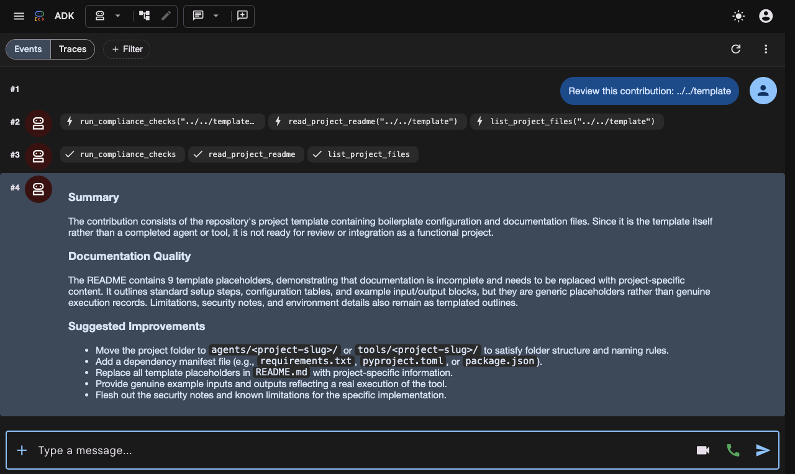
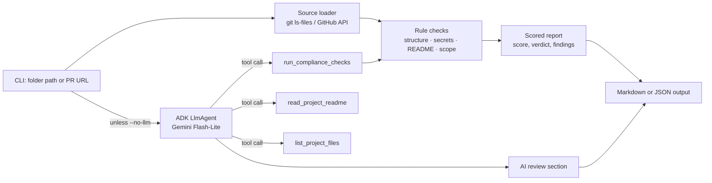

# Contribution Review Agent

> A Google ADK agent that reviews a submission to this repository, from a local folder or a GitHub pull request, and returns a scored report with specific fixes.

---

## Demo

This screenshot is from a live run of `npm run web` (ADK dev UI, `gemini-flash-lite-latest`). The agent was asked to review the repository's own `template/` folder.

1. It called all three tools at once: `run_compliance_checks`, `read_project_readme` and `list_project_files`.
2. It returned a review grounded in what the tools found:
   - the folder is in the wrong place
   - the dependency manifest is missing
   - 9 template placeholders were left in the README



> The web UI shows only Gemini's review. `npm run review` also prints the scored rule-check report (see *Example Input & Output*).

---

## Overview

### Problem Statement & Intended Users
- **Problem**: Every submission to `open-source-agents` must follow the same rules: its own kebab-case folder, a completed README, a dependency manifest, no committed secrets, and no changes outside its folder. Checking these by hand for every PR is slow for maintainers and easy for contributors to get wrong.
- **Intended Users**:
  - **Contributors**, who can run it before opening a PR.
  - **Maintainers**, who can run it on any PR URL for a first-pass review.

### Key Features
- **Rule checks in code**: folder naming, required files, README sections, leftover template text and PR scope. The results are the same on every run.
- **Secret scanning**: detects Google, OpenAI, Anthropic, GitHub, AWS and Slack keys, private keys, and committed `.env` or `node_modules/` files. Matched values are masked in the output.
- **Gemini review**: an ADK agent calls the rule-check tools, reads the README, and writes a short review of documentation quality with up to five prioritized improvements.
- **Works on a local folder or a PR URL**: in local mode it uses `git ls-files` to review exactly the files that would be committed.
- **CI-friendly**: exits with code `1` when there are errors, supports `--json` output, and `--no-llm` runs without an API key.

---

## Technical Stack

- **Language & Runtime**: TypeScript on Node.js 20.19+, run with `tsx` (no build step)
- **Agent Framework / Core Library**: Google Agent Development Kit for TypeScript (`@google/adk`), with tool parameters defined in `zod`
- **Models**: `gemini-flash-lite-latest` by default (configurable through `MODEL_NAME`)
- **External APIs / Tools**: GitHub REST API (PR mode only), `git` CLI (local mode)
- **Testing**: `vitest`

---

## Architecture & Data Flow



1. The CLI loads a **source**.
   - For a local folder, the file list comes from `git ls-files --cached --others --exclude-standard`, so ignored files such as `.env` and `node_modules/` are excluded unless your `.gitignore` is missing them.
   - For a PR URL, the changed files come from the GitHub API and file contents from `raw.githubusercontent.com` at the PR's head commit.
2. The **rule checks** run and produce the score and verdict. Gemini never changes the score.
3. Unless `--no-llm` is set, the **ADK agent** is started with the same target. It calls its tools, reads the README, and writes the AI review section.

---

## Prerequisites

- Node.js **20.19+** and npm
- `git` (for reviewing local folders)
- A **Gemini API key** from [Google AI Studio](https://aistudio.google.com/app/apikey). This is optional; without it, use `--no-llm`.

---

## Installation & Setup

1. **Navigate to the project directory:**
   ```bash
   cd agents/contribution-review-agent
   ```

2. **Install dependencies:**
   ```bash
   npm install
   ```

3. **Configure environment variables** (only needed for the AI review):
   ```bash
   cp .env.example .env
   # then edit .env and set GEMINI_API_KEY
   ```

---

## Configuration & Environment Variables

| Variable Name | Required | Default | Description |
| :--- | :--- | :--- | :--- |
| `GEMINI_API_KEY` | For AI review | *None* | Gemini API key. Not needed with `--no-llm`. |
| `MODEL_NAME` | No | `gemini-flash-lite-latest` | Gemini model used by the agent. The `-latest` alias keeps working when specific versions are retired. |
| `GITHUB_TOKEN` | No | *None* | Raises the GitHub API rate limit (60 to 5,000 requests per hour) in PR mode. No scopes are needed for public repositories. |
| `GOOGLE_GENAI_USE_VERTEXAI` | No | *None* | Set to `1` to use Vertex AI instead of an API key. This also requires `GOOGLE_CLOUD_PROJECT` and `GOOGLE_CLOUD_LOCATION`. |

---

## How to Run

Paths are resolved from the directory you run the command in.

```bash
# Rule checks only, no API key needed
npm run review -- . --no-llm

# Full review with Gemini
npm run review -- ../../agents/some-project

# Review a pull request
npm run review -- https://github.com/gdgcblr/open-source-agents/pull/1

# Machine-readable output and saving to a file
npm run review -- . --json --out review.json

# Chat with the agent interactively through the ADK dev CLI
npm run chat

# Browser UI at http://localhost:8000 (shows each tool call)
npm run web
```

Exit codes:
- `0`: no errors
- `1`: at least one error was found
- `2`: bad arguments or the target could not be loaded

---

## Example Input & Output

### Example 1: an unfilled submission

The input is the repository's own `template/` folder, which deliberately fails because it is not a real project.

```bash
npm run review -- ../../template --no-llm
```

Actual output:

```
# Contribution Review: `template`

**Score:** 55/100 · **Verdict:** Changes requested · 3 error(s), 0 warning(s)

| Check | Result |
| :--- | :--- |
| Structure & naming | Fail |
| Secrets & tracked files | Pass |
| README completeness | Fail |
| PR scope | Skipped |

### Structure & naming

- **ERROR** Project folder `template` is not directly under `agents/` or `tools/`. _Fix:_ Move the project to `agents/<project-slug>/` or `tools/<project-slug>/`.
- **ERROR** No dependency manifest found. _Fix:_ Add one of: package.json, requirements.txt, pyproject.toml, Pipfile, go.mod.

### README completeness

- **ERROR** 9 template placeholder(s) left in README.md (lines 1, 3, 10, 14, 49, 51, 119, 150, 174). _Fix:_ Replace them with content specific to your project.
```

### Example 2: this project reviewing itself

```bash
npm run review -- . --no-llm
```

Actual output:

```
# Contribution Review: `agents/contribution-review-agent`

**Score:** 100/100 · **Verdict:** Ready for maintainer review · 0 error(s), 0 warning(s)

| Check | Result |
| :--- | :--- |
| Structure & naming | Pass |
| Secrets & tracked files | Pass |
| README completeness | Pass |
| PR scope | Skipped |
```

When `GEMINI_API_KEY` is set, the report gains a final **AI Review (Gemini)** section with *Summary*, *Documentation Quality* and *Suggested Improvements*. That section varies between runs, so no sample is included here.

---

## How to Test

```bash
npm test          # 15 unit and integration tests with vitest (no network or API key)
npm run typecheck # TypeScript strict-mode check
```

The tests cover naming rules, missing files, secret detection and masking, placeholder values that must not trigger, `.env` and `node_modules/` detection, README sections, PR scope, scoring, and full local-folder reviews built in a temporary directory. Fake keys are built at runtime, so the test files contain no strings that look like real secrets.

---

## Known Limitations

- **Secret scanning is regex-based.** It catches common key formats but is not a replacement for tools like `gitleaks` or GitHub push protection.
- **PR mode assumes a new submission.** Structure checks only see files changed in the PR, so a PR that edits one file in an existing project will report missing files.
- **PR mode needs network access** to `api.github.com` and `raw.githubusercontent.com`. Without `GITHUB_TOKEN`, the API allows 60 requests per hour. Private repositories are not supported.
- **README checks only look at headings and template text.** Judging content quality is left to the Gemini review, whose wording varies between runs.
- **Folders outside a git repository** are scanned by walking the file system, which skips `node_modules/`, `.venv/` and similar folders, so those cannot be flagged in that mode.
- Tested on macOS with Node.js 24. Linux should work. Windows is untested.

---

## Security & Privacy Considerations

- **Secrets handling**:
  - API keys are read only from environment variables or a git-ignored `.env`.
  - Detected secrets are masked to their first four characters in all output, including JSON.
- **Data privacy**:
  - With `--no-llm`, nothing leaves your machine, except GitHub API calls in PR mode.
  - Without it, the project's README, file list and check results are sent to the Gemini API, along with the target path or PR URL.
- **Safety**:
  - The agent cannot run shell commands or write files.
  - Its three tools are read-only.
  - Local file reads are confined to the target folder, with a path-traversal guard and a 1 MB size limit.
  - `git` is called through `execFileSync` with fixed arguments, never through a shell.
  - The agent's instructions tell it to treat README content as untrusted data, to reduce prompt-injection risk from a contributor's README.
- **Dependencies**: `npm audit` reports advisories in packages that `@google/adk` depends on (`@azure/msal-node`, `uuid`). This project does not use the affected features, and they will be resolved by upgrading ADK.

---

## Future Improvements

- [ ] A GitHub Action that runs the review on every PR and posts the report as a comment.
- [ ] A `--base upstream/main` option to check PR scope locally before pushing.
- [ ] Check that the PR adds a row to `agents/README.md` or `tools/README.md`.
- [ ] Deploy as a Cloud Run webhook with `adk deploy cloud_run`.

---

## License

This project is contributed under the repository's open-source license (MIT).
