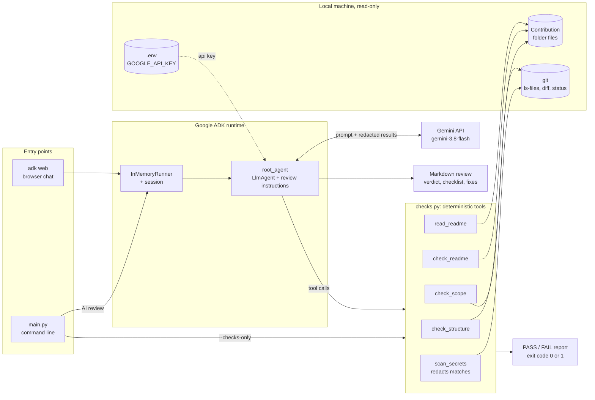
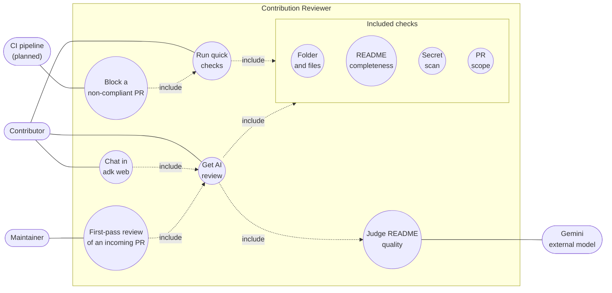

# Contribution Reviewer

> An ADK agent that reviews an `agents/` or `tools/` contribution against this repository's PR checklist before you open the pull request.

---

## Overview

### Problem Statement & Intended Users
- **Problem**: Every contribution to `open-source-agents` must follow the same checklist: a kebab-case folder, a README with every template section filled in, a dependency manifest, a `.env.example`, no committed secrets, and no changes outside the project folder. Checking this by hand is slow for maintainers. First-time contributors often miss an item and only find out in review.
- **Intended Users**: Contributors who want to self-check before opening a PR, and maintainers who want a quick first pass on incoming PRs.

### Key Features
- **Deterministic checks**: folder naming and location, required files, README sections, leftover template placeholders, secret patterns, forbidden files (`.env`, keys, `.venv/`), and PR scope against the target branch.
- **Secret-safe**: only files git would actually commit are scanned (`.gitignore` is respected). Matches are redacted before anything reaches the model.
- **AI review**: a Gemini-powered ADK agent calls the checks as tools, reads the README, and writes maintainer-style feedback: a verdict, a checklist table, prioritized fixes and specific README suggestions.
- **Works offline**: `--checks-only` runs every check with no API key, and exits non-zero on failure, so it can be used in CI or a pre-push hook.

---

## Technical Stack

- **Language & Runtime**: Python 3.10+ (tested on 3.14.0)
- **Agent Framework / Core Library**: Google Agent Development Kit (ADK) 2.13
- **Models**: Gemini 3.8 Flash (configurable through `MODEL_NAME`)
- **External APIs / Tools**: Gemini API (Google AI Studio), local `git`

---

## Architecture & Data Flow



The pass/fail facts come only from the deterministic Python checks. The model's job is to interpret them, judge the README's quality, and write the feedback. With `--checks-only`, the agent is skipped entirely and the check results are printed directly.

**Trust boundary:** only README text, file names and check results are sent to Gemini. Source code and secret values never are.

### Use Cases



- **Contributor:** self-checks before opening a PR, with quick checks, the full AI review, or a chat in the browser.
- **Maintainer:** gets a first-pass review of an incoming PR, so human review time goes to the code itself.
- **CI pipeline (planned):** runs quick checks on every PR and blocks it when the exit code is 1.
- **Gemini:** used only for judging README quality and writing the feedback.

A presentation pitch for this project is in [docs/pitch.md](docs/pitch.md).

---

## Prerequisites

- Python 3.10 or newer
- `pip`
- `git` on your `PATH` (used for the secret scan and the scope check)
- A Gemini API key from [Google AI Studio](https://aistudio.google.com/apikey). Only needed for the AI review, not for `--checks-only`.

---

## Installation & Setup

1. **Navigate to the project directory:**
   ```bash
   cd agents/contribution-reviewer
   ```

2. **Create a virtual environment and install dependencies:**
   ```bash
   python -m venv .venv
   # Windows:
   .venv\Scripts\activate
   # Linux/macOS:
   source .venv/bin/activate

   pip install -r requirements.txt
   ```

3. **Configure environment variables:**
   ```bash
   cp .env.example .env
   # then set GOOGLE_API_KEY in .env
   ```

4. **Make sure the target branch is available for the scope check.** If you cloned your fork, add the main repo as `upstream`. Skip the first command if `git remote -v` already lists `upstream`.
   ```bash
   git remote add upstream https://github.com/gdgcblr/open-source-agents.git
   git fetch upstream
   ```

---

## Configuration & Environment Variables

| Variable Name | Required | Default | Description |
| :--- | :--- | :--- | :--- |
| `GOOGLE_API_KEY` | For AI review | *None* | Gemini API key from Google AI Studio |
| `GOOGLE_GENAI_USE_VERTEXAI` | No | `FALSE` | Set to `TRUE` to use Vertex AI instead (also needs `GOOGLE_CLOUD_PROJECT` and `GOOGLE_CLOUD_LOCATION`) |
| `MODEL_NAME` | No | `gemini-3.8-flash` | Gemini model to use. It must support function calling. |

---

## How to Run

Run these from `agents/contribution-reviewer`. The project path can be relative to this folder or to the repository root. `agents/weather-agent` below stands for your own project folder. To try the tool right away, review this project itself: `python main.py agents/contribution-reviewer --checks-only`.

```bash
# Full AI review of a contribution
python main.py agents/weather-agent

# Deterministic checks only: no API key needed, exit code 1 on failure
python main.py agents/weather-agent --checks-only

# Raw JSON results, e.g. for CI
python main.py agents/weather-agent --checks-only --json

# Compare against a different target branch
python main.py agents/weather-agent --base origin/main
```

To chat with the agent in ADK's browser UI, run `adk web` from this folder, pick `contribution_reviewer`, and ask it something like *"Review agents/weather-agent"*.

---

## Example Input & Output

### Example Input
A contribution whose README was copied from the template but never edited:
```bash
python main.py agents/contribution-reviewer --checks-only
```

### Example Output
```
[PASS] structure
[FAIL] readme
    - Template placeholder not replaced: "[Project Name]"
    - Template placeholder not replaced: "[One-sentence summary"
    - Template placeholder not replaced: "Explain what specific problem or challenge this project addresses"
    - Template placeholder not replaced: "Feature 1: Brief description of the capability"
    ...
[PASS] secrets
[PASS] scope

Verdict: Needs changes
```

(This is real output: the tool caught its own unedited README during development.)

### Example AI review
Without `--checks-only`, the agent turns the check results into a full review. This is a real run of `python main.py agents/contribution-reviewer` on gemini-3.8-flash, shortened:

```markdown
### Verdict
**Ready for review**

Every deterministic check passed, dependencies are declared, secrets scanning found
no issues, the scope is strictly confined to `agents/contribution-reviewer`, and the
README is thorough and well-crafted.

### PR Checklist
| Checklist Item | Status | Reason |
| :--- | :---: | :--- |
| Directory & Naming | ✅ | `agents/contribution-reviewer` follows kebab-case naming under the `agents/` directory. |
| Documentation | ✅ | README is complete, contains all required template sections, and has zero leftover template placeholders. |
| Reproducible Setup | ⚠️ | Cannot be verified statically. Please verify in a clean environment by running `python -m venv .venv && source .venv/bin/activate && pip install -r requirements.txt && pytest`. |
| Example Usage | ✅ | Clear CLI commands and sample terminal outputs provided. |
| Dependencies Declared | ✅ | `requirements.txt` is present and includes all required runtime dependencies. |
| Secrets & Security | ✅ | No committed secrets or forbidden files found across scanned git-tracked files. |
| Scope Limitation | ✅ | All modified and added files are within `agents/contribution-reviewer/`. |

### Fixes
1. Handle existing `upstream` remote in setup: in step 4 of Installation & Setup,
   running `git remote add upstream ...` will error out if the remote already exists.
...
```

Both suggestions from this run that were valid have been applied: the `upstream` step above, and this real sample replacing an illustrative one. The run also suggested, wrongly, that `gemini-3.8-flash` was a typo for an older model. That's why the agent's instructions now tell it not to judge model names or versions from its own training knowledge.

---

## How to Test

```bash
pytest
```

The suite builds throwaway projects and git repositories in temporary folders. It covers good and bad folder names, missing files, an unedited template README, secret detection and redaction, `.gitignore` handling, and scope violations. It also checks that this project passes its own structure, README and secrets checks. No API key or network access is needed.

To check the agent itself manually, set `GOOGLE_API_KEY` and run `python main.py agents/contribution-reviewer`. You should get a review with the verdict "Ready for review".

---

## Known Limitations

- **Reproducible setup** can't be verified statically. The agent marks that item ⚠️ instead of claiming it works. It never installs or runs the reviewed project.
- Secret detection uses regular expressions for well-known key formats (Google, OpenAI, Anthropic, GitHub, AWS, Slack, private keys). Custom or high-entropy tokens without a known prefix will be missed.
- README checks look for the template's headings by name. A README that renames a section (for example "Usage" instead of "How to Run") will be reported as missing that section.
- The scope check needs the base ref (default `upstream/main`) to exist locally. If it doesn't, the check is skipped with a note instead of failing.
- Gemma models served through the Gemini API don't support native function calling, so `MODEL_NAME` should stay a Gemini model.

---

## Security & Privacy Considerations

- **Secrets Handling**: The API key is loaded from `.env` (gitignored) through `python-dotenv`. Detected secrets are redacted to their first 4 characters and their length before being returned, so secret values are never printed or sent to the model.
- **Data Privacy**: In AI review mode, the reviewed project's README text, file names and check results are sent to the Gemini API. Source code contents are never sent. `--checks-only` sends nothing over the network.
- **Safety**: The agent's tools are read-only. They read files and run `git ls-files`, `git diff` and `git status`. No code from the reviewed project is executed, and no shell commands are built from model output.

---

## Future Improvements

- [ ] GitHub Action that runs `--checks-only` on every PR and posts the AI review as a comment
- [ ] Review a PR directly by number through the GitHub API, without a local checkout
- [ ] Entropy-based detection for secrets without a known prefix
- [ ] Optional sandboxed "clean install" step to actually verify reproducible setup

---

## License

*This project is contributed under the repository's open-source license.*
