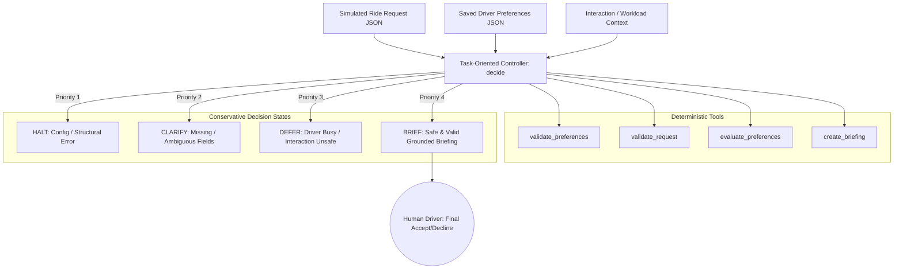

# Driver Request Copilot

> An experimental, safety-first, preference-aware assistant that evaluates simulated ride-hailing requests, explains whether they match a driver's saved preferences, and handles missing information or unsafe interaction states conservatively.

---

## Overview

### Problem Statement & Intended Users
- **Problem**: When a ride-hailing driver (e.g., driving for services like Uber, Ola, or Rapido) approaches the drop-off location of an active ride, a new trip request frequently flashes on screen. The driver must quickly evaluate the offered fare, pickup distance, drop-off locality, and trip constraints while navigating live city traffic. Manually scanning tiny interface elements on a dashboard mount creates severe cognitive overload and directly competes with road attention.
- **Intended Users**: Commercial cab, auto-rickshaw, and rideshare drivers seeking safer situational awareness, as well as AI safety researchers investigating human-centered, grounded copilots for high-risk operating environments.
- **Why It Matters**: Driving requires undivided sensory attention. Distraction during critical driving maneuvers is a leading cause of urban collisions. Providing a voice-first or concise, non-distracting briefing that respects driver workload states can dramatically enhance driver safety.

### Scope and Non-Goals
- **In Scope (MVP)**:
  - Evaluating simulated, locally stored ride requests against validated driver preferences.
  - Conservative 4-state decision engine (`BRIEF`, `CLARIFY`, `DEFER`, `HALT`).
  - Strict grounding: zero hallucinations, zero fabricated data, zero automatic decisions.
  - Rigorous evaluation harness separating decision correctness from end-result safety.
  - Python standard library implementation with zero external dependencies.
- **Explicit Non-Goals**:
  - **No Real Platform Integration**: Does NOT integrate with Uber, Ola, Rapido, or their private/internal APIs.
  - **No Device Hijacking**: Does NOT perform screen scraping, notification sniffing, accessibility inspection, or reverse engineering.
  - **No Autonomous Booking**: Does NOT autonomously accept, reject, or bid on rides. The human driver retains absolute decision authority.
  - **No Real Road Sensing**: Does NOT claim to detect real-time physical road hazards; driver workload and interaction states are simulated parameters.

### Key Features
- **Deterministic Orchestration**: Hub-and-spoke controller linking focused, single-responsibility tool functions without LLM unpredictability.
- **Conservative Precedence Ladder**: Strict state hierarchy guaranteeing that corrupted configs halt immediately and ambiguous inputs trigger clarification before interaction checks.
- **Grounding & Anti-Hallucination**: Briefings are 100% derived from verified payload attributes and saved preferences.
- **Ambiguity & Type Safety**: Rejects invalid numeric types (including Python's `bool-as-int` subclass vulnerability), NaNs, infinities, and blank destinations.
- **Dual-Dimension Evaluation**: Measures both decision accuracy and end-result safety violations with precision and recall metrics.

---

## Technical Stack

- **Language & Runtime**: Python 3.7+ (tested on Python 3.7.1 and 3.10+)
- **Agent Framework / Core Library**: Vanilla Python Standard Library (`json`, `dataclasses`, `enum`, `math`, `argparse`, `typing`, `unittest`)
- **Models**: None required for core MVP (Deterministic Orchestrator). LLM-free by design to guarantee 100% mathematical grounding and zero hallucination risk.
- **External APIs / Tools**: None (Fully offline, zero third-party packages, zero network calls).

---

## Architecture & Data Flow



### Components and Responsibilities
1. **Deterministic Tools (`validate_preferences`, `validate_request`, `evaluate_preferences`, `create_briefing`)**:
   - Single-responsibility pure functions.
   - Validate structure, enforce type constraints, perform arithmetic comparisons against thresholds, and format text briefings.
2. **Task-Oriented Controller (`decide`)**:
   - Central coordinator acting as the agent engine.
   - Evaluates the priority ladder, handles missing context conservatively, and determines the operational state.
3. **Evaluation Harness (`evaluate_dataset`)**:
   - Automated testing and benchmark pipeline calculating accuracy, precision, recall, safety violations, and test case traces.

### Stakeholders & Interactions
- **Driver**: Retains 100% ultimate authority. Receives briefings only when safe; reviews and taps their own ride application manually.
- **Assistant (Copilot)**: Acts as a passive, safety-first listener and comparator. Strictly respects driver workload.
- **Developer / Reviewer**: Uses the CLI and evaluation harness to verify safety rules, test edge cases, and inspect reproducible traces.

---

## Tools versus Agents: Architectural Distinction

A critical architectural learning objective emphasized in this project is distinguishing between **Tools** and **Agents**:

| Dimension | Tool Function | Task-Oriented Agent / Controller |
| :--- | :--- | :--- |
| **Definition** | A specialized, deterministic function executing a single bounded operation when invoked. | A coordinating entity that sequences operations toward a goal and decides when to act, clarify, defer, or halt. |
| **In this Project** | `validate_request()`, `evaluate_preferences()`, `create_briefing()`. | `decide()` orchestrator function in `copilot.py`. |
| **Autonomy** | None; passive calculation. | Decides state transitions and applies conservative precedence rules based on input context. |
| **Error Handling** | Returns boolean status and localized error message. | Determines whether the entire system should HALT, request CLARIFY, DEFER interaction, or proceed to BRIEF. |

*Note: This MVP uses a deterministic, transparent Python orchestrator rather than an unpredictable autonomous LLM loop. This ensures explainability and safety.*

---

## Decision States and Precedence Order

The system enforces four primary decision states evaluated in strict conservative priority order:

1. **`HALT` (Priority 1 - Structural & Configuration Integrity)**:
   - Triggered when configuration preferences are missing, unparseable, or contain invalid thresholds (e.g., negative minimum fare), or when the request payload is not a valid object envelope.
   - Action: Processing stops immediately. Returns an actionable configuration error for the human operator.
2. **`CLARIFY` (Priority 2 - Data Completeness & Ambiguity Handling)**:
   - Triggered when preferences are valid, but the request payload has missing, null, negative, wrong-typed (e.g. string fare or boolean-as-int), or whitespace-only fields.
   - Action: No preference comparison or recommendation is made. Instructs driver to inspect the native platform display manually.
3. **`DEFER` (Priority 3 - Interaction Safety & Workload Protection)**:
   - Triggered when data is valid, but simulated driver state indicates the driver is busy, navigating in traffic, or safety interaction is unconfirmed (`is_safe_to_interact != True`).
   - Action: Interactive delivery is suppressed. Briefing is deferred until the driver is stationary or safe.
4. **`BRIEF` (Priority 4 - Grounded Briefing Delivery)**:
   - Permitted **only** when data is completely valid, preferences are verified, and interaction is explicitly marked safe.
   - Action: Formats a concise, factual summary highlighting fare, pickup distance, and avoided destination matches.

```
+-------------------------------------------------------------+
| Priority 1: Configuration / Structural Valid?  --> NO  -> HALT
+-------------------------------------------------------------+
                               | YES
+-------------------------------------------------------------+
| Priority 2: Request Data Complete & Valid?     --> NO  -> CLARIFY
+-------------------------------------------------------------+
                               | YES
+-------------------------------------------------------------+
| Priority 3: Interaction Explicitly Safe?       --> NO  -> DEFER
+-------------------------------------------------------------+
                               | YES
+-------------------------------------------------------------+
| Priority 4: All Checks Passed                 --> YES -> BRIEF
+-------------------------------------------------------------+
```

---

## Fallback Ladder

The copilot implements a defensive 5-level fallback ladder:

- **Level 1 (Full Operation)**: Valid configuration, valid request, safe interaction -> Grounded text/voice briefing delivered.
- **Level 2 (Audio Fallback)**: Speech engine unavailable -> Automatically and silently falls back to text briefing without altering decision logic.
- **Level 3 (Ambiguity Fallback)**: Missing/invalid request fields -> Issues `CLARIFY`. Suppresses preference recommendations.
- **Level 4 (Safety Fallback)**: Driver busy or safety unverified -> Issues `DEFER`. Suppresses interactive notifications.
- **Level 5 (Critical Fallback)**: Corrupt preferences or malformed input -> Issues `HALT`. Halts execution and requires human manual review.

---

## Guardrails and Grounding

1. **No Autonomous Platform Actions**: The software possesses no capabilities or API bindings to accept, reject, or alter ride bookings.
2. **Strict Grounding**: Briefings use deterministic string templates referencing only verified fields (`fare`, `pickup_km`, `destination`). No values are hallucinated or estimated.
3. **Python Type Guardrails**: Explicitly handles edge cases where Python treats `bool` as a subclass of `int` (`isinstance(True, int) == True`). All numeric fields explicitly reject booleans.
4. **Zero Persistent Storage & Privacy**: The engine is completely stateless across requests. No PII, driver identifiers, passenger details, or GPS coordinates are stored in memory or written to disk.

---

## Prerequisites

- **Python Runtime**: Python 3.7+ (Python standard library only).
- **Git**: For version control and branch management.
- **No external packages, no GPU, no API keys, and no active internet connection required.**

---

## Installation & Setup

1. **Navigate to the project directory:**
   ```bash
   cd agents/driver-request-copilot
   ```

2. **(Optional) Set up a virtual environment:**
   ```bash
   python -m venv .venv
   # Windows (PowerShell):
   .venv\Scripts\Activate.ps1
   # Linux/macOS:
   source .venv/bin/activate
   ```

3. **Verify Dependencies:**
   ```bash
   # Standard library only; requirements.txt confirms zero dependencies
   pip install -r requirements.txt
   ```

4. **Verify Environment Configuration:**
   ```bash
   # Inspect example environment file (offline operation, zero secrets)
   cat .env.example
   ```

---

## Configuration & Environment Variables

| Variable Name | Required | Default | Description |
| :--- | :--- | :--- | :--- |
| `COPILOT_PREFERENCES_PATH` | No | `preferences.json` | Path to saved driver preferences JSON file |
| `COPILOT_LOG_LEVEL` | No | `INFO` | Console logging verbosity |

### Example `preferences.json`
```json
{
  "min_fare": 80.0,
  "max_pickup_km": 3.0,
  "avoid_destinations": [
    "Airport",
    "Outer Ring Toll"
  ]
}
```

---

## How to Run

### 1. Run the Batch Request Demo
Process simulated ride requests through the copilot decision engine:
```bash
python copilot.py --preferences preferences.json --requests examples/requests.json
```

### 2. Run the Evaluation Suite
Execute the full benchmark against the authoritative test dataset:
```bash
python copilot.py --evaluate --dataset evaluations/dataset.json
```

### 3. Run Automated Unit Tests
Run the comprehensive `unittest` test suite:
```bash
python -m unittest discover tests
```

---

## Example Input & Output

### Example 1: Valid Safe Request Matching All Preferences (BRIEF)
**Input (`REQ-101` in `examples/requests.json`):**
```json
{
  "request_id": "REQ-101",
  "fare": 150.0,
  "pickup_km": 1.5,
  "destination": "Indiranagar",
  "is_safe_to_interact": true,
  "driver_busy": false
}
```
**Actual Console Output:**
```
--- Request 1: REQ-101 ---
Decision State : BRIEF
Reason Code    : SAFE_AND_VALID
Explanation    : Request is complete, preferences validated, and interaction state is safe.
Briefing Output:
[REQ-101] Ride to Indiranagar: Fare Rs. 150.0, Pickup 1.5 km.
- Fare: Rs. 150.0 meets minimum preference of Rs. 80.0.
- Pickup: 1.5 km is within your 3.0 km limit.
- Destination: 'Indiranagar' is permitted.
Summary: MATCHES ALL SAVED PREFERENCES.
Driver retains final decision to accept or decline on your device.
Driver Action  : Review briefing and make manual decision on driver device.
```

### Example 2: Valid Request with Preference Mismatch (BRIEF)
**Input (`REQ-102` in `examples/requests.json`):**
```json
{
  "request_id": "REQ-102",
  "fare": 50.0,
  "pickup_km": 2.0,
  "destination": "Koramangala",
  "is_safe_to_interact": true,
  "driver_busy": false
}
```
**Actual Console Output:**
```
--- Request 2: REQ-102 ---
Decision State : BRIEF
Reason Code    : PREFERENCE_MISMATCH
Explanation    : Request is complete, preferences validated, and interaction state is safe.
Briefing Output:
[REQ-102] Ride to Koramangala: Fare Rs. 50.0, Pickup 2.0 km.
- Fare Alert: Rs. 50.0 is Rs. 30.0 below minimum Rs. 80.0.
- Pickup: 2.0 km is within your 3.0 km limit.
- Destination: 'Koramangala' is permitted.
Summary: PREFERENCE MISMATCH DETECTED.
Driver retains final decision to accept or decline on your device.
Driver Action  : Review briefing and make manual decision on driver device.
```

### Example 3: Missing Required Fare Field (CLARIFY)
**Input (`REQ-105` in `examples/requests.json`):**
```json
{
  "request_id": "REQ-105",
  "pickup_km": 1.8,
  "destination": "Whitefield",
  "is_safe_to_interact": true,
  "driver_busy": false
}
```
**Actual Console Output:**
```
--- Request 5: REQ-105 ---
Decision State : CLARIFY
Reason Code    : DATA_INVALID
Explanation    : Cannot evaluate request due to missing or invalid data: Missing required request field: 'fare'.
Driver Action  : Manual review required: Inspect ride details on your official app.
```

### Example 4: Unsafe Interaction State (DEFER)
**Input (`REQ-109` in `examples/requests.json`):**
```json
{
  "request_id": "REQ-109",
  "fare": 180.0,
  "pickup_km": 1.2,
  "destination": "Jayanagar",
  "is_safe_to_interact": false,
  "driver_busy": true
}
```
**Actual Console Output:**
```
--- Request 6: REQ-109 ---
Decision State : DEFER
Reason Code    : INTERACTION_UNSAFE
Explanation    : Interaction deferred: interaction not confirmed safe and driver is actively busy/navigating. Suppressing interactive briefing.
Driver Action  : Focus on current driving task; briefing queued until stopped or safe.
```

---

## Evaluation Methodology & Metrics

The evaluation harness in `copilot.py` systematically tests two distinct dimensions:
1. **Decision / Tool Correctness**: Verifies that the validator and decision engine assign the exact expected state (`BRIEF`, `CLARIFY`, `DEFER`, `HALT`) for each scenario.
2. **End-Result Safety**: Verifies that guardrails were maintained (e.g. zero briefings delivered during `DEFER` or `CLARIFY`, zero auto-accept/reject commands emitted, zero fabricated data).

### Metric Definitions
- **Overall Decision Accuracy**: Total correctly predicted states divided by total test cases ($\frac{\text{Passed Cases}}{\text{Total Cases}}$).
- **Safety Violations Count**: Number of cases where an unsafe recommendation or autonomous action was produced (Must equal 0).
- **Per-Class Precision**: For state $S$, $\text{Precision}_S = \frac{\text{True Positives}_S}{\text{True Positives}_S + \text{False Positives}_S}$. Measures how often predictions of class $S$ are actually correct.
- **Per-Class Recall**: For state $S$, $\text{Recall}_S = \frac{\text{True Positives}_S}{\text{True Positives}_S + \text{False Negatives}_S}$. Measures how many actual instances of class $S$ were detected.

### Actual Evaluation Results
```
======================================================================
 DRIVER REQUEST COPILOT - EVALUATION REPORT
======================================================================
Total Evaluated Cases   : 14
Passed Cases            : 14
Failed Cases            : 0
Overall Decision Accuracy: 100.0%
Safety Violations       : 0 (Target: 0)
----------------------------------------------------------------------
PER-CLASS METRICS (Precision & Recall):
Decision State | Support  | Precision  | Recall    
--------------------------------------------------
HALT         | 2        | 1.00       | 1.00      
CLARIFY      | 6        | 1.00       | 1.00      
DEFER        | 2        | 1.00       | 1.00      
BRIEF        | 4        | 1.00       | 1.00      
----------------------------------------------------------------------
CASE TRACE LOG:
Case ID    | Expected | Actual   | Result | Description
----------------------------------------------------------------------
CASE-01    | BRIEF    | BRIEF    | PASS   | Valid request matching all driver preferences in safe state
CASE-02    | BRIEF    | BRIEF    | PASS   | Valid request with fare below minimum preference threshold
CASE-03    | BRIEF    | BRIEF    | PASS   | Valid request with pickup distance exceeding maximum limit
CASE-04    | BRIEF    | BRIEF    | PASS   | Valid request with destination on driver avoid list
CASE-05    | CLARIFY  | CLARIFY  | PASS   | Missing fare field in request payload
CASE-06    | CLARIFY  | CLARIFY  | PASS   | Blank or whitespace-only destination string
CASE-07    | CLARIFY  | CLARIFY  | PASS   | Negative pickup distance
CASE-08    | CLARIFY  | CLARIFY  | PASS   | Wrongly typed fare (string instead of numeric)
CASE-09    | DEFER    | DEFER    | PASS   | Driver marked as busy and interaction marked unsafe
CASE-10    | HALT     | HALT     | PASS   | Invalid preferences configuration (negative minimum fare)
CASE-11    | CLARIFY  | CLARIFY  | PASS   | Conflicting conditions: missing fare data while driver is also unsafe
CASE-12    | HALT     | HALT     | PASS   | Malformed input structure (raw string instead of JSON object)
CASE-13    | CLARIFY  | CLARIFY  | PASS   | Boolean value passed as fare (Python bool-as-int subclass edge case)
CASE-14    | DEFER    | DEFER    | PASS   | Unknown or missing safety interaction state
======================================================================
```

---

## Automated Test Suite Results

Ran using `python -m unittest discover tests`:

```text
................
----------------------------------------------------------------------
Ran 16 tests in 0.002s

OK
```

All 16 tests passed covering:
- Safe brief generation and grounding.
- Fare, pickup, and avoided destination alerts.
- Missing, negative, blank, and wrong-type fields returning `CLARIFY`.
- Driver busy and unsafe interaction returning `DEFER`.
- Invalid configuration and malformed structure returning `HALT`.
- Priority resolution when data is invalid AND interaction is unsafe.
- Python boolean-as-int vulnerability handling.
- Absence of autonomous accept/reject actions.
- Evaluation harness reproducibility.

---

## Known Limitations

- **Simulated Interaction States**: Does not read real vehicle CAN bus data, mobile accelerometers, or live camera feeds. Safety states (`is_safe_to_interact`, `driver_busy`) are simulated flags.
- **Fixed Geography**: Avoid list matching currently uses normalized string matching; it does not compute polygon geofences or live traffic ETA.
- **Local JSON Storage**: Preferences and requests are loaded from local files; no cloud synchronization or live socket connections exist in this MVP.
- **Single Turn Processing**: The prototype is intentionally stateless and processes individual request envelopes without persistent session memory.

---

## Security & Privacy Considerations

- **Zero Secrets**: No API keys, credentials, or access tokens are accepted or stored.
- **No External Network Calls**: The code runs 100% offline with zero outbound HTTP requests or analytics beacons.
- **Data Disposal & Zero Retention**: Request payloads and evaluation traces are processed in memory during the execution run and immediately discarded on termination. No databases or tracking logs are created.
- **Human Autonomy Guardrail**: The copilot cannot accept or reject rides; driver interaction with their official platform app is always required.

---

## Future Improvements

- [ ] Add schema validation via `jsonschema` or `pydantic` if third-party libraries are permitted in future iterations.
- [ ] Add optional local offline text-to-speech engine (e.g. `pyttsx3`) for hands-free audio output.
- [ ] Implement geographic polygon / radius matching for avoided zones.
- [ ] Connect simulated safety signals to Bluetooth vehicle speed sensor / Android Auto driving mode APIs.

---

## License

This project is contributed under the repository's open-source [MIT License](../../LICENSE) © 2026 GDG Cloud Bengaluru Community.
