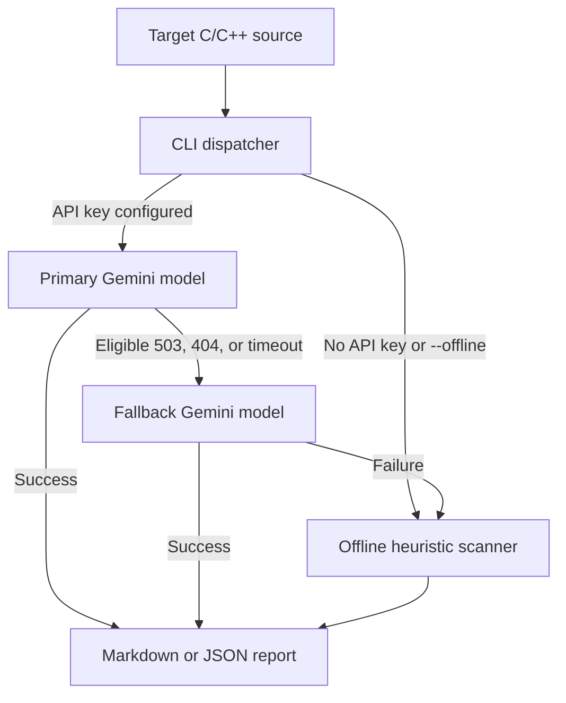

# Embedded Register Auditor

> An autonomous LLM-powered review agent and static checker that detects critical bare-metal C/C++ register-access hazards, with automatic offline heuristic fallback.

---

## Overview

### Problem Statement & Intended Users

Bare-metal firmware developers frequently encounter subtle hardware-level bugs when configuring microcontroller peripherals:
- Accessing peripheral registers before enabling their corresponding peripheral bus clock (causing silent hardware freeze or ignored writes).
- Missing `volatile` qualifiers on memory-mapped I/O (MMIO) pointers or register structs, allowing the compiler to optimize away reads/writes.
- Non-atomic Read-Modify-Write (RMW) operations on shared peripheral registers, leading to interrupt race conditions.
- Shift width overflows such as `(1 << 31)` with signed integers causing undefined behavior.

**Embedded Register Auditor** provides an autonomous static review agent powered by Google Gemini (`gemini-3.8-flash`) via the official Google GenAI SDK (`google-genai`). It retries eligible model availability errors with `gemini-3.5-flash`, then falls back to a deterministic, zero-dependency offline heuristic scanner if generation is unavailable.

It is built for embedded firmware engineers, bare-metal developers, reviewers, and students writing C/C++ for ARM Cortex-M, STM32, ESP32, NXP, RISC-V, and similar microcontroller platforms.

### Key Features

- **Autonomous LLM Analysis**: Uses Gemini (`gemini-3.8-flash` by default) via the official Google GenAI SDK (`google-genai`) to deeply analyze register manipulation patterns and MCU hardware semantics.
- **Resilient Model Fallback**: Retries 503, 404, and timeout failures with `gemini-3.5-flash`, then switches to offline heuristics if generation still fails.
- **Bounded Network Requests**: Uses IPv4 DNS resolution, a 20-second request timeout, and limited SDK retries.
- **Peripheral Clock Gating Checks**: Identifies register access that occurs before enabling peripheral bus clocks (RCC, APB, AHB, SYSCON, etc.).
- **Volatile Pointer Validation**: Flags MMIO pointers declared without `volatile` qualifiers.
- **Concurrency & RMW Detection**: Flags non-atomic bitwise operations (`|=`, `&=`, `^=`) on control/status registers.
- **Shift Width & Overflow Verification**: Detects undefined behavior from constant shifts exceeding operand bit-width or signed 32-bit limits.
- **Automatic Offline Fallback**: Works completely offline without API keys or internet access whenever `GEMINI_API_KEY` is omitted or `--offline` is supplied.
- **Structured Output**: Emits comprehensive Markdown reports with executive summaries, findings tables, detailed analysis, and remediated code snippets, or structured JSON.

---

## Technical Stack

- **Language & Runtime**: Python 3.10+ (tested with Python 3.15)
- **Agent Framework / SDK**: Google GenAI SDK (`google-genai>=0.1.1`), `python-dotenv>=1.0.0`
- **Models**: Gemini 3.8 Flash (`gemini-3.8-flash`, configurable via `GEMINI_MODEL`), with Gemini 3.5 Flash fallback
- **Offline Scanner**: Python standard library regex/text heuristics
- **Output Formats**: Markdown, JSON

---

## Architecture & Data Flow



---

## Prerequisites

- Python 3.10 or newer (e.g., `python`, `python3`, or `python3.15`)
- Google Gemini API key (optional; only required for LLM-powered review mode)

---

## Installation & Setup

Run these commands from the repository root in PowerShell.

1. **Create a virtual environment and install dependencies:**
   ```powershell
   uv venv agents\embedded-reg-auditor\.venv
   uv pip install --python agents\embedded-reg-auditor\.venv\Scripts\python.exe -r agents\embedded-reg-auditor\requirements.txt
   ```

2. **(Optional) Configure local credentials for LLM mode:**
   ```powershell
   Copy-Item agents\embedded-reg-auditor\.env.example agents\embedded-reg-auditor\.env
   notepad agents\embedded-reg-auditor\.env
   ```

   Replace the placeholder in `.env` with your Gemini API key. Keep this file private; `.env` is excluded by the agent's `.gitignore`. Never put a real key in `.env.example` or commit it.

   ```dotenv
   GEMINI_API_KEY=your_gemini_api_key_here
   GEMINI_MODEL=gemini-3.8-flash
   ```

The `.venv` Python executable can run the agent and tests without relying on a `python` command being on `PATH`:

```powershell
agents\embedded-reg-auditor\.venv\Scripts\python.exe agents\embedded-reg-auditor\agent.py --file agents\embedded-reg-auditor\test_samples\stm32_uart.c --offline
```

Alternatively, `uv run` can select a Python interpreter managed by uv:

```powershell
uv run --no-project --directory agents\embedded-reg-auditor python agent.py --file test_samples\stm32_uart.c --offline
```

For live Gemini calls, install the requirements above and configure `.env`:

```powershell
uv run --no-project --directory agents\embedded-reg-auditor python agent.py --file test_samples\stm32_uart.c
```

If the primary and fallback requests both fail, the CLI prints advisory messages to stderr and returns an offline report. A timeout can indicate network/proxy restrictions; it does not establish whether the API key is valid.

---

## Configuration & Environment Variables

| Variable Name | Required | Default | Description |
| :--- | :--- | :--- | :--- |
| `GEMINI_API_KEY` | No | *None* | Google Gemini API key. Enables autonomous LLM analysis mode. If omitted, the agent defaults to offline mode. |
| `GEMINI_MODEL` | No | `gemini-3.8-flash` | Primary Gemini model identifier for firmware auditing; eligible failures retry with `gemini-3.5-flash`. |

---

## How to Run

### 1. Autonomous LLM Mode (Recommended)

When `GEMINI_API_KEY` is present in your environment or `.env` file:

```powershell
# Run LLM audit using default gemini-3.8-flash
uv run --no-project --directory agents\embedded-reg-auditor python agent.py --file test_samples\stm32_uart.c

# Specify a custom model
uv run --no-project --directory agents\embedded-reg-auditor python agent.py --file test_samples\stm32_uart.c --model gemini-3.5-flash

# Output structured JSON
uv run --no-project --directory agents\embedded-reg-auditor python agent.py --file test_samples\stm32_uart.c --format json

# Save report to a file
uv run --no-project --directory agents\embedded-reg-auditor python agent.py --file test_samples\stm32_uart.c --output audit-report.md
```

### 2. Offline Fallback Mode (Zero External Calls)

Force offline heuristic scanning even if an API key is set, or run without an API key:

```powershell
# Force offline scan
uv run --no-project --directory agents\embedded-reg-auditor python agent.py --file test_samples\stm32_uart.c --offline

# Offline JSON report
uv run --no-project --directory agents\embedded-reg-auditor python agent.py --file test_samples\stm32_uart.c --offline --format json
```

*Exit Codes:* Returns `1` if advisory findings or register hazards were detected; returns `0` if no hazards were found.

---

## Example Input & Output

### Example Input

Target firmware code in [`test_samples/stm32_uart.c`](test_samples/stm32_uart.c):

```c
#include <stdint.h>

#define USART2_BASE 0x40004400U
#define UART_BAUD_RATE 115200U

typedef struct {
    volatile uint32_t CR1;
    volatile uint32_t CR2;
    volatile uint32_t CR3;
    volatile uint32_t BRR;
} USART_TypeDef;

void uart2_init(void) {
    USART_TypeDef *uart = (USART_TypeDef *)USART2_BASE;
    uart->BRR = UART_BAUD_RATE;
    uart->CR1 |= (1 << 31);
}
```

Run from the repository root using:
```powershell
uv run --no-project --directory agents\embedded-reg-auditor python agent.py --file test_samples\stm32_uart.c --offline
```

### Example Output

````markdown
# Embedded Register Audit

File: `test_samples/stm32_uart.c`

## Executive Summary
Scanned `test_samples/stm32_uart.c` in offline heuristic mode. Identified 4 advisory register access hazard(s) requiring hardware review.

| Line | Check | Severity | Risk | Remediation |
| ---: | --- | --- | --- | --- |
| 15 | peripheral-clock | warning | The peripheral may be accessed before its clock is enabled; register writes may be ignored or the peripheral may not respond. | Confirm the MCU clock tree and enable this peripheral's bus clock before configuring it. |
| 14 | volatile-mmio-pointer | warning | Memory-mapped pointer 'uart' is not declared volatile, so the compiler may elide or reorder hardware accesses. | Declare the pointed-to type volatile, for example: volatile USART_TypeDef *uart = (volatile USART_TypeDef *)USART2_BASE; |
| 16 | register-read-modify-write | info | This read-modify-write can lose concurrent updates or have side effects on write-sensitive registers; behavior depends on the MCU and interrupt usage. | Check the register's write semantics and concurrency requirements. Prefer vendor-provided atomic set/clear registers or a documented critical section when appropriate. |
| 16 | shift-width | warning | The constant expression shifts by 31; it may overflow a signed int or use a shift count outside the operand width. | Use an explicitly sized unsigned constant (for example, UINT32_C(1)) and verify the shift is smaller than the destination type width. |

## Detailed Findings & Context

### Line 15: peripheral-clock

```c
uart->BRR = UART_BAUD_RATE;
```

Suggested action: Confirm the MCU clock tree and enable this peripheral's bus clock before configuring it.

### Line 14: volatile-mmio-pointer

```c
USART_TypeDef *uart = (USART_TypeDef *)USART2_BASE;
```

Suggested action: Declare the pointed-to type volatile, for example: volatile USART_TypeDef *uart = (volatile USART_TypeDef *)USART2_BASE;

### Line 16: register-read-modify-write

```c
uart->CR1 |= (1 << 31);
```

Suggested action: Check the register's write semantics and concurrency requirements. Prefer vendor-provided atomic set/clear registers or a documented critical section when appropriate.

### Line 16: shift-width

```c
uart->CR1 |= (1 << 31);
```

Suggested action: Use an explicitly sized unsigned constant (for example, UINT32_C(1)) and verify the shift is smaller than the destination type width.

## Remediated Code Snippet

Below is a remediated reference pattern illustrating proper peripheral clock gating, volatile MMIO qualification, safe bitfield manipulation, and unsigned constant shifts:

```c
// 1. Enable peripheral bus clock before accessing peripheral registers
RCC->APB1ENR |= (1U << 17); // e.g. USART2 clock enable

// 2. Ensure MMIO pointers are volatile-qualified
volatile USART_TypeDef *uart = (volatile USART_TypeDef *)USART2_BASE;

// 3. Configure peripheral registers safely
uart->BRR = UART_BAUD_RATE;

// 4. Use unsigned constant shifts within type width (avoid signed overflow)
uart->CR1 |= (1U << 31);
```
````

---

## How to Test

Run the current automated unit tests from the repository root:

```powershell
uv run --no-project --directory agents\embedded-reg-auditor python -m unittest discover -s . -v
```

The committed unit tests cover the heuristic findings and clock-enable check. Run an offline smoke test with:

```powershell
uv run --no-project --directory agents\embedded-reg-auditor python agent.py --file test_samples\stm32_uart.c --offline
```

---

## Known Limitations

- In offline mode, regex heuristics do not parse full C/C++ ASTs and cannot track control flow across multiple translation units or macros.
- Peripheral clock names vary across MCU families (e.g. STM32 `RCC`, NXP `CLK_GATE`, TI `PRCM`).
- Read-Modify-Write is not inherently invalid on all registers; legality depends on target MCU atomic registers (e.g. `BSRR`) vs status flag registers.
- Reports serve as advisory security and correctness guidance, not a formal hardware certification.

---

## Security & Privacy Considerations

- **Secrets Handling**: API keys are read from environment variables or local `.env` files and are never hardcoded or tracked in Git.
- **Offline Privacy**: In `--offline` mode or when no API key is provided, analysis executes 100% locally with zero network traffic.
- **Safe Execution**: Source files are analyzed purely statically; firmware is never compiled or executed by the auditor.

---

## Future Improvements

- [x] Add automated unit tests for heuristic checks and CLI modes.
- [x] Add autonomous LLM auditing using the official Google GenAI SDK.
- [ ] Support user-supplied CMSIS-SVD register files for MCU-specific bitfield validation.
- [ ] Add Model Context Protocol (MCP) server endpoints for integration into IDE agent workflows.

---

## License

This project is contributed under the repository's open-source license.
