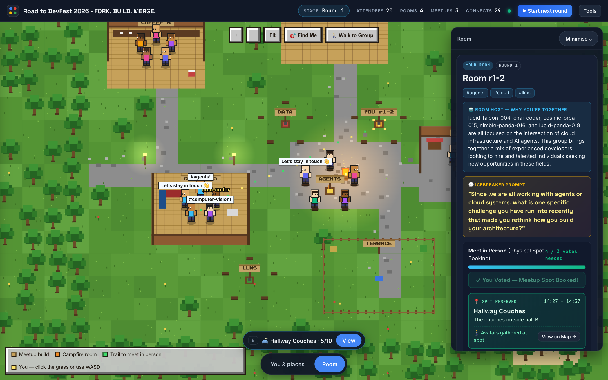
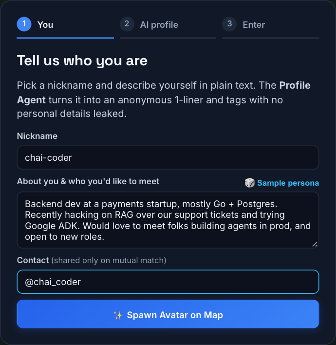
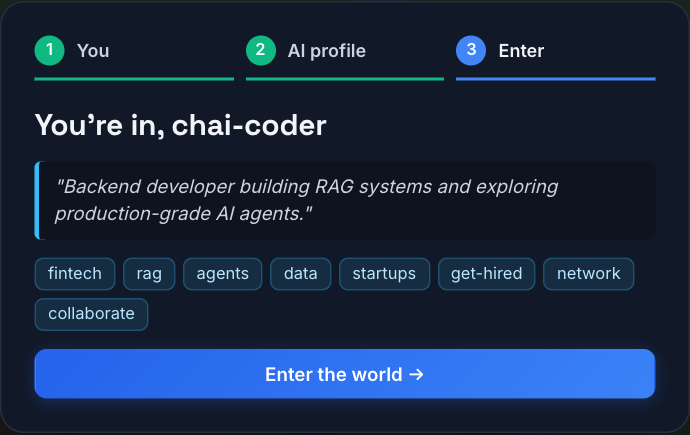
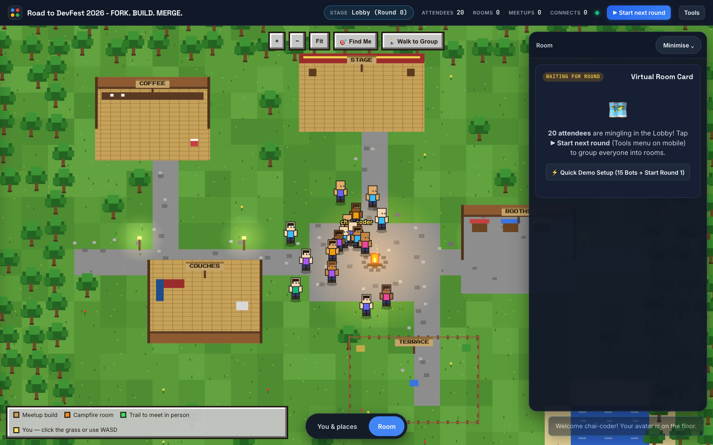
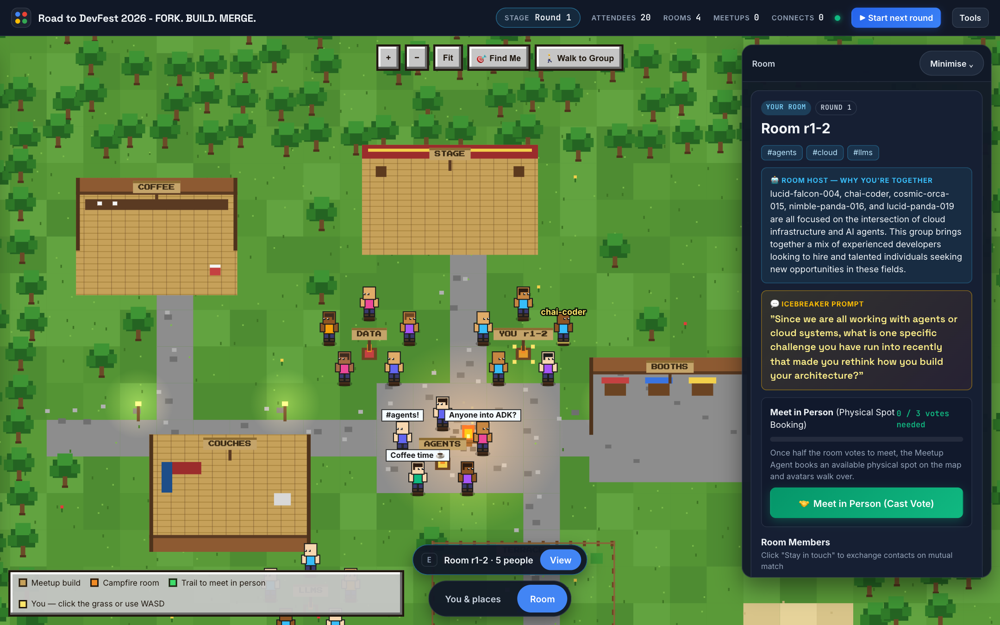
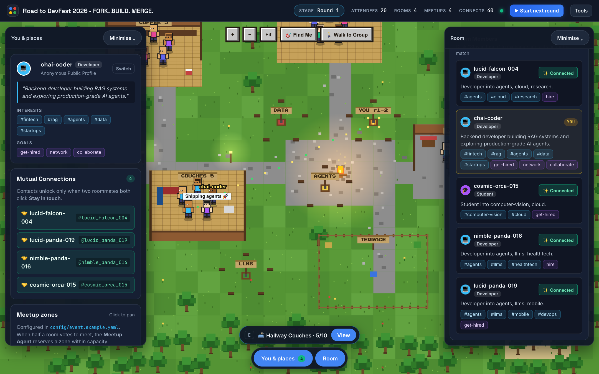
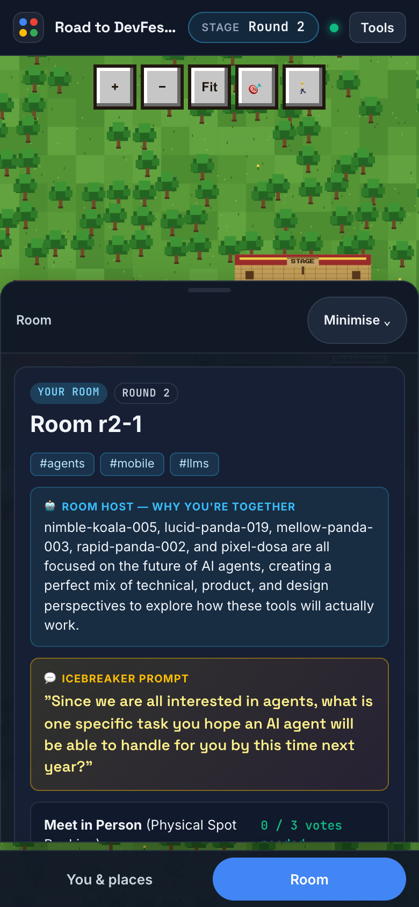

# Event Networking Agent

> Groups event attendees into small rooms of people likely to hit it off, breaks the ice for them, and books a physical spot when they decide to meet in person.




---

## Contents

- [Quick Start](#quick-start)
- [Overview](#overview)
- [Screenshots](#screenshots)
- [Technical Stack](#technical-stack)
- [Architecture & Data Flow](#architecture--data-flow)
- [Project Structure](#project-structure)
- [Prerequisites](#prerequisites)
- [Installation & Setup](#installation--setup)
- [Configuration & Environment Variables](#configuration--environment-variables)
- [How to Run](#how-to-run)
- [Example Input & Output](#example-input--output)
- [How to Test](#how-to-test)
- [Known Limitations](#known-limitations)
- [Security & Privacy Considerations](#security--privacy-considerations)
- [Future Improvements](#future-improvements)

---

## Quick Start

No API key is needed to try it; without one, every LLM step uses its offline fallback.

```bash
cd agents/event-networking-agent
python -m venv .venv && source .venv/bin/activate   # Windows: .venv\Scripts\activate
pip install -r requirements.txt
cp .env.example .env                                # optional: add GEMINI_API_KEY
uvicorn networking_agent.api:create_app --factory --port 8000
```

Open <http://localhost:8000/>, sign up, then click **⚡ Quick Demo Setup** in the Room panel. It fills the floor with synthetic attendees and starts round 1, so you can try the whole flow on your own. Then vote **Meet in Person**, and use **Tools → ⚡ Simulate votes & connects** to have the bots vote and reciprocate.

---

## Overview

### Problem Statement & Intended Users
- **Problem**: At a 250-person meetup most people talk to the two people they came with. Networking is left to chance, it is hardest for introverts and newcomers, and "go network!" gives nobody a reason to walk up to a stranger.
- **Intended Users**: Community organisers (GDG chapters, meetups, hackathons, conferences) and their attendees.

### Key Features
- **Anonymous sign-up**: attendees pick a nickname and describe themselves in free text. Gemini turns that into a structured profile (role, interests, goals) and an anonymous one-liner with no name, employer or contact details.
- **Matchmaking rounds**: the organiser starts a round and everyone is placed in a room of 4-5 people, chosen for shared interests, complementary goals (hiring ↔ job-seeking, learning ↔ mentoring, cofounder ↔ cofounder) and a mix of roles. Nobody is grouped with the same person twice unless the numbers make it impossible.
- **Room host**: each room gets a short "why you're together" note and an icebreaker written for that specific group.
- **Meet in person**: when half a room votes to meet, the meetup agent books one of the organiser's physical spots. Spots have capacities, so a busy spot gets the group the next free slot instead of a crowd.
- **Stay in touch**: contacts are revealed only when two people who shared a room both choose to connect.
- **Runs without an API key**: every LLM step has a deterministic offline fallback, so the event (and the simulator) works even if Gemini is down or rate-limited.
- **2D virtual-world UI**: a top-down venue map (`web/`, plain HTML/CSS/JS on a canvas, no build step). Organiser spots are buildings, rooms gather around campfires, and avatars walk to the booked spot. Works on phones.

---

## Screenshots

These were captured from a real local run with `gemini-3.1-flash-lite`: one person signed up and 19 synthetic attendees were added with the demo tools. The profile, "why you're together" and icebreaker text is genuine model output.

| 1. Sign up | 2. Profile agent output |
| :---: | :---: |
|  |  |
| Nickname plus a free-text intro. The contact field is only shared on a mutual match. | The Profile agent writes an anonymous one-liner and tags. The employer and contact details are dropped. |

**3. Lobby.** Attendees mingle on the venue floor until the organiser starts a round.



**4. Matched room.** The matchmaker forms rooms of 4–5. The room host explains the grouping and writes an icebreaker for this group.



**5. Meet in person.** Once half the room votes, the meetup agent books a spot within capacity and the avatars walk there.


**6. Mutual connections.** A contact is revealed only when both people click "Stay in touch".



| 7. Mobile |
| :---: |
|  |
| On phones the panels become bottom sheets, and an on-screen joystick moves your avatar. |

---

## Technical Stack

- **Language & Runtime**: Python 3.11+
- **Agent Framework / Core Library**: Vanilla Python agents on the `google-genai` SDK; FastAPI for the HTTP API
- **Models**: Gemini `gemini-3.1-flash-lite` (configurable). Structured JSON output, minimal thinking.
- **External APIs / Tools**: Gemini API only. No database: state is in memory for the duration of an event.

---

## Architecture & Data Flow

```
              organiser: config/event.yaml (spots, capacities, room size)
                                          |
[Attendee] --join--> Profile agent (Gemini) --> anonymous profile
                                          |
[Organiser] --start round--> Matchmaker (plain code) --> rooms of 4-5
                                          |
                              Room host agent (Gemini) --> "why" + icebreaker per room
                                          |
[Room members] --vote "meet in person"--> Meetup agent --> spot + time, within capacity
                                          |
[Attendees] --"stay in touch"--> mutual match --> contacts revealed
                                          |
                                     next round (no repeat pairings)
```

Where the LLM is used, and where it deliberately is not:

| Step | Implementation | Why |
| :--- | :--- | :--- |
| Profile agent | Gemini, structured output, offline keyword fallback | Free text is messy; the output is validated against a fixed interest vocabulary so it cannot invent tags |
| Matchmaker | Plain code: pairwise affinity, greedy seeding, swap-based local search | Must place 250 people in under a second, be reproducible and enforce hard constraints (no repeats) |
| Room host agent | Gemini, offline template fallback | Writing a warm, group-specific icebreaker is what LLMs are good at |
| Meetup agent | Plain code: earliest free slot per spot | Capacity is a hard constraint |

Only profile fields (nickname, role, interests, goals, one-liner) are sent to Gemini for room intros. The raw sign-up text is sent once, to build the profile, and contact details never are.

---

## Project Structure

```
agents/event-networking-agent/
├── README.md
├── .env.example              # copy to .env; every variable is documented below
├── requirements.txt          # pinned runtime + test dependencies
├── pytest.ini
├── Dockerfile                # single-process container (port $PORT, default 8080)
├── config/
│   └── event.example.yaml    # organiser config: room size, timings, physical spots
├── networking_agent/
│   ├── api.py                # FastAPI app: attendee, admin, world and demo endpoints; serves web/
│   ├── service.py            # in-memory event state: join, rounds, votes, likes, connections
│   ├── profile_agent.py      # Gemini: free text -> anonymous structured profile (+ offline fallback)
│   ├── matchmaker.py         # plain code: affinity scoring, greedy seeding, swap-based local search
│   ├── host_agent.py         # Gemini: "why you're together" + icebreaker per room (+ template fallback)
│   ├── meetup_agent.py       # plain code: earliest free slot per spot within capacity
│   ├── llm.py                # google-genai client, JSON-schema output, call/failure counters
│   ├── models.py, config.py  # pydantic models and YAML config loader
│   └── synthetic.py          # synthetic attendees for the simulator and demo bots
├── web/                      # 2D virtual-world UI (index.html, app.js, styles.css)
├── simulate.py               # whole-event simulator with matchmaker-vs-random metrics
├── tests/                    # 81 offline tests (pytest)
└── docs/screenshots/         # images used in this README
```

---

## Prerequisites

- Python 3.11+
- pip (or uv)
- Optional: a Gemini API key from [Google AI Studio](https://aistudio.google.com/apikey). Without one, everything runs offline.

---

## Installation & Setup

1. **Navigate to the project directory:**
   ```bash
   cd agents/event-networking-agent
   ```

2. **Set up the virtual environment and install dependencies:**
   ```bash
   python -m venv .venv
   # Windows:
   .venv\Scripts\activate
   # Linux/macOS:
   source .venv/bin/activate

   pip install -r requirements.txt
   ```

3. **Configure environment variables:**
   ```bash
   cp .env.example .env
   # then set GEMINI_API_KEY (optional) and ADMIN_TOKEN
   ```

4. **Configure your event (organisers):** copy `config/event.example.yaml` to `config/event.yaml`, edit the spots, and set `EVENT_CONFIG=config/event.yaml`.

---

## Configuration & Environment Variables

| Variable Name | Required | Default | Description |
| :--- | :--- | :--- | :--- |
| `GEMINI_API_KEY` | No | *None* | Gemini API key. If unset, profiles and icebreakers use the offline fallback |
| `LLM_MODE` | No | `auto` | `auto` (Gemini when a key is set), `offline`, or `gemini` (fail if no key) |
| `MODEL_NAME` | No | `gemini-3.1-flash-lite` | Gemini model id |
| `EVENT_CONFIG` | No | `config/event.example.yaml` | Path to the organiser's event file |
| `ADMIN_TOKEN` | No | random per run | Organiser secret for starting rounds. If unset, one is generated and printed at startup |
| `CORS_ORIGINS` | No | `*` | Comma-separated origins allowed to call the API (set this to your UI's URL in production) |

Notes:
- `.env` is read from this project directory (`agents/event-networking-agent/.env`). Run every command from this directory too, because `EVENT_CONFIG` is a relative path.
- The minimum for a live event is `GEMINI_API_KEY` and a long random `ADMIN_TOKEN` (for example from `python -c "import secrets; print(secrets.token_urlsafe(24))"`).
- To force fully offline behaviour for a demo or CI, set `LLM_MODE=offline`.

Event file (`config/event.example.yaml`):

| Key | Default in example | Meaning |
| :--- | :--- | :--- |
| `event.name` | `Road to DevFest 2026 - FORK. BUILD. MERGE.` | Shown in the UI header |
| `event.room_size` | `5` | People per room; rooms come out as `room_size` or `room_size - 1` |
| `event.walk_minutes` | `3` | Head start to walk to a booked spot |
| `event.meetup_minutes` | `10` | How long a group holds a spot |
| `event.max_wait_minutes` | `30` | If no spot frees up within this window, the group is asked to retry |
| `spots[]` | 5 spots, 90 places | `id`, `name`, `description`, `capacity` (people, must be ≥ `room_size`), optional map `x`/`y` (tile coordinates) |

---

## How to Run

**Simulate a whole event** (250 synthetic attendees, 3 rounds, no key needed):
```bash
python simulate.py
python simulate.py --attendees 100 --rounds 5 --meet-prob 0.8
python simulate.py --llm --attendees 20      # real Gemini calls
```

**Run the API server & 2D Virtual-World UI (`web/`):**
```bash
uvicorn networking_agent.api:create_app --factory --port 8000
# 2D Virtual-World UI at http://localhost:8000/
# interactive API docs at http://localhost:8000/docs
```

**At a real venue**, attendees open the UI on their phones, so bind to all interfaces and share the URL as a QR code. Keep it to one worker, because state is in memory:
```bash
uvicorn networking_agent.api:create_app --factory --host 0.0.0.0 --port 8000 --workers 1
```

**Container:** a single-process `Dockerfile` is included. It listens on `$PORT` (default 8080). `.dockerignore` and `.gcloudignore` keep `.env`, `.venv` and the tests out of the image and the upload. Pass secrets at runtime; never bake them into the image:
```bash
docker build -t event-networking-agent .
docker run -p 8080:8080 -e GEMINI_API_KEY=... -e ADMIN_TOKEN=... event-networking-agent
```

**Deploy to Cloud Run** (secrets in Secret Manager):
```bash
PROJECT=your-project REGION=asia-south1
printf %s "$GEMINI_API_KEY" | gcloud secrets create networking-agent-gemini-key --project $PROJECT --data-file=-
python -c "import secrets;print(secrets.token_urlsafe(24),end='')" | gcloud secrets create networking-agent-admin-token --project $PROJECT --data-file=-
# grant roles/secretmanager.secretAccessor on both secrets to the service's runtime service account
gcloud run deploy event-networking-agent --source . --project $PROJECT --region $REGION \
  --allow-unauthenticated --min-instances 1 --max-instances 1 \
  --set-env-vars LLM_MODE=auto,MODEL_NAME=gemini-3.1-flash-lite \
  --set-secrets GEMINI_API_KEY=networking-agent-gemini-key:latest,ADMIN_TOKEN=networking-agent-admin-token:latest
```
`--max-instances 1` is required: state lives in memory, so a second instance would split the event. `--min-instances 1` prevents scale-to-zero from wiping the event when traffic is quiet.

**Running an event (organiser):**
1. Put your venue's meeting spots and capacities in `config/event.yaml` and set `EVENT_CONFIG=config/event.yaml`.
2. Share the UI URL. Attendees sign up and wait in the lobby.
3. Start each round with `curl -X POST -H "X-Admin-Token: $ADMIN_TOKEN" http://<host>:8000/api/admin/rounds` (or **▶ Start next round** in the UI).
4. Track progress with `GET /api/admin/stats` (attendees, rooms, meetups, LLM calls/failures).

| Endpoint | Auth | Purpose |
| :--- | :--- | :--- |
| `GET /` | none | 2D top-down virtual-world UI (`web/index.html`) |
| `POST /api/join` | none | `{nickname, about, contact?}` → `{token, me}` |
| `GET /api/me/room` | `X-Attendee-Token` | Current room: members, why, icebreaker, votes, meetup |
| `POST /api/me/room/meet` | `X-Attendee-Token` | Vote to meet in person; books a spot once half the room agrees |
| `POST /api/me/like` | `X-Attendee-Token` | `{to_id}`, someone you shared a room with |
| `GET /api/me/connections` | `X-Attendee-Token` | Mutual connections with their contact |
| `GET /api/world` | none | Public floor state (spots, active rooms, public profiles, stats) for the 2D map |
| `POST /api/demo/seed`, `/round`, `/simulate`, `/reset` | none | Live demo controls in the UI (seed bots, start round, simulate votes) |
| `POST /api/admin/rounds` | `X-Admin-Token` | Start the next round |
| `GET /api/admin/stats` | `X-Admin-Token` | Attendees, rooms, meetups, LLM calls/failures |
| `GET /api/event`, `GET /api/spots` | none | Event name and spots (for drawing the map) |

---

## Example Input & Output

### 1. Simulator (offline, `python simulate.py`)

Genuine output from this repository. Attendees are synthetic and "meet in person" votes are random (`--meet-prob 0.6`), so this demonstrates the matching and constraint handling, not real-world social outcomes.

```
Event: Road to DevFest 2026 - FORK. BUILD. MERGE.
Spots: Coffee Corner (15), Stage Left (20), Sponsor Alley (20), Hallway Couches (10), Terrace (25)
LLM:   offline (keyword rules + templates)

250 attendees joined in 0.0s
Profile agent vs ground truth: role accuracy 100% | interests precision 96% recall 98% | goals precision 91% recall 88%

Round 1: 50 rooms (sizes [5]) in 0.16s
                               matchmaker   random
  mean pair affinity                 0.49     0.16
  share w/ common interest           100%      92%
  share w/ goal match                 79%      56%
  37 rooms chose to meet in person
...
Round 3: 50 rooms (sizes [5]) in 0.16s
                               matchmaker   random
  mean pair affinity                 0.42     0.17
  share w/ common interest            99%      94%
  share w/ goal match                 79%      58%
  30 rooms chose to meet in person

Constraints
  repeat pairings across rounds: 0 (random grouping: 22)
  spot peak load vs capacity:    coffee-corner 15/15, stage-left 20/20, sponsor-alley 20/20, hallway-couches 10/10, terrace 25/25
  capacity ever exceeded:        False
  wait for a free spot (min):    median 10, max 20
  rooms that found no spot within 30 min: 0

Sample room r1-1:
  - quiet-lynx-195 (developer; mlops, mobile, design, open-source): Developer into mlops, mobile, design.
  - cosmic-panda-074 (developer; mlops, security, fintech): Developer into mlops, security, fintech.
  - lucid-lynx-010 (developer; security, fintech): Developer into security, fintech.
  - lucid-lynx-236 (founder; security, startups, open-source): Founder into security, startups, open-source.
  - witty-yak-199 (student; agents, mlops, devops): Student into agents, mlops, devops.
  why:        You all orbit mlops, security; lucid-lynx-236 is hiring and quiet-lynx-195 is looking.
  icebreaker: What broke the first time you put a model in front of real users?
  meetup:     Coffee Corner at 11:03
```

The profile-agent accuracy line is a sanity check only: the synthetic sign-ups are generated from phrase lists, so the offline keyword rules score higher here than they would on real people.

### 2. API with Gemini (`gemini-3.1-flash-lite`)

Input to `POST /api/join`:
```json
{
  "nickname": "chai-coder",
  "about": "Backend dev at a payments startup in Koramangala, mostly Go + Postgres. Recently hacking on RAG over our support tickets and trying Google ADK. Would love to meet folks building agents in prod, and honestly open to new roles. Ping me at ravi@example.com",
  "contact": "@chai_coder"
}
```

Output (`token` omitted). The one-liner drops the name, email, employer and neighbourhood:
```json
{
  "me": {
    "id": "b1a28097",
    "nickname": "chai-coder",
    "role": "developer",
    "interests": ["fintech", "rag", "agents", "startups"],
    "goals": ["get-hired", "network"],
    "one_liner": "Backend developer building RAG solutions and exploring production-ready AI agents in the fintech space."
  }
}
```

After the organiser starts a round, `GET /api/me/room` for another attendee (trimmed to the room-level fields):
```json
{
  "id": "r1-1",
  "shared_interests": ["agents", "llms"],
  "why": "guest-1, guest-2, and design-dosa are all deeply invested in the intersection of AI agents and language models. This group brings together students eager to build with a designer interested in the user experience of these tools, creating a perfect space for cross-disciplinary learning.",
  "icebreaker": "What is one specific challenge you have run into while trying to make an AI agent feel intuitive or easy for a user to interact with?",
  "votes": 0,
  "votes_needed": 2,
  "meetup": null
}
```

Two members then call `POST /api/me/room/meet`, and the second vote books a spot:
```json
"meetup": {"spot_id": "coffee-corner", "spot_name": "Coffee Corner", "spot_description": "Next to the coffee counter, ground floor", "meet_at": "2026-10-24T07:00:20Z", "until": "2026-10-24T07:10:20Z"}
```

---

## How to Test

```bash
pytest                                       # 81 tests, offline, about 1 s
python simulate.py                           # whole-event check, offline
python simulate.py --llm --attendees 20      # preflight against Gemini before a live event
```

The tests cover room sizing, the matchmaker beating random grouping, no repeat pairings, spot capacity and waiting, profile cleaning, and the full API flow (join → round → vote → meetup → mutual connect).

---

## Known Limitations

- **In-memory state**: a server restart loses the event. Run a single process (one uvicorn worker); multiple workers would each hold separate state.
- **Spot capacity drives waiting**: with the example spots (90 places) and 60% of members voting to meet, about 70% of rooms meet and about half of those wait one slot (median 10 minutes). For no waiting, total spot capacity should be roughly `attendees × share of rooms that meet` (about 175 places for 250 people at the default vote rate).
- **Small events repeat pairings**: with 20 people in rooms of 5, a second round must re-pair some people (pigeonhole); the matchmaker keeps it to the minimum.
- **Matching quality is measured against its own scoring**: "affinity" is a heuristic (interest overlap + complementary goals). There is no real-world evaluation yet of whether these rooms lead to better conversations.
- **Rate limits**: joins call Gemini once each. On low quota tiers, a rush of sign-ups may hit 429s; those attendees get an offline profile rather than an error.
- **Model availability**: `gemini-2.5-flash-lite` is cheaper on paper but returned `404 ... no longer available to new users` for a new key in October 2026; `MODEL_NAME` lets you switch.
- **Demo endpoints are open**: `/api/demo/seed`, `/round`, `/simulate` and `/reset` need no token, so the UI's organiser tools work without setup. Anyone who can reach the server can use them, including resetting the event. For a real event, put the server behind a proxy that blocks `/api/demo/*`, and start rounds with the admin endpoint instead.
- **No real-time push**: the UI polls the API, so updates can appear a few seconds late.
- Tested on macOS with Python 3.11 (Chrome, desktop and mobile viewport). Linux should work; Windows is untested. The container was built and deployed with `gcloud run deploy --source` (Cloud Build), not with a local Docker build.

---

## Security & Privacy Considerations

- **Secrets Handling**: The Gemini key and admin token are read from environment variables (`.env`, git-ignored). Admin endpoints use a constant-time token comparison.
- **Anonymity**: Attendees are identified by a nickname and a random public id. Each attendee's credential is a separate random token returned once at sign-up, so knowing someone's public id (which room-mates can see) does not let you act as them. The raw sign-up text and contact details are never returned by the API to other attendees, and contacts are shared only on a mutual "stay in touch".
- **Data Privacy**: The sign-up text is sent to the Gemini API once to build the profile; room intros send only profile fields. No location data is collected. Nothing is written to disk, so all data is gone when the process stops. Tell attendees not to put personal details in the free-text field.
- **Safety**: The agent does not execute code or shell commands. LLM output is validated against fixed schemas and vocabularies before use.

---

## Future Improvements

- [x] Virtual-world UI: a 2D top-down map where organiser spots are zones, avatars walk between rooms, and room card shows the icebreaker and "Meet in person" button (`web/`).
- [ ] Real-time updates over WebSockets instead of polling `/api/me/room`.
- [ ] Persist state (SQLite or Firestore) so a restart does not end the event.
- [ ] Use post-meetup feedback ("did you connect?") to tune matching weights between rounds.
- [ ] Organiser dashboard: live room map, spot load, round timer.

---

## License

*This project is contributed under the repository's open-source license.*
