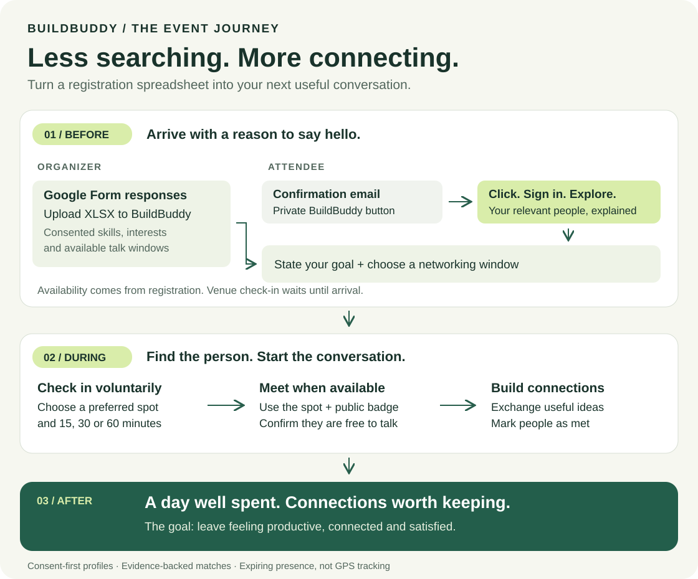

# BuildBuddy — turn event registrations into real connections

> Find people worth meeting, understand why you match, and find each other at the event.

BuildBuddy helps community-event attendees turn “Who should I talk to?” into a useful conversation. Organizers bring their confirmed, consenting attendees’ Google Form responses; attendees discover relevant people through a private invitation in their confirmation email.

## Before, during, and after the event

**Before:** the organizer uploads the confirmed attendees’ spreadsheet and sends each person a private BuildBuddy button in their confirmation email. Attendees open it to explore matches before arrival. Networking availability comes from their registration responses.

**During:** attendees describe what they need, explore their top three introductions, and voluntarily check in at an approved meeting spot. A public badge code helps confirm they have found the right person. After a conversation, **We’ve met** makes room for new suggestions.

**After:** the aim is to leave with useful connections, shared ideas, and a sense of time well spent—not just a list of names.

Opening the email button does not mark venue arrival. Check-ins start when attendees choose a spot at the event and expire automatically. BuildBuddy does not book future meetings.

## Ask for the connection you need

> “I want to know how I can start contributing to open source.”

BuildBuddy looks for people with relevant skills, projects, or shared interests. In the fictional sample, Kiran’s Git/testing skills and contributor starter kit, and Farah’s documentation skills and first-contribution guide, provide reasons to start a conversation.

Every recommendation explains **why this person**, **what you could offer them**, and **how to break the ice**. Shared interest is clearly distinguished from relevant offered skills: interest alone does not make someone a mentor.

The sample profiles are fictional; the screenshot illustrates the experience, not measured networking outcomes.

## What makes BuildBuddy useful?

- **Start with your existing registrations:** import selected, confirmed Google Form responses as an XLSX file.
- **Use ordinary language:** describe a goal instead of guessing exact skill tags.
- **Make conversations mutual:** see how you may be able to help each other.
- **Trust the evidence, not a compatibility percentage:** inspect the profile details behind each suggestion.
- **Find people in the room:** filter by networking window or recent check-in, then look for their public badge code.
- **Stay in control:** choose whom to approach, mark people as met, end a check-in, or remove your profile.

## Privacy and choice

Only attendees who explicitly consent to networking appear in matches. Access is private to the event, and personal invitation links must not be forwarded. Profiles stay on the organizer’s server; organizers can access that data.

Matching works without a paid AI account. Optional cloud assistance sends the typed request and aggregate result counts—not attendee profiles or locations—to Google. Attendees can leave it off.

BuildBuddy never messages another attendee on your behalf. Removing your profile stops it appearing in BuildBuddy; deleting the original registration response is a separate request to the organizer.

## Know its limits

Matches are conversation leads, not verified expertise or guaranteed availability. English requests work best, and nuanced goals can be misunderstood. Check the evidence and ask before approaching someone.

Spreadsheet imports are snapshots, not a live Google Sheets connection. Confirmation emails use the organizer’s existing email service. Meeting acceptance, future reservations, and real-world networking outcomes are not guaranteed.

## Learn more

[Organizer guide](ORGANIZER_GUIDE.md) · [Attendee guide](ATTENDEE_GUIDE.md) · [Privacy details](PRIVACY.md)

For maintaining or hosting the app: [setup, configuration, architecture and testing](DEVELOPMENT.md) · [deployment and email integration](DEPLOY.md) · [verified test results](VERIFICATION.md) · [contribution review](SUBMISSION_REVIEW.md).

## License

BuildBuddy application code is MIT licensed. Optional models and dependencies retain their own licenses; see the [technical guide](DEVELOPMENT.md#license-and-contribution).
