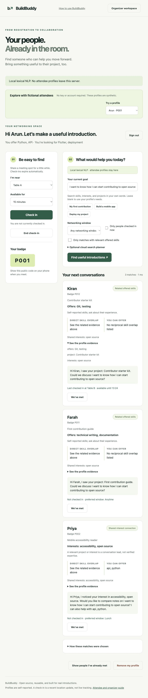

# BuildBuddy — useful introductions, backed by evidence

> Import event registration responses, describe your goal in ordinary language, and find people who can help—or explore the same interest—with you.

**Example:** “I want to know how I can start contributing to open source.” BuildBuddy retrieves contribution-related projects, Git/documentation skills, and open-source interests. It explains the source of each recommendation instead of treating interest as verified expertise. A short-lived meeting-spot check-in helps you find the person in the room.

**Private by default:** local NLP searches skills, interests, and project descriptions. A downloaded MiniLM model adds semantic matching on the organizer’s own server. No attendee profiles are sent to a hosted AI service. The optional Gemini tool planner sees only the requester’s goal and aggregate hit counts.

[Organizer guide](ORGANIZER_GUIDE.md) · [Attendee guide](ATTENDEE_GUIDE.md) · [Security and privacy](PRIVACY.md)

**Evaluator URL and email button:** see [DEPLOY.md](DEPLOY.md) for a no-key Render deployment, included `render.yaml`, and private confirmation-email links that open pre-event matches. GitHub Pages alone cannot host the Python backend. Hosted deployment requires your hosting account; no public URL is provisioned automatically.

## Quick start: no API key

Requires Python 3.11+ and a modern browser. From this folder:

```bash
python3 -m venv .venv
source .venv/bin/activate
python -m pip install -r requirements-dev.txt
python -m pytest -q
python app.py --demo
```

Windows PowerShell activation: `.venv\Scripts\Activate.ps1`.

Open **http://127.0.0.1:8000**, select **Arun · P001**, and enter the open-source request above. **Kiran and Farah** should appear among the top three in local lexical mode. Their Git/documentation skills and contribution projects support those recommendations. The sample XLSX has 20 fictional responses, 18 with consent; no real attendee data is bundled.

### Enable local semantic AI

```bash
python -m pip install -r requirements-semantic.txt
python setup_model.py
cp .env.example .env
```

Put the printed `BUILDBUDDY_MODEL_DIR=...` line in `.env`, then restart `python app.py --demo`. If the hub download transport stalls, use `python setup_model.py --direct`. The first setup downloads public model files, approximately 90 MB for weights. Once installed, inference loads local files only; the running app never initiates a model download. An unavailable model produces an explicit **Local lexical NLP** label and warning instead of a false AI claim.

The semantic engine is [all-MiniLM-L6-v2](https://huggingface.co/sentence-transformers/all-MiniLM-L6-v2), executed with [FastEmbed](https://github.com/qdrant/fastembed) and ONNX Runtime. It creates sentence vectors for similarity comparison. This is trained-model inference, not a generative chatbot. The model is English-focused and truncates long fields; keep responses concise.

## What reviewers can verify

| Try this | Expected behavior |
| --- | --- |
| “I want to start contributing to open source” | Contribution-related people, with exact profile evidence |
| “I want to put my app online” | Deployment/hosting connections |
| “I want to run AI offline” | A local-model connection such as Nila |
| `Docker` | Kabir’s offered Docker skill |
| A goal unrelated to the event, such as `quantum spectroscopy` | No sufficiently relevant match |
| Check Priya in at Table B in another tab; search as Arun with available-now enabled | Priya’s recent, expiring check-in |
| Mark a person as met | Exclude them for that viewer, without changing other attendees’ results |
| Search only relevant offered skills | Exclude interest-only connections |
| Inspect “See the profile evidence” and “How these matches were chosen” | Source fields and actual workflow/tool trace |



The screenshot and sample are illustrative, not proof of real-world networking outcomes. See the test commands below for reproducible checks.

## Overview

**Problem:** registration spreadsheets contain useful skills and interests, but attendees still struggle to identify a mutually useful person and locate them.

**Users:** community-event organizers, attendees, and developers reusing the retrieval or privacy patterns.

**Features:** multi-event XLSX ingestion, explicit consent, local multi-field NLP, optional semantic AI, reciprocal benefits, source evidence, bounded optional tool calling, private attendee tokens, expiring check-ins, met history, withdrawal persistence, token replacement, and organizer event deletion.

## Technical stack

Python/FastAPI/Uvicorn; SQLite; openpyxl for ingestion; plain HTML/CSS/JavaScript; optional FastEmbed/ONNX Runtime; optional Gemini REST function calling. No frontend build step, vector server, Google login, or paid model account is required for the base application. Dependencies are declared in project-local requirements and constraints files.

## Architecture and data flow

```text
Form responses → XLSX → validate + consent → event-specific SQLite profiles
                                                  ↓
Authenticated request → filter eligible people → local multi-field retrieval
                                                  ↓
              local MiniLM + lexical evidence + reciprocal skill relevance
                                                  ↓
                     evidence-backed cards + private, expiring check-ins

Optional: user goal → Gemini search_people tool call → local search
                               ↑                         ↓
                               └── aggregate hit count ──┘
                         finish → locally composed introductions
```

### Where the AI and agent are used

- **Local lexical NLP:** token normalization, a documented small phrase-expansion map, and BM25 retrieval across offers, projects, and interests. This is language retrieval, not an LLM.
- **Local semantic AI:** MiniLM encodes the query and profile fields locally. Cosine similarity contributes to retrieval and ranking. No prompts or profile vectors are stored. The engine is identified explicitly in the UI.
- **Optional Gemini agent:** the model chooses real `search_people` and `finish` tool calls. It receives only counts, can try one additional search, and is bounded to three model turns/two searches. Successful related searches can provide a small agreement bonus to already-grounded candidates. The model cannot add an attendee who did not meet the original local relevance and eligibility checks. Invalid calls or provider failures fall back to local results.

The default local workflow is not an autonomous LLM agent. It is a local NLP networking assistant with deterministic orchestration; installing MiniLM adds semantic AI. The optional cloud path is a bounded tool-calling agent, not a hidden extra model request on every search. See [Gemini function calling](https://ai.google.dev/gemini-api/docs/function-calling).

## Ranking and evidence

Eligibility is enforced first: correct event, not self, not already met, compatible networking window, and optionally a current check-in. Semantic similarity never overrides these rules.

Each candidate’s offers, project, and interests are searched separately. Evidence is the original source text plus matched/related terms or a semantic similarity above the configured code threshold (currently 0.48). The score combines:

- Direct offered-skill overlap: 5 points each.
- Reciprocal skill overlap: 3 points each.
- Shared interests: up to 2 points.
- BM25 field relevance, lower-weight domain expansions, and thresholded semantic similarity. Project and offers evidence are weighted above general interests.

The top three are returned, with stable ID tie-breaking. Scores are ranking heuristics, not compatibility percentages. Labels distinguish direct skill evidence, related offered skills, relevant projects, and shared-interest connections. A model similarity is not a credential or a guarantee someone can mentor you.

## Installation and configuration

Place the complete folder at `agents/event-networking-matchmaker/` in the monorepo. Follow the quick start above; run `python app.py` without `--demo` for real events. The organizer key is printed locally at startup unless supplied in `.env`.

| Variable | Default / purpose |
| --- | --- |
| `BUILDBUDDY_ADMIN_KEY` | A random temporary organizer key; configure a stable, strong secret for a real instance |
| `BUILDBUDDY_DB` | `data/buildbuddy.sqlite3` beside the application; use a private persistent location |
| `BUILDBUDDY_MODEL_DIR` | Unset; path printed by model setup enables local semantic inference |
| `BUILDBUDDY_ALLOWED_HOSTS` | `localhost,127.0.0.1`; add the exact HTTPS hostname or LAN IP when hosting |
| `GEMINI_API_KEY` | Unset; optional server-side Google credential |
| `GEMINI_MODEL` | Unset; a model available to your account that supports function calling |

Restart after changing `.env`. The optional Gemini checkbox sends the typed goal and aggregate counts to Google, never profiles or locations. Model billing and quotas depend on your account. The code makes at most three model calls with bounded timeouts; it does not measure monetary cost. Live provider behavior must be verified using your own authorized key.

## Input format

[Sample XLSX](sample/form-responses.xlsx). Required columns are `Attendee ID`, `Display name`, `Skills I can help with`, `What I want help with`, `Available networking window`, and `Allow my profile to appear in event matches`. `Interests` and `What I am building` are optional but strongly recommended. See the organizer guide for question types, consent wording, aliases, reimports, and a complete operating procedure.

The first row contains headers. Use `Form Responses 1`, or put responses on the first sheet. Only explicit consent values `Yes`, `True`, or `I agree` are accepted. Unknown columns are discarded. Duplicate identities, ambiguous headers, formulas, and invalid files fail before database changes. Limits: 1,000 rows, 50 columns, 5 MB XLSX, 25 MB expanded content, and 1,000 characters per recognized field.

## Example input and output

Input as Arun:

```text
I want to know how I can start contributing to open source
```

The lexical test verifies that Kiran and Farah appear among the returned IDs. Evidence includes Kiran’s offered `Git, testing` and project `Contributor starter kit`, and Farah’s `technical writing, documentation` and `First contribution guide`. The response contains `label`, `reason`, `caveat`, `evidence`, `you_help`, `starter`, and current check-in fields. Names and facts come from the imported rows, not generated biography text.

## Tests and evaluation

```bash
python -m pip install -r requirements-dev.txt
python -m pytest -q
python evaluate.py
```

The tests cover the original open-source regression, project/interest retrieval, paraphrases, evidence labeling, offered-only filtering, consent, malformed XLSX, event isolation, token replacement, identity reassignment, check-in expiry, withdrawals/reimports, deletion, request bounds, host/origin checks, concurrent independent sessions, and bounded Gemini tools with mocked HTTP.

The base test suite uses lexical NLP and does not need internet or model weights. Provider tests use fake responses and do not claim a live Gemini run. A 200-profile catalog test checks functional retrieval, not 200 concurrent users. `evaluate.py` checks ten curated queries and sequential 200-profile retrieval timing. These are synthetic regression checks, not a held-out accuracy benchmark. Actual results and unverified components are recorded in [VERIFICATION.md](VERIFICATION.md). Run `python evaluate.py --model-dir /path/to/model` to evaluate an installed semantic model separately.

## Security and privacy

Read [PRIVACY.md](PRIVACY.md) before using real attendee data. Key properties: consenting profiles only; per-event authentication; hashed private tokens; source-grounded text rendering; no profile data in cloud planner calls; no profile-vector cache; in-app withdrawal suppression; organizer-only import/rotation/deletion; bounded uploads; private database permissions; cross-origin rejection; no-store responses; and fresh authorization/profile checks after slow matching.

Use HTTPS for real attendees, restrict access to the database and organizer key, and announce a retention policy. Delete event data at the end of that policy. Source Forms/Sheets, downloaded tokens, and backups require separate management.

## Known limitations

- XLSX snapshots, not a live Google Sheets connection. No automatic email or token delivery.
- English-focused lexical/model retrieval. The phrase map is small; negation, nuanced intent and technical jargon may be misunderstood. Inspect evidence rather than assuming semantic relevance proves expertise.
- No guaranteed meeting acceptance, availability reservation, or recommendation capacity balancing.
- One SQLite instance; no distributed deployment or 200-concurrent-attendee load claim.
- The privacy boundary is the organizer’s server, not each attendee’s phone. Organizers can access stored data.
- Local model files are downloaded separately and not bundled in the PR. Missing or incompatible dependencies produce a visible fallback.
- Runtime dependencies and platform compatibility need validation on each deployment. Real mobile-device and live Gemini verification must not be inferred from passing API tests.
- One organizer role. Lost tokens are rotated after identity verification; there is no account recovery service.

## Future improvements

QR-assisted check-in, opt-in meeting requests, capacity-aware recommendations, evaluated multilingual embeddings, and consent-aware Google Sheets synchronization.

## License and contribution

Application code is under the parent repository’s MIT license; `LICENSE` preserves that notice. MiniLM model weights carry their own Apache-2.0 license and attribution. Runtime dependencies keep their own licenses. Sample profiles are fictional.

Keep all files inside `agents/event-networking-matchmaker/`. Do not commit `.env`, data, model caches, private-token exports, or virtual environments. Run the tests and reviewer walkthrough, then submit the project with the upstream PR checklist. No root build changes are needed.
