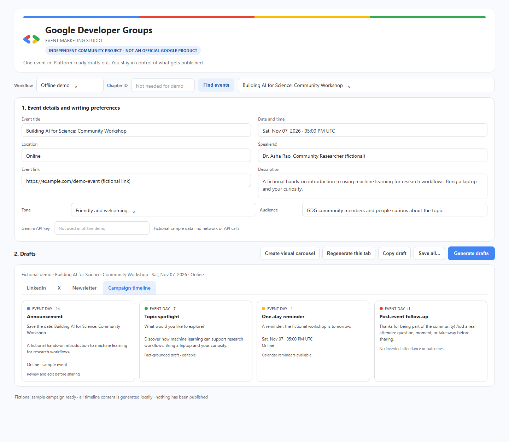

# GDG Event Marketing Agent

> Turn a published GDG Community event into review-ready LinkedIn, X, and email
> newsletter drafts with Gemini—or explore the interface with offline sample data.

---

## Overview

### Problem Statement & Intended Users

GDG organizers often need to rewrite the same event details for several
communication channels. This tool fetches the nearest upcoming published event
from GDG Community (Bevy) and drafts channel-specific copy for organizers to
review and edit.

**Intended users:** GDG chapter organizers and community volunteers.

### Key Features

- Fetches the nearest future published event for a chapter ID.
- Lists upcoming events so organizers can choose the right event.
- Lets organizers edit event facts before generating, or use a fully custom event.
- Generates LinkedIn, X, and email newsletter drafts with Gemini.
- Uses channel-specific copywriting guidance for stronger hooks, scannable
  event details, useful calls to action, and fact-checked, non-generic messaging.
- Adds audience, tone, call-to-action, extra guidance, and channel-selection controls.
- Provides editable drafts, per-channel regeneration, word/character counts,
  copy-to-clipboard, and Markdown/text export.
- Turns the selected LinkedIn draft into a locally generated, four-card visual
  carousel with accessible descriptions, individual PNG downloads, and PDF
  printing; the cards reuse draft/event facts instead of inventing new claims.
- Builds an event-aware campaign timeline (announcement, topic spotlight,
  one-day reminder, and post-event follow-up) and exports review reminders as
  an `.ics` calendar file. It does not publish or schedule posts with social
  networks.
- Adds a Google Developer Groups bracket-mark header with a clear notice that
  this is an independent community project, not an official Google product.
- Uses a Google-inspired light theme with familiar blue, red, yellow, and green
  accents, readable card-like surfaces, and a prominent primary action.
- Keeps network work off the UI thread and presents actionable validation/errors.
- Includes offline demo mode with fictional event data; no credentials or network
  are needed to explore the interface.
- Never publishes content; files are created only after an explicit export action.

### UI Preview



This visual preview uses fictional offline-demo details. The chapter, speaker,
event, and link are fictional; no live API-generated content or real organizer
information is shown.

---

## Social media manager comparison and project scope

Buffer's official product pages describe publishing and a multi-channel
calendar, an AI content assistant and idea organization, community comment
management, analytics, collaboration/approvals, and Start Page. This project
focuses on the part most relevant to volunteer-led GDG events: turning verified
event facts into a complete campaign package.

| Product area | This project |
| :--- | :--- |
| Platform-specific drafting and AI copy refinement | LinkedIn, X, and newsletter drafts with Gemini, editable by organizers. |
| Publishing calendar and planning | Event-relative campaign plan plus local `.ics` reminders for manual review. No social-account publishing or queue integration. |
| Content organization and repurposing | Event draft editing, channel variants, and a four-card downloadable visual carousel. |
| Team collaboration and approvals | Human review is supported in the app; there are no accounts, shared workspace, or multi-user approval system. |
| Community inbox and replies | Not included; this app does not connect to social accounts or access comments. |
| Analytics and reporting | Not included; the app does not collect reach, engagement, or follower data. |
| Start Page / link-in-bio | Not included. |

**Event-specific differentiators:** the campaign timeline is anchored to the
event date; the follow-up explicitly asks organizers to add a real takeaway
instead of inventing attendance or outcomes; and the visual carousel is created
locally from the selected draft and event facts. These are differentiators of
this project's workflow, not a claim that no other product offers similar
capabilities.

The UI header uses Google's Developer bracket mark as a community identifier.
This is an independent open-source project and is not affiliated with or
endorsed by Google. See the [Google Developers community page](https://developers.google.com/community)
for the mark's source context.

Feature research checked on 2026-10-24 against Buffer's public
[overview](https://buffer.com/), [Publish](https://buffer.com/publish),
[Create](https://buffer.com/create), [AI Assistant](https://buffer.com/ai-assistant),
[Community](https://buffer.com/community), [Insights](https://buffer.com/insights),
[Collaborate](https://buffer.com/collaborate), and
[Start Page](https://buffer.com/start-page) pages. Product capabilities can
change; consult Buffer's current pages for the latest details.

---

## Technical Stack

- **Language & Runtime:** Python 3.9+ (Python 3.10+ recommended)
- **Agent framework / core library:** Python script with Google Gen AI SDK
- **Model:** `gemini-3.8-flash` by default; override with `GEMINI_MODEL`
- **Desktop UI:** Tkinter (included with most standard Python distributions)
- **External APIs:** Public GDG Community event API and Gemini API
- **Other dependencies:** Requests and python-dotenv

---

## Architecture & Data Flow

Live mode reads local configuration, requests published events for the selected
chapter, filters out past events, and sends the upcoming event details to Gemini
for selected channel drafts. The UI runs requests away from the main window
thread and supports editing, copying, and explicit export. Event campaign plans
and calendar reminders are generated locally. The app does not publish content.

```text
Local chapter ID ──> GDG Community event API ──> nearest upcoming event
                                                  │
Local Gemini key ─────────────────────────────────┴─> Gemini ──> channel drafts
                                                                    │
                                           UI drafts / visual carousel
Event time + facts ──> local campaign timeline ──> optional .ics reminders
```

Offline demo mode bypasses both APIs and displays clearly labeled fictional
sample content.

---

## Prerequisites

- Python 3.9 or newer; Python 3.10+ is recommended (Python 3.9 is end-of-life).
- A Gemini API key from [Google AI Studio](https://aistudio.google.com/apikey)
  for live generation only.
- Internet access to gdg.community.dev and the Gemini API for live generation.

---

## Installation & Setup

From the repository root, enter the project:

```powershell
cd agents\gdg-event-marketing
```

On macOS or Linux:

```bash
cd agents/gdg-event-marketing
```

Create and activate a virtual environment, then install dependencies.

Windows PowerShell:

```powershell
python -m venv .venv
.\.venv\Scripts\Activate.ps1
python -m pip install -r requirements.txt
```

If PowerShell blocks activation, invoke `.venv\Scripts\python.exe` directly.
On macOS or Linux:

```bash
python3 -m venv .venv
source .venv/bin/activate
python -m pip install -r requirements.txt
```

---

## Configuration & Environment Variables

For live mode, copy `.env.example` to `.env` and fill in your own values.

Windows PowerShell:

```powershell
Copy-Item .env.example .env
notepad .env
```

macOS or Linux:

```bash
cp .env.example .env
```

| Variable Name | Required | Default | Description |
| :--- | :--- | :--- | :--- |
| `GEMINI_API_KEY` | Live mode | None | Your private Gemini API key. |
| `GDG_CHAPTER_ID` | Live mode | None | Chapter ID from the GDG Community page. |
| `GEMINI_MODEL` | No | `gemini-3.8-flash` | Gemini model available to your account. |

Find the chapter ID on your chapter page at
[gdg.community.dev](https://gdg.community.dev/). If it is not displayed, view
the page source and search for `Globals.chapter_id`; the URL slug is not
necessarily the numeric chapter ID. You can also enter the ID in the UI or pass
it to the CLI with `--chapter-id`.

**Keep `.env` local.** It is ignored by Git. Do not add personal chapter
settings, API keys, or other credentials to source files or pull requests.
Values typed into the UI are only held in memory for that run; the UI never
saves them. The UI masks the API-key field while typing.

---

## How to Run

### Desktop UI

Launch the regular interface:

```powershell
python ui.py
```

For a presentation-ready window with the sample drafts loaded:

```powershell
python ui.py --demo
```

Choose **Offline demo** to explore without a key or network. Choose **Live**,
enter a chapter ID and Gemini key (or configure them in `.env`), then click
**Find events** to choose from upcoming chapter events, or select **Live:
custom event** to enter one manually. Edit the fetched event details, select
channels, set a tone, audience, and call to action, then click **Generate
drafts**. Edit drafts in-place, regenerate a selected channel, copy it, or save
all drafts as Markdown/text. Click **Create visual carousel** after generating
a LinkedIn draft to save and open a four-card local preview. Navigate the cards,
download each as a PNG, or print the full carousel to PDF. Review generated
copy and visuals before using them; the app never posts content.

Open **Campaign timeline** and click **Build event timeline** to create
announcement, topic spotlight, one-day reminder, and post-event follow-up copy.
For this feature, custom event date/time must be ISO 8601 with a timezone, such
as `2026-11-07T17:00:00+05:30`. Exporting calendar reminders creates an `.ics`
file for manual review; it does not schedule posts with a social network.

### Offline CLI demo

```powershell
python agent.py --demo
```

The demo chapter `DEMO-CHAPTER-001`, its event, speaker, and example link are
fictional. Do not present demo output as live API-generated content or use its
fictional link.

### Live CLI mode

```powershell
python agent.py
```

Or specify a chapter for one run:

```powershell
python agent.py --chapter-id 12345
```

The agent fetches the nearest upcoming published event, then prints the
LinkedIn, X, and newsletter drafts. Past events are skipped. If no upcoming
event exists, it reports that without calling Gemini.

---

## Example Input & Output

### Example input (fictional offline demo)

```text
Chapter: DEMO-CHAPTER-001 (fictional)
Event: Building AI for Science: Community Workshop
Location: Online
```

### Example output (fictional sample)

```text
LinkedIn:
Curious about AI for research? Join us for Building AI for Science:
Community Workshop!

A fictional hands-on introduction to using machine learning for research
workflows. Bring a laptop and your curiosity.
...

X:
Explore AI for research at Building AI for Science: Community Workshop! ...
```

The offline demo renders sample content deterministically. Live Gemini output
will vary and must be fact-checked before publication.

---

## How to Test

Run the offline unit tests from this folder:

```powershell
python -m unittest discover -s tests
```

Check syntax:

```powershell
python -m py_compile agent.py ui.py prompts.py tests\test_agent.py
```

Run `python ui.py --demo` to manually verify the desktop interface, tabs, and
copy button without using network access or credentials.

---

## Known Limitations

- Live mode requires a valid Gemini key and a chapter with an upcoming
  published event.
- Event details depend on the public GDG Community API response.
- Drafts may need editing for local voice, timing, accessibility, and platform
  conventions; generated copy is not automatically fact-checked.
- This project creates drafts only; it does not connect to LinkedIn, X, or email
  services to publish or send content.
- Tkinter must be present in the Python distribution to launch the desktop UI.

---

## Security & Privacy Considerations

- **Secrets handling:** The local `.env` is ignored by Git. The example file
  contains placeholders only. UI-entered API keys are masked and are not saved.
- **Data privacy:** In live mode, public event details are sent to Gemini to
  generate drafts. Do not include private attendee information in event data.
  Offline demo mode makes no network requests.
- **Safety:** The agent does not execute model-generated code, access LinkedIn
  credentials, or publish content. A human should review all drafts.

---

## Future Improvements

- [ ] Add localization and chapter-specific brand voice profiles.
- [ ] Add more social channels and configurable platform limits.
- [ ] Add optional integrations for publishing and performance analytics.

---

## License

This project is contributed under the repository's open-source license.
