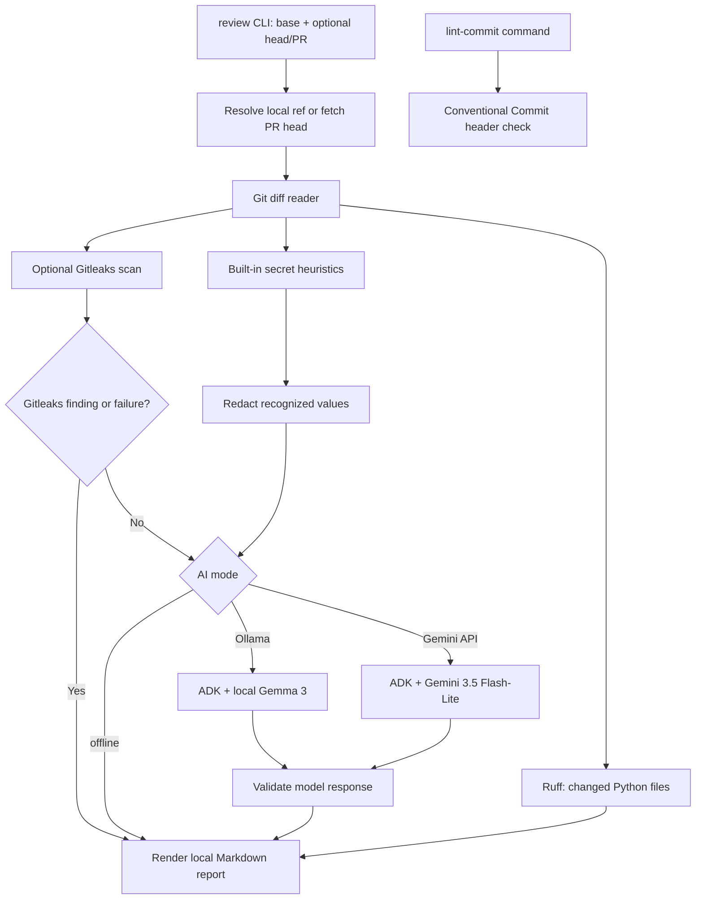

# GitPulse

> A local-first pull request review assistant that combines deterministic diff checks with an optional Gemma-powered summary.

---

## Overview

### Problem Statement & Intended Users

- **Problem**: Reviewing changes requires understanding intent, checking for risky additions, and producing a concise summary.
- **Intended Users**: Contributors and maintainers reviewing local branches, commits, and GitHub pull requests.

### Key Features

- Scans added diff lines for a small set of heuristic credential and risky-call patterns; values are redacted from findings.
- Optionally uses Gitleaks' Git scanner for commit ranges or stdin scanner for worktree/diff input; possible secrets block model submission by default.
- Uses Google ADK with local Gemma 3 through Ollama or optional Gemini 3.5 Flash-Lite through the Gemini API for a semantic summary and Conventional Commit suggestion.
- Runs Ruff on changed Python files and provides a separate Conventional Commit header linter.
- Provides offline mode, model-independent tests, and a local Markdown review draft. It never posts to GitHub or modifies source files.

---

## Technical Stack

- **Language & Runtime**: Python 3.10+
- **Agent Framework / Core Library**: Google Agent Development Kit (ADK) Python 2.13.0
- **Models**: Gemma 3 4B through local Ollama, or optional Gemini 3.5 Flash-Lite `gemini-3.5-flash-lite` through the Gemini API; offline mode does not load a model
- **External APIs / Tools**: Local Git executable, Ruff, optional Gitleaks CLI, optional local Ollama service, and optional Gemini API. PR heads are fetched through Git refs; no GitHub API or MCP server is used.

---

## Architecture & Data Flow

The CLI compares an explicit base ref with a local branch, tag, commit, or fetched GitHub pull-request head. Python runs the selected secret scanners and Ruff; the ADK agent provides an optional semantic summary. A Gitleaks finding or scan failure blocks model submission by default. Model output is validated before the local Markdown report is written.



---

## Prerequisites

Required: Python 3.10+, Git, and the fork's `upstream` remote. Ruff is installed with the Python requirements. GitPulse has been tested on Windows with Python 3.14.3; the macOS/Linux setup commands are documented but have not been verified here.

Optional: Install the standalone Gitleaks CLI v8.30.1 from its [official releases](https://github.com/gitleaks/gitleaks/releases) for dedicated secret scanning; it is not a Python package. Its real binary was smoke-tested on temporary diffs and a temporary Git repository. Install Ollama and `gemma3:4b` for local AI review. Gemini API review needs a Google AI Studio API key, sends the redacted diff to Google's API, and may consume quota or incur charges; check current account pricing and limits before use.

---

## Installation & Setup

Create a virtual environment and install the project dependencies:

```powershell
cd agents/gitpulse
py -3 -m venv .venv
.\.venv\Scripts\python.exe -m pip install -r requirements.txt
```

On macOS/Linux, use `python3 -m venv .venv` and `./.venv/bin/python -m pip install -r requirements.txt` instead.

No `.env` file is needed for offline mode or local Ollama defaults. To use Gemini API mode, copy `.env.example` to `.env`, set `GEMINI_API_KEY`, and keep `GITPULSE_API_MODEL=gemini-3.5-flash-lite`; never commit `.env`. To use Gitleaks, install its standalone executable and ensure `gitleaks version` works in the same terminal.

---

## Configuration & Environment Variables

| Variable Name          | Required                | Default                    | Description                                                                    |
| :--------------------- | :---------------------- | :------------------------- | :----------------------------------------------------------------------------- |
| `GITPULSE_MODEL`     | No                      | `gemma3:4b`              | Local Ollama Gemma 3 model tag used in `ollama` mode                         |
| `OLLAMA_API_BASE`    | No                      | `http://localhost:11434` | Ollama endpoint. Use a remote endpoint only if you intend to send diffs there. |
| `GITPULSE_API_MODEL` | No                      | `gemini-3.5-flash-lite`  | Gemini API model ID used in `gemini-api` mode                                |
| `GEMINI_API_KEY`     | Only for `gemini-api` | *None*                   | Google AI Studio key. Keep it in ignored `.env` or the process environment.  |

---

## How to Run

After [Installation &amp; Setup](#installation--setup), run this from `agents/gitpulse/` to review your current branch against the original repository's `main`. It runs offline by default, so no model, API key, or Gitleaks installation is needed:

```powershell
.\.venv\Scripts\python.exe cli.py review --base upstream/main
```

On macOS/Linux, use `./.venv/bin/python cli.py review --base upstream/main`.

GitPulse writes `PULL_REQUEST_REVIEW.md` in this directory. The file is ignored by Git. Read it for the suggested commit, scanner findings, Ruff results, and any model summary.

To review another target, choose one option:

| Target                                                | Command option                                                     |
| ----------------------------------------------------- | ------------------------------------------------------------------ |
| Current checkout                                      | No extra option; head defaults to `HEAD`.                        |
| Any local branch, tag, or commit                      | `--head-ref origin/feature/topic` or `--head-ref <commit-sha>` |
| GitHub pull request                                   | `--pr-number 42 --remote upstream`                               |
| Staged and unstaged tracked edits on current `HEAD` | `--include-worktree`                                             |

Remote branches must be fetched before using `--head-ref`. PR mode fetches `refs/pull/<number>/head` into a private ref without checking out the PR. Other forges can be reviewed by fetching their source branch and passing it with `--head-ref`.

For a semantic review, add `--mode ollama` after starting Ollama, or `--mode gemini-api` after setting `GEMINI_API_KEY` in `.env`. To use dedicated secret scanning, install Gitleaks and add `--secret-scanner gitleaks` (or `both`). Gitleaks findings/failure skip AI review so possible secrets are not sent to a model.

Other useful switches:

- `--output PATH` changes the report location; `--overwrite` replaces an existing report.
- `lint-commit --message "feat(scope): summary"` checks a commit header.

Gitleaks findings or failure skip model review by default. Reports are written to the ignored `PULL_REQUEST_REVIEW.md` unless `--output` is supplied. Exit codes: `0` clean, `1` findings, `2` input/setup error, `3` model failure, `4` Ruff failure, `5` Gitleaks failure.

---

## Example Input & Output

### Example Input

```
Review the changes in my current branch relative to `upstream/main`.
```

### Example Output

```markdown
# GitPulse Pull Request Review

**Base ref:** `diff file: sample-change.diff`
**AI analysis:** Completed

## Suggested Commit

`feat: Add normalize_project_name function`

## Change Summary

- Introduce a new function
- Lowercase and hyphenate project names
```

This sample was produced by a local Gemma 3 4B smoke run; model wording can vary.

```

---

## How to Test

From the repository root, run the automated suite. It uses fixture diffs and mocked responses, so it does not call Ollama or the Gemini API:

```powershell
agents\gitpulse\.venv\Scripts\python.exe -m pytest agents/gitpulse/tests -q
```

On macOS/Linux, use `agents/gitpulse/.venv/bin/python -m pytest agents/gitpulse/tests -q`.

For a separate live-model smoke test, run the bundled sample diff with `--mode ollama` or `--mode gemini-api`. Gemini 3.5 Flash-Lite completed a smoke review on the bundled harmless diff. Gitleaks v8.30.1 detected a synthetic test key, redacted it from the report, and correctly blocked model submission. Automated tests do not require either model or Gitleaks.

---

## Security & Privacy Considerations

- **Secrets Handling**: `.env` is ignored by Git. Recognized credentials are redacted from model input and findings, but the heuristic redactor is not complete; review sensitive diffs before using any non-local endpoint.
- **Data Privacy**: The default `OLLAMA_API_BASE` is localhost. `gemini-api` sends the redacted diff to Google's API; redaction can miss secrets. Gitleaks findings block model submission by default. PR head fetching uses the configured Git remote and credentials. No GitHub API or external posting is performed.
- **Safety**: The model has no tools. GitPulse invokes Git with argument arrays and never executes diff content. Normal reviews are read-only; explicit `--pr-number` use fetches the PR head into `refs/gitpulse/pull/<number>/head` without changing the checked-out branch or worktree. GitPulse does not modify source files, commit, push, or post reviews.

---

## License

This project is contributed under the repository's MIT license.
