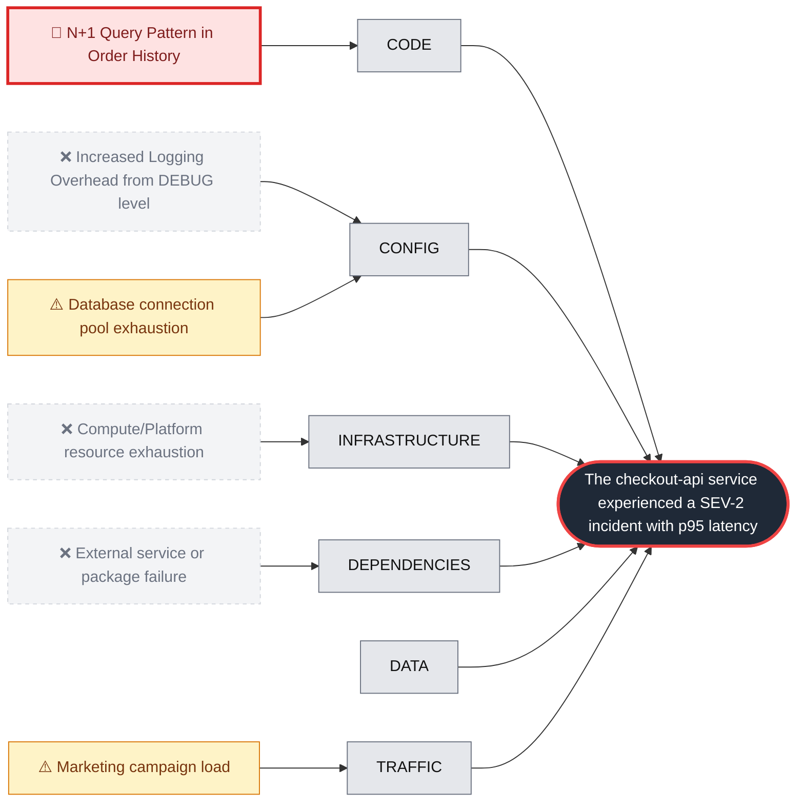

# RCA: Checkout API Latency Spike due to N+1 Query Pattern

_Generated by Ishikawa in 48.8s · 27 model calls · est. $0.068 · ~44 engineer-minutes saved vs a 45-minute manual baseline_

**Guardrail decision:** 🛑 Needs human review

**Effect:** The checkout-api service experienced a SEV-2 incident with p95 latency spiking to 2,430ms (baseline 180ms) and 504 upstream timeouts.

**Root cause:** Commit a1f3c9e introduced an N+1 query pattern in the order history endpoint by replacing a single 'selectinload' query with nested loops that perform individual database lookups for every order and item.

**Culprit:** `a1f3c9e`

**Immediate fix:** `git revert a1f3c9e`

## Fishbone

## Hypotheses examined

| Verdict | Category | Hypothesis | Confidence | Evidence |
| :--- | :--- | :--- | :--- | :--- |
| 🎯 root_cause | code | N+1 Query Pattern in Order History | 95% | Diff a1f3c9e shows selectinload(Order.items) removed and replaced by nested loops querying OrderItem and Product.thumb_url. db_queries_per_request_orders_history spiked from 3 to 58 at 09:31:30Z. Logs show GET /v1/orders/history taking up to 3012ms with db_queries=74. |
| ⚠️ contributing | config | Database connection pool exhaustion | 80% | db_connection_pool_utilization_pct hit 100% at 09:34:00Z. Logs show 'sqlalchemy pool: checkout waited 640ms for connection (pool_size=10, in_use=10)' at 09:37:15Z. This is a downstream effect of the N+1 query volume. |
| ⚠️ contributing | traffic | Marketing campaign load | 95% | Traffic volume increased 18% (1400 -> 1650 RPM) at 09:30Z. A similar campaign on 2026-10-17 maintained a p95 of 190ms, indicating the volume alone was not the cause. |
| ❌ refuted | config | Increased Logging Overhead from DEBUG level | 30% | LOG_LEVEL changed from info to debug at 08:55:00Z in 7bd20e4. Latency remained at baseline for 36 minutes after this change until the 09:31:00Z deployment. |
| ❌ refuted | infrastructure | Compute/Platform resource exhaustion | 100% | CPU utilization (38% -> 44%) and memory (51% -> 53%) remained within healthy ranges. Instance count increase from 4 to 6 was a reactive autoscaling event at 09:36:00Z. |
| ❌ refuted | dependencies | External service or package failure | 100% | requirements.lock unchanged in last 7 days. 504 errors were internal 'waiting for db connection' timeouts, not external dependency failures. |

## 5 Whys

1. p95 latency spiked to 2,430ms because the database connection pool was exhausted.
2. The connection pool was exhausted because the /v1/orders/history endpoint began executing 58 queries per request instead of 3.
3. The query count increased because an N+1 pattern was introduced to fetch item thumbnails in commit a1f3c9e.
4. The N+1 pattern was not caught during code review because the performance impact of nested database queries in loops was overlooked.
5. The CI/CD pipeline lacks automated performance regression testing that flags significant increases in database query counts per request.

## Corrective actions

- [ ] Revert commit a1f3c9e to restore baseline latency.
- [ ] Refactor the thumbnail feature to use joined loading or a single bulk query for all items in the order history.
- [ ] Increase the database connection pool size from 10 to 20 to provide more headroom for traffic spikes.

## Preventive actions

- [ ] Implement automated linting or static analysis to detect database queries inside loops.
- [ ] Add performance regression tests to the CI pipeline that monitor and alert on 'queries per request' metrics.
- [ ] Establish a mandatory performance review for any changes to high-traffic database-backed endpoints.

## Guardrails

| Check | Result | Detail |
| :--- | :--- | :--- |
| Remediation allowlist | pass | matches allowlisted pattern: git revert |
| Exactly one root cause | pass | 1 root cause(s) |
| Evidence grounded in tool output | pass | 100% of 12 evidence lines traced to tool output |
| Culprit seen in evidence | pass | a1f3c9e |
| Root-cause confidence ≥ 0.6 | pass | 0.95 |
| No prompt injection reached the model | pass | 1 injection attempt(s) quarantined |

Redacted before reaching the model: aws_access_key ×1

Quarantined 1 prompt-injection attempt(s) from: list_recent_deploys
