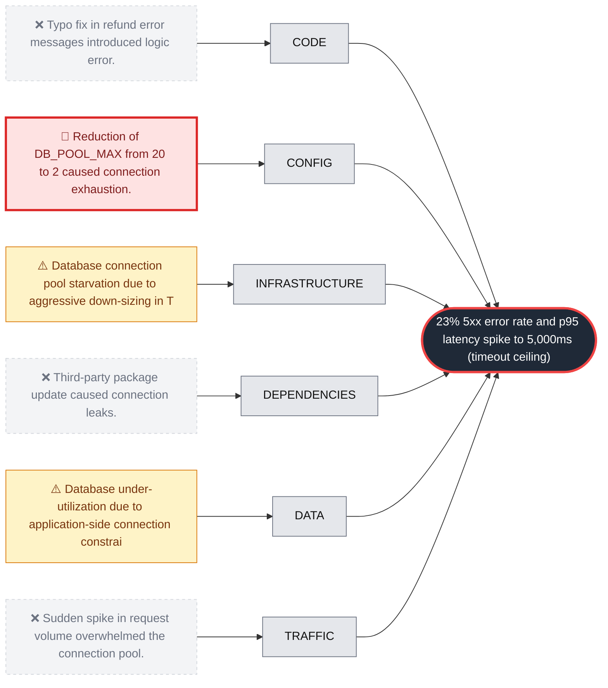

# RCA: payments-api SEV-1: Database connection pool exhaustion

**Effect:** 23% 5xx error rate and p95 latency spike to 5,000ms (timeout ceiling) starting at 2026-10-22 14:02:00Z.

**Root cause:** The infrastructure change infra-8812 reduced the DB_POOL_MAX configuration from 20 to 2, which was insufficient to handle the steady-state traffic of ~940 RPM, leading to QueuePool exhaustion and connection timeouts.

**Culprit:** `DB_POOL_MAX`

**Immediate fix:** `gcloud run services update payments-api --set-env-vars DB_POOL_MAX=20`

## Fishbone

## Hypotheses examined

| Verdict | Category | Hypothesis | Confidence | Evidence |
| :--- | :--- | :--- | :--- | :--- |
| 🎯 root_cause | config | Reduction of DB_POOL_MAX from 20 to 2 caused connection exhaustion. | 100% | Config change in revision payments-api-00043-vow reduced DB_POOL_MAX from 20 to 2. Logs show 'TimeoutError: QueuePool limit of size 2 overflow 0 reached, connection timed out, timeout 5.00' starting at 14:02:30Z. 503 errors for POST /v1/charge explicitly cite 'db connection unavailable'. |
| ⚠️ contributing | infrastructure | Database connection pool starvation due to aggressive down-sizing in Terraform. | 100% | Terraform change infra-8812 deployed at 14:01:00Z. db_connections_per_instance dropped from 9 to 2 at 14:01:30Z. Service CPU utilization dropped from 30% to 12%, indicating I/O blocking. |
| ⚠️ contributing | data | Database under-utilization due to application-side connection constraints. | 100% | Database active connections dropped from 72 to 16. Database CPU utilization plummeted from 41% to 15% while application errors spiked. |
| ❌ refuted | code | Typo fix in refund error messages introduced logic error. | 100% | Commit e44b7a1 is a documentation-only change in app/errors.py ('ammount' -> 'amount'). No logic changes or new queries were introduced. |
| ❌ refuted | dependencies | Third-party package update caused connection leaks. | 100% | No lockfile changes in the last 14 days. Logs confirm the error is internal to the SQLAlchemy QueuePool configuration. |
| ❌ refuted | traffic | Sudden spike in request volume overwhelmed the connection pool. | 100% | Traffic remained stable at ~940 RPM, within normal daily bands. Endpoint distribution for /v1/charge and /v1/refund remained consistent. |

## 5 Whys

1. The payments-api service returned 503 errors and timed out at 5,000ms.
2. The application could not acquire a database connection within the 5-second timeout.
3. The database connection pool was exhausted because the maximum size was set to 2.
4. An infrastructure change (infra-8812) reduced the pool size from 20 to 2 to save costs.
5. The change was applied without load testing or validation against current traffic requirements.

## Corrective actions

- [ ] Revert infra-8812 in Terraform to restore the DB_POOL_MAX to 20.
- [ ] Increase the connection timeout in the application to provide better visibility during saturation.

## Preventive actions

- [ ] Implement automated load testing for infrastructure changes that modify resource limits or pool sizes.
- [ ] Add CI linting to flag aggressive reductions (>50%) in critical environment variables like DB_POOL_MAX.
- [ ] Establish a minimum baseline for connection pools based on instance count and expected RPM.
