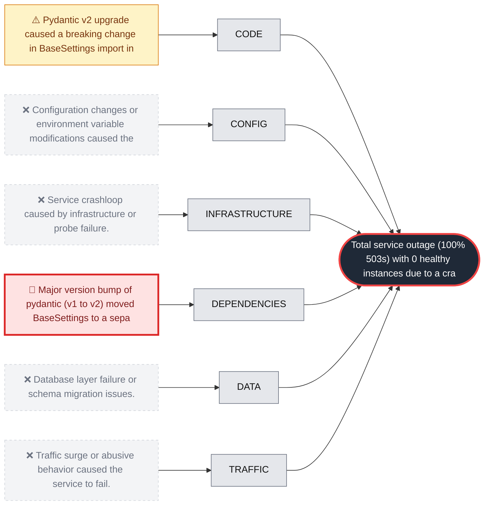

# RCA: Search-api service crashloop due to Pydantic v2 breaking change

**Effect:** Total service outage (100% 503s) with 0 healthy instances due to a crashloop immediately following deployment.

**Root cause:** The major version bump of Pydantic from v1 to v2 in commit 5d9a0f3 introduced a breaking change where BaseSettings was moved to the pydantic-settings package, causing a fatal ImportError on startup.

**Culprit:** `5d9a0f3`

**Immediate fix:** `git revert 5d9a0f3`

## Fishbone

## Hypotheses examined

| Verdict | Category | Hypothesis | Confidence | Evidence |
| :--- | :--- | :--- | :--- | :--- |
| 🎯 root_cause | dependencies | Major version bump of pydantic (v1 to v2) moved BaseSettings to a separate package. | 100% | get_dependency_changes shows pydantic bumped from 1.10.17 to 2.9.2 Logs show pydantic.errors.PydanticImportError: BaseSettings has been moved to the pydantic-settings package at 2026-10-20T07:09:41Z |
| ⚠️ contributing | code | Pydantic v2 upgrade caused a breaking change in BaseSettings import in search/settings.py. | 100% | The failure was triggered by the dependency upgrade in commit 5d9a0f3, though search/settings.py itself was not modified. |
| ❌ refuted | config | Configuration changes or environment variable modifications caused the crash. | 100% | get_config_changes confirms revision search-api-00210-ruk was an image-only change with no config modifications. |
| ❌ refuted | infrastructure | Service crashloop caused by infrastructure or probe failure. | 100% | Startup probe failures and crashloops were symptoms of the application's fatal ImportError, not the cause. |
| ❌ refuted | data | Database layer failure or schema migration issues. | 100% | Database metrics show a drop in activity (20 to 0 connections) as a consequence of the service outage, with no evidence of DB-side errors. |
| ❌ refuted | traffic | Traffic surge or abusive behavior caused the service to fail. | 100% | Traffic volume remained stable at ~300 RPM during the onset of the incident, ruling out a load-induced failure. |

## 5 Whys

1. The search-api service returned 100% 503 errors to users.
2. The service entered a crashloop because the container failed to start.
3. The application failed to initialize due to a PydanticImportError for BaseSettings.
4. A Dependabot PR bumped Pydantic from v1 to v2, which moved BaseSettings to a separate package.
5. CI unit tests did not catch the error because they do not import the settings module, and there was no integration test for service startup.

## Corrective actions

- [ ] Revert the Pydantic v2 dependency bump.
- [ ] Update search/settings.py to import BaseSettings from pydantic-settings if upgrading to v2.
- [ ] Add pydantic-settings to requirements.lock.

## Preventive actions

- [ ] Add a smoke test to CI that attempts to initialize the application settings.
- [ ] Implement a container startup test in the deployment pipeline to verify the service can reach a 'ready' state before traffic shift.
- [ ] Configure Dependabot to require manual approval for major version bumps of core libraries.
