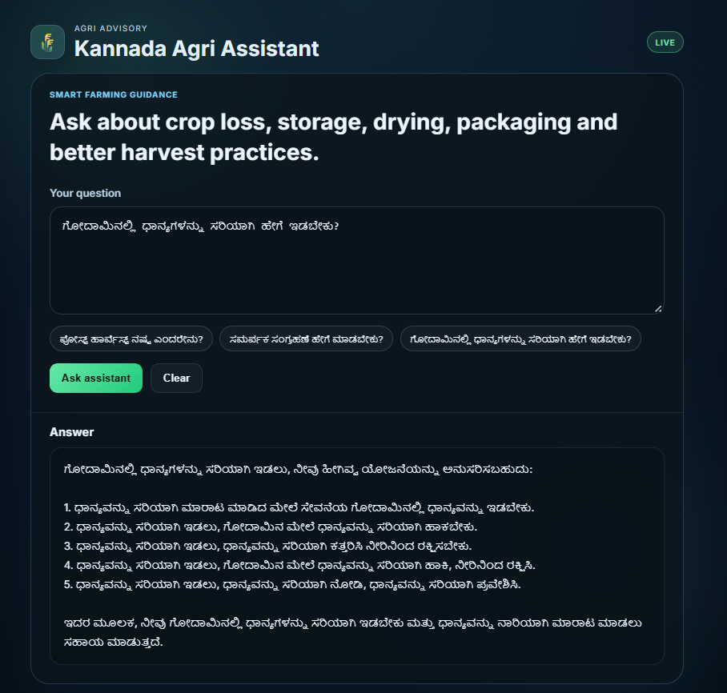

# Kannada Agri Assistant

> A lightweight Flask-based agricultural assistant that answers farmer questions in Kannada using a local Ollama LLM.

---

## What is this project?

This project is a simple AI-powered agriculture helper designed for farmers and agri stakeholders in Karnataka. It helps answer questions related to:

- post-harvest losses
- grain storage and drying
- packaging and handling
- crop quality issues
- farm operations and best practices

The app uses a browser UI and a JSON API, and it can run completely offline with a local model through Ollama.

## UI preview



---

## What it does

- Accepts a user question from the browser UI or API
- Builds a prompt for an agriculture expert
- Sends the question to a local LLM using Ollama
- Returns the answer in Kannada
- Provides a simple interactive web interface

---

## Tech stack

- Python 3.11+
- Flask
- LangChain
- LangChain Ollama integration
- Ollama local model runtime
- HTML, CSS, JavaScript

---

## Project structure

```text
agents/kannada-agri-assistant/
├── agent.py
├── assets/
│   └── kannada-agri-assistant-ui.png
├── .env
├── requirements.txt
├── README.md
├── static/
│   ├── app.js
│   └── style.css
├── templates/
│   └── index.html
├── test_agent.py
└── venv/
```

### Main files
- `agent.py` – Flask app and model integration
- `templates/index.html` – browser UI
- `static/app.js` – frontend logic
- `static/style.css` – styling
- `test_agent.py` – basic app tests

---

## Prerequisites

Before starting, make sure you have:

- Python 3.11 or later
- pip
- Ollama installed on your machine
- An internet connection once to download the model

Install Ollama here:

https://ollama.com/download

---

## Download and setup

### 1) Download the project

```bash
git clone https://github.com/<your-username>/<your-repo-name>.git
cd <your-repo-name>
cd agents/kannada-agri-assistant
```

If you are already inside the repository, you can skip the clone step.

### 2) Open the project folder

```bash
cd agents/kannada-agri-assistant
```

### 3) Create a virtual environment

```bash
python -m venv venv
```

On Windows:

```bash
venv\Scripts\activate
```

### 4) Install dependencies

```bash
pip install -r requirements.txt
```

If needed, make sure the required packages are present:

```bash
pip install flask python-dotenv langchain langchain-ollama
```

### 5) Install and pull the Ollama model

```bash
ollama pull llama3.2:3b
```

If `ollama` is not in PATH on Windows, use the full install path for your system:

```powershell
& "C:\Path\To\Ollama\ollama.exe" pull llama3.2:3b
```

### 6) Configure environment variables

Create or update `.env`:

```env
OLLAMA_MODEL=llama3.2:3b
OLLAMA_BASE_URL=http://localhost:11434
```

---

## Run the app

Start the Flask app:

```bash
python agent.py
```

Then open in a browser:

```text
http://127.0.0.1:5000/
```

---

## Browser usage

1. Open the app in your browser.
2. Type a question such as:
   - `ಪೋಸ್ಟ್ ಹಾರ್ವೆಸ್ಟ್ ನಷ್ಟ ಎಂದರೇನು?`
   - `ಗೋದಾಮಿನಲ್ಲಿ ಧಾನ್ಯಗಳನ್ನು ಸರಿಯಾಗಿ ಹೇಗೆ ಇಡಬೇಕು?`
3. Click the Ask assistant button.
4. The answer appears in the response panel.

---

## API usage

The app exposes a POST endpoint:

```http
POST /ask
Content-Type: application/json
```

Example body:

```json
{
  "question": "ಕೃಷಿಯಲ್ಲಿ ಪೋಸ್ಟ್ ಹಾರ್ವೆಸ್ಟ್ ನಷ್ಟ ಎಂದರೇನು?"
}
```

Example response:

```json
{
  "answer": "ಪೋಸ್ಟ್ ಹಾರ್ವೆಸ್ಟ್ ನಷ್ಟವು ..."
}
```

---

## Response time notes

This project uses a local Ollama model, so the first response may take a few seconds while the model loads. A smaller model such as `llama3.2:3b` is faster than the larger `llama3.2` and is recommended for local use.

---

## Testing

Run the basic tests:

```bash
pytest -q
```

or:

```bash
python -m pytest -q
```

---

## Troubleshooting

### Model not found

If the app reports a model-related error, pull the model again:

```bash
ollama pull llama3.2:3b
```

### App seems stale

If you changed the code or model and it still behaves like the old version:

- stop the Flask process
- start it again
- ensure the correct working directory is used

### Ollama not running

Check if the local Ollama server is active:

```bash
curl http://localhost:11434
```

You should see a response from Ollama.

---

## Future improvements

- add chat history
- support more Kannada farming use cases
- add voice input/output
- export answers as text or PDF
- support more local models and comparison mode

---

## License

This project is part of the open-source-agents repository and follows the repository license.
