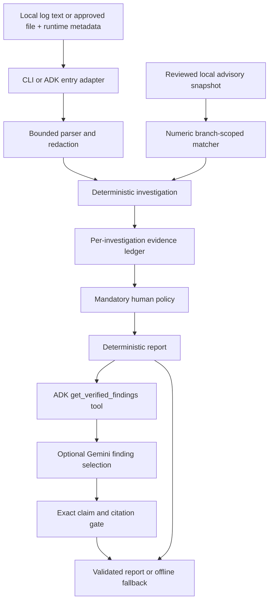

# TraceGuard AI

Evidence-driven PHP/Node.js incident investigation, with a dependency-free offline core and an optional Google ADK/Gemini agent.

## Problem statement and intended users

During an application incident, responders need to distinguish runtime vulnerability exposure from suspicious requests and actual compromise. Manual log inspection is slow, loses provenance across notes, and does not reliably correlate branch-specific security releases. Unconstrained model summaries can invent causes or citations.

TraceGuard turns a bounded UTF-8 log sample plus an asserted runtime version into cited findings, unknowns, safe investigation steps, and a deterministic `PASS`, `HOLD`, or `ESCALATE` decision. It retains the original TraceTriage operational detectors for database pools, memory, DNS, TLS, authentication, timeouts, and related symptoms.

**In scope:** local text logs; exact upstream PHP/Node.js versions; a reviewed advisory subset; evidence validation; human escalation; repeatable synthetic evaluations. **Out of scope:** comprehensive vulnerability scanning, dependency/SBOM analysis, vendor backport verification, forensic proof of compromise, production integrations, automated patching, containment, or incident closure.

| Stakeholder | Need and expected output | Human oversight |
| --- | --- | --- |
| Application developers | Reproducible symptoms, runtime matches, cited operational hypotheses | Verify code paths and deployment identity |
| DevOps/SRE engineers | Exposure context, bounded timeline, missing telemetry and next checks | Verify infrastructure context and approve operational changes |
| Security/SOC analysts | Publisher provenance, suspicious indicators, evidence ledger | Assess applicability, authenticity, and false positives |
| Incident responders | Severity rationale, unknowns, escalation package | Decide scope, containment, credential handling, and remediation |
| Open-source maintainers | Isolated code, fixtures, dependency manifest, reproducible report | Review changes and independently verify advisory updates |

### Acceptance criteria

On committed golden fixtures: 100% correct scoped version matching, 100% citation validity, 100% recall of mandatory escalation cases, zero unsupported confirmed-compromise assertions, rejection of fabricated claims even when they cite real evidence, and identical repeated deterministic output. Offline execution must work with no credentials or installed third-party packages. These are fixture targets, not production accuracy guarantees. See [evaluation results](evaluations/README.md) and the [machine-readable report](evaluations/report.json).

## Technical stack and architecture

Python 3.12; standard-library core; optional Google ADK 2.13.0, Gemini Developer API, and python-dotenv 1.2.4. No database, web service, local model, or model-weight path is required.



| Component | Responsibility |
| --- | --- |
| `engine.py` | Existing operational signals, line numbers, redaction, bounded file reads |
| `advisories.py`, `data/advisories.json` | Schema/provenance checks, snapshot freshness, exact version comparison |
| `investigation.py` | Investigation-local ledger, security indicators, conflicts, deterministic policy and report |
| `credibility.py` | Validate references and exact allowed claims; preserve mandatory escalation |
| `config.py` | Environment-driven paths and bounded configuration |
| `cli.py`, `tools.py` | CLI input, approved-directory file access, strict ADK request parsing |
| `agent.py` | Public ADK adapter; runs local analysis before any provider call |
| `adk_adapter.py`, `ai.py` | Ephemeral ADK tool session, time/call limits, sanitized API failures, AI output gate |
| `tests/`, `evaluations/`, `evaluate.py` | Golden fixtures, regression/failure tests, real result reporting |

Core modules never import Gemini or ADK. Each investigation owns its evidence dictionary: `R1` is asserted runtime/exposure metadata, `L<number>` is an original log line, `A:<CVE>` is a reviewed advisory, and `N<number>` is a publisher notice. References have meaning only inside their report. No shared global evidence ledger or persistent agent memory is used for decisions.

## Security and trust boundaries

- Logs and model responses are untrusted. Pattern matches mean a log **mentions** an indicator, not that the event actually occurred. The agent never confirms compromise automatically.
- Gemini receives only supported finding templates, their references, and the mandatory decision through `get_verified_findings`. It receives no raw logs, excerpts, filenames, arbitrary user metadata, or prior conversation history from this adapter.
- AI selection uses a deliberately restricted contract: `{ "decision": "...", "claims": [...] }`. Each selected claim must equal a complete canonical finding. A real citation attached to invented prose is rejected. All deterministic findings remain in the final report, even if Gemini selects fewer.
- Prompt-injection detection is heuristic; safety does not depend on finding every attack phrase. Arbitrary log text never becomes model instructions, and no tool executes commands.
- Redaction is best-effort, covering common credentials, quoted keys, bearer tokens, cookies, JWTs, connection URLs, and private-key blocks. Redaction occurs before excerpt truncation. This is not comprehensive DLP. Use synthetic demonstrations and approved data only.
- ADK's UI/session service may store the original request locally; prefer the filename interface and approved synthetic files. Do not enable third-party telemetry exporters for sensitive inputs. Offline CLI performs no network calls.
- Advisory JSON is an operator-reviewed configuration artifact, not a signed threat feed. Schema checks and official URL allowlisting do not cryptographically authenticate its contents. Review changes to it as security-sensitive code.
- Reports never execute actions, patch systems, send messages, or declare an incident resolved.

## Advisory coverage and freshness

The snapshot was independently checked on **2026-10-24**. It contains a deliberately small October 21 release subset:

| Product | Curated CVE | Official severity | Branch-specific fixed versions |
| --- | --- | --- | --- |
| PHP | [CVE-2026-109618](https://github.com/php/php-src/security/advisories/GHSA-w8hw-w9fx-j79w) | Critical | 8.2.35, 8.3.36, 8.4.27, 8.5.12 |
| PHP | [CVE-2026-109619](https://github.com/php/php-src/security/advisories/GHSA-6wmf-4rv5-p3rp) | Critical | 8.2.35, 8.3.36, 8.4.27, 8.5.12 |
| Node.js | [CVE-2026-111497](https://nodejs.org/en/blog/vulnerability/october-2026-security-releases) | High | 22.23.4, 24.22.1, 26.12.1 |

Each record stores the CVE, product, severity, publication date, source URL, reviewed flag, and explicit ranges. `introduced <= version < fixed` is AFFECTED; `fixed <= version < branch_end` is FIXED for that record. Ranges are intentionally restricted to the listed upstream branches. Unsupported branches, prereleases, distro suffixes, missing versions, and invalid data produce UNKNOWN. Matching does not verify whether an asserted version was actually released or deployed.

**PHP follow-up:** the [October 23 publisher notice](https://www.php.net/archive/2026.php) describes additional session configuration concerns without complete curated ranges here. Consequently PHP 8.4.27 is FIXED for the two listed CVEs but its investigation remains HOLD for manual follow-up. No new affected range or severity is invented.

After seven days the snapshot is stale: overall runtime status becomes UNKNOWN. Historical affected matches remain visible and still trigger escalation. A FIXED result is never a claim that a runtime is secure, supported, or free of other vulnerabilities. Review [data provenance and update instructions](data/README.md) before refreshing the snapshot.

## Installation and environment setup

Tested on **Windows 11 Home, Python 3.12.10**. Linux, macOS, and containers are untested. Docker was not available during validation.

PowerShell, from the repository root:

```powershell
cd agents/log-evidence-triage-agent
py -3.12 -m venv .venv
.\.venv\Scripts\Activate.ps1
python -m unittest discover -s tests -v
python -m incident_triage.cli --file samples/spring-boot-incident.log
```

Offline CLI/tests use only the standard library. Seven ADK tests are explicitly skipped if optional packages are absent. Activation is optional; use `.\.venv\Scripts\python.exe` directly if PowerShell policy blocks activation. On this workstation the unactivated `python` command was a Windows Store alias, so `py -3.12` was used.

For optional AI/ADK:

```powershell
python -m pip install -r requirements.txt
python -m pip check
Copy-Item .env.example .env
```

Only copy `.env.example` if `.env` does not already exist. Add your own `GOOGLE_API_KEY` locally. Never commit `.env`. [Google AI Studio](https://aistudio.google.com/app/apikey) provides Gemini credentials; model access, quota, and billing depend on your account. A successful request can incur API charges. The adapter permits at most three model calls per investigation and does not retry indefinitely.

`requirements-lock.txt` records the complete dependency versions installed during Windows validation; `python -m pip install -r requirements-lock.txt` reproduces that dependency set where compatible wheels exist. It is not a cross-platform lockfile guarantee.

Cross-platform command forms (not verified outside Windows):

```bash
python3 -m venv .venv
source .venv/bin/activate
python -m pip install -r requirements.txt
python -m incident_triage.cli --text "INFO ready" --product nodejs --version 22.23.4
```

### Configuration

| Variable | Default | Purpose |
| --- | --- | --- |
| `GOOGLE_API_KEY` | unset | Optional Gemini API credential; never printed |
| `MODEL_NAME` | unset; example supplies `gemini-3.5-flash-lite` | An account-accessible Gemini model, required for AI mode |
| `GOOGLE_GENAI_USE_VERTEXAI` | example: `FALSE` | This contribution tests Gemini Developer API; Vertex AI is untested |
| `TRIAGE_LOG_DIR` | project `samples/` | Approved ADK file directory; resolved path containment enforced |
| `TRIAGE_ADVISORY_PATH` | project `data/advisories.json` | Operator-reviewed advisory snapshot |
| `TRIAGE_ADVISORY_MAX_AGE_DAYS` | `7` | Freshness window, integer 1-90; increasing it weakens freshness checks |
| `TRIAGE_AI_TIMEOUT_SECONDS` | `60` | Wall-clock request limit, integer 1-120 |
| `TRIAGE_EVAL_REPORT` | project `evaluations/report.json` | Evaluation output path |

Offline commands read actual process environment variables and do not require dotenv. `--ai` and the ADK entry point additionally load the project's `.env`, without overriding process variables. Freshness uses the current UTC date; golden fixtures explicitly freeze the date to 2026-10-24, so future evaluation runs remain repeatable.

## CLI usage and demo scenarios

All commands below run from this project directory with the environment active:

```powershell
# Existing operational sample: preserves pool-exhaustion hypotheses; HOLD without runtime metadata
python -m incident_triage.cli --file samples/spring-boot-incident.log

# Critical PHP exposure: ESCALATE, AFFECTED, compromise NOT_CONFIRMED
python -m incident_triage.cli --file samples/php-critical.log --product php --version 8.4.26 --internet-facing --production

# Patched scoped Node CVE: PASS, FIXED (not a security clearance)
python -m incident_triage.cli --file samples/node-patched.log --product nodejs --version 22.23.4 --format json

# Suspicious requests on a patched runtime: HOLD
python -m incident_triage.cli --file samples/node-suspicious.log --product nodejs --version 22.23.4

# AI selection, with a labeled deterministic fallback on errors
python -m incident_triage.cli --file samples/node-patched.log --product nodejs --version 22.23.4 --ai
```

CLI files are explicitly selected by the local user; the ADK file interface is additionally restricted to `TRIAGE_LOG_DIR`. Limits are 1,000,000 UTF-8 bytes and 5,000 lines. Supported file extensions are `.log`, `.txt`, `.jsonl`; JSONL is inspected as text, without an application-specific schema. Oversized files are rejected, not silently truncated. All accepted lines are scanned; only three evidence examples per security indicator are retained. Operational excerpts retain the starter's bounded limits.

Exit code `0` means a report was produced, including HOLD/ESCALATE; `2` means invalid input. Consumers must inspect `decision`, not treat exit code zero as a security clearance. JSON includes the existing operational report under `analysis`, plus `runtime`, `findings`, `evidence`, `unknowns`, and `escalation`.

Example excerpt from an actual synthetic PHP run:

```text
=== TraceGuard AI | offline_deterministic ===
ESCALATE: scoped runtime assessment AFFECTED; compromise is not confirmed.
```

The complete escalation object includes summary, severity, rationale, verified reference membership, unknowns, next investigation steps, and the required human decision. Evidence membership is verified; the truth of log statements is not.

## Google ADK usage

```powershell
adk run incident_triage
# Or a local browser UI:
adk web .
```

Submit a structured request:

```json
{"filename":"php-critical.log","product":"php","version":"8.4.26","internet_facing":true,"production":true}
```

Use `log_text` instead of `filename` for a synthetic pasted sample. Flags must be JSON booleans. Unstructured text is treated as log data with unknown runtime, not as operational instructions. Natural-language file selection from the starter is replaced with explicit structured input so untrusted text cannot select files or alter policy.

The public custom ADK agent runs deterministic investigation first. A separate ephemeral `LlmAgent` can call only `get_verified_findings`; it cannot read arbitrary files, call shells, or change policy. Its raw events are not forwarded as the final user report. Only validated selection or deterministic fallback is returned. This small custom boundary is intentional: it controls what reaches the provider and what can leave the adapter.

## Human escalation and failure modes

Policy precedence is **ESCALATE > HOLD > PASS**. Missing evidence, stale data, or an invalid model response cannot downgrade an existing escalation.

- **ESCALATE:** a scoped affected runtime has official high/critical severity (even with asserted internal exposure), a log mentions a possible webshell/reverse shell/exfiltration/unauthorized process, or possible credentials appear in logs. Human investigation determines applicability and truth.
- **HOLD:** missing/invalid runtime, incomplete or stale advisory data, unresolved publisher notice, conflicting runtime statements, suspicious requests without corroboration, missing logs, or failed AI credibility checks.
- **PASS:** sufficient evidence for the narrow report and no policy hold/escalation condition. It does not authorize closure or assert safety.

| Failure | Failsafe and fallback |
| --- | --- |
| Missing/placeholder/invalid key; unavailable model; API/quota error; timeout | Do not invent an AI response; retain labeled `offline_fallback` with a sanitized diagnostic |
| Missing, malformed, future-dated, unverified, or stale advisory snapshot | Runtime UNKNOWN and manual verification; retain urgent historical exposure when known |
| Unsupported or contradictory runtime evidence | HOLD, preserve assertions and request deployment verification |
| High/critical exposure or suspected compromise/data exposure | Evidence-backed ESCALATE; human decides containment and remediation |
| Instructions inside logs | Treat as data, omit raw text from AI input, continue valid analysis |
| Fabricated citation, arbitrary diagnosis, extra output fields, skipped evidence tool | Reject AI output; HOLD unless mandatory ESCALATE already applies |
| Missing/oversized/binary/invalidly encoded file, traversal | Sanitized actionable input error; no unbounded reads or shell execution |

## Evaluation instructions

```powershell
python -m unittest discover -s tests -v
python -m incident_triage.evaluate
```

The evaluator runs the actual test suite and writes totals, passed/failed/skipped counts, metric groups, individual case status, failure details, environment versions, and coverage limitations. It returns nonzero on failures. [Golden fixtures](evaluations/golden.json) are retained alongside all test code. [Evaluation notes](evaluations/README.md) distinguish dependency-free tests, real ADK runner tests with a fake model, and live provider observations. This is a deterministic harness, not an LLM judge or an ADK EvalSet score.

## Limitations and known risks

- Three curated CVEs are not a complete PHP/Node.js feed. PHP's follow-up remains unresolved in the matcher. Old and vendor-patched runtimes require manual review.
- User-supplied runtime and exposure fields are not independently attested. Log conflicts may represent multiple services, rolling deployments, spoofing, or stale lines; the agent cannot decide which.
- Regex indicators have false positives and false negatives. A log mentioning a webshell triggers precautionary escalation, not a confirmed-compromise assertion.
- Redaction is best-effort. A local ADK UI may retain inputs. Do not use sensitive data without organizational authorization.
- AI usefulness is intentionally limited to selecting canonical findings. Free-form diagnosis is excluded because citation membership alone cannot establish semantic support.
- Gemini model availability, quota, cost, and latency vary. Live observations are recorded separately; fake-model tests do not prove provider reliability.
- Evaluation evidence is synthetic and narrow. No penetration test, production incident replay, or cross-platform certification was performed.

## Future enhancements and contribution

See [GOOD_FIRST_ISSUES.md](GOOD_FIRST_ISSUES.md) for scoped newcomer tasks. Follow the upstream [CONTRIBUTING.md](../../CONTRIBUTING.md) and PR template. Keep changes within this directory, refresh advisory provenance before changing expectations, and run the complete suite. No commit, push, or PR is performed by the implementation workflow without the owner's approval.

## License

Contributed under the parent repository's [MIT License](../../LICENSE). No third-party application source was copied; curated security facts link to their original publishers.
