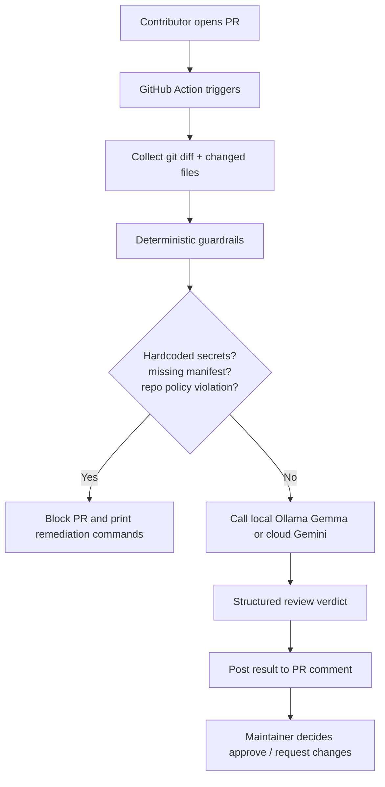

# Maintainer Guard

## Project Overview
Autonomous pre-flight code review guard and triaging pipeline for open-source repositories.

This project is a repo-native maintainer assistant designed to catch issues that most generic review tools miss: secret leaks, missing dependency manifests, policy violations, and unclear contributor intent. It uses deterministic guardrails before invoking the model and emits structured, action-ready guidance that contributors can fix immediately.

## Working Structure / Flow


This is the visible judge-friendly architecture: GitHub PR -> diff extraction -> deterministic checks -> model review -> action output -> maintainer decision.

## Difference from Existing PR Triage Tools
Most existing PR triage tools focus on linting, generic code-quality suggestions, or issue classification. This project is different because it is built as a repo governance and contributor safety layer.

- It enforces `CONTRIBUTING.md` policy, not just syntax.
- It performs deterministic pre-flight security checks before using an LLM.
- It blocks dangerous changes early instead of waiting for a human to discover a secret leak.
- It emits copy-paste remediation steps, not vague review comments.
- It is repo-native: the agent lives inside the repository workflow and is visible in GitHub PRs.
- It supports both open-source local inference (Ollama + Gemma) and cloud fallback (Gemini), which makes it realistic and adaptable.

## Local Setup
```bash
cd agents/maintainer-guard
python3 -m venv .venv
source .venv/bin/activate
pip install -r requirements.txt
cp .env.example .env
# Edit .env and set MODEL_PROVIDER=ollama / MODEL_NAME=gemma3:2b
```

## Run with Ollama (local open-source model)
Make sure Ollama is running locally:

```bash
ollama serve
ollama pull gemma3:2b
```

Then:

```bash
MODEL_PROVIDER=ollama MODEL_NAME=gemma3:2b python main.py --mock
MODEL_PROVIDER=ollama MODEL_NAME=gemma3:2b python main.py --repo-root ../.. --format text
MODEL_PROVIDER=ollama MODEL_NAME=gemma3:2b python main.py --repo-root ../.. --format json
```

## Run with Gemini (cloud fallback)
```bash
MODEL_PROVIDER=gemini MODEL_NAME=gemini-2.5-flash python main.py --mock
MODEL_PROVIDER=gemini MODEL_NAME=gemini-2.5-flash python main.py --repo-root ../.. --format text
```

## How to View the Demo
The easiest way to see the actual output is to run the mock PR scenario:

```bash
cd agents/maintainer-guard
source .venv/bin/activate
MODEL_PROVIDER=ollama MODEL_NAME=llama3:latest python main.py --mock --format text
```

This will print a human-readable maintainer review in the terminal, including the verdict, policy violations, and remediation commands.

If you want the machine-readable version for CI or GitHub comments, use:

```bash
MODEL_PROVIDER=ollama MODEL_NAME=llama3:latest python main.py --mock --format json
```

Expected output: the script blocks the mock PR because it contains a hardcoded API key and fails repo policy checks.

## Core USP
- Enforces repository-specific guidelines from `CONTRIBUTING.md` instead of only checking syntax.
- Uses deterministic pre-flight checks for secrets and dependency policy before invoking the LLM.
- Produces actionable remediation payloads: exact shell commands and fix steps, not vague review noise.
- Gives maintainers a structured review verdict that can be surfaced as a PR check or bot comment.
- Runs as a GitHub-native workflow in the repository so contributors and maintainers see it directly in PRs.
- Flags likely duplicate or overlapping open PRs so maintainers can spot parallel work earlier.
- Helps avoid reviewer duplication and reduces the chance that two PRs solve the same issue in parallel.

## What the Guard Does
- Scans pull request diffs for common secret leakage patterns.
- Validates dependency-related changes are tracked in a manifest file.
- Reads `CONTRIBUTING.md` rules when present and checks for documentation, changelog, breaking-change, and branch naming violations.
- Uses the local Ollama/Gemma or Google Gemini SDK for semantic review when the diff passes pre-flight checks.
- Produces structured maintainer output with remediation guidance.

## GitHub Action Integration
This guard is designed to live in the target repository and run as a GitHub-native PR check.

The workflow file is located at `.github/workflows/maintainer-guard.yml` and runs automatically on pull requests. It:
- checks out the repo
- installs the Python dependencies
- reads the PR diff against the base branch
- runs the deterministic security and CONTRIBUTING policy checks
- invokes Gemini or Ollama for semantic review
- posts the result back to the PR as a comment
- fails the check when the PR violates guardrails

Configure the repository secret `GEMINI_API_KEY` in GitHub settings before enabling the workflow.

## Local CLI vs. GitHub Action
The local `python main.py` command is for development and testing. The real product value is the GitHub Action because the agent becomes part of the repository’s contributor workflow, where maintainers and contributors see the review directly in the PR UI.
