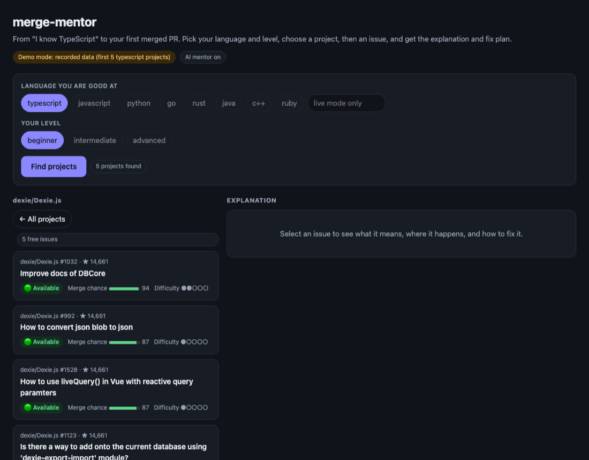
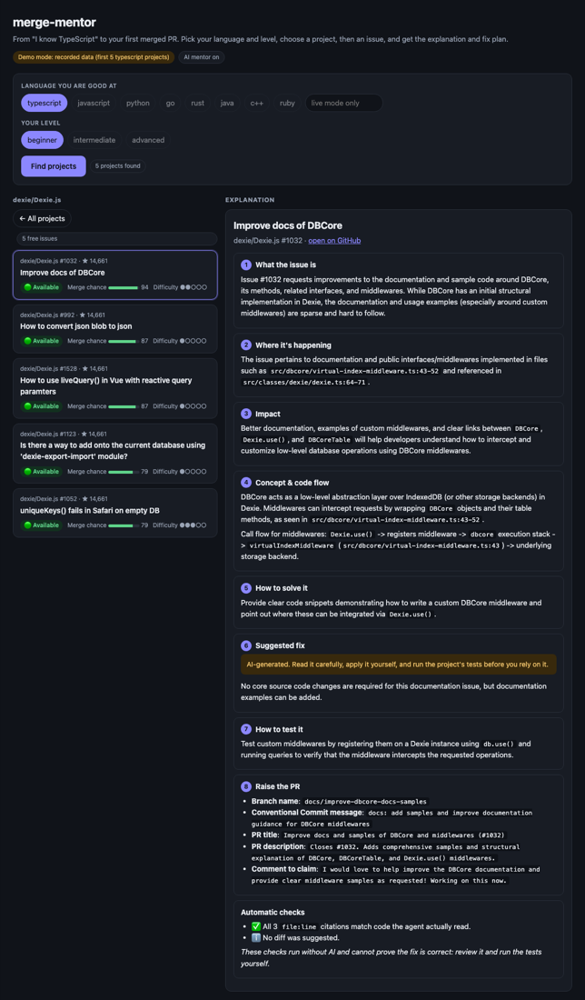
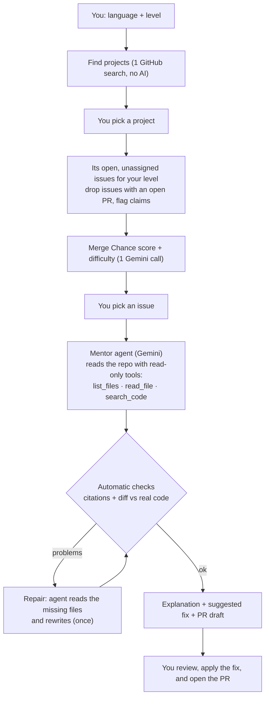

# merge-mentor

> From "I know TypeScript" to your first merged PR. Tell merge-mentor your language and level: it finds open-source issues you can actually get merged, then an AI agent reads the code and explains the issue, its impact, and how to fix it.

---





*Screenshots of the web UI in demo mode (recorded data).*

---

## How it is different

Most issue finders stop at a ranked list. merge-mentor goes further, and it checks its own work:

| | Typical issue finder | merge-mentor |
|---|---|---|
| Starts from | a repository you already chose | your **language and level**: it finds the projects too |
| Issues someone already took | often listed | **hidden** (open PR) or **flagged** (claim comment) |
| Understanding the code | a label or a score | an AI agent **reads the real files** with read-only tools |
| What you get | a list | 8 sections ending in a **PR draft** that follows your next steps |
| Can you trust the AI? | take its word | **automatic checks** compare its citations and diff with the real code, and it repairs itself once |

---

## Overview

### Problem Statement & Intended Users
- **Problem**: Finding a "good first issue" is easy. Getting it merged is hard. Newcomers pick issues someone already claimed, pick repos that never merge outside PRs, or get lost in an unfamiliar codebase.
- **Intended Users**: Students and developers making their first open-source contributions, and mentors guiding them.

### Key Features
- **Language + level search**: finds active repos written mainly in your language, and their open, unassigned issues for your level.
- **Claim check**: flags issues that already have an open PR or a "can I work on this?" comment.
- **Merge Chance score**: ranks issues by how often the repo merges outside contributors, how fast, and how active it is.
- **Automatic checks**: every `file:line` citation and suggested diff is compared with the code the agent really read, with one repair round if something is off.
- **AI code mentor**: a Gemini agent reads the repo with read-only tools and explains the issue, where it happens, its impact, the concept and code flow, how to solve it, a suggested fix, how to test it, and a ready-to-use PR description.

---

## Technical Stack

- **Language & Runtime**: TypeScript on Node.js 20.12+
- **Agent Framework**: Gemini function calling via [`@google/genai`](https://www.npmjs.com/package/@google/genai)
- **Models**: Gemini Flash (`gemini-3.6-flash` by default, with automatic fallback to `gemini-3.5-flash-lite` and `gemini-3.1-flash-lite` if the free-tier quota is hit)
- **External APIs**: GitHub REST API (read-only)

---

## Architecture & Data Flow



**Merge Chance (0-100)** combines: share of merged PRs from outside contributors (30), merge rate (20), time to merge (20), recent repo activity (15), and how crowded the issue is (15). An open linked PR marks the issue 🔴 **Taken**; a recent claim comment marks it 🟡 **Claimed**.

**The mentor's explanation (CLI and web UI) has 8 sections:**

1. **What the issue is**: in plain words
2. **Where it's happening**: files and functions, with `file:line`
3. **Impact**: who or what is affected and how serious it is
4. **Concept & code flow**: the concept to understand, and the call flow through the code
5. **How to solve it**: the approach and why
6. **Suggested fix**: a code diff for you to review and apply yourself (never applied automatically)
7. **How to test it**: steps to verify the fix
8. **Raise the PR**: branch name, commit message, PR title and description, and a comment to claim the issue

---

## Prerequisites

- Node.js 20.12+ and npm
- A Gemini API key from [Google AI Studio](https://aistudio.google.com/apikey) (free tier works)
- Recommended: a GitHub token. Create a **fine-grained token** at [github.com/settings/personal-access-tokens/new](https://github.com/settings/personal-access-tokens/new) with **Public repositories (read-only)** access, no extra permissions, and a short expiry. No special access is needed; all data is public.

---

## Installation & Setup

```bash
cd agents/merge-mentor
npm install
npm run build
cp .env.example .env   # then add your keys
```

---

## Configuration & Environment Variables

| Variable Name | Required | Default | Description |
| :--- | :--- | :--- | :--- |
| `GEMINI_API_KEY` | Yes, for explanations | *None* | Gemini API key. Without it, merge-mentor only finds and scores issues. |
| `MODEL_NAME` | No | `gemini-3.6-flash` | Preferred Gemini model. If it is rate-limited, merge-mentor falls back to lighter Flash-Lite models automatically. |
| `GITHUB_TOKEN` | No (recommended) | *None* | Read-only GitHub token. Raises the rate limit from 60 to 5,000 requests/hour and enables code search. |

---

## How to Run

### Web UI (simplest)

```bash
npm run ui          # then open http://localhost:3000
npm run ui:demo     # same UI on recorded data: no keys or network needed
```

Pick your language and level and press **Find projects** (one cheap GitHub search). Click a project to see only its free issues (that is when claims and merge history are checked and Gemini rates difficulty), then click an issue to see the 8-section explanation, a color-coded suggested diff with copy buttons, and the PR draft. Choosing step by step keeps GitHub and Gemini calls to what you actually look at. The server listens on `localhost` only, so your keys never leave your machine.

### Command line

```bash
npm start -- --lang typescript --level beginner      # search, then pick an issue
npm start -- --lang typescript --repo dexie/Dexie.js   # only one project's issues
npm start -- --issue owner/repo#123                  # explain one issue directly
npm start -- --lang python --level intermediate --save   # also save as Markdown
npm run demo                                         # offline demo, no keys needed
```

Levels: `beginner` (default), `intermediate`, `advanced`.

---

## Example Input & Output

Real output, recorded 2026-10-24 (replay it any time with `npm run demo`, no keys needed):

```
$ npm start -- --lang typescript --level beginner --repo dexie/Dexie.js --pick 1

🔎 Finding beginner issues in typescript repositories…
✔ 1 repos, 5 open issues. Checking claims and merge history…
 #  Issue                                                     Merge Chance   Difficulty  Status
 1  dexie/Dexie.js#1032 Improve docs of DBCore                94 High        ●●○○○       🟢 Available
 2  dexie/Dexie.js#992 How to convert json blob to json       87 High        ●○○○○       🟢 Available
 3  dexie/Dexie.js#1528 How to use liveQuery() in Vue with r… 87 High        ●○○○○       🟢 Available
 4  dexie/Dexie.js#1123 Is there a way to add onto the curre… 79 High        ●○○○○       🟢 Available
 5  dexie/Dexie.js#1052 uniqueKeys() fails in Safari on empt… 79 High        ●●●○○       🟢 Available

🤖 Mentor is exploring dexie/Dexie.js#1032…
   → search_code(query="DBCore")
   → list_files(prefix="src/dbcore")
   → read_file(start_line=1, path="src/classes/dexie/dexie.ts", end_line=100)
   → read_file(start_line=1, end_line=60, path="src/dbcore/virtual-index-middleware.ts")
   → checking the answer found 1 problem; asking the mentor to fix them
   → read_file(...)  → read_file(...)

## 1. What the issue is
Issue #1032 requests improvements to the documentation and sample code around DBCore, its methods, related interfaces, and middlewares. While DBCore has an initial structural implementation in Dexie, the documentation and usage examples (especially around custom middlewares) are sparse and hard to follow.…

## 2. Where it's happening
The issue pertains to documentation and public interfaces/middlewares implemented in files such as `src/dbcore/virtual-index-middleware.ts:43-52` and referenced in `src/classes/dexie/dexie.ts:64-71`.…

## 3. Impact · 4. Concept & code flow · 5. How to solve it · 6. Suggested fix · 7. How to test it · 8. Raise the PR
   (shortened here; the full text is in the screenshot above)

## Automatic checks
- ✅ All 3 `file:line` citations match code the agent actually read.
- ℹ️ No diff was suggested.

These checks run without AI and cannot prove the fix is correct: review it and run the tests yourself.
```

In this run the first draft guessed a file it had never opened; the automatic checks caught it, the agent read two more files, and the final answer's citations all verified.

---

## How to Test

```bash
npm test       # 29 tests, no network and no API keys
npm run demo   # end-to-end run on recorded data
```

What the tests cover:

| Area | What is checked |
|---|---|
| **Scoring** | claim detection (open PR, recent claim, bots, PRs from other repos), Merge Chance weights, repo health, bot PRs ignored |
| **Guardrails** | citations must point at lines the agent was shown; diffs are compared with the real file; risky additions; prompt-injection phrases; problems sent back for repair |
| **Security** | path traversal blocked, search qualifiers stripped, repo names validated, only `api.github.com` reachable, secrets masked |
| **End to end (offline)** | the real pipeline replayed on recorded data: project search, one project scored and ranked, the recorded explanation has all 8 sections and no warnings, other languages refused with a clear message, no secrets in the recording |

`npm run record-demo` re-records the demo from live GitHub and Gemini (about 1 Gemini call for ratings plus one explanation); `npm run record-demo:mentor` refreshes only the explanation.

---

## Known Limitations

- Claim detection is pattern-based; silent or non-English claims may be missed.
- Merge Chance is a heuristic from the last 50 closed PRs, not a guarantee.
- The AI explanation and suggested fix can be wrong. The automatic checks catch invented citations and diffs that do not match the file, but they cannot prove a fix is correct. Always verify them against the cited `file:line` references.
- Without `GITHUB_TOKEN`, GitHub allows 60 requests per hour (about 2-3 runs) and the `search_code` tool is off.
- The Gemini free tier has a small daily request limit per model (20/day on some models). merge-mentor falls back to lighter models automatically, but a very busy day can still exhaust all of them; the scores still work without Gemini.
- Only issues labelled for your level (for example `good first issue`) are searched, so some good issues without labels are not found.
- The web UI in `--demo` mode only has an explanation for the one recorded issue.
- Tested on macOS only.

---

## Security & Privacy Considerations

- **Secrets Handling**: keys are read from a git-ignored `.env` file, never printed or saved, and secret-looking strings are masked in output.
- **Data Privacy**: only public GitHub data is read. Issue text and public code are sent to Gemini.
- **Safety guardrails** (all enforced in code, none depend on the model behaving):
  - **Read-only by construction:** the GitHub client sends only `GET` requests, only to `api.github.com`, with timeouts and a single polite retry when GitHub asks it to slow down. It cannot push, comment, or open PRs, and it never clones or runs code from other repositories.
  - **Agent tools are fenced in:** `list_files`, `read_file` and `search_code` only reach the one selected repository (path checks block `..` and odd characters; search qualifiers such as `repo:` are stripped; 400-line read limit; 8 tool calls maximum).
  - **Untrusted text stays untrusted:** issue text, comments and file contents are marked as data in the prompt, and issue text is scanned for prompt-injection phrases (shown as a warning).
  - **The answer is checked after the model finishes, without any AI:** every `file:line` citation must fall inside lines the agent was actually shown; the suggested diff's removed/context lines must exist in the real file; added lines are scanned for risky patterns (shell pipes, `eval`, external URLs, secrets read from the environment). Results appear under **Automatic checks** in every explanation.
  - **Secrets never leave:** keys are read from a git-ignored `.env`, never printed or saved, and secret-looking strings are masked in all output. Only public GitHub data and issue text go to Gemini.
  - **The web UI server is locked down:** bound to `127.0.0.1`; `GET` only; `localhost` Host header required; cross-site requests rejected (`Sec-Fetch-Site`/`Origin`); parameters validated; strict Content-Security-Policy with a per-request script nonce and no framing; at most 2 explanations at once and 90 API requests per minute; closing the tab cancels the run.
  - **Budgets:** at most 120 Gemini calls per process, with automatic fallback to lighter models if one is rate-limited.

---

## Future Improvements

- [ ] Explanations in other languages (Hindi, Kannada)
- [ ] GitHub Action that recommends issues on a repo's README

---

## License

This project is contributed under the repository's open-source license (MIT).
