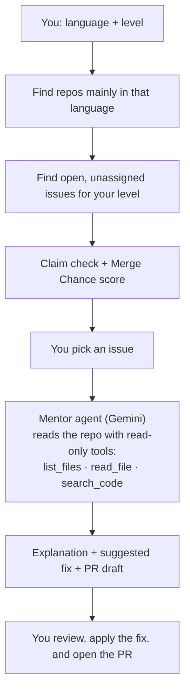

# merge-mentor

> From "I know TypeScript" to your first merged PR. Tell merge-mentor your language and level: it finds open-source issues you can actually get merged, then an AI agent reads the code and explains the issue, its impact, and how to fix it.

---

## Overview

### Problem Statement & Intended Users
- **Problem**: Finding a "good first issue" is easy. Getting it merged is hard. Newcomers pick issues someone already claimed, pick repos that never merge outside PRs, or get lost in an unfamiliar codebase.
- **Intended Users**: Students and developers making their first open-source contributions, and mentors guiding them.

### Key Features
- **Language + level search**: finds active repos written mainly in your language, and their open, unassigned issues for your level.
- **Claim check**: flags issues that already have an open PR or a "can I work on this?" comment.
- **Merge Chance score**: ranks issues by how often the repo merges outside contributors, how fast, and how active it is.
- **AI code mentor**: a Gemini agent reads the repo with read-only tools and explains the issue, where it happens, its impact, the concept and code flow, how to solve it, a suggested fix, how to test it, and a ready-to-use PR description.

---

## Technical Stack

- **Language & Runtime**: TypeScript on Node.js 20.12+
- **Agent Framework**: Gemini function calling via [`@google/genai`](https://www.npmjs.com/package/@google/genai)
- **Models**: Gemini Flash (`gemini-3.6-flash` by default, with automatic fallback to `gemini-3.5-flash-lite` and `gemini-3.1-flash-lite` if the free-tier quota is hit)
- **External APIs**: GitHub REST API (read-only)

---

## Architecture & Data Flow



**Merge Chance (0-100)** combines: share of merged PRs from outside contributors (30), merge rate (20), time to merge (20), recent repo activity (15), and how crowded the issue is (15). An open linked PR marks the issue 🔴 **Taken**; a recent claim comment marks it 🟡 **Claimed**.

**The mentor's explanation (CLI and web UI) has 8 sections:**

1. **What the issue is**: in plain words
2. **Where it's happening**: files and functions, with `file:line`
3. **Impact**: who or what is affected and how serious it is
4. **Concept & code flow**: the concept to understand, and the call flow through the code
5. **How to solve it**: the approach and why
6. **Suggested fix**: a code diff for you to review and apply yourself (never applied automatically)
7. **How to test it**: steps to verify the fix
8. **Raise the PR**: branch name, commit message, PR title and description, and a comment to claim the issue

---

## Prerequisites

- Node.js 20.12+ and npm
- A Gemini API key from [Google AI Studio](https://aistudio.google.com/apikey) (free tier works)
- Recommended: a GitHub token. Create a **fine-grained token** at [github.com/settings/personal-access-tokens/new](https://github.com/settings/personal-access-tokens/new) with **Public repositories (read-only)** access, no extra permissions, and a short expiry. No special access is needed; all data is public.

---

## Installation & Setup

```bash
cd agents/merge-mentor
npm install
npm run build
cp .env.example .env   # then add your keys
```

---

## Configuration & Environment Variables

| Variable Name | Required | Default | Description |
| :--- | :--- | :--- | :--- |
| `GEMINI_API_KEY` | Yes, for explanations | *None* | Gemini API key. Without it, merge-mentor only finds and scores issues. |
| `MODEL_NAME` | No | `gemini-3.6-flash` | Preferred Gemini model. If it is rate-limited, merge-mentor falls back to lighter Flash-Lite models automatically. |
| `GITHUB_TOKEN` | No (recommended) | *None* | Read-only GitHub token. Raises the rate limit from 60 to 5,000 requests/hour and enables code search. |

---

## How to Run

### Web UI (simplest)

```bash
npm run ui          # then open http://localhost:3000
npm run ui:demo     # same UI on recorded data: no keys or network needed
```

Pick your language and level, press **Find issues**, then click an issue to see the 8-section explanation, a color-coded suggested diff with copy buttons, and the PR draft. The server listens on `localhost` only, so your keys never leave your machine.

### Command line

```bash
npm start -- --lang typescript --level beginner      # search, then pick an issue
npm start -- --issue owner/repo#123                  # explain one issue directly
npm start -- --lang python --level intermediate --save   # also save as Markdown
npm run demo                                         # offline demo, no keys needed
```

Levels: `beginner` (default), `intermediate`, `advanced`.

---

## Example Input & Output

Real output (recorded 2026-10-24; replay it any time with `npm run demo`):

```
$ npm start -- --lang typescript --level beginner --pick 1

🔎 Finding beginner issues in typescript repositories…
✔ 8 repos, 6 open issues. Checking claims and merge history…

 #  Issue                                                     Merge Chance   Difficulty  Status
 1  google-gemini/gemini-cli#27790 fix(vscode-ide-companion)… 71 High        ●○○○○       🟢 Available
 2  excalidraw/excalidraw#3957 Provide option to hide activi… 15 Low         ●●○○○       🔴 Taken (PR #11083 open)
 3  nexu-io/open-design#8889 CLI project create silently dro… 15 Low         ●●○○○       🔴 Taken (PR #8893 open)
 ...

🤖 Mentor is exploring google-gemini/gemini-cli#27790…
   → search_code(query="gemini.diff.accept")
   → read_file(start_line=120, path="packages/vscode-ide-companion/src/extension.ts", end_line=190)
   → read_file(start_line=185, path="packages/vscode-ide-companion/src/extension.ts", end_line=210)

## 1. What the issue is
In the VS Code companion extension (`packages/vscode-ide-companion/src/extension.ts`), two
`context.subscriptions.push(...)` calls wrap multiple registration/listener statements in extra
parentheses separated by commas, so only the last one is actually pushed…

## 2. Where it's happening
- `packages/vscode-ide-companion/src/extension.ts`, around lines 146–165 and lines 187–194.

## 3. Impact
- Extension reload/update failures: `gemini.diff.accept` stays registered across reloads, so the next
  activation throws "command 'gemini.diff.accept' already exists".
- Resource leaks: the `onDidChangeWorkspaceFolders` listener is never torn down…

## 4. Concept & code flow      (comma operator, call flow through activate())
## 5. How to solve it
## 6. Suggested fix            (a unified diff to review and apply yourself)
## 7. How to test it
## 8. Raise the PR             (branch, commit message, PR title/description, claim comment)
```

Output sections 4-8 are shortened here. Note how the tool correctly marks 5 of the 6 issues as 🔴 Taken because they already have an open pull request.

---

## How to Test

```bash
npm test       # unit tests: claim detection, scoring, path guardrails, secret masking (no network)
npm run demo   # end-to-end run on recorded data
```

---

## Known Limitations

- Claim detection is pattern-based; silent or non-English claims may be missed.
- Merge Chance is a heuristic from the last 50 closed PRs, not a guarantee.
- The AI explanation and suggested fix can be wrong. Always verify them against the cited `file:line` references.
- Without `GITHUB_TOKEN`, GitHub allows 60 requests per hour (about 2-3 runs) and the `search_code` tool is off.
- The Gemini free tier has a small daily request limit per model (20/day on some models). merge-mentor falls back to lighter models automatically, but a very busy day can still exhaust all of them; the scores still work without Gemini.
- Only issues labelled for your level (for example `good first issue`) are searched, so some good issues without labels are not found.
- The web UI in `--demo` mode only has an explanation for the one recorded issue.
- Tested on macOS only.

---

## Security & Privacy Considerations

- **Secrets Handling**: keys are read from a git-ignored `.env` file, never printed or saved, and secret-looking strings are masked in output.
- **Data Privacy**: only public GitHub data is read. Issue text and public code are sent to Gemini.
- **Safety guardrails**:
  - The web UI server binds to `127.0.0.1` only, accepts only `GET` requests with a `localhost` Host header, validates every parameter, and sends a strict Content-Security-Policy.
  - GitHub client allows only `GET` requests to `api.github.com`; it cannot push, comment, or open PRs.
  - Agent tools are locked to the selected repo, with path checks and a 400-line read limit.
  - Issue text is treated as untrusted data in the prompt (prompt-injection protection).
  - The agent loop stops after 8 tool calls.
  - Never clones, installs, or runs code from other repositories.

---

## Future Improvements

- [ ] Explanations in other languages (Hindi, Kannada)
- [ ] GitHub Action that recommends issues on a repo's README

---

## License

This project is contributed under the repository's open-source license (MIT).
