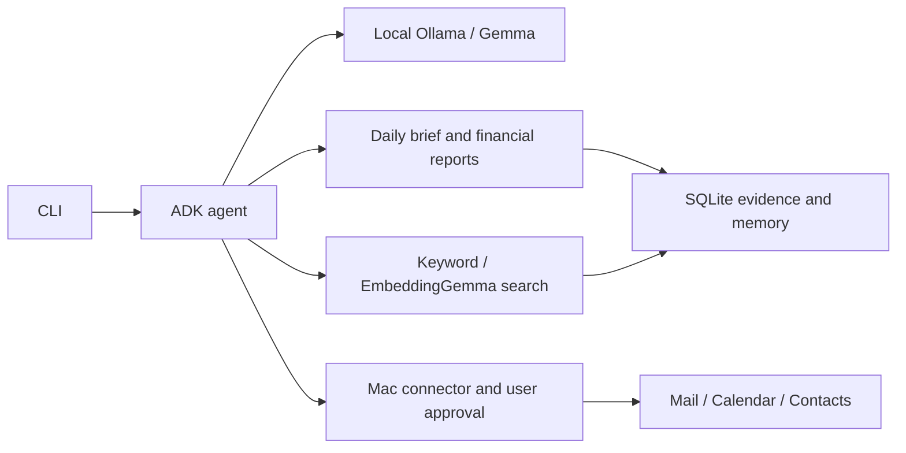

# migine-personal-agent

**Migine is an anagram of Gemini.**

A local Mac assistant for credit card bills, subscription spending, daily briefs,
Calendar, and Contacts. Built with uv, ADK 2.x, Gemma through Ollama, EmbeddingGemma,
and SQLite. App changes require approval. Contacts access is not yet working.

## Setup

Requires macOS 14+, Xcode Command Line Tools, [uv](https://docs.astral.sh/uv/),
and [Ollama](https://ollama.com/).

```sh
cd agents/migine-personal-agent
cp .env.example .env
uv sync --frozen
ollama pull gemma4:e4b
ollama pull embeddinggemma
sh scripts/build-mac-helper.sh
```

Set `MIGINE_MAC_HELPER` in `.env` to the executable path printed by the build.
Keep Ollama running locally. Allow Calendar and Mail Automation access when requested.
No cloud API key is needed.

## Try the demo

```sh
MIGINE_DATA_DIR=./demo uv run migine demo --month 2026-10
MIGINE_DATA_DIR=./demo uv run migine summary --month 2026-10
```

## ADK Web example

After creating the demo data above, run from this project folder:

```sh
MIGINE_DATA_DIR=./demo uv run adk web examples/web --host 127.0.0.1 --port 8000 --max_llm_calls 8
```

Open [localhost:8000](http://127.0.0.1:8000), select `migine_web`, and ask:
“Summarise my bills and subscription spending for October 2026.”
This is a local development UI. Chat history is stored in ignored `.adk/` folders under
`examples/web/`. App tools still connect to your Mac. Approve proposed changes with
`MIGINE_DATA_DIR=./demo uv run migine apply REQUEST_ID` in the Mac terminal.

## Components



## Tests and limits

Tested only on macOS. Linux and Windows are untested; the Mac app connectors require macOS.
Run `uv run pytest -q`. See [test results](TESTING.md) for validation and open issues.
Mail scans can be incomplete. Financial records require review. Real bill totals and
Docker image execution remain unverified.

## Privacy

Gemma and EmbeddingGemma run locally through Ollama; no hosted model API is required.
Cached email, memory, search vectors, and chat history stay in local storage until deleted.
Private data is excluded from Git, but SQLite is not encrypted by this app. Protect your
Mac and backups. Initial dependency and model downloads require internet access.
Keep ADK Web on localhost. See [privacy and data deletion](USAGE.md#privacy-and-limits).

[Commands, Docker, and privacy](USAGE.md) · [Contributing](../../CONTRIBUTING.md)

Keep contributions inside this project folder. Never commit credentials or personal data.
The repository MIT license applies.
