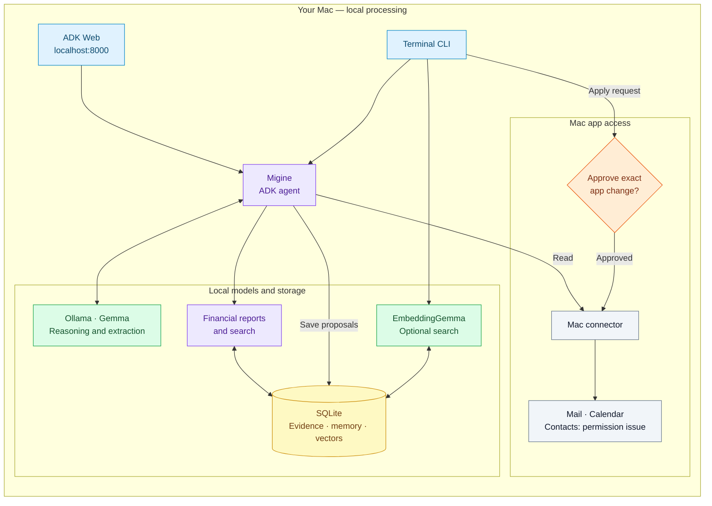

# migine-personal-agent

**Migine is an anagram of Gemini.**

A local Mac assistant for credit card bills, subscription spending, daily briefs,
Calendar, and Contacts. Built with uv, ADK 2.x, Gemma through Ollama, EmbeddingGemma,
and SQLite. App changes require approval. Contacts access is not yet working.

## Run locally

Requires macOS 14+, Xcode Command Line Tools, [uv](https://docs.astral.sh/uv/),
and [Ollama](https://ollama.com/). No cloud API key is needed.

Run from the macOS **Terminal** app, starting at the repository root. Some VS Code
terminal configurations block Calendar access through macOS permission rules.

```sh
cd agents/migine-personal-agent
sh scripts/setup-local.sh
sh scripts/run-local.sh
```

Setup installs locked dependencies, prepares `.env`, builds the Mac helper, starts
Ollama if needed, and downloads missing configured models. Valid settings are preserved.
The launch script repairs invalid helper paths before starting ADK Web.

Open [ADK Web](http://127.0.0.1:8000), select `migine_web`, and ask:
“What is on my calendar for the next seven days?” Allow Calendar access when requested.

To populate bill and subscription reports, [import and review your email](USAGE.md#use-personal-records).
Mail import is explicit; setup does not read your Inbox or accept financial records.
Keep the terminal running; press **Ctrl+C** to stop. ADK Web is for local development.
See [usage](USAGE.md) for permissions, configuration, and approval commands.

## Components



## Tests and limits

Tested only on macOS. Linux and Windows are untested; the Mac app connectors require macOS.
Run `uv run pytest -q`. See [test results](TESTING.md) for validation and open issues.
Mail scans can be incomplete. Financial records require review. Real bill totals and
Docker image execution remain unverified.

## Privacy

Gemma and EmbeddingGemma run locally through Ollama; no hosted model API is required.
Cached email, memory, search vectors, and chat history stay in local storage until deleted.
Private data is excluded from Git, but SQLite is not encrypted by this app. Protect your
Mac and backups. Initial dependency and model downloads require internet access.
Keep ADK Web on localhost. See [privacy and data deletion](USAGE.md#privacy-and-limits).

[Commands, Docker, and privacy](USAGE.md) · [Contributing](../../CONTRIBUTING.md)

Keep contributions inside this project folder. Never commit credentials or personal data.
The repository MIT license applies.
