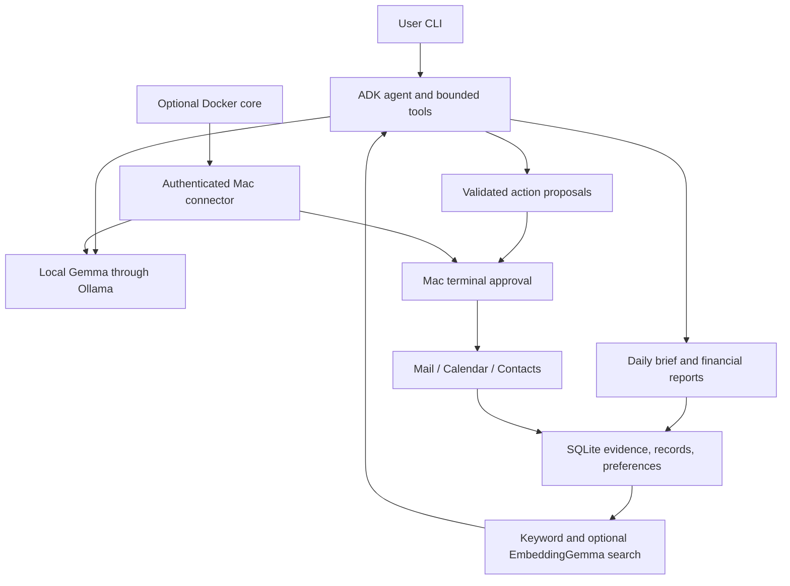

# migine-personal-agent

A local Mac assistant for daily attention items, credit card bills, subscription spending,
Calendar events, and Contacts. Uses Python, uv, Google ADK 2.x, Gemma, Ollama, and SQLite.
No cloud API key is needed. Initial model downloads require internet access.

## Setup

Requires macOS 14+, Xcode Command Line Tools, [uv](https://docs.astral.sh/uv/),
and [Ollama](https://ollama.com/). Python 3.12 is selected by uv.

From the repository root:

```sh
cd agents/migine-personal-agent
sh scripts/setup-local.sh
sh scripts/run-local.sh
```

Open [ADK Web](http://127.0.0.1:8000), select `migine_web`, and ask about your Calendar.
Keep the terminal running; press **Ctrl+C** to stop. On later runs, only `run-local.sh`
is needed while Ollama is running.

Setup installs locked dependencies, creates `.env` only if missing, builds the Mac helper,
and sets `MIGINE_MAC_HELPER` if unset or invalid. It starts the installed Ollama app if needed and
pulls missing models named in `.env`. Existing settings and data are preserved. Initial
model downloads can be large. Setup does not import email or change app records.

The launch script checks the helper path before starting ADK Web. It reuses the built
helper, builds it if missing, and repairs stale or placeholder paths in `.env`. It also
exports the checked path to the Web process, including when an old value was inherited
from the terminal. Restart ADK Web after updating the launcher.

Keep Ollama on its configured local address (default `127.0.0.1:11434`). Edit `.env`
to select local Gemma and EmbeddingGemma tags, your time zone, and the data directory
(default `./data`). Run `uv run migine doctor` to check installed models.

Allow Calendar access when requested. For Mail, grant the calling terminal or app access
under System Settings > Privacy & Security > Automation. No Full Disk Access is required.
Enable birthday calendars in Calendar to include those events. Contacts permission
prompting is unresolved; see [current test results](TESTING.md).

If Calendar fails in the VS Code terminal, stop ADK Web and launch `sh scripts/run-local.sh`
from the macOS Terminal app. macOS can attribute the helper request to the terminal's
host app; the tested VS Code build lacks the Calendar entitlement required by its hardened
runtime. Rebuilding the helper alone cannot grant that host permission. Allow Calendar
access when prompted, then start a new Web chat. Permission failures are reported as
unavailable data, not an empty calendar.

The helper uses local ad-hoc signing; signed/notarised distribution is future work.
ADK Web is a local development UI. Its chat history is stored separately in ignored
`.adk/` folders under `examples/web/`. CLI and Web use the same configured financial
records, preferences, and search index.

## Use personal records

```sh
uv run migine sync --since 2026-10-01 --limit 50
uv run migine extract
uv run migine review
uv run migine review RECORD_ID accept
uv run migine summary --month 2026-10
uv run migine remember bill_notice_days 3
uv run migine brief --calendar
uv run migine calendar --days 14
uv run migine contacts 'Alex'
uv run migine chat 'Summarise my bills due in October 2026.'
```

`sync` explicitly caches selected Inbox text (up to 16,000 characters per message).
It scans the first requested Inbox positions, then filters by date. Use `--offset N`
to continue at a later position. Each message has a 12-second read limit, with a
120-second limit for the full scan. Slow messages are skipped and reported; successful
reads are retained. A partial scan is not complete spending coverage.
`extract` sends that text to local Gemma. Each candidate must be reviewed before it
contributes to totals. Inspect the fields AND the quoted evidence before acceptance.
Exact evidence matching does not prove the extracted fields are correct.
Use `review RECORD_ID reject` for bad candidates.

Bills are grouped by due month. Subscriptions use charge dates. Currencies stay
separate. Only matched, credited payments count. A matching statement month, issuer,
card, and currency are required. Scheduled payments do not clear a bill. Duplicate
references count once; ambiguous duplicates and conflicting statements need review.
“Confirmed by email” does not mean independently verified bank settlement.

```sh
uv run migine search 'credit card payment'
uv run migine index
uv run migine search 'payment reminders' --semantic
uv run migine memories
uv run migine forget bill_notice_days
uv run migine forget SOURCE_ID --source
uv run migine export
uv run migine propose mail.flag '{"id":"MESSAGE_ID","value":true}'
uv run migine apply REQUEST_ID
```

Changes require an exact preview and a typed challenge in the Mac terminal. Requests
expire after five minutes and cannot be reused. The model can only propose changes.
Supported changes: Mail flag/read status and Contacts create/update name/add email.
Contact updates preserve other fields; the supplied given/family names replace those fields.
Mail sending, payments, deletion, calendar edits, attachments, and background scheduling
are outside this MVP. Mail reads/changes cover Inbox only. Contacts search uses names.
Birthdays/anniversaries appear when supplied by an enabled Calendar; Contacts also exposes dates.

## Docker

Docker packages the agent core. Mac app access and Ollama remain on the Mac.
The connector proxies only fixed local model endpoints; do not expose Ollama on the LAN.

1. Complete native setup. In a Mac terminal, start the connector:

```sh
uv run migine connector --bind 0.0.0.0 --token-file "$PWD/connector.token"
```

2. Set `MIGINE_MAC_CONNECTOR_TOKEN_FILE` in `.env` to the absolute token path.
   Keep `MIGINE_MAC_CONNECTOR_URL` unset in the host `.env`; Compose sets it in the container.
3. Keep the connector terminal open for host approval prompts. Allow only local Docker
   traffic to port 8765 with your host firewall. This HTTP bridge is for a trusted local
   machine; it is not a remote or multi-user service. Default native binding is loopback.

```sh
docker compose build
docker compose run --rm migine doctor
docker compose run --rm migine summary --month 2026-10
docker compose run --rm migine chat 'What needs my attention?'
```

Compose mounts a protected token and a persistent data volume. It publishes no container
ports and runs without root. Use the same commands as native mode after `migine`.
`host.docker.internal` requires Docker Desktop or equivalent host routing.

## Components



## Tests and evaluations

```sh
uv run pytest -q
uv run ruff check src tests evals
uv run python evals/run.py > eval-results.json
```

Tests use synthetic records and fake adapters. The evaluation command runs eight live
Gemma extraction cases, including scheduled payments and malicious email instructions;
it returns a failure status if any case fails. Run it with the exact model used for your
personal data. Test passes are not model accuracy results. See [TESTING.md](TESTING.md).

## Privacy and limits

Model inference and embeddings run locally through Ollama. No hosted model API is needed.
Initial dependency and model downloads require internet access. Testing has been limited
to macOS; Linux and Windows are untested, and native app access requires macOS.

SQLite is not encrypted by this app. Use macOS disk encryption and protect backups.
Sources, candidate records, vectors, approval payloads, and ADK conversations remain on
disk until deleted. `forget --source` removes cached source text, linked records, and
vectors; chat history can still contain earlier excerpts. Remove `sessions.sqlite3*`
while the app is stopped to clear chat history. Stop the app and delete the data directory
(or Docker volume) to reset all local state. ADK sessions have no automatic retention yet.

Totals cover accepted email evidence only. Missing/archived emails, truncated content,
unreported reversals, and different transaction references can make results incomplete.
Cross-source duplicates with different references require manual review. Email sender
authenticity is not verified by this MVP. No automatic payment or reminder suppression
occurs. Model outputs and source text are untrusted; code validates tools and approvals.

## Contributing

Follow [CONTRIBUTING.md](../../CONTRIBUTING.md). Keep changes in this project folder,
include tests and eval cases, and never commit personal mail, databases, credentials,
or real contacts. The repository MIT license applies.
