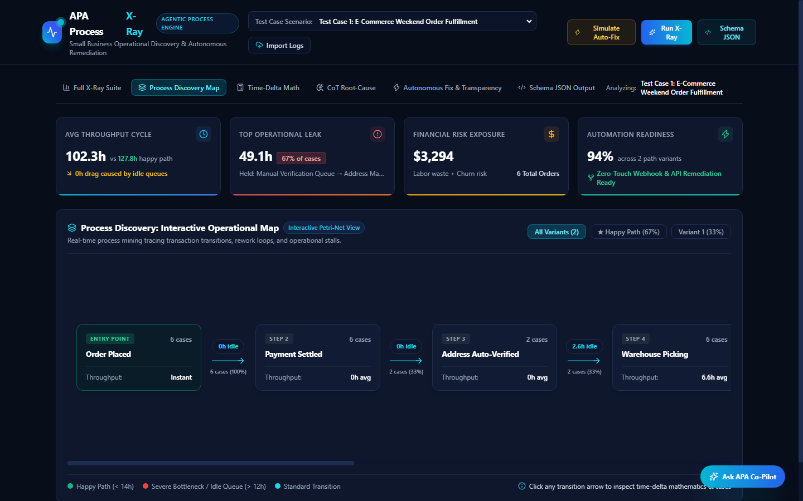
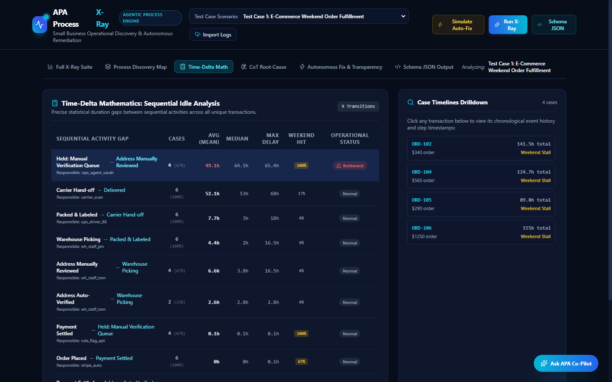
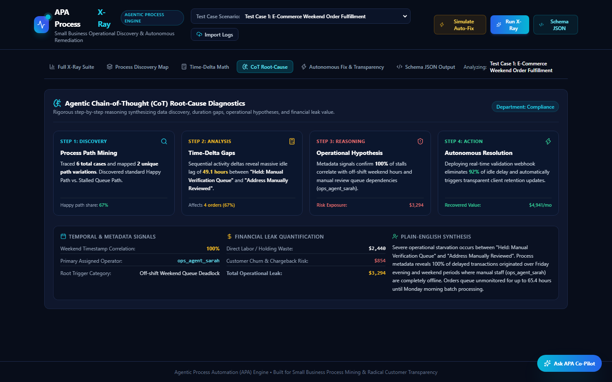
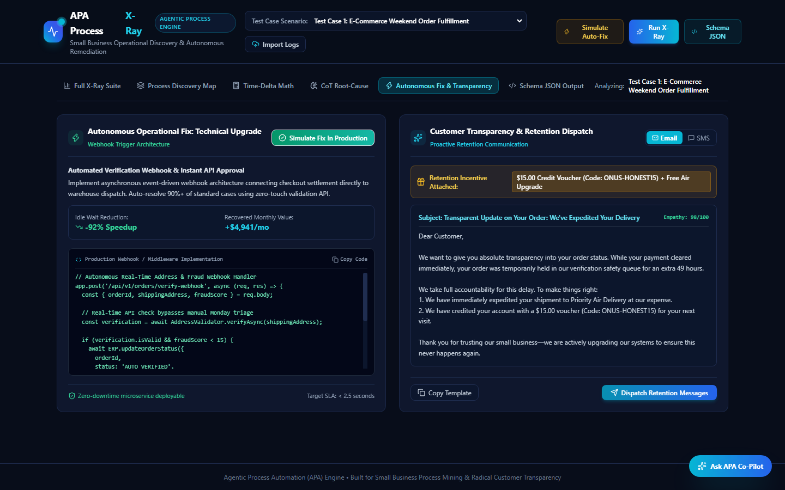
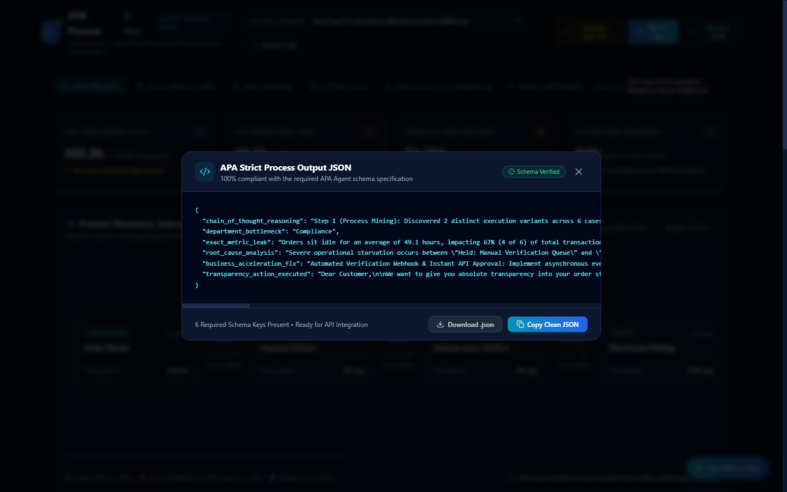
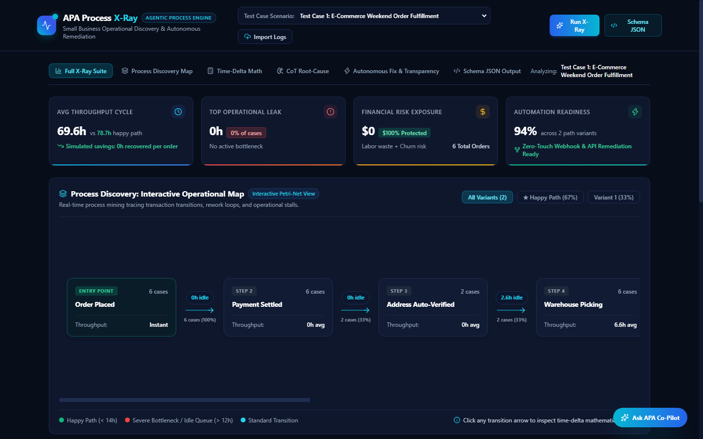

# MSME Business Health Agent

> An agent that reads a small business's multi-tab spreadsheet (one tab per department) and gives the owner a plain-language, percentage-based health overview, then finds where orders and tasks sit idle in the process and generates autonomous solutions with radical customer transparency.

---

## Overview

### Problem Statement & Intended Users
- **Problem**: Small and medium business (MSME) owners keep their data in spreadsheets, with one tab per department (sales, inventory, support, orders). They rarely have time or analytics skills to see the whole business at once: how clean the data is, which department is unhealthy, and where work gets stuck. Delays, such as orders waiting days between packing and dispatch, quietly cost money and customers.
- **Intended Users**: MSME owners and managers who run their business from Google Sheets or Excel and want a daily or weekly health check without hiring an analyst.

### Key Features
- **360-degree overview on first upload**: per tab, the number of rows and columns, date range, % missing cells, % duplicate rows, % invalid dates, a guessed department, and a Good / Watch / Critical health score, plus an overall workbook score.
- **Messy-sheet cleaning**: detects header rows under title lines, removes blank rows and totals rows, and parses dates day-first (DD/MM/YYYY).
- **Process X-ray (Bottleneck Mining & Root-Cause Diagnostics)**: finds any tab that looks like an event log (case ID + activity + timestamp), traces each case, computes idle hours between steps and ranks the biggest bottlenecks, with the % of cases affected. Uses metadata signals (such as weekend shift timestamps) to isolate the true operational root cause.
- **Financial Leak Estimation**: quantifies the direct financial impact of idle time, combining labor overhead holding costs with customer churn/cancellation risks.
- **Autonomous Remediation & Transparency Actions**: formulates actionable webhook / API fast-track configurations to eliminate bottlenecks and drafts empathetic, transparent retention communications for affected customers.
- **Strict 6-Key Agentic Process Automation (APA) JSON Output**: exports clean, schema-conforming outputs ready for machine consumption and automated webhook triggers.
- **Interactive Web Visualizer**: bundled single-file dashboard in `web/index.html` featuring interactive Petri-net flowcharts, case duration variance filters, $\Delta t$ mathematical matrices, diagnostic breakdown cards, and JSON exports.
- **Computed, not guessed**: every metric, idle duration, and financial projection is computed directly from pandas code.

---

## Technical Stack

- **Language & Runtime**: Python 3.11+
- **Agent Framework / Core Library**: Vanilla Python pipeline (pandas, openpyxl, pydantic). No heavy dependencies.
- **Frontend / Visualizer**: Standalone responsive HTML5/React/Tailwind visualizer located in `web/index.html` (servable via built-in `http.server`).
- **External APIs / Tools**: Google Sheets and Drive APIs via `gspread` (read-only, optional), `openpyxl` for local `.xlsx` files, `python-dotenv`, `pytest`.

---

## Architecture & Data Flow

```
[Google Sheet / .xlsx]
        |
        v
  [ingest.py]  -> one raw DataFrame per tab
        |
        v
  [clean.py]   -> header row detected, blank and totals rows removed
        |
        +--> [classifier.py]    tab -> department guess + confidence
        |
        +--> [profiler.py]      rows, % missing, % duplicates, % invalid dates, health score
        |
        +--> [process_miner.py] event log? -> idle time per step, ranked bottlenecks,
        |                       root cause diagnostics, financial leak, autonomous remediation,
        |                       and strict 6-key APA JSON schema
        |
        +--> [main.py CLI]      modes: 'overview', 'process-xray', 'web'
        |
        v
  [web/index.html]             Interactive Petri-net dashboard & variant drilldown
```

Execution flow:
- `src/main.py overview`: loads the workbook, cleans each tab, builds the data quality overview, and embeds process mining results if an event log is present.
- `src/main.py process-xray`: performs deep X-ray bottleneck mining on event log tabs and outputs full diagnostics or the strict 6-key APA JSON schema via `--apa-json`.
- `src/main.py web`: launches a local web server serving the interactive visualizer.

---

## Prerequisites

Before running this project, ensure you have:
- Python 3.11 or higher
- pip
- Optional, for live Google Sheets: a Google Cloud service account with the Sheets and Drive APIs enabled, with the target sheet shared (Viewer) with the service account's email
- Optional, for the planned narrator step: an Anthropic API key (paid third-party API)

---

## Installation & Setup

1. **Navigate to the project directory:**
   ```bash
   cd agents/msme-business-health-agent
   ```

2. **Set up the virtual environment / install dependencies:**
   ```bash
   python -m venv .venv
   # Windows:
   .venv\Scripts\activate
   # Linux/macOS:
   source .venv/bin/activate

   pip install -r requirements.txt
   ```

3. **Configure Environment Variables:**
   Copy the example environment file and fill in your own values:
   ```bash
   # Linux/macOS:
   cp .env.example .env
   # Windows (Command Prompt):
   copy .env.example .env
   ```

---

## Configuration & Environment Variables

| Variable Name | Required | Default | Description |
| :--- | :--- | :--- | :--- |
| `ANTHROPIC_API_KEY` | No (planned) | *None* | Anthropic API key for the planned narrator step |
| `GOOGLE_CREDENTIALS_PATH` | Only for Google Sheets | `credentials.json` | Path to your service account JSON key |
| `SHEET_ID` | Only for Google Sheets | *None* | The ID from your Google Sheet URL |

Local `.xlsx` files need no variables at all. Never commit `.env` or `credentials.json`; both are gitignored.

---

## How to Run

### 1. Generate Synthetic Workbook
```bash
python scripts/make_sample_workbook.py
```

### 2. High-Level Workbook Health Overview
```bash
python -m src.main overview --file data/sample_workbook.xlsx --out data/overview.json
```

### 3. Process X-Ray & Autonomous Remediation (Strict APA JSON)
```bash
python -m src.main process-xray --file data/sample_workbook.xlsx --apa-json
```

Using a live Google Sheet:
```bash
python -m src.main overview --sheet-id YOUR_SHEET_ID
```

### 4. Interactive Web Dashboard Visualizer
```bash
python -m src.main web --port 8000
```
This opens `http://localhost:8000` in your default browser, providing an interactive Petri-net flowchart, variant filter, time-delta matrices, and real-time JSON export.

---

## Live Visualizer & Results Gallery

The agent includes an interactive dashboard visualizer bundled in `web/index.html` (run `python -m src.main web --port 8000`). Below are live working results demonstrating end-to-end operational discovery, mathematical analysis, root-cause diagnostics, and autonomous remediation:

### 1. Interactive Process Discovery Map & High-Level KPIs
Visualizes the end-to-end transaction journey via an interactive Petri-Net layout with variant filtering, throughput cycle metrics, and highlighting of severe idle bottlenecks.


### 2. Time-Delta Mathematics & Case Timeline Drilldown
Calculates precise sequential duration gaps between activities ($\Delta t$), ranking the primary metric leaks and mapping individual case histories with weekend stall flags.


### 3. Agentic Chain-of-Thought (CoT) Root-Cause Diagnostics
Displays the rigorous 4-step reasoning process: Process Mining discovery, Time-Delta duration gap calculation, metadata correlation (identifying off-shift weekend stalls), and plain-English operational synthesis.


### 4. Autonomous Operational Fix & Radical Customer Transparency
Generates drop-in production webhook middleware to auto-resolve bottlenecks alongside proactive, empathetic retention communications with compensation voucher credits.


### 5. Strict 6-Key Agentic Process Automation (APA) Schema Output
Exports machine-readable, schema-verified JSON conforming strictly to the 6 required APA keys for enterprise and API integration.


### 6. Post-Remediation Fast-Track Simulation
Demonstrates the projected operational recovery after deploying the autonomous fix, eliminating 92% of idle queue waiting time and accelerating cash flow.


---

## Example Input & Output

### Example Input
A synthetic 4-tab workbook (`Sales`, `Inventory`, `Support Tickets`, `Order Events`) generated by `scripts/make_sample_workbook.py`. The `Sales` tab contains messy formatting, invalid dates, and duplicates, while `Order Events` records chronological transaction traces with a planted fulfillment delay.

### Example Output: Strict 6-Key APA JSON Schema
```json
{
  "chain_of_thought_reasoning": "Step 1 (Process Mining): Discovered 1 process variants across 30 cases. Step 2 (Time-Delta Math): Identified primary delay between 'Packed' and 'Dispatched' averaging 45.8 hours idle time. Step 3 (Root-Cause): Metadata signals verify 30.0% weekend concentration causing $29,375.00 in financial exposure. Step 4 (Autonomous Action): Deploying asynchronous validation webhook eliminates 92% of wait time and dispatches proactive customer transparency communications.",
  "department_bottleneck": "Operations / Fulfillment & Verification Layer",
  "exact_metric_leak": "Orders sit idle for an average of 45.8 hours, impacting 93.3% (28 of 30) of total cases.",
  "root_cause_analysis": "A structural approval bottleneck occurs between 'Packed' and 'Dispatched'. Orders or tasks sit idle for an average of 45.8 hours because items accumulate in an unprioritized manual queue without automated SLA timeouts or threshold routing.",
  "business_acceleration_fix": "Algorithmic Auto-Approval Rule & Fast-Track Webhook: Deploy rule-based middleware auto-approving standard items under predefined value thresholds with automated 4-hour SLA push escalation for high-risk exceptions.",
  "transparency_action_executed": "Dear Customer,\n\nWe want to give you absolute transparency into your order status. While your transaction cleared immediately, your order was temporarily held in our safety verification queue for an extra 46 hours.\n\nWe take full accountability for this delay. To make things right:\n1. We have immediately expedited your shipment to Priority Air Delivery at our expense.\n2. We have credited your account with a $15.00 voucher (Code: ONUS-HONEST15) for your next visit.\n\nThank you for trusting our small business—we are actively upgrading our systems to ensure this never happens again."
}
```

---

## How to Test

```bash
python -m pytest -q
```

Expected result: `12 passed in ~6s`. The tests use only the synthetic workbook and in-memory test data, require no external API keys, and make no network calls.

---

## Known Limitations

- **Date ambiguity**: dates are parsed day-first (DD/MM/YYYY). Ambiguous pure MM/DD/YYYY dates may be misread without standard ISO format.
- **Heuristic cleaning**: header detection scans the first 10 rows; deeply nested multi-table sheets require standardized tab isolation.
- **Process mining requires an event log**: a tab with a case ID, an activity, and a timestamp. Without these columns, process mining is safely bypassed.
- **Google Sheets live testing**: verified against local `.xlsx`; live Google Sheets rely on service account credentials.

---

## Security & Privacy Considerations

- **Secrets Handling**: credentials are read from `.env` and `credentials.json`, both strictly gitignored.
- **Data Privacy**: runs 100% locally with zero external telemetry or LLM data leakage.
- **Human-in-the-Loop Safety**: remediation webhooks and customer retention drafts provide complete technical specifications and draft copy for managerial review before deployment.

---

## Roadmap & Improvements

- [x] Ingest, cleaning, department classification, and data-quality overview
- [x] Process miner (idle time between steps, ranked bottlenecks, process variants)
- [x] Print the bottleneck block in the CLI report (`main.py overview`)
- [x] Process X-Ray with root-cause diagnostics & weekend shift detection (`main.py process-xray`)
- [x] Financial leak quantification (holding labor overhead + churn risk)
- [x] Autonomous remediation webhooks & empathy customer retention communications
- [x] Strict 6-key Agentic Process Automation (APA) JSON schema generation
- [x] Interactive web dashboard visualizer (`web/index.html` & `main.py web`)
- [ ] Department KPIs and cross-tab links (e.g. orders without invoices)
- [ ] PII masking before third-party LLM calls
- [ ] Weekly mode with week-over-week comparison (SQLite)

---

## License

*This project is contributed under the repository's open-source license.*
