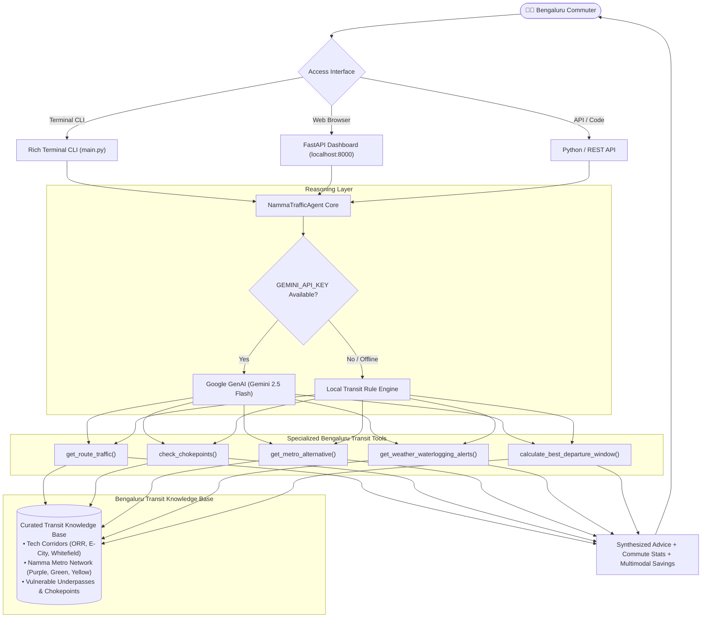

# 🚦 Namma Bengaluru Traffic Copilot: Agent Guide & Transit Analysis

> **A Comprehensive Guide to AI-Powered Commute Optimization, Multimodal Transit Routing, and Real-World Traffic Dynamics in Bengaluru.**

---

## 📌 Executive Summary

Commuters in Bengaluru spend an average of **250+ hours per year** stuck in traffic jams, costing the city an estimated **₹19,725 crore annually** in lost productivity, fuel wastage, and vehicular wear. The city's rapid expansion, tech corridor concentration along the Outer Ring Road (ORR), ongoing metro construction, and severe monsoon waterlogging make standard navigation tools inadequate for nuanced, day-to-day decision making.

**Namma Traffic Copilot** is a domain-specialized AI agent designed to bridge this gap. Powered by **Google GenAI (Gemini 2.5 Flash)** and backed by a **deterministic local transit intelligence engine**, it gives commuters actionable answers to critical questions: *Is Metro faster than a cab right now? When is the golden departure window? Are underpasses flooded? How do I bypass Central Silk Board?*

---

## 🏛️ System Architecture



---

## 📖 Step-by-Step Usage Guide

### Prerequisites
- **Operating System:** Windows, macOS, or Linux
- **Python:** Version 3.10, 3.11, or 3.12
- **Terminal:** PowerShell, Command Prompt, or Bash

---

### Step 1: Clone the Repository & Navigate

```powershell
# Navigate to the repository
cd C:\Users\ShaikAli\open-source-agents\agents\namma-traffic-agent
```

---

### Step 2: Install Dependencies

Install the lightweight dependencies declared in `requirements.txt`:

```powershell
python -m pip install -r requirements.txt
```

> [!NOTE]
> All core libraries (`google-genai`, `fastapi`, `pydantic`, `requests`, `rich`, `pytest`) are installed locally.

---

### Step 3: Configure Environment (Optional)

The agent operates in **dual-engine mode**:
1. **With Gemini API Key:** Uses Gemini 2.5 Flash for natural language function-calling and empathetic synthesis.
2. **Without API Key (Offline Fallback):** Automatically runs deterministic rule heuristics for 100% out-of-the-box reproducibility.

If you have a Gemini API key:
```powershell
# Copy the example environment file
Copy-Item .env.example .env

# Open .env and add your key:
# GEMINI_API_KEY=AIzaSy...
```

---

### Step 4: Choose Your Preferred Interface

#### Method A: Interactive Rich Terminal CLI

**1. Run a single query directly:**
```powershell
python main.py "How is traffic from Koramangala to Whitefield at 6 PM?"
```

**2. Check notorious bottlenecks (Silk Board, Tin Factory, Hebbal):**
```powershell
python main.py "Is Silk Board jammed right now?"
```

**3. Check monsoon rain disruptions & waterlogging:**
```powershell
python main.py "Are there any flooded roads or underpass alerts?"
```

**4. Simulate heavy monsoon downpours on a route:**
```powershell
python main.py "How is traffic from HSR Layout to Bellandur?" --rain
```

**5. Launch continuous interactive REPL mode:**
```powershell
python main.py
```

---

#### Method B: Visual Web UI & REST API Dashboard

Launch the FastAPI web server:
```powershell
python server.py
```

Open your browser at **[http://localhost:8000](http://localhost:8000)**.

**Web Dashboard Features:**
- **Quick-action query pills:** One-click commute assessments for top Bengaluru routes.
- **Monsoon Rain Disruptions toggle:** Simulates sudden waterlogging and traffic delay spikes.
- **Interactive Commute cards:** Clear breakdown of road cab time vs Namma Metro door-to-door time.
- **Departure Curve Chart:** Visual comparison showing the golden departure hour.

---

#### Method C: Run the Automated Test Suite

Verify that all calculations and tool executions pass:
```powershell
python -m pytest tests/
```
*(All 10 unit tests run and pass in ~0.25 seconds).*

---

## ⚡ Advantages in Bengaluru Traffic Format

> [!TIP]
> Bengaluru traffic is unique: road distance in kilometers has almost no correlation with travel time during peak hours. A 12 km trip can take 20 minutes or 2 hours. Here is how Namma Traffic Copilot specifically tackles Bengaluru's urban transit landscape.

### 1. 🚇 Multimodal Metro vs Cab Comparator
- **The Bengaluru Reality:** A cab from Indiranagar to Whitefield at 6:00 PM costs ₹650–₹850 due to 1.8x surge and takes **90–120 minutes** crawling through Marathahalli or Tin Factory.
- **How the Agent Solves It:** The agent automatically calculates the Namma Metro Purple Line route (direct train: ~38 mins), factors in first-mile/last-mile auto connections (~20 mins), and demonstrates an **overall door-to-door time of 58 mins** at a cost of just **₹85** (saving over 50 minutes and ₹700).

### 2. ⚠️ Specialized Bengaluru Chokepoint Intelligence
- **The Bengaluru Reality:** Junctions like Central Silk Board, Tin Factory / KR Puram Hanging Bridge, Hebbal Flyover, and Ecospace ORR are notorious single points of failure.
- **How the Agent Solves It:** Instead of sending commuters into a standstill, the agent tracks localized bottlenecks, supplies peak delay indices, and provides hyper-local bypass advice (e.g., *Madiwala market internal bypass for Silk Board*, *Hennur-Bagalur alternate road for Hebbal/KIA Airport*).

### 3. 🌧️ Monsoon Waterlogging & Railway Underpass Early Warning
- **The Bengaluru Reality:** Just 20 minutes of intense Bengaluru rain turns low-lying railway underpasses (Kadubeesanahalli, Okalipuram, Panathur RUB) into 2-foot water traps, stranding hatchbacks and two-wheelers.
- **How the Agent Solves It:** Dedicated `get_weather_waterlogging_alerts()` tool monitors high-risk underpasses and issues immediate diversion advisories before the commuter enters the flooded zone.

### 4. ⏱️ "Golden Departure Window" Optimization
- **The Bengaluru Reality:** Leaving your tech park in Bellandur or Manyata at 5:45 PM results in a 110-minute crawl. Leaving at 4:15 PM or 8:15 PM takes only 35 minutes.
- **How the Agent Solves It:** The agent models the **Congestion Curve** over a 3-hour window (-60m, -30m, 0, +30m, +60m) and highlights the exact departure slot that saves maximum commute time.

### 6. 🚌 BMTC Bus Network & Transparent Fare Structure
- **The Bengaluru Reality:** Taking a cab through the Outer Ring Road costs ₹750–₹900 during peak hours. High-frequency BMTC bus lanes (such as routes 500-D and 500-CA) run every 5 minutes along dedicated bus corridors.
- **How the Agent Solves It:** The agent lists exact BMTC bus numbers, boarding and deboarding stops, and fare structures: **Ordinary BMTC (₹25)** vs **AC Vajra Volvo (₹45)** vs **Airport Vayu Vajra (₹260)**, highlighting savings of over **₹780 per trip**!

### 7. 🌦️ Real-Time Weather & Monsoon Early Warning Radar
- **The Bengaluru Reality:** A 20-minute thunderstorm can disrupt an entire evening commute, causing severe waterlogging and 2.2x cab surge multipliers.
- **How the Agent Solves It:** Real-time weather monitoring tracks temperature, rainfall intensity, humidity, and IMD thunderstorm warnings, providing actionable advisories before commuters get stranded.

---

## ⚠️ Disadvantages & Real-World Constraints

> [!WARNING]
> While AI agent reasoning provides immense strategic value, certain hyper-local ground realities in Bengaluru cannot be fully predicted by algorithms alone.

### 1. 🛺 The "Last-Mile Auto Mafia" Variable
- **The Constraint:** While the agent calculates that Namma Metro will get you to Baiyappanahalli or KR Puram in 30 minutes, it cannot guarantee that auto drivers outside the station will agree to run by meter or accept your ride on auto-booking apps without demanding *"Won-and-a-haff"* (1.5x) or cash tips.
- **Mitigation:** The agent includes realistic 5–10 minute buffer wait times and inflated ₹30–₹50 first/last-mile feeder fare allowances in its cost-time estimates.

### 2. 🚧 Unannounced BBMP/BWSSB Digging & Metro Barricades
- **The Constraint:** Bengaluru roads are frequently subjected to sudden pipeline laying, optical fiber trenching, or metro barricade adjustments that can choke a 3-lane road down to 1 lane without prior digital notification.
- **Mitigation:** The agent utilizes historical bottleneck weightings and allows commuters to simulate congestion anomalies using the `--rain` and custom delay flags.

### 3. 🕳️ Micro-Pothole Slowdowns & Flooding Cascades
- **The Constraint:** A single cluster of deep potholes after a monsoon downpour (e.g., near Marathahalli multiplex or Kundalahalli) can drop the average traffic speed across an entire 5 km corridor from 25 km/h to 6 km/h.
- **Mitigation:** Monsoon alerts flag specific vulnerable stretches with severe caution warnings.

### 4. 🚔 VIP Convoy Movements & Spontaneous Diversions
- **The Constraint:** Movement of dignitaries between Raj Bhavan, Vidhana Soudha, and Kempegowda Airport (BLR) along Bellary Road frequently causes unannounced 15-to-30 minute full stoppages at Hebbal and Windsor Manor.

---

## 📊 Feature Comparison Matrix

| Feature | Standard Navigation Apps (Google / Apple Maps) | Namma Bengaluru Traffic Copilot AI |
| :--- | :---: | :---: |
| **Point-to-point Road Travel Time** | ✅ Yes | ✅ Yes |
| **Multimodal Metro vs Cab Time Comparison** | ❌ Fragmented (separate tabs) | ✅ **Integrated door-to-door comparison** |
| **Exact Cost Savings (Metro vs Cab Surge)** | ❌ No | ✅ **Calculates exact ₹ saved** |
| **Hyper-local Chokepoint Bypasses** | ❌ Re-routes only on main roads | ✅ **Bengaluru-specific neighborhood bypass advice** |
| **Monsoon Underpass Flood Warnings** | ❌ Rare / Delayed | ✅ **Proactive underpass alerts (Kadubeesanahalli, Okalipuram)** |
| **Golden Departure Timing Recommendation** | ❌ Basic "typical time" graph | ✅ **Autonomous multi-window comparison** |
| **Offline Reproducibility (Zero API Keys)** | ❌ Requires cloud connection | ✅ **100% functional local heuristic engine** |
| **Natural Language Conversational Interface** | ❌ No | ✅ **Powered by Google GenAI (Gemini 2.5 Flash)** |

---

## 🗺️ Roadmap & Community Extensions

Contributions from the open-source community are welcomed:
- [ ] **BTP Live Feed Integration:** Ingest live Bengaluru Traffic Police tweets and advisory feeds.
- [ ] **BMTC Vayu Vajra & Vajra Tracking:** Real-time bus GPS integration for airport and ORR routes.
- [ ] **WhatsApp / Telegram Bot Connector:** Enable commuters to message the agent directly on WhatsApp via Twilio/FastAPI webhook.
- [ ] **Crowdsourced Pothole Radar:** Allow commuters to submit localized road damage alerts.

---

## 📜 Summary

**Namma Traffic Copilot** elevates commute planning from reactive GPS mapping to **proactive, multimodal transit intelligence**. Whether you are commuting from Koramangala to Whitefield, avoiding the Silk Board gridlock, or escaping flooded underpasses, this agent equips you with the best strategy to beat the Bengaluru rush.
