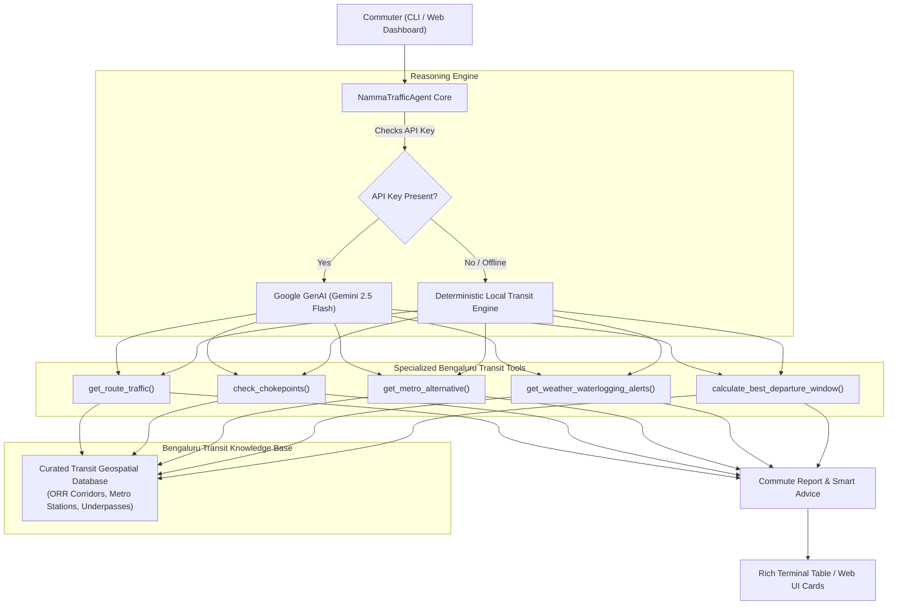

# 🚦 Namma Travel

> Intelligent Bengaluru multimodal transit optimizer, mobile travel app (Android & iPhone), and real-time bottleneck bypass agent.

[](https://www.python.org/downloads/)
[](https://ai.google.dev/)
[](https://fastapi.tiangolo.com/)
[](../../namma-travel-app/)
[](https://opensource.org/licenses/MIT)

Built for the **FORK. BUILD. MERGE.** initiative under **Road to DevFest 2026** by **GDG Cloud Bengaluru**.

---

## 📌 Problem Statement

Bengaluru commuters lose an estimated **250+ hours per year** in gridlock. Major tech corridors—such as the Outer Ring Road (Silk Board to Marathahalli/Hebbal), Old Airport Road, and Whitefield—suffer from severe bottlenecks, sudden monsoon rain waterlogging at railway underpasses, and chaotic surge pricing on ride-hailing apps.

Standard navigation apps often give raw point-to-point times without contextual advice:
- *Should I take Namma Metro instead of a cab during peak rush hour?*
- *When is the golden departure window to avoid a 60-minute delay?*
- *Is Central Silk Board or Tin Factory currently impassable?*
- *Are key underpasses flooded after recent rains?*

**Namma Travel** is a domain-specialized AI agent designed to bridge this gap by combining LLM tool-calling reasoning (powered by Google Gemini 2.5 Flash) with local transit knowledge and deterministic fallbacks.

---

## 📱 Mobile App & Executive Presentation

- **[📱 Namma Travel Mobile App (`namma-travel-app/`)](../../namma-travel-app/):** Cross-platform mobile app package for Android (Google Play Store AAB) and iPhone (iOS Capacitor/Safari PWA).
- **[📄 Executive Word Presentation (.docx)](Namma_Travel_App_Presentation.docx):** Complete presentation deck in Microsoft Word with embedded visual charts, fare benchmarks, and architecture diagrams.
- **[🏪 Play Store Installation Guide](../../namma-travel-app/PLAYSTORE_INSTALL_GUIDE.md):** Step-by-step Google Play Store (Bubblewrap TWA) and Apple App Store publishing guide.
- **[📖 Bengaluru Traffic AI Agent Guide (In-Depth)](BENGALURU_TRAFFIC_AI_AGENT_GUIDE.md):** Complete guide with advantages, real-world constraints, and Bengaluru transit dynamics.
- **[📊 Interactive DevFest Presentation Deck (HTML)](presentation.html):** 10-slide interactive slide deck for live demos.
- **[🎤 Presentation Speaker Notes (Markdown)](PRESENTATION.md):** Slide-by-slide script and talking points.

---

## 🏛️ Architecture Overview



---

## ⚡ Key Features

- **Multimodal Metro vs Cab Comparator:** Directly compares road travel times and surge taxi fares against Namma Metro (Purple, Green, and Yellow Lines), highlighting saved minutes and rupees.
- **🚌 BMTC Bus Routes & Fare Breakdown:** Integrates exact BMTC bus routes (500-D, 500-CA, 335-E, KIA-9) with Ordinary (₹25) and AC Vajra Volvo (₹45) fares, stops, and frequencies.
- **🌦️ Real-Time Weather & Monsoon Radar:** Live temperature, rainfall status, thunderstorm warnings, and waterlogging impact index on roads and underpasses.
- **🛰️ High-Resolution Satellite Map Interface:** Full-screen satellite imagery with road network overlays, pulsing chokepoints, and colored congestion polylines.
- **Bengaluru Chokepoint Intelligence:** Live congestion scores, delay estimates, and internal bypass routes for Silk Board, Tin Factory, Hebbal Flyover, Marathahalli Bridge, Ecospace ORR, and Goraguntepalya.
- **Monsoon & Underpass Alerts:** Tracks waterlogging risks in notorious low-lying underpasses (Kadubeesanahalli, Okalipuram, Panathur RUB).
- **Golden Departure Optimizer:** Computes congestion curves across a 3-hour window to recommend the single best time to leave.
- **100% Out-of-the-Box Reproducibility:** Operates with full functionality in local heuristic mode even without an external API key; enhanced by Gemini 2.5 Flash when `GEMINI_API_KEY` is supplied.

---

## 🆚 Google Maps vs. Namma Traffic AI Agent

| Feature | 🗺️ Google Maps | 🚦 Namma Traffic AI Agent |
| :--- | :---: | :---: |
| **Core Philosophy** | **Reactive Navigation:** Tells you where traffic is and guides you into it. | **Proactive Strategist:** Tells you how to *bypass* traffic and *save money*. |
| **Multimodal Comparison** | ❌ **Fragmented:** Metro, bus, and driving are hidden in separate tabs without cost comparison. | ✅ **Integrated Side-by-Side:** Automatically compares Road Cab vs Namma Metro vs BMTC Bus on a single screen. |
| **Ride-Hail Surge & Cost Savings** | ❌ **No surge prediction:** Does not show ride-hail surge multipliers or ₹ savings. | ✅ **Calculates Exact ₹ Saved:** Shows how taking Metro/Bus saves **₹700+ per trip** over surge cabs. |
| **BMTC Bus & Metro Fares** | ❌ Limited schedule info, no smart card vs token breakdown. | ✅ **Detailed Fares:** Ordinary (₹25), Vajra AC (₹45), Metro QR Ticket (₹57), Token (₹60). |
| **Realistic Track & Road Visuals** | ❌ Generic flat colored lines. | ✅ **Realistic Infrastructure:** Railway track with ballast & rail sleepers/ties; asphalt roadbed with dashed lane divider. |
| **Live Moving Vehicle Tracking** | ❌ Static route overview. | ✅ **Continuous Moving Simulation:** Live animated Metro Train (`🚆`), BMTC Bus (`🚌`), and Cab (`🚖`) moving along routes in real time. |
| **Road Repairs & Active Work Zones** | ❌ Generic slow-traffic warning without construction context. | ✅ **Active BBMP & BMRCL Work Zones:** Details 8 critical city road cuts (Silk Board pier work, Ecospace BWSSB trenching, Marathahalli bridge milling) with detour bypasses. |
| **Hyper-Local Bengaluru Bypasses** | ❌ **Generic rerouting:** Often routes cars into narrow dead-end gullies or trapped service roads. | ✅ **Local Chokepoint Knowledge:** Knows specific bypasses for Central Silk Board, Tin Factory, Hebbal, and Marathahalli Bridge. |
| **Monsoon Underpass Flood Alerts** | ❌ **Delayed/Reactive:** Flags road closures only after vehicles are already stranded. | ✅ **Proactive Flood Radar:** Alerts commuters about waterlogged railway underpasses (*Kadubeesanahalli, Okalipuram, Panathur*) before they enter. |
| **Golden Departure Window** | ❌ Shows generic historical bar graphs. | ✅ **Autonomous Timing Curve:** Analyzes travel times across a 3-hour window to recommend the single best time to leave. |
| **Developer Open-Source Access** | ❌ **Closed proprietary API:** Costs $5–$10 per 1,000 requests on Google Cloud. | ✅ **100% Open-Source & Reproducible:** MIT licensed, runs locally without mandatory paid API keys. |

### 🚗 Real-World Commute Example: Koramangala ➡️ Whitefield (Friday 6:00 PM)

```
┌────────────────────────────────────────────────────────────────────────┐
│                        WHAT GOOGLE MAPS DOES                           │
├────────────────────────────────────────────────────────────────────────┤
│ • Suggests driving via Outer Ring Road (ORR).                          │
│ • Shows a 19 km route in deep red: "130 mins (severe delays)".         │
│ • Commuter books an Uber/Ola: hits 1.6x surge fare = ₹832.             │
│ • Commuter crawls bumper-to-bumper through Marathahalli for 2+ hours.  │
└────────────────────────────────────────────────────────────────────────┘
```
*vs.*
```
┌────────────────────────────────────────────────────────────────────────┐
│                    WHAT NAMMA TRAFFIC AI AGENT DOES                    │
├────────────────────────────────────────────────────────────────────────┤
│ • Evaluates all transit modes instantly:                               │
│     🚖 Road Cab: 130 mins, ₹832 (1.6x surge active)                    │
│     🚇 Namma Metro: 78 mins door-to-door, ₹87                          │
│     🚌 BMTC 500-D Vajra AC: 65 mins, ₹45                               │
│ • Recommends Metro Purple Line: saves 52 minutes and ₹745!             │
│ • Identifies the Golden Departure Window: leaving at 4:00 PM           │
│   cuts commute time down to 67 minutes and eliminates cab surge!      │
└────────────────────────────────────────────────────────────────────────┘
```

---

## 🔥 8 Things Google Maps CANNOT Do (The AI Copilot Superpowers)

> [!IMPORTANT]
> Google Maps is a **reactive GPS tool**—it tells you when you're already trapped in traffic. **Namma Traffic Copilot** is a **proactive transit strategist** that optimizes your wallet, safety, and commute time.

### 1. 💰 Calculates Exact Rupee Savings (Surge Protection)
- **Google Maps:** Has zero knowledge of dynamic ride-hail surge pricing. It won't tell you how much money you are burning.
- **Namma Traffic AI Agent:** Automatically computes Ola/Uber surge multipliers (1.5x–2.1x) and calculates the **exact rupees saved**:
  > *"Taking Namma Metro over an Uber cab on this route saves you **₹745** and **52 minutes**!"*

### 2. 🔀 Unified Side-by-Side Multimodal Comparison
- **Google Maps:** Keeps Car, Bike, Transit, and Walking in separate, disconnected tabs. You have to manually guess which option is best.
- **Namma Traffic AI Agent:** Evaluates **Road Cab vs. Namma Metro vs. BMTC Bus** side-by-side on a single screen, delivering an instant optimization verdict.

### 3. ⏱️ Autonomous "Golden Departure Window" Recommendation
- **Google Maps:** Shows passive, historical "typical traffic" bar charts that force you to guess.
- **Namma Traffic AI Agent:** Computes a **Congestion Curve** across a 3-hour window (-60m, -30m, now, +30m, +60m) and pinpoints the golden departure hour:
  > *"Leaving at **4:00 PM** instead of 6:00 PM cuts your commute by **63 minutes** and eliminates surge pricing completely!"*

### 4. 🌧️ Proactive Railway Underpass Flood Early Warning
- **Google Maps:** Does not warn drivers about flooded underpasses until cars are already floating and traffic is dead. Often directs sedans into 2-foot water traps.
- **Namma Traffic AI Agent:** Actively tracks flood-vulnerable underpasses (**Kadubeesanahalli, Okalipuram, Panathur RUB**) and issues **advance diversion warnings** before you reach the danger zone.

### 5. ⚠️ Hyper-Local Bengaluru Chokepoint Bypasses
- **Google Maps:** Frequently redirects cars into narrow dead-end residential gullies or trapped service roads (like the Central Silk Board service road trap).
- **Namma Traffic AI Agent:** Encodes domain-specific local knowledge:
  - *Central Silk Board (9.6/10):* Advises Madiwala market internal bypass or Yellow Line.
  - *Tin Factory bottleneck:* Directs commuters to the Purple Line metro to soar over the hanging bridge.
  - *Hebbal Airport crawl:* Advises using the Hennur-Bagalur alternate expressway.

### 6. 🗣️ Conversational AI Commute Reasoning
- **Google Maps:** Rigid input boxes that only accept point A to point B.
- **Namma Traffic AI Agent:** Powered by **Google GenAI (Gemini 2.5 Flash)**, you can ask natural questions via CLI or Web:
  - *"Is Silk Board jammed right now?"*
  - *"Indiranagar to Airport: should I take a cab or the KIA-9 bus?"*
  - *"Any waterlogging alerts near Bellandur or ORR?"*

### 7. 🎫 Transparent Public Transit Fare Tiers
- **Google Maps:** Displays basic bus lines with zero fare tier breakdowns.
- **Namma Traffic AI Agent:** Shows exact fare tiers across services:
  - **Namma Metro:** Token Fare (₹60) vs. Smart Card / WhatsApp QR Ticket (₹57).
  - **BMTC Buses:** Ordinary BMTC (₹25) vs. AC Vajra Volvo (₹45) vs. Airport Vayu Vajra (₹260).

### 8. 🔓 100% Open-Source & Reproducible for Developers
- **Google Maps:** Proprietary closed-source platform charging \$5–\$10 per 1,000 API requests.
- **Namma Traffic AI Agent:** MIT licensed, community-driven, runs locally with **zero paid API key dependencies**, fully aligned with the **GDG Cloud Bengaluru Road to DevFest 2026** mission.

---

## 🛠️ Prerequisites

- Python 3.10 or higher
- Optional: Google Gemini API Key (`GEMINI_API_KEY`) from [Google AI Studio](https://aistudio.google.com/)

---

## 🚀 Quick Start

### 1. Clone & Navigate to Project

```bash
git clone https://github.com/<your-username>/open-source-ai.git
cd open-source-ai/agents/namma-traffic-agent
```

*(Or if running directly from scratch directory:)*
```bash
cd C:\Users\ShaikAli\.gemini\antigravity\scratch\namma-traffic-agent
```

### 2. Install Dependencies

```bash
python -m pip install -r requirements.txt
```

### 3. Configure Environment (Optional)

```bash
cp .env.example .env
# Edit .env and paste your GEMINI_API_KEY (optional)
```

---

## 💻 Usage

### Option A: Interactive CLI & Rich Terminal Dashboard

Run a single natural language query:
```bash
python main.py "How is traffic from Koramangala to Whitefield at 6 PM?"
```

Simulate heavy monsoon rain impact:
```bash
python main.py "How is traffic from HSR to Bellandur?" --rain
```

Inspect specific chokepoints:
```bash
python main.py "Is Silk Board jammed?"
```

Check waterlogged underpasses:
```bash
python main.py "Are there any flooded roads or underpass alerts?"
```

Launch interactive conversational mode:
```bash
python main.py
```

### Option B: Interactive Web Dashboard & REST API

Launch the local web server:
```bash
python server.py
```
Open your browser at **[http://localhost:8000](http://localhost:8000)** to view the visual dashboard with quick-action commute cards, live congestion meters, and the AI Copilot.

---

## 📊 Sample Terminal Output

```
  _   _                                _____            __  __ _        
 | \ | | __ _ _ __ ___  _ __ ___   __ |_   _| __ __ _ / _|/ _(_) ___   
 |  \| |/ _` | '_ ` _ \| '_ ` _ \ / _` || || '__/ _` | |_| |_| |/ __|  
 | |\  | (_| | | | | | | | | | | | (_| || || | | (_| |  _|  _| | (__   
 |_| \_|\__,_|_| |_| |_|_| |_| |_|\__,_||_||_|  \__,_|_| |_| |_|\___|  

🚦 Real-time Bengaluru Traffic Copilot & Multimodal Commute Optimizer
Powered by Google GenAI (Gemini 2.5 Flash) + Local Transit Intelligence

● Mode: local-heuristic-engine (Running in reproducible local mode)
⚡ Tools Invocations: get_route_traffic, get_metro_alternative, calculate_best_departure_window

               🚗 Commute Overview: Koramangala ➡️ Whitefield               
┌─────────────────────┬────────────────────────────────────────────────────┐
│ Metric              │ Details                                            │
├─────────────────────┼────────────────────────────────────────────────────┤
│ Distance            │ 19.1 km                                            │
│ Current Travel Time │ 130 mins                                           │
│ Off-Peak Duration   │ 52 mins                                            │
│ Traffic Congestion  │ 🔴 Heavy Gridlock (Expect bumper-to-bumper delays) │
│ Est. Auto Fare      │ ₹315                                               │
│ Est. Cab Fare       │ ₹832 (Surge: 1.6x)                                 │
└─────────────────────┴────────────────────────────────────────────────────┘

                     🚇 Namma Metro Multimodal Alternative                     
┌──────────────────┬───────────────────────────────────────────────┬──────────┐
│ Stage            │ Station / Mode                                │ Time     │
├──────────────────┼───────────────────────────────────────────────┼──────────┤
│ First Mile       │ South End Circle (Green Line, 4.5 km away)    │ ~23 mins │
│ Metro Train Ride │ Interchange: Majestic (Nadaprabhu Kempegowda) │ 50 mins  │
│ Last Mile        │ Whitefield (Kadugodi) (Purple Line, 0.0 km)   │ ~5 mins  │
│ Total Time       │ Door-to-door                                  │ 78 mins  │
│ Fare             │ Metro ₹57 + Auto                              │ ₹87      │
└──────────────────┴───────────────────────────────────────────────┴──────────┘

┌────────────────────── 🤖 Namma Copilot Recommendation ──────────────────────┐
│  🚗 Bengaluru Commute Assessment: Koramangala ➡️ Whitefield                 │
│  • Estimated Road Travel Time: 130 minutes (Off-peak: 52 mins)             │
│  • Congestion: 🔴 Heavy Gridlock (Expect bumper-to-bumper delays)          │
│                                                                             │
│  🚇 Multimodal Alternative (Namma Metro):                                   │
│  • Total Door-to-Door Time: ~78 mins (vs 130 mins road cab)                │
│  • Cost: ₹87 (Saves ₹745 vs cab surge)                                     │
│  • Verdict: 🚇 Highly Recommended: Take Namma Metro                        │
│                                                                             │
│  ⏱️ Smart Departure Advice: Leaving at 16:00 hrs can save you up to 63      │
│  minutes compared to peak rush at 17:00 hrs!                               │
└─────────────────────────────────────────────────────────────────────────────┘
```

---

## 📁 Repository Structure

```
agents/namma-traffic-agent/
├── README.md                      # Comprehensive documentation and guide
├── Namma_Travel_App_Presentation.docx # Executive Presentation Deck with visuals
├── requirements.txt               # Dependencies manifest
├── .env.example                   # Sanitized environment variable template
├── .gitignore                     # Git ignore rules
├── main.py                        # Rich CLI entrypoint & interactive REPL
├── server.py                      # FastAPI web server, Auth & REST API
├── agent/
│   ├── __init__.py                # Package exports
│   ├── core.py                    # NammaTrafficAgent implementation & Gemini tool calling
│   ├── knowledge.py               # Bengaluru transit dataset (corridors, hubs, choke points)
│   └── tools.py                   # 5 specialized transit intelligence tools
├── web/
│   ├── index.html                 # Modern responsive web dashboard (dark mode, mobile bottom sheet)
│   ├── manifest.json              # PWA Web App Manifest for mobile installation
│   ├── sw.js                      # Service Worker providing offline transit caching
│   ├── icon-192.svg               # Mobile app icon
│   └── icon-512.svg               # High-resolution splash icon
├── namma-travel-app/              # Standalone mobile app package for Android & iPhone
│   ├── package.json               # Capacitor 6.0 & Bubblewrap dependencies
│   ├── capacitor.config.json      # App ID (com.nammatraffic.travelapp) & theme
│   ├── twa-manifest.json          # Google Trusted Web Activity config
│   ├── PLAYSTORE_INSTALL_GUIDE.md # Step-by-step Play Store & App Store guide
│   └── www/                       # Packaged web assets
└── tests/
    ├── test_agent.py              # Tests for agent execution and intent handling
    ├── test_auth.py               # Tests for Gmail OAuth and Mobile OTP login
    └── test_tools.py              # Tests for all transit tools
```

---

## 🧪 Testing & Verification

Run the automated test suite using `pytest`:

```bash
python -m pytest tests/
```

Expected output:
```
tests/test_agent.py ....                                                 [ 26%]
tests/test_auth.py ....                                                  [ 53%]
tests/test_tools.py .......                                              [100%]
======================== 15 passed in 0.50s ========================
```

---

## ⚠️ Known Limitations & Assumptions

1. **Traffic Modeling:** Traffic delays and multipliers are calibrated against Bengaluru's historical peak-hour commute distributions (Morning 8:30-11:30 AM, Evening 5:00-9:00 PM). Live external API integrations (Google Maps / TomTom Traffic API) can be hooked up for dynamic GPS probe inputs.
2. **Yellow Line Metro:** The Yellow Line (RV Road to Bommasandra / Electronic City) schedule estimates are modeled on trial-run and projected frequency.

---

## 🗺️ Roadmap & Extensions

- [ ] Direct integration with Karnataka Open Data / Bengaluru Traffic Police (BTP) live twitter/feed advisories.
- [ ] BMTC Vajra / Vayu Vajra Airport bus real-time GPS schedule tracking.
- [ ] Integration into WhatsApp / Telegram bot via Twilio or FastAPI webhook.

---

## 📜 License & Community

Licensed under the **MIT License**. Created with ❤️ for **GDG Cloud Bengaluru**'s **FORK. BUILD. MERGE. (Road to DevFest 2026)**.
