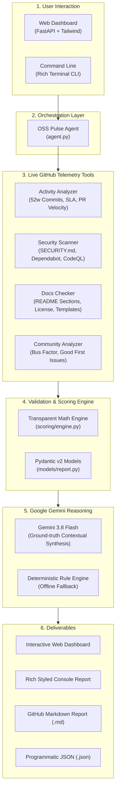

# 🏥 OSS Pulse Agent
### Evidence-Driven, Explainable Repository Intelligence Powered by Google Gemini

[](https://www.python.org/)
[](https://ai.google.dev/)
[](http://localhost:8000)
[](Dockerfile)
[](tests/)
[](LICENSE)

---

## 🎯 Whom Is This Built For?

OSS Pulse Agent is engineered for four primary groups in the open-source ecosystem:

| Audience | How It Helps |
| :--- | :--- |
| **🛠️ Developers & Engineering Teams** | Evaluating open-source dependencies before adding them to production, ensuring you don't adopt abandoned or vulnerable packages. |
| **🌱 New Contributors & Students** | Discovering verified, approachable entry points through unassigned `good first issue` and `help wanted` recommendations. |
| **👑 Open-Source Maintainers** | Gaining an objective, evidence-based audit of their project's maintenance backlog, SLA turnaround times, and governance gaps. |
| **🏢 Open-Source Program Offices (OSPOs)** | Auditing organizational portfolios and tracking repository health over time with reproducible metrics. |

---

## 🛑 What Problem Does This Solve?

### The Core Problem: *Stars and Checklists Lie*
When developers evaluate an open-source project on GitHub, they usually rely on two misleading signals:
1. **Star Counts:** A repository might have 15,000 stars, but hasn't received a commit or bug fix in three years. High star counts reflect historical popularity, not current maintenance.
2. **Checkbox Linters:** Existing tools check whether files simply exist (`README.md`, `LICENSE`, `SECURITY.md`). A one-line stub README or an empty file counts as a "pass," even if it provides zero installation instructions or API examples.

### The Consequences:
- **Abandoned Dependencies:** Teams ship software depending on libraries whose sole maintainer walked away years ago.
- **Hidden Security Debt:** Projects lack automated dependency update pipelines (Dependabot) or SAST workflows (CodeQL).
- **Contributor Friction:** Newcomers eager to contribute face stale issues, missing guidelines, and no clear starting point.

---

## 💡 How Does OSS Pulse Agent Solve It?

### In Simple Words:
Instead of asking *"Does this file exist?"*, OSS Pulse Agent asks:
1. **"How is this project actually maintained?"** (Measures real commit frequency, days since last commit, and PR merge velocity).
2. **"Is the documentation actually helpful?"** (Parses README section headers for Installation, Usage, and Examples).
3. **"Is there a single point of failure?"** (Calculates the *Bus Factor*—how many contributors account for >50% of the codebase).
4. **"Where can I help right now?"** (Finds unassigned beginner issues with one-click GitHub links).
5. **"What does this evidence actually mean?"** (Feeds verifiable facts to **Google Gemini 3.8 Flash** to generate a grounded executive explanation).

---

## 🏛️ System Architecture & Data Flow



### Complete Data Flow Lifecycle:
1. **User Request:** You input any public repository (e.g. `pallets/flask` or `gdgcblr/meetup`).
2. **Live Extraction:** Four specialized tools query GitHub's REST API for commit history, pull request turnaround, issue response SLAs, workflow files, and contributor distributions.
3. **Evidence Validation:** Every fact is mapped into an `Evidence` object with measured values, sample sizes, observation windows, and GitHub verification URLs.
4. **Deterministic Scoring:** The scoring engine applies transparent mathematical formulas (Activity 30%, Security 25%, Docs 20%, Community 25%).
5. **Gemini Synthesis:** Gemini receives the structured evidence and generates human-readable explanations of project health and risks.
6. **Rendering:** Results are instantly displayed in the Web UI, printed to the terminal, or exported to Markdown/JSON.

---

## ⚖️ Transparent Scoring Model

Scores reflect transparent, verifiable weighting across four core pillars:

| Category | Weight | What We Actually Measure |
| :--- | :---: | :--- |
| **📊 Activity & Maintenance** | **30%** | 52-week commit velocity, 90-day activity, days since last commit, median issue resolution time, median PR merge duration, and stale backlog ratio. |
| **🔒 Security Configuration** | **25%** | Responsible disclosure (`SECURITY.md`), automated dependency patching (`.github/dependabot.yml`), active SAST workflows (`CodeQL`, `Semgrep`, `Trivy`), and default branch protection. |
| **📝 Documentation Quality** | **20%** | README character depth, explicit headers (`Installation`, `Usage`, `Examples`), valid OSI License, `CONTRIBUTING.md`, and issue templates. |
| **👥 Community Health** | **25%** | Bus factor (contributor concentration), 90-day active contributors, discussions, and unassigned `good first issue` counts. |

> **Trustworthy AI Policy:** Missing or restricted data is never silently treated as a zero or assumed as a pass. Metrics unavailable due to permissions are tracked explicitly in `DataCoverage` indicators (e.g. *Data Coverage: 82% | Evidence Quality: High*).

---

## 🚀 Quickstart & How to Use

### 1. Prerequisites
- Python 3.10 or higher
- Git

### 2. Installation
```bash
# Clone the repository
git clone https://github.com/gdgcblr/open-source-agents.git
cd open-source-agents/oss-pulse-agent

# Install dependencies
pip install -r requirements.txt

# Configure your keys
copy .env.example .env
# Edit .env and paste your GEMINI_API_KEY (and optional GITHUB_TOKEN)
```

---

### 3. How to Run (Choose Your Preferred Interface)

#### Option A: Interactive Web Dashboard (Recommended)
Launch the local web server:
```bash
python app.py
```
Open **[http://localhost:8000](http://localhost:8000)** in your browser. Type any repository (e.g. `pallets/flask` or `gdgcblr/meetup`) and click **"Analyze Repo"** to view interactive gauges, progress bars, and Gemini insights.

#### Option B: Terminal CLI
Analyze any repository directly from your terminal:
```bash
# Analyze a single repository
python cli.py analyze pallets/flask

# Export report to Markdown and JSON
python cli.py analyze tiangolo/fastapi --output reports/fastapi_report --format all

# Side-by-side comparison of two projects
python cli.py compare pallets/flask tiangolo/fastapi
```

#### Option C: Docker Container
Run with Docker without needing local Python installations:
```bash
docker build -t oss-pulse-agent .
docker run -p 8000:8000 --env-file .env oss-pulse-agent
```

---

## 🧪 Automated Test Suite

We maintain a 100% pass rate across 21 unit and integration tests covering scoring archetypes, API 403/404 handling, and input sanitization:

```bash
pytest tests/ -v
```

```text
============================= test session starts =============================
collected 21 items

test_agent.py::test_score_activity_mature_active PASSED                  [  4%]
test_agent.py::test_score_activity_small_stable_library PASSED           [  9%]
test_agent.py::test_score_activity_abandoned_inactive PASSED             [ 14%]
test_agent.py::test_score_activity_empty_fresh_repo PASSED               [ 19%]
test_agent.py::test_score_security_full_protection PASSED                [ 23%]
test_agent.py::test_score_security_missing_all PASSED                    [ 28%]
test_agent.py::test_score_security_branch_protection_restricted PASSED   [ 33%]
test_agent.py::test_score_documentation_thorough PASSED                  [ 38%]
test_agent.py::test_score_documentation_minimal PASSED                   [ 42%]
test_agent.py::test_score_community_healthy PASSED                       [ 47%]
test_agent.py::test_score_community_single_maintainer_risk PASSED        [ 52%]
test_agent.py::test_data_coverage_statistics PASSED                      [ 57%]
test_agent.py::test_overall_score_weighted_grades PASSED                 [ 61%]
test_agent.py::test_untrusted_input_sanitization PASSED                  [ 66%]
test_agent.py::test_github_rate_limit_exception PASSED                   [ 71%]
test_agent.py::test_github_404_not_found PASSED                          [ 76%]
test_agent.py::test_markdown_and_json_serialization PASSED               [ 80%]
test_tools_integration.py::test_activity_analyzer_integration PASSED     [ 85%]
test_tools_integration.py::test_security_scanner_integration PASSED      [ 90%]
test_tools_integration.py::test_doc_checker_integration PASSED           [ 95%]
test_tools_integration.py::test_community_analyzer_integration PASSED    [100%]

============================= 21 passed in 1.21s ==============================
```

---

## 📂 Project Structure

```text
oss-pulse-agent/
├── app.py                 # FastAPI + Tailwind interactive web dashboard
├── cli.py                 # Command-line interface (analyze & compare modes)
├── agent.py               # Gemini 3.8 Flash tool orchestrator & fallback
├── Dockerfile             # Production Linux container specification
├── requirements.txt       # Production dependencies
├── .env.example           # Environment variables template
├── models/
│   └── report.py          # Pydantic v2 schemas (Evidence, Coverage, Findings)
├── tools/
│   ├── github_client.py   # Resilient GitHub REST client (5,000 req/hr)
│   ├── github_analyzer.py # 52w commit velocity, SLA & stale backlog analyzer
│   ├── security_scanner.py# SECURITY.md, Dependabot & SAST pipeline checker
│   ├── doc_checker.py     # README depth, section parser & license checker
│   └── community_analyzer.py # Bus factor & good-first-issue discoverer
├── scoring/
│   └── engine.py          # Evidence-backed scoring formulas & data coverage
├── export/
│   └── renderer.py        # Terminal visualizer, Markdown & JSON exporters
└── tests/
    ├── test_agent.py      # Unit tests (archetypes, edge cases, rate limits)
    └── test_tools_integration.py # Integration tests for all 4 analyzers
```

---

## 👥 Authors & Acknowledgments

- **Built for:** [GDG Cloud Bengaluru](https://github.com/gdgcblr) — *Road to DevFest: Open Source Edition (Fork, Build, Merge)*.
- **AI Engine:** Google Gemini 3.8 Flash via the `google-genai` SDK.
- **License:** Apache License 2.0 — see [LICENSE](LICENSE) for details.
