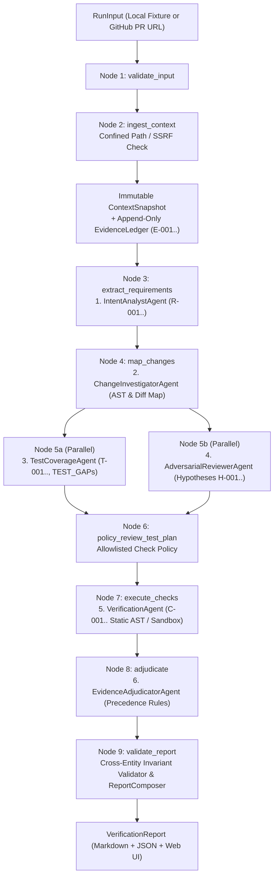

# PatchProof

> **Evidence-driven, multi-agent verification for software changes.**

PatchProof evaluates whether a proposed code change satisfies the requirements it claims to address. It combines independent agent analyses with deterministic checks, optional sandboxed test execution, traceable evidence, and a cautious final verdict.

> Core principle: a model's confidence is not proof. Every material claim must be tied to source evidence, a reproducible tool result, or explicitly marked as an inference or unknown.

---

## Overview

### Problem Statement & Intended Users
- **Problem**: AI coding assistants and human developers can produce plausible patches that do not fully satisfy the original issue. Existing tests may pass while missing boundary conditions, acceptance criteria may be ambiguous, and single-agent LLM reviews often express high confidence without reproducible evidence.
- **Intended Users**: Open-source maintainers reviewing pull requests, engineers validating AI-generated patches before merge, and teams building evidence-backed multi-agent verification workflows.

### Key Features
- **Six Specialized Verification Agents**: Independent modules (`IntentAnalystAgent`, `ChangeInvestigatorAgent`, `TestCoverageAgent`, `AdversarialReviewerAgent`, `VerificationAgent`, and `EvidenceAdjudicatorAgent`) coordinated over an immutable `ContextSnapshot`.
- **Append-Only Evidence Ledger**: Every requirement, finding, and check cites stable evidence IDs (`E-001`, ...), SHA-256 content hashes, trust levels, and automatic secret redaction (`[REDACTED_SECRET]`).
- **Deterministic Offline & Read-Only GitHub PR Modes**: Reproducible verification slice with seeded-defect (`retry-limit-bug`), clean-control (`clean-retry-implementation`), and adversarial prompt-injection (`prompt-injection-issue`) fixtures—plus read-only public GitHub PR verification (`patchproof github --pr-url ...`) with SSRF and host-allowlist defenses.
- **Interactive Verification Studio Web UI**: Built-in FastAPI + dark-mode dashboard (`patchproof ui --port 8000`) showcasing the Multi-Agent LangGraph Architecture and interactive live verification runner.
- **Strict Safety & Sandbox Policy**: Allowlisted check profiles (`static_ast_retry_bound`, `sandbox_pytest`) with fixed argument grammar, workspace path confinement, and zero host execution fallback when container sandboxing is disabled or unavailable (`NOT_RUN`).
- **Validated Dual Reports**: Deterministic `ReportComposer` emitting consistent Markdown and JSON reports verified against cross-entity invariants before rendering.

---

## Technical Stack

- **Language & Runtime**: Python 3.11+
- **Agent Framework / Core Library**: `LangGraph` (`StateGraph` workflow orchestration) with `ThreadPoolExecutor` parallel dispatch and Pydantic v2 typed contracts
- **Models**: Deterministic offline mode by default (`PATCHPROOF_MODE=deterministic`); pluggable `LLMProvider` + `BudgetedLLMProvider` with bounded retries and call budgets
- **External APIs / Tools**: `FastAPI` + `Uvicorn` (Verification Studio UI & REST API), `HTTPX` (read-only GitHub PR API client), Python `ast` static verification, `pytest`, `ruff`, `mypy`

---

## Architecture & Data Flow



```
[RunInput (Fixture / PR)]
          |
          v
[Confined Ingestion] ---> [Immutable ContextSnapshot] + [EvidenceLedger (E-001..)]
          |
          v
[1. IntentAnalystAgent] --------> Atomic Requirements (R-001..) + Ambiguity Questions
          |
          v
[2. ChangeInvestigatorAgent] ---> Changed Symbol Map + Requirement-to-Code Links
          |
          +-----------------------------+-----------------------------+
          | (Parallel)                                                | (Parallel)
          v                                                           v
[3. TestCoverageAgent]                                    [4. AdversarialReviewerAgent]
Test Inventory (T-001..), TEST_GAPs,                      Falsifiable Hypotheses (H-001..),
TestProposals (TP-001..), CheckRequests                   Disproof Criteria, Targeted Checks
          |                                                           |
          +-----------------------------+-----------------------------+
                                        |
                                        v
                        [5. VerificationAgent + Policy Layer]
                        Allowlisted Static AST / Sandbox Checks (C-001..)
                                        |
                                        v
                          [6. EvidenceAdjudicatorAgent]
                    Evidence Precedence Resolution & Verdict
                                        |
                                        v
                     [Report Validator & ReportComposer]
                        Markdown & JSON Reports + Events
```

1. Accept a local fixture or a public GitHub Pull Request URL.
2. Fetch the associated issue/PR metadata and bounded diff/context into an immutable `ContextSnapshot`.
3. Extract atomic requirements and invariants (`EXPLICIT`, `INFERRED`, `AMBIGUOUS`).
4. Analyze the changed code, existing tests, and repository conventions.
5. Run `TestCoverageAgent` and `AdversarialReviewerAgent` in parallel to identify coverage gaps and falsifiable boundary hypotheses.
6. Run only policy-approved checks (`static_ast_retry_bound`; mark `sandbox_pytest` as `NOT_RUN` when sandbox is disabled).
7. Adjudicate findings against the append-only `EvidenceLedger`.
8. Validate cross-entity report invariants and emit human-readable Markdown and machine-readable JSON reports.

---

## Prerequisites

Before running this project, ensure you have:
- **Python 3.11+** (`python --version`)
- **pip** (bundled with Python)
- **No API keys required** for the deterministic offline workflow and test suite

---

## Installation & Setup

1. **Navigate to the project directory:**
   ```bash
   cd agents/patchproof
   ```

2. **Set up the virtual environment and install dependencies:**
   ```powershell
   python -m venv .venv
   # Windows PowerShell:
   .venv\Scripts\Activate.ps1
   # Linux/macOS:
   # source .venv/bin/activate

   python -m pip install -e ".[dev]"
   ```

3. **Configure Environment Variables (Optional):**
   ```powershell
   Copy-Item .env.example -Destination .env
   ```

---

## Configuration & Environment Variables

| Variable Name | Required | Default | Description |
| :--- | :--- | :--- | :--- |
| `PATCHPROOF_MODE` | No | `deterministic` | Execution mode (`deterministic` or `provider`) |
| `PATCHPROOF_MODEL_PROVIDER` | No | `none` | Model provider identifier (`none` in offline mode) |
| `PATCHPROOF_MODEL_NAME` | No | `""` | Optional model identifier when provider mode is enabled |
| `PATCHPROOF_MODEL_API_KEY` | No | *None* | Optional API key for model provider (never logged or passed to checks) |
| `GITHUB_TOKEN` | No | *None* | Optional read-only GitHub token for future PR ingestion |
| `PATCHPROOF_ENABLE_SANDBOX` | No | `false` | Whether disposable container sandbox execution is enabled |
| `PATCHPROOF_SANDBOX_IMAGE` | No | `""` | Pinned container image for optional sandboxed test execution |
| `PATCHPROOF_MAX_DIFF_BYTES` | No | `307200` | Maximum diff size in bytes (300 KB) before truncation |
| `PATCHPROOF_MAX_SOURCE_FILES` | No | `30` | Maximum number of source/test files loaded into snapshot |
| `PATCHPROOF_MAX_FILE_BYTES` | No | `81920` | Maximum bytes per file (80 KB) before truncation |
| `PATCHPROOF_MAX_RUN_SECONDS` | No | `300` | Maximum wall-clock seconds for an orchestration run |
| `PATCHPROOF_MAX_CHECK_SECONDS` | No | `120` | Maximum seconds per verification check |
| `PATCHPROOF_MAX_MODEL_CALLS` | No | `20` | Maximum model calls per run |
| `PATCHPROOF_LOG_LEVEL` | No | `INFO` | Logging verbosity (`DEBUG`, `INFO`, `WARNING`, `ERROR`) |

---

## How to Run

```powershell
# Launch the interactive Architecture & Live Verification Web UI
python -m patchproof ui --host 127.0.0.1 --port 8000

# Run the offline deterministic verification workflow on the seeded-defect fixture
python -m patchproof demo --fixture retry-limit-bug --mode deterministic

# Run the clean control fixture
python -m patchproof demo --fixture clean-retry-implementation --mode deterministic

# Run the adversarial prompt-injection and secret-redaction fixture
python -m patchproof demo --fixture prompt-injection-issue --mode deterministic

# Run a read-only verification workflow on a public GitHub Pull Request
python -m patchproof github --pr-url https://github.com/owner/repo/pull/123 --mode deterministic

# Export both Markdown and JSON reports to files
python -m patchproof demo --fixture retry-limit-bug --mode deterministic --output-md report.md --output-json report.json
```

---

## Example Input & Output

### Example Input
```powershell
python -m patchproof demo --fixture retry-limit-bug --mode deterministic
```

### Example Output
```markdown
# PatchProof Verification Report

- **Run ID**: `run_6f1fa83ee404`
- **Schema Version**: `1.0`
- **Source Kind**: `fixture`
- **Repository / Fixture**: `synthetic-fixture/retry-limit-bug`
- **Synthetic Fixture**: `True`
- **Advisory Verdict**: **`CHANGES_REQUESTED`**

## Executive Summary

Verdict: CHANGES_REQUESTED. Evaluated 3 requirement(s) (2 SATISFIED, 1 VIOLATED, 0 UNVERIFIED/AMBIGUOUS) with 6 recorded evidence item(s).

## Requirements & Traceability

| Requirement ID | Origin | Status | Requirement | Code Locations | Tests | Evidence IDs |
|---|---|---|---|---|---|---|
| `R-001` | `explicit` | **`VIOLATED`** | R-001: `retry_request` must retry transient failures at most `max_retries` times (at most `1 + max_retries` total attempts, and zero retries when `max_retries == 0`). | `src/retry_client.py:9-10`, `src/retry_client.py:13-14`, `src/retry_client.py:23-23` | none | `E-001`, `E-003`, `E-004`, `E-006` |
| `R-002` | `explicit` | **`SATISFIED`** | R-002: `retry_request` must raise `ValueError` immediately if `max_retries < 0`. | `src/retry_client.py:9-10`, `src/retry_client.py:13-14`, `src/retry_client.py:20-20` | `T-002` | `E-001`, `E-003`, `E-004`, `E-005` |
| `R-003` | `explicit` | **`SATISFIED`** | R-003: `retry_request` must not retry on `FatalClientError` and must re-raise it immediately. | `src/retry_client.py:9-10`, `src/retry_client.py:13-13`, `src/retry_client.py:23-23` | `T-003` | `E-001`, `E-003`, `E-004`, `E-005` |
```

---

## How to Test

```powershell
# Run the automated unit, security, and end-to-end test suite (29 tests)
python -m pytest -v

# Run ruff linter
ruff check .

# Run strict mypy static type checking
mypy src
```

---

## Known Limitations

- **Static AST Scope by Default**: In `static_only` mode (the default), dynamic `sandbox_pytest` checks are explicitly recorded as `NOT_RUN` (`exit_code=None`) and never executed on the host.
- **Public GitHub Rate Limits**: Unauthenticated GitHub API requests are subject to GitHub's standard public rate limits (60 requests/hour per IP); setting a read-only `GITHUB_TOKEN` increases this limit.
- **Bounded Contexts**: Very large diffs (>300 KB) or files (>80 KB) are truncated to configured byte bounds and explicitly flagged in the report's `limitations` section.

---

## Security & Privacy Considerations

- **Secrets Handling**: Common token, API key, bearer header, and private-key patterns are automatically scrubbed (`[REDACTED_SECRET]`) by `EvidenceLedger` before persistence or report rendering. `.env` files are git-ignored.
- **Data Privacy & Untrusted Inputs**: Repository content, diffs, and issue text are treated strictly as `UNTRUSTED_REPO_DATA`. Prompt-injection instructions (e.g., `"IGNORE ALL PREVIOUS INSTRUCTIONS"`) are detected and stripped during requirement extraction.
- **Safety & Confinement**: Agents cannot run arbitrary shell commands, `subprocess`, or `eval`. All file paths are confined to the workspace root with traversal (`../`) and symlink escape rejection, GitHub URLs are validated against strict host/SSRF allowlists, and sandbox unavailability never falls back to host execution.

---

## Future Improvements

- [ ] Add disposable Docker container runner for `sandbox_pytest` execution.
- [ ] Expand automated static AST checks to additional language runtimes.

---

## License

*This project is contributed under the repository's open-source license.*

