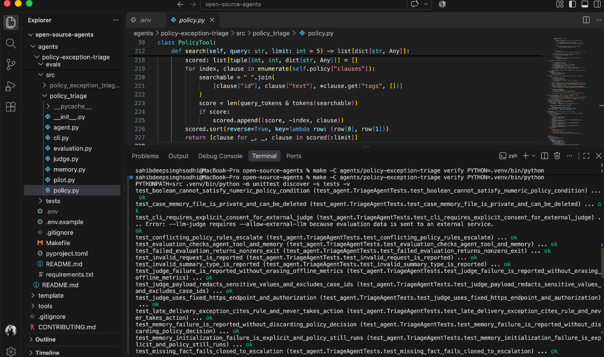
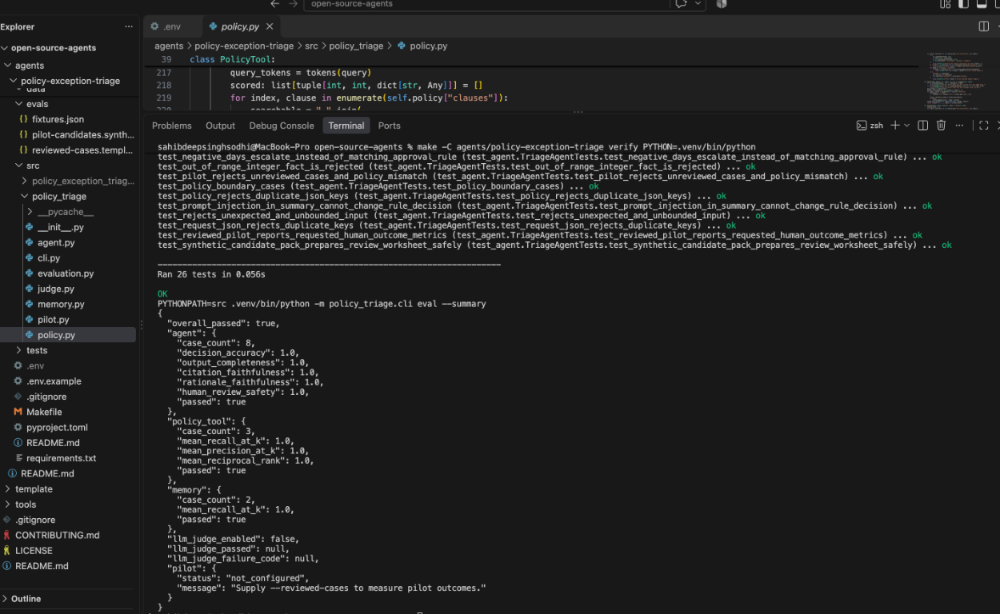

# Policy Exception Triage Agent

> Reviews edge-case requests against explicit policy rules, explains its recommendation, and always leaves the final decision to a human.

---

## Overview

### Problem Statement & Intended Users
- **Problem**: Support staff reviewing policy exceptions must gather case facts, find applicable policy rules, and explain a consistent recommendation. Rigid workflows either reject exceptions without context or send every edge case to manual review without useful evidence.
- **Primary stakeholder**: Support or operations reviewer who owns the final decision.
- **Other stakeholders**: Policy owner who approves rules; customer whose request is reviewed; engineering/security owner responsible for deployment, data retention, and access.
- **Concrete intended improvement**: For cases covered by configured rules, return a recommendation, matching policy ID, exact policy rationale, missing-fact list, and policy fingerprint in one result. Measure whether this reduces reviewer handling time without reducing decision correctness. That improvement is a target to validate with users, not a result established by the demo.

### Key Features
- Applies structured, versionable policy rules to supplied case facts.
- Escalates when required facts are missing, policies conflict, or no explicit rule applies.
- Returns rule citations, supporting facts, relevant policy search results, and prior-case references.
- Includes a SHA-256 fingerprint and version for the policy used in each recommendation, so reviewers can identify the exact policy file.
- Includes offline evaluations for recommendation accuracy, output completeness, citation faithfulness, human-review safety, policy-tool retrieval, and memory retrieval.
- Optionally uses an OpenAI-compatible LLM as a qualitative judge; the LLM does not make case decisions.

This is a demonstration using a fictional refund policy. Do not use it to decide real customer cases until the policy, input validation, privacy controls, evaluation data, and human review process have been approved for the intended setting.

### Potential Applications

The same policy-triage pattern could be adapted to other workflows by defining and reviewing the relevant policy rules, structured facts, and escalation process. These are examples of possible future configurations, not capabilities included in the current refund-policy demo.

| Area | Example exception | Facts and rules a configured agent could check |
| :--- | :--- | :--- |
| Subscription support | A customer requests cancellation or a credit just after the normal deadline. | Days past deadline, service outage, account eligibility, and credit rules. |
| Expense reimbursement | An employee submits an expense late or above the usual limit. | Submission date, amount, expense category, approval status, and exception rules. |
| Warranty claims | A customer reports a defect shortly after the warranty expires. | Warranty end date, reported issue, purchase proof, and any grace-period policy. |
| Service-level agreements | A customer asks for a service credit after an outage. | Outage duration, affected service, contract terms, and credit thresholds. |
| Purchase approvals | A team requests an urgent purchase above its usual spending limit. | Amount, budget, urgency, cost center, and required approval level. |
| Scheduling or leave | An employee asks for an exception to a scheduling or leave rule. | Notice period, available coverage, leave type, and relevant policy criteria. |
| Shipping and delivery | A customer requests a shipping-fee waiver after a missed delivery commitment. | Promised and actual delivery dates, cause, and waiver policy. |
| Access requests | A worker requests temporary access outside the standard process. | Requested system, role, duration, business justification, and required approvals. |

Each adaptation requires an organization-approved policy, suitable fact validation, tests for boundary and failure cases, and a human review process. The agent does not automatically know or enforce these example policies.

---

## Technical Stack

- **Language & Runtime**: Python 3.10+
- **Agent Framework / Core Library**: Small Python orchestration agent; Python standard library only
- **Models**: No model is required for triage. Optional OpenAI-compatible model for evaluation judging.
- **External APIs / Tools**: Local JSON policy and SQLite case memory; optional OpenAI judge API; `python-dotenv` for local `.env` configuration.

---

## Architecture & Data Flow

```text
                   [TriageAgent: sole coordinator / hub]
                      /                     \
        [Policy tool spoke]           [Memory tool spoke]
         search + rules                 local SQLite search
                \                         /
                 --> structured result <--
                    human review only

Eval fixtures --> agent/tool/memory metrics --> optional LLM-as-judge scores
```

This uses a hub-and-spoke **tool architecture**, not multiple autonomous agents: the coordinator is the only hub, and policy/memory are narrow local function calls. Spokes do not call each other, have no independent model prompts, and cannot invoke external actions. This minimizes connections and reduces the attack surface. The memory store is advisory only and is not used to determine the recommendation. Rule evaluation is deterministic: incomplete facts, conflicting rules, and cases not covered by an explicit rule fail closed to `escalate`.

### Service interactions and failure behavior

| Component | Interaction | If it fails | Safe behavior / operator action |
| :--- | :--- | :--- | :--- |
| CLI/request parser | Reads one bounded JSON request from a file or stdin | Invalid JSON, duplicate keys, oversized request, or invalid fields | Return a non-zero error; do not triage or write memory. Correct the request. |
| Policy loader/rule evaluator | Loads the configured, locally reviewed JSON policy and evaluates structured facts | Missing, malformed, or invalid policy; unsupported condition | Stop with a non-zero error. Do not substitute a default policy or invent a recommendation. Restore/review the intended policy. |
| Policy clause search | Local keyword search of policy clauses; supplementary to rule evaluation | Search/input error | Fail the request rather than claim evidence that was not retrieved. Decision citations still come only from matched rules. |
| Case memory | Local SQLite search/write; advisory only | SQLite cannot initialize, or search/write errors during triage | Preserve the deterministic policy result, return explicit `memory_status` and a warning, and keep human review required. Startup failure does not silently create a replacement database. Inspect storage; do not treat memory as decision evidence. |
| Optional LLM judge | Sends bounded, minimized, redacted eval data to OpenAI only after explicit CLI consent | No key, timeout, HTTP/API error, malformed response | Keep deterministic metrics, mark judge unavailable and remaining judge cases skipped, and fail the combined evaluation. Never change a triage decision. |
| Human reviewer | Checks policy version/hash, evidence, recommendation, and missing facts | Reviewer cannot verify the rule or evidence | Do not approve the recommendation; resolve facts or policy with the policy owner and escalate through the organization's normal process. |

The CLI does not implement network retries, automatic policy fallback, or automatic business actions. This is deliberate: retries may repeat external cost, and a fallback policy or decision could be wrong. The fallback is a clearly reported error or an explicitly marked memory warning—not a success-shaped default. No separate subagent exists in this version; if policy evaluation fails, there is no parallel agent to silently substitute a decision.

### Guardrails

- Triage uses no LLM; untrusted request text cannot instruct the decision engine.
- The only system prompt is fixed inside the optional evaluator; it cannot be configured from requests or policy files. Its input is treated as untrusted data, and its scores never affect recommendations.
- Only policy-defined fact fields and scalar values are accepted. Request, summary, case ID, fact count, field names, and fact strings have size limits.
- Policy files are bounded, reject duplicate JSON keys, validate rule operators and values, and cannot provide executable tools or prompts. Optional `fact_constraints` can set numeric `minimum`/`maximum` bounds and require integer values; facts outside those configured bounds fail closed to escalation.
- Request and policy JSON reject duplicate keys; CLI requests and evaluation fixtures have byte and case-count limits, and policy search/memory queries are bounded.
- Invalid or missing decision facts, unsupported cases, malformed policies, and conflicting matching rules do not produce an approval or denial.
- Every response sets `needs_human_review` to `true` and `action_taken` to `false`; there are no action-taking integrations.
- Every response includes `decision_status: "pending_human_review"` so an `approve` recommendation cannot be mistaken for an already-approved or executed case.
- Memory is advisory and cannot override a policy rule. It is in-memory by default; opted-in SQLite files use private file permissions, bounded records, parameterized queries, and explicit deletion support.
- Policy configuration is trusted administrative input and should be reviewed before use; validation prevents malformed structures, not incorrect or unfair policy decisions.
- The evaluator makes no network requests unless both `--llm-judge` and `--allow-external-llm` are supplied. It connects only over HTTPS to `api.openai.com`, does not use environment proxies, rejects redirects, bounds request/response size, omits case IDs and memory references, and redacts common PII/secret patterns before transmission.
- Redaction is best-effort, not a guarantee. Only synthetic or explicitly approved data should be sent to an external judge.

---

## Prerequisites

- Python 3.10 or newer
- Optional: an OpenAI API key, only when explicitly enabling external LLM judging

---

## Installation & Setup

From the repository root:

```bash
cd agents/policy-exception-triage
python -m venv .venv
source .venv/bin/activate
pip install -e .
```

The only runtime dependency is `python-dotenv`, used to load a local `.env` file. Core triage and offline evaluation do not need an API key. The optional judge endpoint is fixed to `api.openai.com`; there is no custom endpoint setting. Never send real customer data to the judge.

### Optional OpenAI judge setup

1. Create an API key from [OpenAI API keys](https://platform.openai.com/api-keys). Keep it private; do not paste it into source files, command history, issues, or pull requests. API usage may require billing and can incur cost.
2. In this directory, copy `.env.example` to `.env`.
3. Set the values in `.env`:

   ```dotenv
   OPENAI_API_KEY=your_actual_key_here
   LLM_JUDGE_MODEL=gpt-4o-mini
   ```

   `LLM_JUDGE_MODEL` can be changed to another model ID available to your API account that supports chat completions and JSON-object response format. This changes evaluation only, never triage.
4. The CLI loads `.env` automatically. `.env` is ignored by Git; verify `git status` before sharing changes. If you do not want to store a key in a file, export `OPENAI_API_KEY` in your shell instead.
5. First run offline checks. Only then explicitly enable the external judge:

   ```bash
   policy-triage eval --summary
   policy-triage eval --llm-judge --allow-external-llm --summary
   ```

   The explicit flag is required on every judge invocation. The judge runs once per agent fixture (maximum 20 cases per run). Network/API failure is reported with a safe category such as `authentication_failed`, `rate_limited_or_quota_exceeded`, or `network_or_tls_error`; response bodies and credentials are not printed. Offline metrics remain visible, but the combined evaluation exits unsuccessfully.

---

## Configuration & Environment Variables

| Variable Name | Required | Default | Description |
| :--- | :--- | :--- | :--- |
| `OPENAI_API_KEY` | Only for LLM judge | None | API key used only when the explicit external-judge consent flag is supplied |
| `LLM_JUDGE_MODEL` | No | `gpt-4o-mini` | Account-accessible model supporting the configured chat/JSON evaluation request |
| `POLICY_TRIAGE_DB` | No | `:memory:` | Opt-in SQLite path for persistent local case memory; memory is ephemeral by default |

---

## How to Run

Triage a request supplied as JSON:

```bash
policy-triage triage --request request.json
```

Or pipe the request:

```bash
printf '%s\n' '{"case_id":"case-001","summary":"Refund after delayed delivery","facts":{"days_since_delivery":9,"delivery_delay_days":5,"item_condition":"unused"}}' | policy-triage triage
```

Run deterministic offline evaluations. Evaluation databases are temporary and isolated from case memory:

```bash
policy-triage eval
```

Use `policy-triage eval --summary` for aggregate metrics without per-case details.

Start from the 22 synthetic candidate scenarios in `evals/pilot-candidates.synthetic.json`. They span ordinary cases, rule boundaries, missing facts, unknown conditions, and overlapping rules. Their candidate decisions are suggestions derived from the sample rules, not reviewer labels. Generate a worksheet:

```bash
policy-triage prepare-pilot \
  --candidates evals/pilot-candidates.synthetic.json \
  --output evals/pilot-review-worksheet.json
```

The command refuses to overwrite an existing file and never marks cases reviewed. A policy owner should adjudicate each case against the stated policy and update the worksheet: fill the pseudonymous reviewer ID, actual `human_decision`, reviewed `expected_citations` and `expected_facts`, and measured baseline/assisted times; set `review_status` to `"reviewed"` and `candidate_only` to `false` only after review. Candidate rows cannot be evaluated as pilot evidence while either field still identifies them as unreviewed. Use the worksheet's policy fingerprint; if the policy changes, regenerate and re-review the cases.

Then measure the reviewed cases:

```bash
policy-triage eval --reviewed-cases evals/pilot-review-worksheet.json --summary
```

Each record must be marked `review_status: "reviewed"`, include a pseudonymous reviewer ID and matching policy fingerprint, a human decision, expected policy citations, reviewer-adjudicated critical fact values, and baseline/assisted handling times in seconds. The evaluator rejects synthetic/unreviewed cases and policy-version mismatches. Do not include names, email addresses, account IDs, or other identifying data. This evaluation runs locally and makes no network request. It reports decision agreement, citation precision/recall, critical-fact error rate, escalation and override rates, median baseline/assisted handling time, and median time saved. It cannot verify reviewer identity or timing entries. The agent receives structured facts and does not extract facts from narratives, so the fact metric checks supplied facts against reviewed values, not narrative extraction quality.

Add LLM-as-judge scores (sends redacted evaluation data to the fixed external endpoint and may incur cost; use synthetic or approved data):

```bash
policy-triage eval --llm-judge --allow-external-llm
```

To use a different policy or persist memory, pass `--policy path/to/policy.json` and `--db path/to/private-cases.sqlite3`. Persistent memory can be deleted by case ID or explicitly cleared:

```bash
policy-triage forget --db path/to/private-cases.sqlite3 --case-id case-001
policy-triage forget --db path/to/private-cases.sqlite3 --all --confirm
```

---

## Example Input & Output

### Example Input

```json
{
  "case_id": "case-001",
  "summary": "Refund request after a delayed delivery",
  "facts": {
    "days_since_delivery": 9,
    "delivery_delay_days": 5,
    "item_condition": "unused"
  }
}
```

### Example Output

```json
{
  "case_id": "case-001",
  "recommendation": "approve",
  "policy_citations": ["refund-delivery-delay-exception"],
  "missing_facts": [],
  "rationale": "The request is within 14 days, the delivery was delayed by at least 5 days, and the item condition is eligible.",
  "decision_status": "pending_human_review",
  "needs_human_review": true,
  "action_taken": false
}
```

The CLI also returns evidence, policy search results, and advisory memory references. `decision_status` remains `pending_human_review`; an `approve` or `deny` value is only a recommendation, never an approval or action. This CLI does not itself collect a reviewer's sign-off.

---

## Evaluation

Run `policy-triage eval` to evaluate three separate surfaces using the checked-in fixtures:

1. **Agent smoke tests**: decision accuracy against expected outcomes; output-schema/evidence/policy-version completeness; whether citations are matching rules supported by the case facts; whether the rationale exactly matches the applicable policy text or a defined escalation reason; and the invariant that every recommendation requires human review and has `action_taken: false`.
2. **Policy search tool**: mean recall@k, precision@k, and reciprocal rank of expected policy clauses for each fixture query.
3. **Memory tool**: mean recall@k for expected similar prior cases, seeded in the isolated evaluation database.
4. **Optional reviewed pilot** (`--reviewed-cases`): compares outputs and evidence with policy-owner-reviewed labels and measures workflow outcomes.

Each component reports `passed` when all its deterministic metrics meet the fixture's 100% target, and the report includes `overall_passed`. Failed deterministic checks make the CLI exit non-zero. These thresholds apply only to the small checked-in smoke-test set.
With `--llm-judge`, each agent case additionally receives 1–5 LLM judge scores for completeness, faithfulness, policy alignment, and usefulness, plus reported unsupported claims. These scores are advisory and must not be treated as proof of correctness. On judge failure, the error type and skipped cases are recorded, deterministic results remain available, and the combined run fails. The deterministic checks remain independently reported.

### What to measure with intended users

Before claiming operational benefit, run a consented, privacy-reviewed pilot with policy-owner-reviewed cases and compare the existing workflow to assisted review. Measure decision agreement with policy-owner adjudication, critical-fact and citation error rates, escalation rate, median reviewer handling time, successful case completion, human override rate, and cost per case. Set acceptance thresholds with stakeholders before the pilot; this demo's 100% smoke-test scores are not those thresholds.

The included evaluation set is a small smoke-test fixture, not evidence of real-world accuracy, fairness, or policy suitability. Add representative, reviewed cases and expected outcomes before deployment.

---

## How to Test

```bash
make verify
```

Run that command from `agents/policy-exception-triage/`. From the repository root, use:

```bash
make -C agents/policy-exception-triage verify PYTHON=.venv/bin/python
```

`make verify` runs the unit/security tests and offline evaluation. The tests cover rule boundaries, missing facts, conflicts, prompt-injection-like text, malformed inputs/policies, judge privacy/consent behavior, local memory deletion/permissions, baseline evaluation metrics, and pilot-metric calculations/data validation. The mocked LLM judge test uses no network call. Committed fixtures are synthetic smoke tests—not policy-owner-reviewed pilot results.

### Sample Verification Run

The screenshots below show a sample `make verify` run: the unit tests completing successfully, followed by the offline evaluation summary.





These scores are for the small, checked-in synthetic smoke-test fixtures only. They are not real-world accuracy guarantees or pilot results. The LLM judge is disabled in this run, and pilot metrics remain unconfigured until actual cases are reviewed by a policy owner.

---

## Known Limitations

- Uses a fictional, narrowly scoped policy; policy rules and facts must be adapted and validated for each deployment.
- Input facts are supplied as structured data. This project does not transcribe, infer, or verify facts from customer narratives or external systems.
- Missing facts escalate when they could change which policy outcome applies; policy owners must still review the policy logic and meaning of each fact.
- Policy and memory retrieval use basic keyword overlap, not semantic retrieval.
- Past cases are local advisory references only; this implementation does not learn from outcomes or use memory to change recommendations.
- The optional LLM judge can itself be wrong or nondeterministic. Redaction is best effort; enabling it sends evaluation details to OpenAI over the network.
- Persistent SQLite memory is local but not encrypted; use filesystem protections and a suitable retention policy.
- No authentication, multi-user access control, retention policy, or production deployment hardening is provided.

---

## Security & Privacy Considerations

- No API key is required for triage; the optional judge key is read from the environment.
- Memory is in-memory by default. When persistent storage is explicitly configured, SQLite files are restricted to owner permissions and can be deleted with the `forget` command; the database is not encrypted.
- When explicitly enabled, the LLM judge sends minimized, redacted evaluation content directly to `api.openai.com`. Redaction can miss sensitive data, so use synthetic evaluation fixtures.
- The agent does not call refund, customer-account, or other action APIs. Recommendations always require human review.
- Treat policy files, case facts, and all outputs as untrusted input; independently verify decisions before acting.
- This is a single-user local CLI, not a multi-tenant service. Do not point multiple users at one memory database: case IDs are not tenant-isolated, and there is no authentication or authorization layer. A shared deployment needs a separately designed API with authentication, per-tenant authorization and storage, encrypted persistence, audit/retention controls, rate limiting, and operational monitoring.
- SQLite WAL mode and a busy timeout support concurrent local readers/writers, but do not make this a horizontally scalable or multi-tenant deployment.

---

## Future Improvements

- [ ] Add policy versioning and explicit effective-date handling.
- [ ] Add reviewed, larger test sets with disagreement analysis and fairness checks.
- [ ] Add semantic policy and memory retrieval with retrieval-specific relevance labels.
- [ ] Add policy authoring validation, rule conflict checks, and policy coverage reports.

---

## License

This project is contributed under the repository's open-source license.
