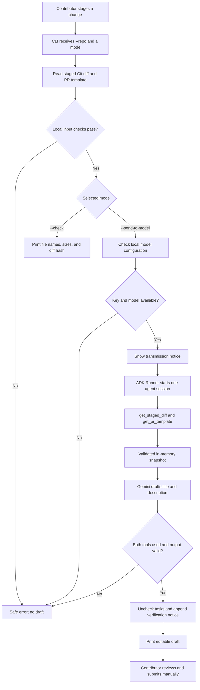

# PR Draft Agent

> Turn validated staged Git changes into an editable, template-aware pull request draft without inventing test results.

---

## Overview

### Problem Statement & Intended Users

- **Problem**: A small code change still needs a clear pull request title and description. Writing one takes time, and a fluent but invented summary is worse than no draft because it hides what was actually verified.
- **Intended Users**: Open-source contributors who have staged a small change and want a first draft. Maintainers benefit indirectly from clearer descriptions, but this agent does not replace review.

### Key Features

- **Staged-only diff**: Excludes unstaged and untracked code changes. The selected PR template is read separately from its current working-tree file.
- **Two read-only tools**: A Google ADK agent retrieves the validated diff and PR template through `get_staged_diff()` and `get_pr_template()`. The model cannot choose paths or run commands.
- **Template-aware output**: Uses a recognized PR template, or documented fallback headings.
- **Honest verification**: Every checklist item is reset to unchecked and a fixed notice states that no tests were run.
- **Local preflight**: `--check` validates inputs and prints a metadata report without a model call or API key.
- **Explicit transmission**: `--send-to-model` is required before staged source material leaves the machine.

---

## Technical Stack

- **Language & Runtime**: Python 3.12, managed with `uv`
- **Agent Framework**: Google Agent Development Kit (ADK) `2.13.0`
- **Model**: Gemini Developer API; verified with `gemini-3.5-flash-lite`, configured through `PR_DRAFT_MODEL`
- **External APIs / Tools**: Gemini API and the local Git executable. No GitHub token, database, or web server.

Verified environment on 2026-10-24: Python 3.12.12, `google-adk==2.13.0`, `google-genai==2.33.0`, and `python-dotenv==1.2.4`, resolved from `uv.lock`.

---

## Architecture & Data Flow



The local checks reject unsupported files, oversized inputs, and recognizable credential material before generation. `--check` stops after the metadata report, so it needs no API key and makes no model call. In generation mode, the two ADK tools read only the validated snapshot; the agent cannot choose new paths or run repository commands. A failed tool or output check produces an error instead of a partial draft. The CLI, capture, agent, and renderer live in `pr_draft_agent/`.

---

## Prerequisites

- Python 3.12 (the project targets `>=3.12,<3.13`)
- [`uv`](https://docs.astral.sh/uv/)
- Git 2.x
- For generation only: a Gemini API key with access to a function-calling model

---

## Installation & Setup

```bash
cd agents/pr-draft-agent
uv sync --python 3.12 --frozen
cp -n .env.example .env
```

Fill `GOOGLE_API_KEY` and `PR_DRAFT_MODEL` in `.env` locally. `.env` is ignored by Git. Existing process environment variables take precedence over the file. Offline checks do not require credentials.

---

## Configuration & Environment Variables

| Variable Name | Required | Default | Description |
| :--- | :--- | :--- | :--- |
| `GOOGLE_API_KEY` | For `--send-to-model` | *None* | Gemini Developer API key. Never pass it as a CLI argument or commit it. |
| `PR_DRAFT_MODEL` | For `--send-to-model` | *None* | Model identifier that supports function calling and is available to your API key. |
| `GOOGLE_GENAI_USE_VERTEXAI` | No | unset | Must stay disabled; Vertex AI mode is rejected by this MVP. |

Only this project's `.env` is loaded explicitly. The target repository's `.env` is never read.

The model is not pinned by the application; provider availability can change. In the final live evaluation, `gemini-2.5-flash` returned `MODEL_UNAVAILABLE` because Google restricts new-user access, while `gemini-3.5-flash-lite` completed all six cases. Set `PR_DRAFT_MODEL=gemini-3.5-flash-lite` to reproduce the verified setup. Current [pricing](https://ai.google.dev/gemini-api/docs/pricing#gemini-3.5-flash-lite) lists standard input/output as free-tier eligible; project quotas still apply. The application does not silently substitute models or change billing settings.

Execution bounds: at most 5 model calls, a 90-second overall generation timeout, a 4,096-token output budget, a 30-second per-request timeout, and at most 2 provider attempts with a 0.5-second initial / 2-second maximum backoff. The Google Gen AI SDK defaults to more retries, so these are set explicitly through ADK's `RunConfig.http_options`. The call cap is not a currency-denominated spending limit.

---

## How to Run

Require an explicit repository; the current directory is never selected silently. Choose exactly one mode.

```bash
# Local, metadata-only validation (no model call)
uv run python -m pr_draft_agent --repo /path/to/checkout --check

# Generation: sends the staged diff, template, and optional intent to Gemini
uv run python -m pr_draft_agent --repo /path/to/checkout --send-to-model \
  --intent "Show a clear error when configuration is missing"
```

The draft is printed to stdout. Progress and errors go to stderr. Saving the draft is your choice:

```bash
uv run python -m pr_draft_agent --repo /path/to/demo --send-to-model > draft.md
```

### Run the demo step by step

Run these steps in the same terminal. They create a disposable repository with a staged bug fix; your project checkout is not changed.

1. From the repository root, install the locked dependencies:

   ```bash
   cd agents/pr-draft-agent
   uv sync --python 3.12 --frozen
   ```

2. Create the demo repository and save its actual path in `DEMO_REPO`:

   ```bash
   DEMO_REPO="$(uv run python examples/create_demo_repo.py | sed -n 's/^Demo repository: //p')"
   git -C "$DEMO_REPO" diff --cached
   ```

   The Git command shows the staged change that the agent will describe. If you open another terminal, repeat this step there to set `DEMO_REPO` again.

3. Check the input locally without an API key or model call:

   ```bash
   uv run python -m pr_draft_agent --repo "$DEMO_REPO" --check
   ```

4. To generate the draft, first set `GOOGLE_API_KEY` and `PR_DRAFT_MODEL` in this project's ignored `.env`, as described in [Installation & Setup](#installation--setup). Then run:

   ```bash
   uv run python -m pr_draft_agent --repo "$DEMO_REPO" --send-to-model \
     --intent "Show a clear error when the configuration file is missing"
   ```

   Review the title, description, unchecked tasks, and verification notice before using the draft in a pull request.

---

## Example Input & Output

The demo command above creates the synthetic repository and runs the offline check. It reports eligibility, relative file names, byte counts, template source, and the diff digest. It never prints file contents:

```text
Eligible: yes
Files: 1
  M config_loader.py
Diff bytes: 385
Template: .github/PULL_REQUEST_TEMPLATE.md
Template bytes: 52
Intent bytes: 0
Diff SHA-256: 3b70d7df6db3ad2f32b87c7cfc9772bb441946c7c4cc6d8f78fcfddbaaaa91a1
```

A generated draft starts with `# <title>`, follows the repository template, and ends with the fixed notice. This excerpt came from a live synthetic bug-fix run on 2026-10-24:

```markdown
# Raise FileNotFoundError when configuration file is missing

## Summary
- Updated `load_config` in `config_loader.py` to check for the existence of the configuration file before attempting to open it.
- Raises a `FileNotFoundError` with a clear message ("Configuration file is missing") if the file does not exist.

## Testing
- [ ] Verify that `load_config` raises a `FileNotFoundError` when passed a path that does not exist.

Verification: This agent inspected staged changes only. It did not execute tests or verify runtime behavior. Review the draft and complete the checklist before submitting.
```

The excerpt is shortened for readability. Six synthetic live cases passed; model behavior can vary between runs.

---

## How to Test

```bash
uv run pytest -q
uv run ruff check .
```

The offline suite uses temporary repositories, a fake ADK runner, and the real ADK `Runner` with a scripted local model. It does not call Gemini. A live model run is a separate acceptance check.

---

## Known Limitations

- Staged changes only. This is not a branch-to-base comparison and does not inspect commits.
- The agent never runs tests, executes code, stages files, commits, or publishes a PR.
- Rename detection is disabled; a rename appears as a deletion plus an addition.
- Inputs are rejected rather than truncated: more than 20 changed paths, diffs over 65,536 UTF-8 bytes, templates over 16,384 bytes, intent over 2,048 bytes, binary files, symlinks, submodules, and unmerged indexes are unsupported.
- Secret detection is a small set of heuristics, not a guarantee. Review staged material before sending it to a hosted model.
- Prompt-injection resistance is partly structural (two no-argument tools) and partly a model behavior that is evaluated, not proven.
- Task-marker normalization protects fenced and multi-line inline code; it is not a full Markdown parser, so indented code blocks are not specially protected. HTML comments in generated drafts are rejected so they cannot hide the verification notice.
- Terminal output is the only interface. ADK Web, GitHub authentication, and automatic PR creation are deferred.
- Development and testing were performed on macOS. Windows is untested.
- Provider retries are bounded, but the five-model-call cap is not a currency-denominated spending limit.
- Model availability is provider-side and can change; an unavailable model is rejected instead of silently substituted.

---

## Security & Privacy Considerations

- **Secrets Handling**: Credentials come only from the process environment or this project's ignored `.env`. The API key is never passed on the command line, included in prompts, or stored in `Settings`.
- **Data Privacy**: With `--send-to-model`, the selected staged diff, file names, PR template, and author intent are sent to Gemini. API usage may be billable. `--check` is local and prints no file contents.
- **Free-tier data use**: Google's current pricing page states that free-tier content may be used to improve its products. The recorded demo uses public synthetic inputs; review the provider's terms before sending private code.
- **Safety**: The model has two no-argument, read-only tools over an already validated in-memory snapshot. It cannot select a repository path, run a command, read another file, or write anything. Repository text is treated as untrusted source data, not instructions.

---

## Verification status

The contribution has been tested locally on macOS. Planning and audit records are kept outside the PR; the commands below reproduce the executable checks.

- **Offline suite**: **219 passed, 1 skipped** on macOS after the Git-hook and output fixes. The skip is the filesystem refusing to create a non-UTF-8 filename; a separate parser test still verifies `INVALID_ENCODING`. Ruff and lock consistency passed.
- **Offline model path**: tests cover a fake runner, the real ADK `Runner` with a scripted local model, both-tool evidence, session isolation, timeout/error mapping, output structure, task normalization, and byte limits. No network call is made by the suite.
- **Fresh environment**: a separate copy omitted `.env`, caches, and the development virtual environment. Frozen offline installation using cached packages, the same suite, Ruff, and CLI help passed.
- **Live Gemini path**: six synthetic cases succeeded with `gemini-3.5-flash-lite`: bug fix, documentation-only change, added test, missing template/intent, partial staging, and one prompt-injection attempt. Both tools were observed, target Git status stayed unchanged, and output did not fabricate test or deployment completion. The supplied key could not generate with `gemini-2.5-flash`.
- **Not established**: broad semantic accuracy, universal prompt-injection resistance, complete secret detection, live behavior across other models/languages, and Windows support. Human review is still required.

---

## Future Improvements

- [ ] Add an ADK Web adapter with the same validation and execution limits.
- [ ] Support branch-to-base comparison in addition to staged changes.
- [ ] Accept test evidence with provenance instead of never claiming test status.
- [ ] Strengthen secret scanning and add per-user spending controls.
- [ ] Create GitHub draft PRs only after explicit review.

---

## License

*This project is contributed under the repository's open-source license.* See the repository [LICENSE](../../LICENSE).
