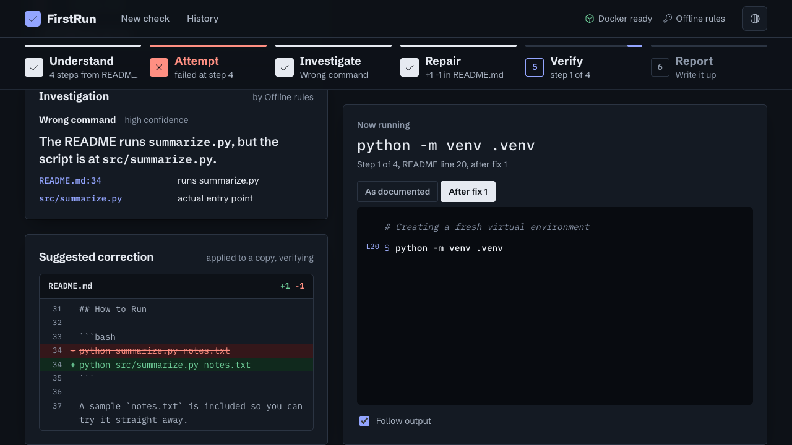
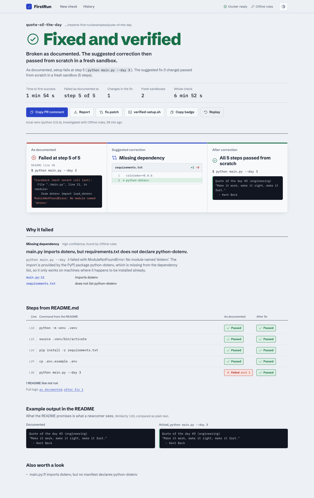
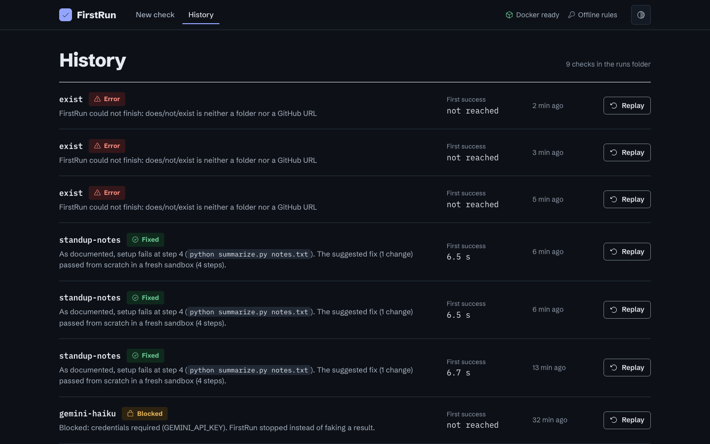
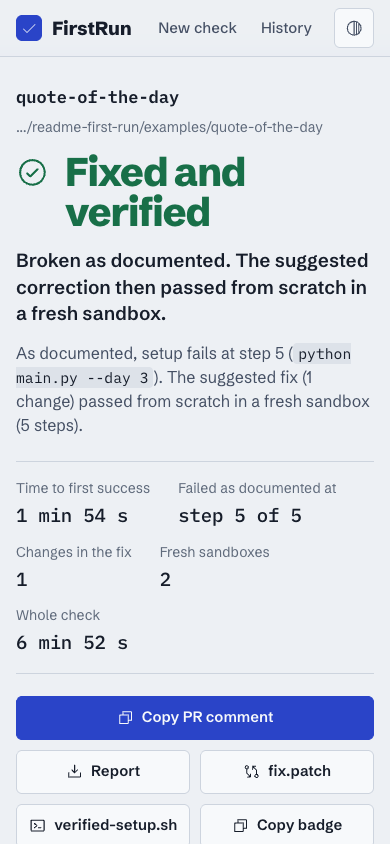

# FirstRun

> Your project works on your laptop. FirstRun checks whether it works on someone else's: it follows your README in a fresh container, keeps proof of where a newcomer gets stuck, proposes the smallest fix and verifies that fix from scratch.



| Report | History and replay | Phone |
| :---: | :---: | :---: |
|  |  |  |

---

## Overview

### Problem Statement & Intended Users
- **Problem**: The person who wrote a README already has the packages installed, the environment variables set and the steps memorised, so the README can look complete while missing something critical: a dependency that was installed globally months ago, a `cp .env.example .env` nobody wrote down, a script that moved to `src/`, a `npm start` left over from a template. Reviewers of this very repository are asked to confirm that "installation instructions work on a fresh clone without unstated dependencies", and today that means doing it by hand for every PR.
- **Intended Users**: Contributors who want to know their project runs for a stranger before they open a PR, and maintainers who want evidence (not a checkbox) that a submission is reproducible.

### Key Features
- **Follows the README literally**: commands are taken verbatim from the README, in order, in one shell, the way a newcomer would type them. Windows-only lines, `git clone` and `cd` into the project are skipped with a recorded reason, never silently.
- **Keeps the first failure**: the "as documented" run is always reported, even when FirstRun knows how to fix it.
- **Investigates like a developer**: a Gemini agent reads files and searches the code with sandboxed tools to connect the error to its cause, with file:line evidence. Without a key, a set of offline rules handles the most common setup failures.
- **Verifies its own fix**: the proposed edits go onto a copy, the patched README is read again and the whole setup runs again in a second fresh sandbox. "Fixed" only means it actually passed.
- **Refuses to fake success**: when a project needs an API key that was not supplied, the verdict is `blocked: credentials required`.
- **Reviewable output**: `report.md`, `report.json`, a `fix.patch`, a `verified-setup.sh` with the exact commands that passed, a ready-to-paste PR comment, and full logs of every run.
- **Four ways in**: a CLI, a local web app that streams the run live (stage tracker, README commands with line numbers, investigator notes, diff, verify) and replays past runs, a batch `scan` that scores every project in a monorepo or every open PR, and an MCP server so coding agents can ask "does this README still work?".
- **Fair to the project**: Node projects get a Node image, every sandbox has git like a real newcomer's machine, placeholder example inputs (`path/to/your/file.pdf`) are noted instead of failed, and network flakes are retried instead of blamed on the README. Authors can annotate a code block with `<!-- firstrun: skip -->`, `long-running` or `expect-exit 1`.

---

## Technical Stack

- **Language & Runtime**: Python 3.10+ (developed and tested on 3.12)
- **Agent Framework / Core Library**: Vanilla Python agent loop (JSON tool calls), no framework
- **Models**: Gemini through the `google-genai` SDK (default `gemini-flash-latest`), or Groq (default `openai/gpt-oss-120b`). Pick with `FIRSTRUN_PROVIDER`, override with `FIRSTRUN_MODEL`. Fully usable offline with built-in rules.
- **External APIs / Tools**: Docker (sandbox), git (to fetch GitHub URLs), GitHub CLI (`gh`, only for scanning PRs), PyPI (the checked project's own installs)
- **Web UI**: standard library HTTP server with Server-Sent Events, hand-written HTML/CSS/JS, no build step
- **MCP**: official `mcp` Python SDK (FastMCP), stdio transport

---

## Architecture & Data Flow

```
 target (folder or GitHub URL)
        |
        v
 [1 Understand]  README + manifests --> planner (Gemini, or offline rules) --> ordered steps
        |                                  skipped lines are kept with a reason
        v
 [2 Attempt]     fresh sandbox #1: run every step in one shell, stop at the first failure
        |        (this "as documented" result is always kept as evidence)
        v
 [3 Investigate] Gemini tool loop: list_files / read_file / search, plus the offline rule hint
        |        --> diagnosis with category, file:line evidence and minimal edits
        v
 [4 Repair]      apply edits to a copy (README, requirements.txt, .env.example) --> git diff
        |
        v
 [5 Verify]      re-read the patched README, run from scratch in fresh sandbox #2
        |        (still failing? back to 3 with the history, up to --max-rounds)
        v
 [6 Report]      runs/<time>-<project>/report.md, report.json, fix.patch, logs/
```

- `firstrun/readme.py` turns README code blocks into steps (offline planner).
- `firstrun/ai.py` holds the Gemini planner, the investigator tool loop and the example output check.
- `firstrun/rules.py` holds the offline diagnosis rules and the import scanner behind the static hints.
- `firstrun/sandbox.py` runs steps in Docker (default) or in a temp folder with a fresh venv (`--sandbox local`).
- `firstrun/agent.py` wires the six stages together. The front ends are `cli.py`, `web.py` (+ `web/`), `scan.py` and `mcp_server.py`.

---

## Prerequisites

- Python 3.10 or newer, with `pip`
- Docker (Docker Desktop on macOS/Windows, Docker Engine on Linux), running. Not needed for `--sandbox local`.
- git, only for checking GitHub URLs
- Optional: a Gemini API key from [Google AI Studio](https://aistudio.google.com/apikey). Without it FirstRun uses its offline rules.

---

## Installation & Setup

1. **Navigate to the project directory:**
   ```bash
   cd agents/readme-first-run
   ```

2. **Set up the virtual environment and install dependencies:**
   ```bash
   python -m venv .venv
   # Windows:
   .venv\Scripts\activate
   # Linux/macOS:
   source .venv/bin/activate

   pip install -r requirements.txt
   ```

3. **Configure environment variables (optional):**
   ```bash
   cp .env.example .env
   ```
   Then put your Gemini key in `.env`. Leaving the placeholder in place keeps FirstRun offline.

---

## Configuration & Environment Variables

| Variable Name | Required | Default | Description |
| :--- | :--- | :--- | :--- |
| `GEMINI_API_KEY` | No | *None* | Gemini key for the AI planner and investigator. `GOOGLE_API_KEY` also works. |
| `GROQ_API_KEY` | No | *None* | Alternative provider: Groq's hosted open models (OpenAI compatible API, called over plain HTTP) |
| `FIRSTRUN_PROVIDER` | No | whichever key is set | `gemini` or `groq`, for when both keys are present |
| `FIRSTRUN_MODEL` | No | `gemini-flash-latest` / `openai/gpt-oss-120b` | Model id for the chosen provider |

These are FirstRun's own settings and are never passed into the project being checked. Secrets the checked project needs go in through `--env-file` or `--pass-env` (see below).

---

## How to Run

Check one of the bundled broken samples. This needs no Docker and no API key:

```bash
python -m firstrun examples/quote-of-the-day --sandbox local --offline
```

The same check in the default Docker sandbox, with Gemini doing the investigation (put your key in `.env` first):

<!-- firstrun: skip needs Docker and a Gemini key on the host -->
```bash
python -m firstrun examples/quote-of-the-day
```

Check a GitHub repository, or one project folder inside a monorepo such as this one (tree URLs with a branch and a path work too):

<!-- firstrun: skip example of a remote target -->
```bash
python -m firstrun https://github.com/gdgcblr/open-source-agents --subdir agents/<project-slug>
```

Open the web app (live pipeline, investigator feed, diff, report, history and replay of past runs), then visit http://127.0.0.1:8765:

```bash
python -m firstrun.web
```

Check every submission in a monorepo, or every open PR of this repository, and get a scoreboard (needs `gh auth login` for PRs; nothing is ever posted to GitHub):

<!-- firstrun: skip needs a GitHub login and runs every project -->
```bash
python -m firstrun.scan --prs gdgcblr/open-source-agents --list
python -m firstrun.scan --root ../.. --dirs agents,tools
```

Let a coding agent call FirstRun as a tool over MCP (setup for Claude Code and Gemini CLI in [docs/mcp.md](docs/mcp.md)):

<!-- firstrun: long-running -->
```bash
python -m firstrun.mcp_server
```

Useful options:

| Option | What it does |
| :--- | :--- |
| `--sandbox local` | Temp folder + fresh venv on this machine instead of Docker. Only for projects you trust. |
| `--offline` | Never call Gemini, use the built-in rules |
| `--env-file secrets.env` / `--pass-env NAME` | Give the checked project the keys it needs (values are never written to reports) |
| `--image python:3.11` | Test against another Python, or a full image when a project needs compilers |
| `--max-rounds 3` / `--no-repair` | How many fix-and-verify rounds to try, or just report |
| `--ci` | Exit code reflects the verdict: 0 passed, 1 broken or fixed, 2 blocked, 3 FirstRun error |
| `<!-- firstrun: skip reason -->` | Put this (or `long-running`) on the line before a code block in your README to tell FirstRun to skip it or treat it as a server |
| `--comment-file comment.md` | Also write a short PR comment version of the report |
| `-v` | Stream the sandbox output live |

Every run writes `runs/<time>-<project>/` with `report.md`, `report.json`, `fix.patch` (when there is a fix) and `logs/`. See [`ci/`](ci/README.md) for running FirstRun on every pull request.

---

## Example Input & Output

All output below is from real runs on the bundled samples (local sandbox, offline rules), trimmed only where marked.

### Example 1: a README that points at the wrong file

**Input**

```bash
python -m firstrun examples/standup-notes --sandbox local --offline
```

**Output**

````text
FirstRun: checking examples/standup-notes

[1/6] Understand
      Plan: 4 steps from README.md (1 line skipped, planner: rules)
      skip  .venv\Scripts\activate  (windows-only (FirstRun runs Linux))

[2/6] Attempt
      Creating a fresh virtual environment
      $ python -m venv .venv
        passed, 2.7s
      $ source .venv/bin/activate
        passed, 0.0s
      $ pip install -r requirements.txt
        passed, 0.9s
      $ python summarize.py notes.txt
        failed (exit 2), 0.0s
      failed as documented, keeping that result before trying a fix

[3/6] Investigate
      found: The README runs `summarize.py`, but the script is at `src/summarize.py`.
        README.md:34  runs summarize.py
        src/summarize.py  actual entry point

[4/6] Repair
      1 edit(s) applied to a copy

[5/6] Verify
      Re-read the patched README: 4 steps
      (... the same four steps again in a fresh venv, all passed ...)

[6/6] Report

Verdict: FIXED
As documented, setup fails at step 4 (`python summarize.py notes.txt`). The suggested fix (1 change) passed from scratch in a fresh sandbox (4 steps).

diff --git a/README.md b/README.md
--- a/README.md
+++ b/README.md
@@ -31,7 +31,7 @@
 ## How to Run
 
 ```bash
-python summarize.py notes.txt
+python src/summarize.py notes.txt
 ```
````

### Example 2: a dependency that only exists on the author's machine

**Input**

```bash
python -m firstrun examples/quote-of-the-day --sandbox local --offline
```

**Output** (excerpt of `runs/<time>-quote-of-the-day/report.md`)

```text
Verdict: FIXED (failed as documented, fix verified)

| 5 | `python main.py --day 3` | 38 | failed | 1 | 0.1s |

    from dotenv import load_dotenv
ModuleNotFoundError: No module named 'dotenv'

3.1 Diagnosis
main.py imports dotenv, but requirements.txt does not declare python-dotenv.
Category: missing_dependency, confidence high, found by rules.
Evidence:
- main.py:11: imports dotenv
- requirements.txt: does not list python-dotenv

Suggested correction:
--- a/requirements.txt
+++ b/requirements.txt
@@ -1 +1,2 @@
 colorama==0.4.6
+python-dotenv

After fix 1: passed. Time to first success: 114.1s for a fresh install, 1 fix, 2 sandbox runs.
```

The run folder also gets `verified-setup.sh`, the exact commands that passed, in order, with their README line numbers.

### Example 3: a project that needs a key nobody gave FirstRun

**Input**

```bash
python -m firstrun examples/gemini-haiku --sandbox local --offline
```

**Output**

```text
Verdict: BLOCKED
Blocked: credentials required (GEMINI_API_KEY). FirstRun stopped instead of faking a result.
```

The report cites `README.md:46` (documents `GEMINI_API_KEY`) and `haiku.py:26` (reads it). Run again with `--pass-env GEMINI_API_KEY` to continue past this point.

---

## How to Test

Unit and integration tests (no Docker, no API key, no network needed except one end-to-end test that installs `python-dotenv` from PyPI):

```bash
pip install pytest
python -m pytest -q
```

Manual check of the three behaviours that matter, using the bundled samples ([`examples/`](examples/README.md)):

```bash
python -m firstrun examples/quote-of-the-day --sandbox local --offline
python -m firstrun examples/standup-notes --sandbox local --offline
python -m firstrun examples/gemini-haiku --sandbox local --offline
```

Expected verdicts: `FIXED` (missing dependency added and verified), `FIXED` (wrong path in the README corrected and verified), `BLOCKED` (needs `GEMINI_API_KEY`, nothing faked).

FirstRun also checks itself: `python -m firstrun . --sandbox local --offline` from this folder runs every command in this README (install, the quickstart, the web app, the MCP server and the test suite) in a fresh environment. The last run passed all 11 steps.

---

## Known Limitations

- Built and tested for Python projects. Other ecosystems are only partly understood: a stray `npm start` is caught, but Node projects are not set up or repaired.
- The default image is `python:3.12-slim`, which has no compilers or git. Projects that build native extensions need `--image python:3.12`.
- Commands run as root inside the container with network access, because `pip install` needs PyPI. The container is limited to 2 GB of memory, 2 CPUs and 512 processes, and is removed after the run.
- Servers and UIs (`streamlit run`, `uvicorn`, `adk web`) pass if they are still running after `--watch` seconds (20 by default). FirstRun does not click through the UI.
- Interactive prompts get no input (stdin is empty), so a program that asks a question fails and is reported as `interactive_input`.
- The offline rules cover the most common setup failures (missing or misnamed dependencies, wrong paths, missing `.env`, template leftovers, credentials, version pins). Anything else needs Gemini, and Gemini can still propose a fix that does not verify. Those runs end as `FAILED` with the unverified patch clearly labelled.
- Each verification is a full fresh install, so a check takes as long as a newcomer's setup (usually 20 seconds to a few minutes). The pip download cache is shared between runs to soften this.
- Tested on macOS (Docker Desktop and local sandbox) and in Linux containers. Windows hosts are untested. Windows-only README lines are skipped, not checked.

---

## Security & Privacy Considerations

- **Secrets Handling**: FirstRun's own key is read from `.env` or the shell. Secrets for the checked project are passed only into the sandbox (a temporary `--env-file` with mode 600 for Docker, deleted after the run). Reports record the variable names, never the values. The local sandbox starts from an empty environment, so nothing from your shell leaks into the project unless you pass it.
- **Data Privacy**: With Gemini enabled, the README, manifests, file list, the failing command's output and any files the investigator chooses to read are sent to the Gemini API. Use `--offline` to keep everything on your machine.
- **Safety**: FirstRun executes the commands written in someone else's README, which is exactly as risky as following that README yourself. The default Docker sandbox runs them in a throwaway container with memory, CPU and process limits, and the checked folder is copied in, never mounted, so the original is not modified. `--sandbox local` runs them on your machine inside a temp folder and venv: use it only for projects you trust. The investigator can only read files inside the project, it cannot run commands, and every edit it proposes is applied to a copy and shown as a diff.

---

## Related Work

Running a README in a sandbox is not a new idea, and FirstRun does not claim it is. What it adds is the combination: the documented path is run literally and its first failure is kept as evidence, the fix is a minimal edit to the docs or manifest rather than a new environment, that fix is verified from scratch in a second sandbox, missing credentials end in an honest `blocked`, and the whole loop also works offline.

| Project | What it does | How FirstRun differs |
| :--- | :--- | :--- |
| [Repo2Run](https://arxiv.org/abs/2502.13681) | Agent that builds a Docker environment until a repo's unit tests run, outputs a Dockerfile | Targets a working test environment. FirstRun targets the README a newcomer reads, and fixes that. |
| [Installamatic](https://arxiv.org/abs/2412.06294) | Agent that reads install docs and tries to install the repo | Closest research idea. No verified documentation patch, no blocked verdict. |
| [ExecutionAgent](https://arxiv.org/abs/2412.10133) | Agent that sets up projects to run their test suites | Same difference as Repo2Run. |
| [EnvBench](https://arxiv.org/abs/2503.14443), [SetupBench](https://github.com/microsoft/SetupBench) | Benchmarks for environment setup agents | Benchmarks, not a tool for maintainers. |
| [pytest-markdown-docs](https://github.com/modal-labs/pytest-markdown-docs), [runme](https://github.com/stateful/runme), cram | Run code blocks from Markdown | Authors have to tag blocks by hand. No investigation, no fix. |
| [newb](https://github.com/ywatanabe1989/newb) | LLM agent tries to use a package from its docs in a container | No fix-and-reverify loop. |
| Dev containers, Copilot `copilot-setup-steps` | Maintainer-written environment config | Somebody has to write and maintain it. FirstRun checks the docs people already have. |

Why it matters: in a study of Python gists, [75.6% needed non-trivial configuration before they ran](https://arxiv.org/abs/1808.04919), and [only 24% of 1.4 million Jupyter notebooks ran without errors](https://koaning.io/posts/many-notebooks), with missing dependencies the most common cause in both.

---

## Future Improvements

- [ ] Node.js and `uv`/`poetry` first-class support (install, diagnose, repair).
- [ ] A second persona that follows the Windows or macOS instructions in a matching runner.
- [ ] Open the verified fix as a pull request automatically (today FirstRun writes `comment.md` and `fix.patch` and leaves posting to a human).
- [ ] Reuse one sandbox image per project between rounds to cut verification time.

---

## License

*This project is contributed under the repository's open-source license.*
