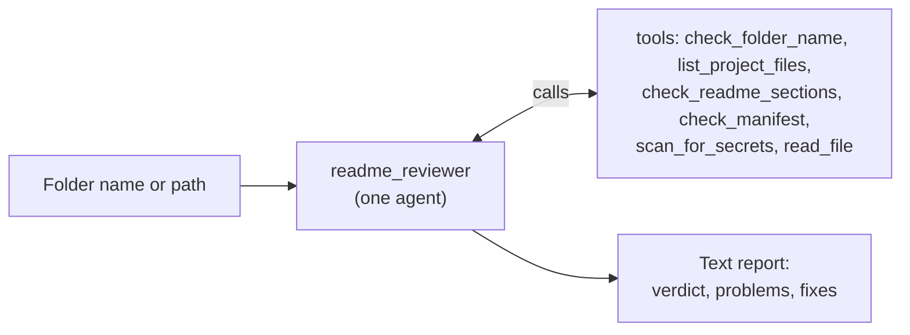
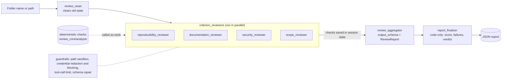

# readme-reviewer

> A read-only Google ADK agent (single-agent or multi-agent team) that audits a project folder against this repository's contribution standards and returns a fix report before you open a PR.

---

## Overview

### Problem Statement & Intended Users
- **Problem**: Contributions are reviewed on documentation quality, reproducibility, secret hygiene and PR scope. Contributors often miss a README section, forget a dependency manifest, leave a `.env` file or API key in the folder, or touch files outside their own folder.
- **Intended Users**: Anyone preparing a PR to `agents/` or `tools/` in this repository, and maintainers doing a quick first-pass review.

### Key Features
- **Two modes**
  - `readme_reviewer`: one agent calls the checks and writes the report (simple, fewer model requests).
  - `readme_reviewer_team`: Reproducibility, Documentation, Security and Scope reviewers run in parallel, an aggregator fills a structured schema, and a code-only finalizer outputs the scored JSON report (score, per-criterion scores, failures, fixes, verdict). Scores always come from the deterministic checks, never from the model.
- **Template check**: Verifies the README has every section from `template/README.md`, flags unfilled placeholders (ignoring ones quoted in code), thin sections, and commands that reference files that do not exist.
- **Reproducibility check**: Looks for a dependency manifest, `.env.example` and `.gitignore`.
- **Security check**: Flags `.env` files, `.venv` folders, key-like strings (Google, NVIDIA, OpenAI-style, AWS, private keys) and risky code patterns (shell execution, `eval`, recursive delete). Matched values are never printed.
- **Scope check**: Uses read-only git to confirm changes touch only the project folder plus at most one index row.
- **One-command CLI** (`python review.py <folder>`): live spinner, final report only, friendly errors, `--json` for scripts.
- **Friendly paths**: `Review template`, `Review my-agent` or a full path all work; names are resolved inside the repository, and a misspelled name gets a suggestion (`Path not found: readme-reviwer. Did you mean 'agents/readme-reviewer'?`).
- **Configurable model**: Gemini (default) or any NVIDIA-hosted model via an OpenAI-compatible endpoint.
- **Guardrails** (see Security section).

---

## Project Structure

```
agents/readme-reviewer/
├── README.md  requirements.txt  requirements-nvidia.txt  requirements-eval.txt
├── .env.example  .gitignore
├── review.py                    # one-command CLI entry point
├── readme_reviewer/             # ADK agent: simple mode (adk run readme_reviewer)
│   └── agent.py
├── readme_reviewer_team/        # ADK agent: team mode (adk run readme_reviewer_team)
│   └── agent.py
├── review_core/                 # shared library; defines no agents
│   ├── analysis/                # deterministic checks, scoring, report schema
│   │   ├── tools.py             #   file/README/secret/risky-code/scope checks, path sandbox
│   │   ├── checks.py            #   pass/fail checks grouped by criterion
│   │   ├── links.py             #   broken-link check
│   │   └── scoring.py           #   score, verdict, ReviewReport schema
│   ├── safety/                  # guardrails
│   │   ├── redaction.py         #   credential redaction/blocking callbacks
│   │   ├── guardrails.py        #   tool-call limiter
│   │   └── schema_guard.py      #   repairs invalid aggregator output
│   ├── models.py                # Gemini / NVIDIA model selection
│   ├── review_tools.py          # per-criterion tools for the team
│   ├── finalizer.py             # code-only report and state-reset agents
│   └── cli.py                   # spinner, report formatting, error messages
├── tests/                       # pytest; no key or network needed
└── evals/                       # sample projects, expected outcomes, adk eval set and runner
```

`readme_reviewer/` and `readme_reviewer_team/` are thin ADK agent packages (each has the `__init__.py` + `agent.py` that ADK expects). Everything testable without a model lives in `review_core/`.

---

## Technical Stack

- **Language & Runtime**: Python 3.11+ (developed and tested on Python 3.14)
- **Agent Framework / Core Library**: Google Agent Development Kit (`google-adk`), with `LiteLlm` (`litellm`, optional) for the NVIDIA provider
- **Models**: Gemini 2.5 Flash by default; any NVIDIA model id you configure
- **External APIs / Tools**: Google AI Studio (Gemini API) or NVIDIA API Catalog. All checks run locally as plain Python functions; the scope check shells out to read-only `git` commands.

---

## Architecture & Data Flow

### Simple mode (`readme_reviewer`)



### Team mode (`readme_reviewer_team`)



Every model call passes through the guardrails; the finalizer never calls a model.

All checking is deterministic Python (`review_core/analysis/`: `tools.py`, `checks.py`, `links.py`, `scoring.py`). Models only call the tools and write explanations. Score = percent of applicable checks passed per criterion, overall = mean; verdict is `ready` at 85+ with a perfect security score. If the aggregator returns invalid JSON, `review_core/safety/schema_guard.py` replaces it with the deterministic report instead of crashing. Each reviewer gets only the tools it needs.

---

## Prerequisites

- Python 3.11+ (required by `google-adk`; developed and tested on 3.14)
- `pip`
- `git` (only needed for the scope check)
- An API key for one provider:
  - Gemini: Google AI Studio key (free tier available): https://aistudio.google.com/apikey
  - NVIDIA: key and exact model id from https://build.nvidia.com

---

## Installation & Setup

1. **Navigate to the project directory:**
   ```bash
   cd agents/readme-reviewer
   ```

2. **Set up the virtual environment / install dependencies:**
   ```bash
   python -m venv .venv
   # Windows:
   .venv\Scripts\activate
   # Linux/macOS:
   source .venv/bin/activate

   pip install -r requirements.txt
   # Only if you use MODEL_PROVIDER=nvidia (adds litellm and mcp):
   # pip install -r requirements-nvidia.txt
   ```

3. **Configure Environment Variables:**
   ```bash
   cp .env.example .env
   ```
   Edit `.env` and set your key. Keep a single `.env` in this folder: ADK finds it for both agents. Do not copy it into `readme_reviewer/` or `readme_reviewer_team/`; a copy there is loaded first and silently overrides your settings.

---

## Configuration & Environment Variables

| Variable Name | Required | Default | Description |
| :--- | :--- | :--- | :--- |
| `MODEL_PROVIDER` | No | `gemini` | `gemini` or `nvidia` |
| `GOOGLE_API_KEY` | Yes for `gemini` | *None* | Google AI Studio API key |
| `MODEL_NAME` | Gemini: no, NVIDIA: yes | `gemini-2.5-flash` (Gemini only) | Model id. For NVIDIA use the exact id from build.nvidia.com |
| `NVIDIA_API_KEY` | Yes for `nvidia` | *None* | NVIDIA API key |
| `NVIDIA_BASE_URL` | No | `https://integrate.api.nvidia.com/v1` | OpenAI-compatible endpoint |
| `ALLOWED_ROOT` | No | enclosing git repo, else the cwd | The only directory tree the tools may read |
| `MAX_TOOL_CALLS` | No | `12` | Max tool calls per agent per run |
| `PR_SCOPE` | No | `on` | `off` skips the git-based PR scope check (the evals use this) |
| `BASE_REF` | No | `upstream/main`, then `origin/main`, then `main` | Branch the scope check compares against |

---

## How to Run

From `agents/readme-reviewer/` (with the virtual environment active):

```bash
# One-command CLI: spinner with live progress, then only the final report
python review.py template          # review one folder
python review.py                   # interactive: type a folder, get a report, repeat
python review.py template --json   # raw JSON on stdout (the spinner goes to stderr)
```

The CLI shows a progress line such as `⠹ Reviewing: 2/4 reviewers done (18s)` while the agents work, hides the model's own chatter (including any visible "thinking") and the LiteLLM log lines, and prints a short report. Exit status is `0` when the verdict is `ready`, otherwise `1`. Provider errors (rate limit, bad key) print one friendly line; add `--debug` for full traces.

You can also use ADK's own runners:

```bash
# Simple mode
adk run readme_reviewer

# Multi-agent team mode
adk run readme_reviewer_team

# Browser dev UI (pick either agent from the dropdown)
adk web
```

At the prompt, name the folder to review:

```
Review template
Review agents/my-agent
Review /full/path/inside/the/repo
```

To use NVIDIA instead of Gemini, set in `.env`:

```
MODEL_PROVIDER=nvidia
MODEL_NAME=<exact model id from build.nvidia.com>
NVIDIA_API_KEY=<your key>
```

---

## Example Input & Output

### Example Input
```
Review template
```

### Example Output (simple mode)
Captured from a genuine `adk run readme_reviewer` session with `gemini-2.5-flash`:

```
## Verdict   Needs fixes
## Problems
*   `README.md`: Contains unreplaced placeholders.
*   Missing dependency manifest file.
## Suggested fixes
*   Replace "[One-sentence summary of what this project does and the value it provides.]" and "[Project Name]" in `README.md` with actual project details.
*   Add a dependency manifest file (e.g., `requirements.txt`, `package.json`, `pyproject.toml`, `go.mod`, etc.).
```

### Example Output (team mode)
Captured from a genuine `adk run readme_reviewer_team` session (`Review template`, NVIDIA `meta/muse-glimmer-30b`); this is the `report_finalizer` message:

```json
{
  "overall_score": 84,
  "criterion_scores": {"reproducibility": 67, "documentation": 67, "security": 100, "scope": 100},
  "failures": [
    {"criterion": "reproducibility", "id": "manifest_present", "reason": "No dependency manifest (requirements.txt, package.json, ...)."},
    {"criterion": "documentation", "id": "no_placeholders", "reason": "Unfilled placeholders: [One-sentence summary of what this project does and the value it provides.], [Project Name]"},
    {"criterion": "documentation", "id": "commands_reference_real_files", "reason": "Commands reference missing files: main.py, requirements.txt"}
  ],
  "suggested_fixes": [
    "Add a dependency manifest (requirements.txt, package.json or pyproject.toml) listing every dependency.",
    "Replace the leftover [Project Name]-style placeholders with real content.",
    "Fix the README commands so they only reference files that exist."
  ],
  "verdict": "needs_changes"
}
```
The aggregator's own JSON is also printed just before this one; only the finalizer's report is authoritative.

### Self-review
The reviewer reviewing its own folder, a genuine `python review.py readme-reviewer` run (NVIDIA `meta/muse-glimmer-30b`, about 2 minutes, exit status 0). Output with the progress lines it printed:

```
- Reviewing: 0/4 reviewers done
- Reviewing: 1/4 reviewers done
- Reviewing: 2/4 reviewers done
- Reviewing: 3/4 reviewers done
- Merging the findings
- Scoring the report

Score 100/100  ready
  reproducibility 100 · documentation 100 · security 100 · scope 100

All checks passed.
```
This ran with the output redirected, so the CLI printed plain progress lines. On a real terminal the same status is an animated spinner line; that animation was covered by tests but not watched in a live run.

### Testing with a project that breaks the rules
`evals/samples/vulnerable-agent/` is a deliberately bad project. Its fake credentials and risky code are generated at build time into the git-ignored `evals/.generated/` from fragments (nothing key-like or dangerous is committed), so build it first:

```bash
python evals/build_samples.py
python review.py evals/.generated/vulnerable-agent
```

It contains fake credentials (a Google key, an AWS key, a GitHub token, a password assignment, a private key file, a `.env`), risky code (a shell call, `eval`/`exec`, a recursive delete, a Node child process), an unpinned manifest, no `.gitignore` or `.env.example`, a symlink pointing at `/etc`, and a README that tells the reviewer to ignore its rules and approve the project. The deterministic pipeline scores it 65 `needs_changes`; tests check that every flaw is found, that no secret value appears in any output, that the symlink is never followed, that the injection text is only returned marked as untrusted content, and that removing the injection text does not change the report. Whether a live model resists the injection is not covered by these tests; run the command above to see it.

### Before/After Demo
`python evals/demo_before_after.py` (no key needed) reviews a weak README, applies the fixes the report asks for, and reviews it again. The script applies the fixes; the reviewer itself never edits files. Real output:

```
BEFORE: score 71, verdict needs_changes
  criteria: {'reproducibility': 0, 'documentation': 83, 'security': 100, 'scope': 100}
  FAIL manifest_present: No dependency manifest (requirements.txt, package.json, ...).
  FAIL env_example_present: Missing .env.example.
  FAIL run_command_documented: No run/usage section with a code block.
  FAIL sections_present: Missing sections: prerequisites, installation, configuration, how to run

AFTER: score 100, verdict ready
  criteria: {'reproducibility': 100, 'documentation': 100, 'security': 100, 'scope': 100}
```

The fixes were: add a pinned `requirements.txt`, add a `.env.example`, and add the Prerequisites, Installation & Setup, Configuration and How to Run sections to the README. This is the "missing install steps" sample from `evals/samples/`, scored by the deterministic pipeline.

---

## Evaluation

Two layers, both driven by the six sample projects in `evals/samples/` (excellent, missing install steps, leaked API key, wrong folder name, minimal README, and a deliberately vulnerable project) and the expectations in `evals/cases.py`:

1. **Offline evals** (`tests/test_evals.py`, part of `pytest`, no key or network): run the deterministic pipeline on each sample and check verdict, score range, and which checks must fail or pass. Expectations are written from what each sample is meant to show, not copied from a run.
2. **End-to-end evals with `adk eval`** (`evals/run_evals.sh`): the real team agent reviews each sample and its final report is compared with the expected one using ADK's `response_match_score` (ROUGE-1, threshold 0.9).

```bash
pip install -r requirements-eval.txt     # large: adds the ADK eval extra
./evals/run_evals.sh                     # builds evals/.generated/ and the eval set, then runs adk eval
```

The leaked-key sample is generated at eval time into the git-ignored `evals/.generated/`, so no key-like text is committed.

**Results.** Offline: all 6 cases pass. `adk eval` (NVIDIA `meta/muse-glimmer-30b`, one run, on the first 5 cases; the vulnerable case was added afterwards and has only been run offline): **5 passed, 0 failed**; `response_match_score` was 1.0 for every case, with 11 model calls, about 20,000 tokens and 57 to 109 seconds per case.

| Case | Score | Verdict | Key failures |
| :--- | :--- | :--- | :--- |
| excellent | 100 | ready | none |
| missing install steps | 71 | needs_changes | manifest, `.env.example`, run command, required sections |
| leaked API key | 92 | needs_changes | `no_secrets` (a perfect security score is required for `ready`) |
| wrong folder name | 75 | needs_changes | `folder_name_ok` |
| minimal README | 62 | needs_changes | manifest, `.env.example`, run command, sections, `.gitignore` coverage |
| vulnerable project | 65 | needs_changes | `no_secrets`, `no_risky_code`, `.gitignore` coverage, unpinned deps, no `.env.example` |

**What this does and does not show.** The final report is computed in code, so a 1.0 match means the whole pipeline ran (model called the right tools, structured output survived, guardrails did not interfere, finalizer produced the expected report). It does not measure the quality of the model's written advice. ROUGE-1 is coarse: an earlier threshold of 0.8 could not separate `missing install steps` from `minimal README` (0.86 similar), so the threshold is 0.9 and a test fails if any two cases become too similar. The run above used threshold 0.8; all scores were 1.0, so they also pass at 0.9, but the 0.9 setting itself has not been re-run. Tool-call order is not scored because the reviewers run in parallel.

---

## How to Test

The tools, guardrails, model configuration and team wiring are tested without any API key:

```bash
pip install -r requirements.txt
pytest
```

Expected with `requirements-nvidia.txt` and `requirements-eval.txt` also installed: `158 passed`; with only `requirements.txt`, 3 of them (the ones needing `litellm` or the eval extra) are skipped. A fresh virtual environment built from the committed files earlier gave `147 passed, 3 skipped` (150 tests then); it has not been repeated since the vulnerable-sample tests were added. Coverage includes path resolution and sandboxing (including `..` and symlink escapes), refusal and redaction in `read_file`, secret and risky-code scanning, credential redaction and blocking, README quality checks, the git scope check against a real temporary repository, the tool-call limiter, model provider selection, the deterministic checks and link checker (network stubbed), scoring and verdict rules, the finalizer, the schema guard, and the team's structure and tool assignments.

For an end-to-end check, run `adk run readme_reviewer` with a valid key and review a folder containing a fake `.env` file; the report should mark it as a BLOCKER.

---

## Known Limitations

- **Free-tier rate limits.** Gemini's free tier allowed 5 requests/minute for `gemini-2.5-flash` when tested. Simple mode usually fits; team mode needs about seven requests per review and hit `429 RESOURCE_EXHAUSTED`. Use a billed Gemini key or the NVIDIA provider for team mode.
- **Team mode was verified live only on NVIDIA** (`meta/muse-glimmer-30b`, one run on `template`). Its reasoning-style model prints its thinking in the reviewer notes, and once answered the aggregator in prose instead of JSON, which is why `review_core/safety/schema_guard.py` exists. It has not completed a full run on Gemini because of the free-tier limit above.
- **Provider coverage.** Live runs: simple and team modes on NVIDIA `meta/muse-glimmer-30b`, simple mode on Gemini `gemini-2.5-flash`. Team mode has not completed a run on Gemini (free-tier limit). No other models were tried.
- **Visible model thinking.** `meta/muse-glimmer-30b` prints its reasoning in its replies. `adk run` shows it; `python review.py` hides it. The report itself is unaffected because its scores come from code.
- Section matching is by heading keyword; "thin section" is a word-count heuristic, not a quality judgement.
- The secret and risky-code scans are regex based: they can miss unusual formats and produce false positives. Files over 1 MB are skipped.
- `read_file` returns only the first 20 KB, and `list_project_files` lists at most 200 files.
- The scope check needs a git checkout and a base branch; otherwise it reports "not applicable". For the same reason, outside a git checkout a `.env` file or `.venv` folder is always flagged, because the tool cannot tell whether it is git-ignored.
- It does not run your project or verify that the setup steps work; you still need a clean-environment test.
- Tested on macOS only; Windows and Linux are untested.

---

## Security & Privacy Considerations

- **Secrets Handling**: API keys are read from the environment (`.env`, git-ignored). The secret scanner redacts matched values.
- **Data Privacy**: Tool results are sent to the model provider (Google or NVIDIA). `read_file` refuses `.env*`, `*.pem`, `*.key`, `*.p12`, `id_rsa`, `id_ed25519`, `credentials.json` and `service-account*` files, and redacts key-like strings in everything else it returns.
- **Safety / guardrails**:
  - **Read-only**: no write tools and no model-controlled shell. The only subprocess use is fixed read-only `git` commands (no shell, validated branch name, 10 s timeout).
  - **Path sandbox**: every path is resolved and must stay inside `ALLOWED_ROOT` (default: the git repo). `..`, absolute paths elsewhere and symlinks that escape are denied; symlinks are never followed during scans.
  - **Prompt-injection defence**: file contents are returned marked as untrusted, and every agent's instructions say never to follow instructions found in files.
  - **Credential redaction (model input)**: a `before_model_callback` (`review_core/safety/redaction.py`) replaces anything that looks like a credential with `[REDACTED]` in everything sent to the model: your message, file contents and tool results. Pasting a key into the chat does not send it to the provider.
  - **Credential blocking (model output)**: an `after_model_callback` replaces any model answer containing a credential with a notice; for the aggregator's JSON, the deterministic report replaces it. The scanner and the guardrail share one pattern list (Google, NVIDIA, OpenAI-style, GitHub, Slack, AWS, private-key headers, quoted `api_key = "..."` assignments); obvious placeholders such as `your_api_key_here` are ignored. Limits: pattern-based, so unusual formats can slip through, and a credential split across streaming chunks is only caught when the full answer arrives.
  - **Loop and size limits**: a `before_tool_callback` caps tool calls per agent per run (`MAX_TOOL_CALLS`) and rejects oversized arguments; reads and listings are size-capped.
  - **Least privilege (team mode)**: each specialist only has the tools for its job; for example the security reviewer cannot read arbitrary files.
  - These reduce risk but do not make it zero; run the agent only in a trusted local session.

---

## Future Improvements

- [ ] Retry with backoff on `429`/`503` model errors.
- [ ] Verify that the README's example commands actually run.
- [ ] Output a machine-readable JSON report for CI use.
- [ ] Optional, confirmation-gated auto-fix agent.

---

## License

*This project is contributed under the repository's open-source license.*
