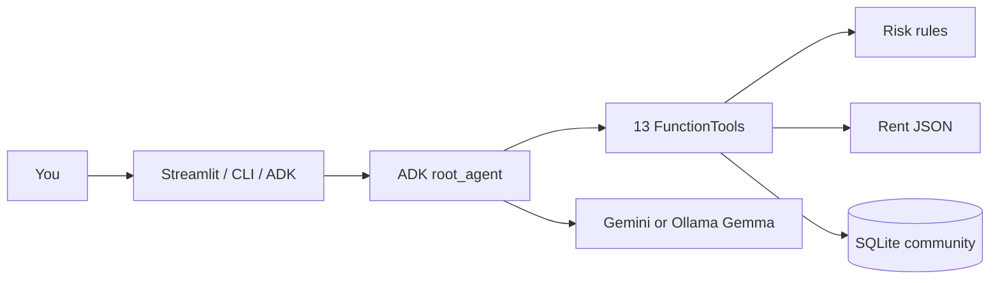

> **📍 This is the RentRakshak project README.** Everything for this agent lives under **`agents/rentrakshak/`** only. The monorepo root [`README.md`](../../README.md) is unchanged (shared catalog).

<div align="center">


<br/>

[](https://google.github.io/adk-docs/)
[](.)
[](.)
[](DOCKER.md)
[-22C55E?style=for-the-badge)](USAGE_GUIDE.md)

<br/>


<br/>

### Full interactive README (animations + live risk preview)

GitHub **does not run JavaScript inside `README.md`** — that is why the rich UI lives in **`README.html`**.  
On GitHub you still get typing text, animated SVG, Mermaid, and collapsible sections below.

| Action | Link |
|--------|------|
| **Open interactive HTML in browser** | [**README.html**](README.html) (clone repo → double-click, or use preview below) |
| **Preview interactive HTML (this PR branch)** | [Open README.html in browser](https://htmlpreview.github.io/?https://raw.githubusercontent.com/rockygeekz/open-source-agents/feat/rentrakshak/agents/rentrakshak/README.html) |
| **View this README on GitHub** | [agents/rentrakshak/README.md](https://github.com/rockygeekz/open-source-agents/blob/feat/rentrakshak/agents/rentrakshak/README.md) (banner, typing SVG, Mermaid, `<details>`) |

```bash
# Local: same folder as this file
open README.html          # macOS
xdg-open README.html      # Linux
```

</div>

# RentRakshak

**RentRakshak** is a demo-ready, open-source **Bengaluru rental safety agent** combined with an **anonymous tenant community** and **vacating-room discovery board**. It is built for people who are about to pay a deposit—not after they have already been scammed.

Hackathon submission for [GDG Cloud Bengaluru — open-source-agents](https://github.com/gdgcblr/open-source-agents). Product name is **RentRakshak** everywhere (UI, agent instructions, docs).

---

## Architecture (live diagram on GitHub)



---

## Explore features (click to expand)

<details open>
<summary><strong>1. AI rental safety agent</strong> — listing + chat, rule IDs, evidence excerpts</summary>

Paste a property listing and optional broker chat. Get **RF-001…** findings, risk tier, verification steps. **Low risk ≠ verified.**

```bash
python main.py --listing @tests/fixtures/suspicious_listing.txt
```

</details>

<details>
<summary><strong>2. Bengaluru rent estimator</strong> — transparent comparables, no hallucinated rent</summary>

Whitefield, Koramangala, HSR, Bellandur, and more. Returns **insufficient data** instead of guessing.

</details>

<details>
<summary><strong>3. Anonymous tenant community</strong> — moderated, PII redaction</summary>

Share experiences without legal name. Search by locality and category.

</details>

<details>
<summary><strong>4. Vacating / room board</strong> — active → filled / expired</summary>

Tenant handover leads; private contact in MVP.

</details>

<details>
<summary><strong>5. Karnataka checklist</strong> — sourced references, no fake deposit cap</summary>

See `data/legal_sources.json` and checklist tools.

</details>

<details>
<summary><strong>6. Docker + local Gemma</strong></summary>

```bash
docker compose run --rm test
export RENTRAKSHAK_LLM_BACKEND=ollama RENTRAKSHAK_OLLAMA_MODEL=gemma3:4b
adk web adk_agent
```

</details>

---

## Who this is for

| Audience | What RentRakshak gives them |
|----------|----------------------------|
| **Students & fresh graduates** | Plain-language risk reports before paying token money; questions to ask brokers |
| **Interns & relocators** | Locality rent **ranges** from a transparent dataset (not hallucinated prices) |
| **Room / flat / PG seekers** | Listing **plus** landlord chat analyzed together for contradictions |
| **Current tenants** | Share experiences **without** publishing real name or contact |
| **Tenants vacating soon** | Post availability so the next person finds a handover lead—not a shady sublet marketplace |
| **Anyone signing in Karnataka** | Agreement **checklist** with source links and explicit uncertainty where law is unclear |

---

## Problem statement

Bengaluru’s rental market moves fast: listings on portals, brokers on WhatsApp, urgent “token today” pressure, and deposits that are hard to recover. Generic chatbots can **sound** helpful but often **invent** rent figures, **miss** scam patterns in pasted chats, or **treat scam text as instructions**.

RentRakshak is designed as **more than a chatbot**:

- **Evidence-backed** warnings (rule id, severity, excerpt from *your* text, next step).
- **Deterministic** rent and moderation logic—the LLM orchestrates; it does not own security or math.
- **Community memory** that is anonymous, moderated, and never presented as verified fact.
- **Google ADK** as the real orchestration layer (13 typed tools), with Gemini when you choose to enable it.

---

## Core experiences (what judges can demo)

### 1. AI rental safety agent (listing + chat)

Paste a property listing, optional broker/owner chat, and optional structured fields (locality, rent, deposit, BHK). The system returns a **structured safety report**:

- Extracted property details and **missing** information  
- **Risk category**: low concern · needs verification · high concern · critical warning  
- **Red-flag findings** with rule IDs (e.g. RF-001 payment before viewing, RF-005 OTP/password, RF-003 third-party payment)  
- **Evidence excerpts** copied from input (reproducible, same input → same rules)  
- Recommended **verification actions** and **questions to ask before paying**  
- Clear **limitations** (no independent verification of owner or property)

The agent does **not** label a listing fraudulent only because rent is low or the contact is a broker. Low risk never means “verified safe.”

**Entry points:** Streamlit **Analyze** tab · `python main.py` (no API key) · ADK `generate_rental_safety_report_tool` / natural-language via `adk run`.

---

### 2. Bengaluru rent estimator (transparent, honest data)

Supports localities including **Whitefield, Marathahalli, Bellandur, Electronic City, Koramangala, HSR Layout, Indiranagar, Hebbal**.

- Matches locality + optional BHK, furnishing, property type against `data/rent_comparables.json`  
- Reports **comparable count**, **min / median / max**, **oldest/newest** observation dates  
- Labels each row: `illustrative_sample`, `observed_listing`, etc.  
- When data is insufficient, returns **no fabricated range**—the LLM is instructed to use the tool only  

**Separate tool:** `assess_deposit_terms` — months-of-rent style guidance **without** inventing a universal Karnataka deposit cap.

---

### 3. Anonymous tenant experiences (community)

Tenants share **categories** such as deposit/refund, maintenance, communication, agreement clarity, move-out, and more—with **positive / neutral / negative** sentiment.

- **No** legal name, email, or phone required to submit  
- **Deterministic moderation**: PII redaction, abuse rejection, unverified criminal accusations held  
- **Legitimate negative** reviews are allowed; the system does not auto-reject negativity  
- Public browse: filter by locality, category, property type, sentiment  
- **Edit token** (secret) for withdraw; never exposed in search results  
- **Report content** workflow for abuse or suspicious posts  

Posts are labeled **user-submitted experiences**, not facts. Small samples are not turned into “everyone in this area is bad.”

---

### 4. Vacating tenant & room availability board

For tenants planning to leave who want to help the **next** tenant discover a room lead (room takeover, roommate replacement, availability lead).

- Status workflow: **draft → pending_review → active → filled / withdrawn / expired**  
- **Private contact** by default (not shown in public search)  
- **Lease safeguard** messaging: check agreement and owner permission  
- Search by locality, room type, max rent; expired posts drop off active results  
- Poster manages post with **edit_token** (authorized status changes only)

---

### 5. Karnataka rental guidance & agreement checklist

12+ checklist items: viewing, authority, written terms, refund, maintenance, notice period, inventory, parties, payments, stamp duty / registration (flagged **needs clarification**), police verification (guidance only), pay-last discipline.

Legal references stored with **title, URL, section, date_checked, scope** in `data/legal_sources.json`. The product **distinguishes**:

- Legal obligations (where sourced)  
- Official guidance  
- Practical recommendations  
- **Uncertainty** when law cannot be confirmed  

---

### 6. Community-aware analysis (integrated, cautious)

When locality is known, the safety report can include a **community summary**: count of published posts, recurring **categories** (not allegations against named individuals). The agent is instructed to:

- Use community as **questions to verify**, not automatic fraud scores  
- State sample size limits  
- Never expose drafts, tokens, or private contact  

---

## Supporting capabilities (strong engineering, not “side notes”)

These matter for trust and judging—even when they are not the headline demo tab.

| Capability | Why it matters |
|------------|----------------|
| **13 ADK `FunctionTool`s** | Typed, testable contract; model must call tools for facts |
| **Deterministic red-flag engine** | Reproducible hackathon judging; evidence tied to input text |
| **Prompt-injection handling** | Listings/chats treated as **untrusted data**, not instructions |
| **PII & secret detection** | Phones, emails, OTP patterns in posts and context |
| **Optional Model Armor hook** | Documented GCP boundary; graceful when unset |
| **SQLite persistence** | Real community and vacating workflows, not mock JSON |
| **Parameterized SQL** | Injection-safe DB access |
| **Pydantic validation** | Tool inputs rejected safely at the boundary |
| **HTML escaping in UI** | Stored XSS mitigation for community text |
| **32 offline pytest tests** | Risk, rent, community, vacating, checklist, agent, integration |
| **Dual runtime** | Works **without** API key (`main.py`, pytest, Streamlit analyze); **with** Gemini (`adk web`) |
| **Demo seed script** | `scripts/seed_demo_data.py` for repeatable judge walkthrough |
| **FEATURE_VERIFICATION_GUIDE.md** | Full manual QA runbook (Sections A–I) |
| **Phased build plan** | `plan/01`–`12-placeholder.md` shows intentional architecture |
| **Docker image** | Reproducible build: `docker compose build` → `test` / `cli` / `seed` (see **[DOCKER.md](DOCKER.md)**) |

---

## Docker (recommended for judges & CI)

No local Python required. Image runs **pytest** and **deterministic safety reports** offline.

```bash
cd agents/rentrakshak
docker compose build
docker compose run --rm test          # 40 tests
docker compose run --rm cli           # suspicious listing JSON report
docker compose run --rm seed          # demo SQLite in a named volume
```

Details: **[DOCKER.md](DOCKER.md)**.

---

## ADK tool catalog

| Tool | Role |
|------|------|
| `analyze_rental_listing` | Extract fields + contradictions |
| `detect_rental_red_flags` | Rule findings + risk category |
| `estimate_bengaluru_rent_tool` | Comparable-based range |
| `assess_deposit_terms_tool` | Deposit months + notes, no fake legal caps |
| `build_rental_checklist_tool` | Full checklist items |
| `get_karnataka_rental_guidance_tool` | Source-backed legal references |
| `create_anonymous_experience_tool` | Moderated community write |
| `search_anonymous_experiences_tool` | Public search only |
| `report_community_content_tool` | Abuse / spam reports |
| `create_vacating_post_tool` | Availability board write |
| `search_available_rooms_tool` | Active rooms only |
| `update_vacating_post_status_tool` | Authorized lifecycle updates |
| `generate_rental_safety_report_tool` | End-to-end structured report |

---

## Google technology choices

| Technology | How RentRakshak uses it |
|------------|-------------------------|
| **[Google ADK](https://google.github.io/adk-docs/)** | `root_agent` in `rentrakshak/agent.py`; tools in `rentrakshak/tools/registry.py`; CLI via `adk_agent/` |
| **Gemini** (`gemini-2.0-flash`) | Orchestration and natural language when `GOOGLE_API_KEY` is set |
| **Gemma (optional)** | Documented Vertex path in `.env.example` for extraction/summary workloads |
| **[Model Armor](https://docs.cloud.google.com/model-armor/overview) (optional)** | `guardrails/model_armor.py` — optional screening; local rules always on |
| **Responsible AI posture** | No false verification; untrusted content; limitations surfaced in every report |

---

## Architecture

```
[Streamlit UI] [main.py CLI] [adk run / adk web]
        │
        ▼
┌─────────────────────┐
│  ADK root_agent     │  ← Gemini when GOOGLE_API_KEY set
│  (13 FunctionTools) │
└──────────┬──────────┘
           │
     ┌─────┴─────┬─────────────┬──────────────┐
     ▼           ▼             ▼              ▼
 risk_rules   rent_estimator  community     vacating
 listing_parser checklist     guardrails    deposit
 safety_report (aggregator)
           │
           ▼
    SQLite + data/*.json
```

**Design principle:** Anything that affects safety, privacy, money, or persistence is **deterministic Python**. The model explains and routes; it does not silently change scores or publish PII.

---

## Sample output (deterministic CLI)

```bash
python main.py --listing @tests/fixtures/suspicious_listing.txt
```

Expect `risk_category: critical_warning`, findings such as **RF-005** (OTP) and payment-pressure rules, plus `guardrail_notes` if the listing contains instruction-override text. No API call is made.

Clean fixture (`tests/fixtures/clean_listing.txt`) yields lower concern without claiming the flat was verified.

---

## Installation

```bash
cd agents/rentrakshak
python3 -m venv .venv && source .venv/bin/activate
pip install -r requirements.txt
pip install -e .
cp .env.example .env
python scripts/seed_demo_data.py
```

## Commands (judges)

| Goal | Command |
|------|---------|
| **Docker smoke (fastest)** | `docker compose build && docker compose run --rm test` |
| **Docker safety report** | `docker compose run --rm cli` |
| **Prove safeguards (local)** | `pytest -q` → 40 passed, offline |
| **No-key demo (local)** | `python main.py --listing @tests/fixtures/suspicious_listing.txt` |
| **HTML web demo (mockup-style UI)** | `./scripts/run_web_demo.sh` → http://127.0.0.1:8080 — upload **JPG/PNG screenshots** (Ollama Gemma or Gemini vision), community, vacating — see `UI_ROADMAP.md` |
| **Streamlit** | `streamlit run ui/streamlit_app.py` (optional) |
| **ADK + Gemini** | `export GOOGLE_API_KEY=... && adk web adk_agent` |
| **Reset demo DB** | `rm -f data/rentrakshak.db && python scripts/seed_demo_data.py` |

Detailed walkthrough: **[USAGE_GUIDE.md](USAGE_GUIDE.md)** · Manual QA: **[FEATURE_VERIFICATION_GUIDE.md](FEATURE_VERIFICATION_GUIDE.md)**

---

## Model setup

| Mode | When to use | Setup |
|------|-------------|--------|
| **Deterministic only** | Judges, CI, Docker `test` | No model; `main.py` / tools |
| **Gemini (cloud)** | Hosted ADK chat | `GOOGLE_API_KEY` + `RENTRAKSHAK_MODEL` |
| **Gemma local (Ollama)** | Your Mac, no API key | `pip install -r requirements-ollama.txt`, `RENTRAKSHAK_LLM_BACKEND=ollama`, `RENTRAKSHAK_OLLAMA_MODEL=gemma3:4b` |
| **Auto** | Prefer Gemini if key exists, else Ollama | `RENTRAKSHAK_USE_OLLAMA=true` |

```bash
python scripts/check_ollama.py   # verify gemma3:4b is pulled
adk web adk_agent
```

- **Gemma on Vertex (optional):** see `.env.example`  
- **Fully offline:** pytest, `main.py`, Docker — no LLM required  

---

## Community privacy & moderation policy

- Submissions do not require legal identity; we do not collect Aadhaar/PAN/bank details for community posts.  
- Phone/email in free text is **redacted** or submissions **held/rejected** when abusive.  
- Public API/search never returns `edit_token` or private contact fields.  
- Reports are stored for moderation review.  
- Anonymity is **best-effort** (timestamps and network metadata may still exist in real deployments—documented honestly).  

---

## Data & legal methodology

- **Rent:** `data/rent_comparables.json` — fictional/demo URLs where marked; asking rents, not transactions.  
- **Law:** `data/legal_sources.json` — pointers for humans; not a substitute for a lawyer.  
- **No scraped live portal data** in the repo (terms-safe demo dataset).  

---

## Security limitations (honest)

- Guardrails reduce prompt injection and PII risk; they do not eliminate it.  
- Model Armor is optional and not fully wired to GCP in the MVP.  
- RentRakshak never independently verifies properties, owners, or reviews.  
- Do not commit `.env` or `*.db`.  

---

## What makes this hackathon-strong

1. **ADK is central** — not a single `chat.completions` script with fake “tools.”  
2. **Show guardrails live** — suspicious fixture + injection line in listing.  
3. **Show community + vacating** — persistent SQLite, privacy defaults.  
4. **Show honesty** — illustrative rent data labeled; insufficient data → no guess.  
5. **Show tests** — `pytest -q` in front of judges.  

---

## Future work

In-app contact relay, rate limiting, admin moderation console, licensed rent feeds, full Model Armor client, Gemma extraction microservice for unstructured listings.

---

## Contributing

Follow [CONTRIBUTING.md](../../CONTRIBUTING.md). Scope changes to `agents/rentrakshak/`.

## License

MIT (repository root).
