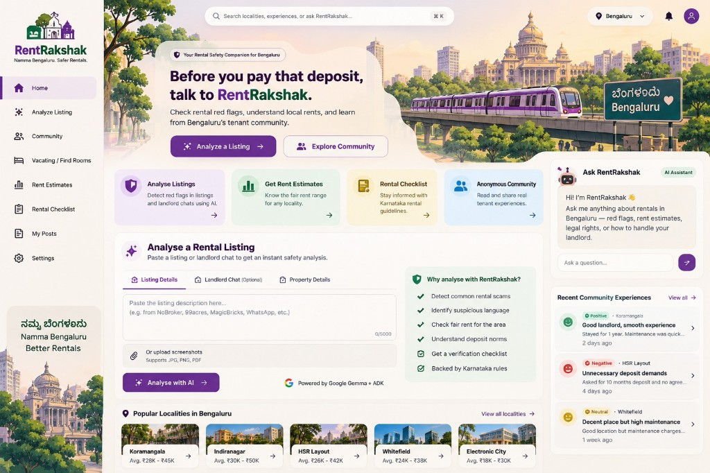

# RentRakshak UI roadmap (mockup alignment)

Reference: purple **dashboard mockup** (sidebar, hero, locality cards, analyse module with upload, Ask RentRakshak rail).

*Full-fidelity target design (Namma Metro / Vidhana Soudha hero, polished analyse module, in-page ADK chat). The shipped `web/` demo implements the functional pieces below; visual polish tracks this mockup.*

## Implemented in `web/` (v0.2)

| Mockup element | Status |
|----------------|--------|
| Sidebar navigation (Home, Analyze, Community, Vacating, Rent, Checklist) | ✅ |
| Hero + feature cards + CTAs | ✅ |
| Popular Bengaluru locality cards with rent ranges | ✅ |
| Analyse listing — tabs: listing / chat / property details | ✅ |
| File upload — TXT, PDF text extract, JPG/PNG/WebP vision OCR | ✅ |
| Rent estimate detail view | ✅ |
| Community feed with locality, category, sentiment, property type | ✅ |
| Share experience — rent band, escalations, ratings | ✅ |
| Vacating search + richer listing fields | ✅ |
| Ask RentRakshak rail (deterministic FAQ) | ✅ |
| Recent experiences rail | ✅ |
| Light purple theme | ✅ |
| Demo seed (12 experiences, 4 vacating posts) | ✅ |

## Future enhancements (vs mockup above)

- [ ] Hero illustration matching mockup (Vidhana Soudha / Namma Metro train)
- [ ] Scanned PDF → page render + vision (image screenshots work via Ollama Gemma / Gemini)
- [ ] Document AI fallback for low-quality photos
- [ ] In-page ADK chat WebSocket to Gemini or Ollama
- [ ] **My Posts** — manage with edit token
- [ ] Settings + privacy panel
- [ ] Mobile-responsive sidebar drawer
- [ ] Map view of locality heat (demo data only)

Run demo: `./scripts/run_web_demo.sh` → http://127.0.0.1:8080
