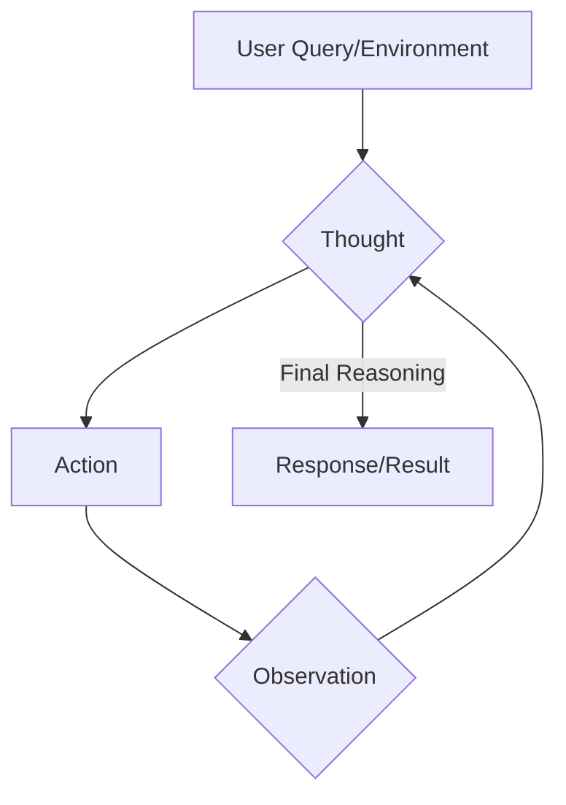

# ReAct: Synergizing Reasoning and Acting in Language Models

## Executive Summary
ReAct proposes a novel paradigm for language models by interleaving verbalized reasoning (Thought), task-specific actions (Action), and environment observations (Observation). This approach enables large language models to perform dynamic reasoning to create, maintain, and adjust action plans, as well as to handle exceptions. It moves beyond isolated, fixed reasoning architectures, offering a more integrated solution for tasks requiring interactive decision-making and accurate reasoning. ReAct demonstrates significant performance improvements over baselines on benchmarks such as AlfWorld and Webshop, and can be effectively combined with methods like Chain-of-Thought with Self-Consistency (CoT-SC) for enhanced factuality and flexibility.

## Key Insights
- ReAct synergizes reasoning (Thought) and acting (Action) by incorporating environment observations into a continuous input stream for language models, facilitating dynamic planning and interactive decision-making.
- The method significantly outperforms traditional prompting and fine-tuning baselines, including Act, BUTLER, and imitation learning (IL) variants, across various interactive reasoning tasks such as AlfWorld and Webshop.
- ReAct's design allows it to adapt its thought processes based on observed outcomes, leading to more grounded, fact-driven, and trustworthy problem-solving trajectories.
- It can be effectively combined with other reasoning techniques, such as CoT-SC, to further enhance performance, especially for tasks requiring both internal knowledge and external factual retrieval.
- ReAct provides an intuitive and straightforward prompting approach, where human annotators can naturally express thoughts in language alongside their actions.

## AlfWorld Task-Specific Success Rates (%)

| Method | Pick | Clean | Heat | Cool | Look | Pick 2 | All |
| --- | --- | --- | --- | --- | --- | --- | --- |
| Act (best of 6) | 88 | 42 | 74 | 67 | 72 | 41 | 45 |
| ReAct (avg) | 65 | 39 | 83 | 76 | 55 | 24 | 57 |
| ReAct (best of 6) | 92 | 58 | 96 | 86 | 78 | 41 | 71 |
| ReAct-IM (avg) | 55 | 59 | 60 | 55 | 23 | 24 | 48 |
| ReAct-IM (best of 6) | 62 | 68 | 87 | 57 | 39 | 33 | 53 |
| BUTLERg (best of 8) | 33 | 26 | 70 | 76 | 17 | 12 | 22 |
| BUTLER (best of 8) | 46 | 39 | 74 | 100 | 22 | 24 | 37 |

## Architecture Diagram

