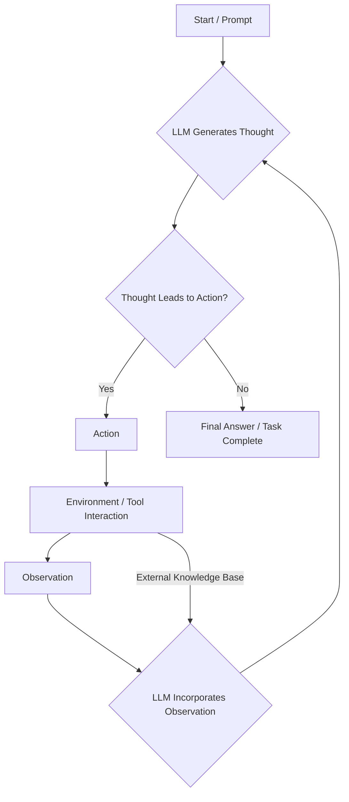

# ReAct: Synergizing Reasoning and Acting in Language Models

## Executive Summary
The paper introduces ReAct, a novel approach that synergizes reasoning and acting in large language models (LLMs). Unlike prior methods that separate these capabilities, ReAct interleaves textual reasoning traces with environment-specific actions and observations. This closed-loop system allows LLMs to dynamically adapt their reasoning based on real-world feedback, enabling them to tackle complex interactive decision-making tasks (e.g., knowledge retrieval, embodied tasks) with improved performance, trustworthiness, and human interpretability across benchmarks like HotpotQA, Fever, AlfWorld, and Webshop.

## Key Insights
- ReAct effectively interleaves reasoning (Thought) and acting (Action/Observation), enabling dynamic adaptation to environmental feedback in a closed-loop system.
- Demonstrates superior performance on interactive tasks, including question answering (HotpotQA, Fever), embodied tasks (AlfWorld), and web navigation (Webshop), compared to reasoning-only (CoT) or acting-only (Act) baselines.
- Enhances groundedness, fact-driven problem-solving, and trustworthiness by integrating external knowledge bases and real-time observations into the reasoning process.
- Provides interpretable reasoning traces, improving human understanding and auditability of the model's decision-making process.
- The approach is generalizable, allowing LLMs to perform various types of reasoning (e.g., goal decomposition, commonsense inference) for different tasks.

## PaLM-540B Prompting Results on HotpotQA and Fever

| Method | HotpotQA EM | Fever Acc |
| --- | --- | --- |
| CoT-SC | 33.4 | 60.4 |
| Act | 25.7 | 58.9 |
| ReAct | 27.4 | 60.9 |
| CoT-SC→ ReAct | 34.2 | 64.6 |
| ReAct→ CoT-SC | 35.1 | 62.0 |
| Supervised SoTA | 67.5 | 89.5 |

## Architecture Diagram

