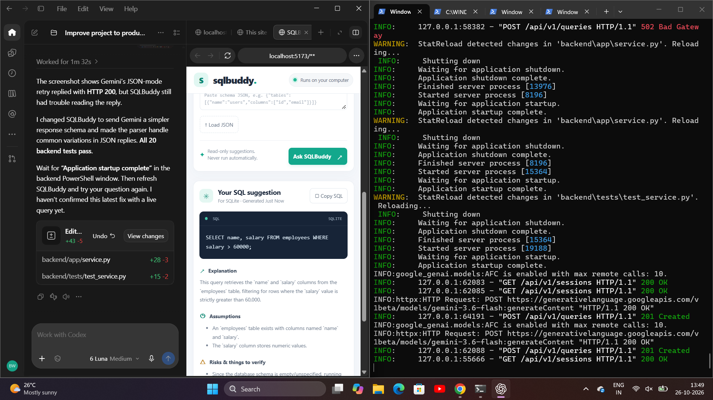
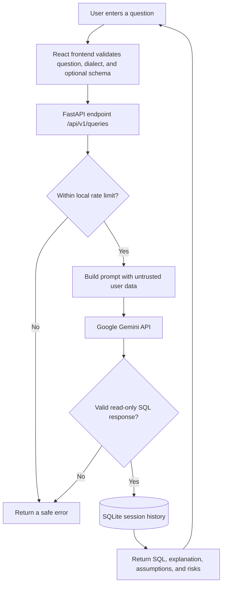

# SQLBuddy

SQLBuddy is a local full-stack SQL learning assistant. The React and TypeScript website talks to a Python FastAPI service, which asks Google Gemini for a structured, read-only SQL suggestion. SQLite stores the app's saved questions and answers. The original Python command-line app remains available.

## Contents

- [Features](#what-it-can-do)
- [Screenshot](#screenshot)
- [How a request flows](#how-a-request-flows)
- [Requirements](#requirements)
- [Windows PowerShell setup](#windows-powershell-first-time-setup)
- [Docker setup](#run-with-docker-desktop)
- [Schema JSON example](#schema-json-example)
- [API overview](#api-overview)
- [Configuration](#configuration)
- [Tests and checks](#tests-and-checks)
- [Troubleshooting](#troubleshooting)
- [Command-line app](#keep-using-the-command-line-version)
- [Safety and limitations](#safety-and-limitations)

## What it can do

- Ask in plain English and choose PostgreSQL, MySQL, or SQLite.
- Add table and column context by typing JSON or selecting a local JSON file.
- Review the suggested SQL, explanation, assumptions, risks, and unverified status.
- Copy SQL and create, reopen, rename, and delete saved sessions.
- Keep saved history in a local SQLite database. SQLBuddy never connects to your database or executes SQL.
- Keep the Gemini key in the backend environment only.

## Screenshot

This screenshot shows SQLBuddy generating a query, explaining it, and listing assumptions and risks. The query is displayed as text and is not run against a database.



## How a request flows

The browser sends the question, selected SQL dialect, and optional schema context to the local API. The backend asks Gemini for a read-only suggestion, validates the response, saves it in local SQLite history, and returns it to the browser. SQLBuddy never connects to or executes queries against a user database.



### Main components

| Component | Responsibility |
| --- | --- |
| React + TypeScript frontend | Collects questions and schema context, shows results, and manages saved-session controls. |
| FastAPI backend | Validates requests, calls Gemini, blocks unsafe SQL responses, and exposes the `/api/v1` API. |
| SQLite history store | Saves question sessions and answers locally on this computer. |
| Google Gemini API | Generates the suggested SQL and explanation; it never receives a database connection. |

## Requirements

- Python 3.10 or newer and Node.js 20 or newer for running without Docker.
- Docker Desktop (optional, for the one-command container setup).
- A Gemini API key for actual AI answers. UI, API, and tests can be checked without making live model requests.

## Windows PowerShell: first-time setup

Run these commands from the repository root (`open-source-agents`):

```powershell
cd agents\sqlbuddy
if (-not (Test-Path backend\.env)) { Copy-Item backend\.env.example backend\.env }
notepad backend\.env
```

In Notepad, replace `your_gemini_api_key_here` with your Gemini key, save, and close the window. The backend loads `backend\.env` when it starts. Never share or commit this file. The CLI's root `.env` is separate and is not overwritten.

### Start the backend

Open a PowerShell window in `agents\sqlbuddy` and run:

```powershell
python -m venv .venv
.\.venv\Scripts\Activate.ps1
python -m pip install -r backend\requirements.txt
python -m uvicorn app.main:app --app-dir backend --reload --port 8000
```

If PowerShell says script activation is disabled, run `Set-ExecutionPolicy -Scope Process -ExecutionPolicy Bypass` in that window, then activate again. Keep this backend window running. The API health check is at <http://localhost:8000/api/v1/health>; interactive API documentation is at <http://localhost:8000/docs>.

### Start the website

Open a **second** PowerShell window, go to the same `agents\sqlbuddy` folder, then run:

```powershell
cd agents\sqlbuddy
cd frontend
npm install
npm run dev
```

Open <http://localhost:5173> in your browser. Leave both terminal windows open while using SQLBuddy. Press **Ctrl+C** in each window to stop its server.

### Run with Docker Desktop

From `agents\sqlbuddy`, after setting the key in `backend\.env`, run:

```powershell
docker compose up --build
```

Open <http://localhost:5173>. Docker Compose stores history in a named volume. Stop the app with **Ctrl+C**, then run `docker compose down` when you want to stop and remove its containers. The database volume remains so your saved history persists.

## Schema JSON example

The schema file is read locally by the browser, checked, and sent to the backend as context. It is never used to open a database connection.

```json
{
  "tables": [
    { "name": "users", "columns": ["id", "email", "created_at"] },
    { "name": "orders", "columns": ["id", "user_id", "total", "created_at"] }
  ]
}
```

Files may contain up to 100 tables and 100 columns per table, with a 12,000-character size limit. Do not include private or sensitive data.

## API overview

All application routes are versioned under `/api/v1`:

| Method | Path | Purpose |
| --- | --- | --- |
| `GET` | `/health` | Check API and local history availability |
| `GET` | `/schema/example` | Return a sample schema JSON structure |
| `POST` | `/queries` | Generate and save a SQL suggestion |
| `GET` | `/sessions` | List saved sessions |
| `GET` | `/sessions/{id}` | Reopen a session and its messages |
| `PATCH` | `/sessions/{id}` | Rename a saved session |
| `DELETE` | `/sessions/{id}` | Delete a session and its messages |

## Configuration

`agents/sqlbuddy/.env.example` lists the settings. Backend settings are read when its process starts.

| Setting | Default | Purpose |
| --- | --- | --- |
| `GEMINI_API_KEY` | Empty | Secret key read from `backend/.env` by the backend |
| `GEMINI_MODEL` | `gemini-3.8-flash` | Gemini model identifier |
| `LOG_LEVEL` | `WARNING` in the example | Python log verbosity |
| `SQLBUDDY_DATABASE_PATH` | `./data/sqlbuddy.db` | Local history database file |
| `SQLBUDDY_FRONTEND_ORIGIN` | `http://localhost:5173` | Allowed browser origin for API requests |
| `SQLBUDDY_RATE_LIMIT_REQUESTS` | `20` | Requests allowed per client in the time window |
| `SQLBUDDY_RATE_LIMIT_WINDOW_SECONDS` | `60` | Rate-limit window length |
| `SQLBUDDY_REQUEST_TIMEOUT_SECONDS` | `120` | Gemini request timeout |
| `SQLBUDDY_MAX_QUESTION_CHARS` | `4000` | Maximum question length |
| `SQLBUDDY_MAX_SCHEMA_CHARS` | `12000` | Maximum schema context length |

SQLite tables are created at startup and tracked with a schema version row. SQLBuddy stores prompts and answers in your local history file. Prompts are also sent to Google Gemini for generation; avoid submitting secrets, personal information, or confidential database details.

## Tests and checks

From `agents/sqlbuddy` with the virtual environment active:

```powershell
python -m pip install -r backend\requirements-dev.txt
python -m unittest discover -s tests -v
python -m pytest backend\tests -v --basetemp=backend\.pytest-tmp
```

In another PowerShell window, from `agents/sqlbuddy\frontend`:

```powershell
npm test
npm run build
```

The Python tests replace the model call with a fake answer; frontend tests mock the API. They do not need a Gemini key or internet access to the model.

## Troubleshooting

| What you see | What to check |
| --- | --- |
| `ModuleNotFoundError: No module named 'app'` | In PowerShell, go to `agents\sqlbuddy`, activate `.venv`, then run `python -m uvicorn app.main:app --app-dir backend --reload --port 8000`. |
| `localhost:5173` refuses to connect | Start the frontend in a second PowerShell window: `cd agents\sqlbuddy\frontend` followed by `npm run dev`. |
| `localhost:8000/api/v1/health` refuses to connect | Start the backend and wait for `Application startup complete`. The page should return `status: ok`. |
| Gemini returns HTTP 401 or 403 | Confirm `GEMINI_API_KEY` is set in `backend\.env`, and check that the key is enabled for the Gemini API. Never paste the key into an issue or screenshot. |
| Gemini returns HTTP 404 | Check that `GEMINI_MODEL` in `backend\.env` names a model available to your Google project. Restart the backend after changing it. |
| Gemini times out | Confirm your internet connection, then try again later. A successful health check only confirms the local API and SQLite history; it does not test Gemini. |
| The page reports it cannot contact Gemini | Check the backend PowerShell window for the newest error. Keep that window open while using the website. |

## Keep using the command-line version

The original CLI is unchanged. From `agents/sqlbuddy`, activate the virtual environment and install its dependencies if needed, then run:

```powershell
python main.py
```

## Safety and limitations

- The app suggests SQL as text only. It never connects to a customer database or executes a query.
- The backend asks for read-only output and blocks model responses that do not look like a single SELECT or read-only WITH statement. This is a cautious check, not a formal SQL parser; review every suggestion before use.
- SQLite history is local and has no user accounts or encryption. Anyone with access to your Windows account and files can read it.
- Rate limiting is in memory for one backend process. It resets on restart and is designed for local use, not a multi-server deployment.
- Gemini model availability, quality, and request limits depend on the Google account and selected model.
- This project is configured for local development. Do not expose the backend publicly without adding authentication and deployment-specific security controls.

## License

This project is contributed under the repository's MIT license.
