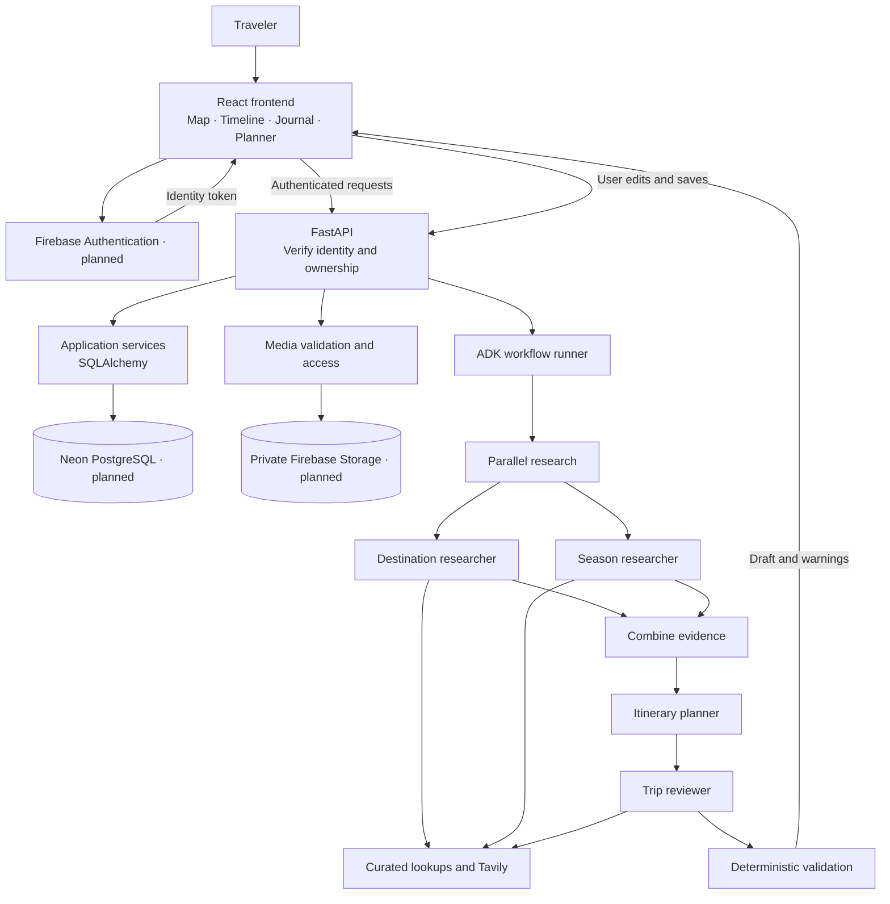
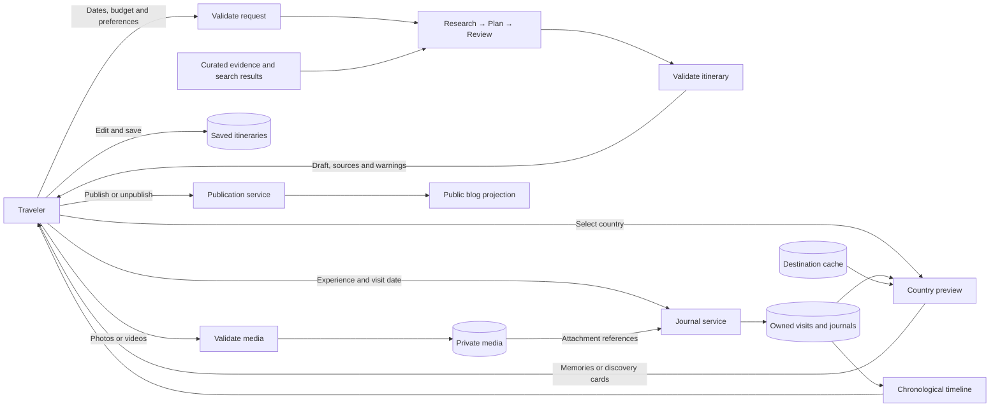
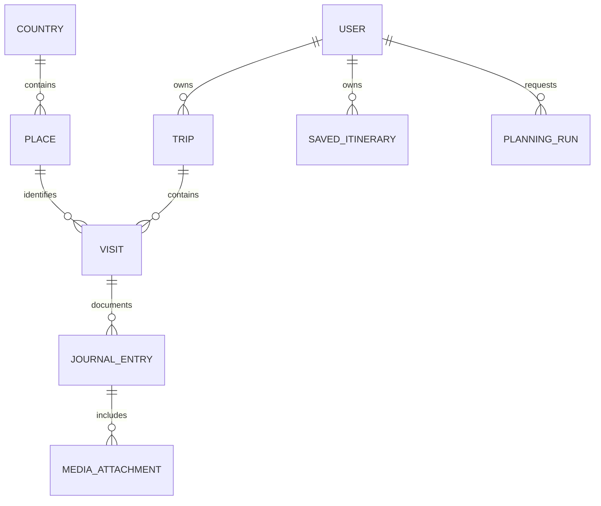

# Travelogue

> An illustrated travel timeline and world map for preserving memories, discovering destinations, and planning trips through coordinated AI agents.

**Status: first local implementation milestone.** The map, illustrated journal/timeline, local persistence, planner UI, four-agent ADK workflow, and Ollama adapter are implemented. The default planner is explicitly scripted. Firebase Authentication, Neon PostgreSQL, Firebase Storage, and public publishing are planned integrations, not working features yet.

| Capability | Current status |
| :--- | :--- |
| World map and five-country discovery | Pan/zoom atlas with natural colors, numbered memory pins, bundled waterways/labels, and curated, unverified destination cards |
| Journal, timeline, and local persistence | Implemented using SQLite; sample stories are fictional |
| Photo/video attachment handling | Implemented; FFprobe required; successful real-media/browser flows not yet verified |
| Planner and saved itineraries | Implemented with editable activity titles/notes and structural checks |
| Local Gemma through Ollama | ADK adapter implemented and tested with a mocked transport; actual inference not run |
| Hosted auth, relational backend, media, publication | Pending Firebase/Neon milestone |

---

## Overview

### Problem Statement & Intended Users

- **Problem:** Travel memories, photos, destination research, and itineraries are scattered across disconnected applications. Travelogue brings them together through geography and chronological storytelling.
- **Intended users:** Travelers documenting journeys and planning trips, and developers exploring an open-source multi-agent application.

**Hosted-app users need only a browser.** They do not install PostgreSQL, Firebase, Python, or agent tools, and do not provide API keys. Local installation requirements apply to developers only.

### Key Features

1. **World map:** Distinguish visited and unvisited countries and mark recorded places.
2. **Destination discovery:** Preview attraction thumbnails and recommended visiting months for unvisited countries.
3. **Multimedia journal:** Record visited places, dates, and experiences with photos and short videos.
4. **Geographic memories:** Preview previously visited places and open their associated blog entries.
5. **Travel planner:** Generate editable daily itineraries from dates, budget, interests, and travel preferences through coordinated agents.
6. **Illustrated timeline:** Organize memories by year, trip, day, and place.

All current entries remain local and private to the demo installation. Explicit publish/unpublish is planned for the authenticated hosted version. Recording a visit marks its country visited even without a blog; only entries with blog content provide blog links.

The interface uses a travel-first editorial layout inspired by the reference direction at [Mindtrip](https://mindtrip.ai/): a bold yellow hero, oversized original headline, bundled postcard illustrations, rounded planning prompt, compact top navigation, and generous white space. Original Travelogue branding, artwork, and copy are retained. Light mode is the default; the header toggle selects dark mode and remembers the choice locally. The atlas now follows a journey-first direction inspired by [Polarsteps](https://www.polarsteps.com/): muted seas, natural ivory/sage land, subtle visited-country tints, coral memory connections, and numbered photo-style stops. Bundled lakes, rivers, and country labels add geographic context. Hover, focus, and press transitions respect reduced motion. Labels and icons accompany colors. Illustrations include passport stamps, postcard imagery, and route lines. Atlas and Journal views are available through responsive navigation; the Journal view renders dated entries along a timeline. Sticky-map storytelling is a future enhancement. Hover previews also work through keyboard selection and mobile taps. Animations respect reduced-motion preferences.

---

## Technical Stack

| Component | Technology and status |
| :--- | :--- |
| Language and runtime | TypeScript, Node.js 22+; Python 3.11+ (verified with Node 24 and Python 3.12) |
| Frontend | React + Vite for the first runnable milestone; replaces the initial Next.js proposal |
| Styling and animation | Custom CSS, native dialogs, and CSS transitions; reduced-motion support |
| Map | Accessible SVG rendering of bundled Natural Earth boundaries; no map-service key |
| Backend | FastAPI, Pydantic |
| Agent framework | Google Agent Development Kit (ADK) |
| Models | Local Gemma 3 through Ollama (`gemma3:4b` by default), or scripted demo |
| Authentication | Firebase Authentication (planned; current app is loopback-only) |
| Relational database | SQLite now; Neon PostgreSQL planned |
| Database access and migrations | Python sqlite3 now; SQLAlchemy/Alembic planned for PostgreSQL |
| Media storage | Local files now; Cloud Storage for Firebase planned |
| Research | Curated fixtures; optional Tavily adapter (live call not verified) |
| Video inspection | FFprobe |
| Local demo | SQLite, local media, scripted agent outputs |

Keep code, manifests, lockfiles, migrations, configuration examples, fixtures, and documentation inside `agents/travelogue/`. Do not add dependencies to the repository root.

---

## Architecture & Data Flow

### Target Hosted Architecture



**Current local deployment:** React/Vite → FastAPI → SQLite/local files. Firebase identity, ownership policies, PostgreSQL, and public access in the diagram above are future work. The application refuses non-demo storage mode and binds to loopback.

Map browsing, journaling, and timeline rendering use ordinary application services. Agents handle research and itinerary generation. The future browser client will never connect directly to Neon; its backend must verify identity and ownership before database access.

### Home and Trip Starters

The homepage prompt recognizes curated country/place names and opens the trip form with the matching country and entered interests. Trip-starter chips prefill Japan, Italy, or Thailand. Unsupported destination input asks the traveler to select a supported workshop country rather than silently planning elsewhere. This prompt does not claim conversational model inference; generation begins only after the planner form is submitted. Header navigation switches between discovery, the journal timeline, and saved trips.

### Planner Progress and Map Controls

- The planner animates while work is active, rotates travel-themed messages, shows elapsed time, and asks travelers to wait. Completion counts come from actual stage callbacks, never a fabricated time-based percentage.
- Research agents can both show as running. Each step reports pending, running, completed, or interrupted; animation stops on completion or failure. Older saved runs without stage metadata do not invent completion states.
- The Ollama request timeout follows the configured workflow deadline. Raising `PLANNER_TIMEOUT_SECONDS` no longer leaves a separate fixed 110-second request limit.
- **Full screen** opens a viewport-filling map dialog and requests native fullscreen where supported. Exit using the map control or Escape. Keyboard focus is contained in the dialog.
- **Pop-out previews** toggles country/place cards. Hover or focus a country or pin to see memories, illustrated attraction thumbnails, and seasonal guidance. Click or press Enter to keep a card open; its links can open memories or official tourism sites. Preview placement is clamped to the map bounds.
- Drag the map to pan. Use +/−, Ctrl/Command + scroll, the fit-memories button, or the world-view button to control the camera. Pointer-anchored zoom is bounded; panning stays inside the bundled map extent.
- A chronological sidebar and horizontal memory strip focus recorded stops on the map. Numbered pins use the first uploaded image when available and labeled illustration fallbacks otherwise. Multiple memories at the same place remain accessible in the hover card.
- **Memory trail** links dated journal entries in chronological order. These are illustrative memory connections, not GPS recordings or confirmed transport routes. No route distances, actual tracks, or travel modes are inferred. Missing places, repeated consecutive places, and date-line crossings do not create misleading segments.
- Country boundaries, 24 lakes, 13 river features, and 177 country-label records are bundled Natural Earth 1:110m data. This generalized atlas has no street-level tiles, 3D terrain, or GPS tracking. No new map-service keys or external tile requests are needed.
- Discovery remains limited to the five curated countries; the new controls do not create destination data or invoke a model on hover.

### Agent Responsibilities

| Agent | Responsibility | Output |
| :--- | :--- | :--- |
| Destination researcher | Find attractions matching interests and constraints | Places, evidence references, coordinates and visit durations where available |
| Season researcher | Assess regional visiting periods for the requested dates | Seasonal guidance, sources, tradeoffs, and uncertainty |
| Itinerary planner | Combine preferences and evidence | Daily activities, travel buffers, and estimated costs |
| Trip reviewer | Independently audit grounding, constraints, and feasibility | Compact categorized findings and warnings; no second full itinerary |

Researchers run in parallel and write separate state keys. Planning and review follow sequentially. Deterministic validation checks required fields, dates, country consistency, duration, and budget arithmetic. Structural validity does not establish factual accuracy.

Bound each run to one country, up to 14 days, eight search calls, four model turns per agent, one reviewer audit, and a configurable overall deadline (120 seconds by default). No recursive delegation. In this milestone tools retrieve evidence before model execution; the custom text/JSON adapter does not claim native Gemma function calling. A single optional Tavily request stays below the search limit. Incomplete runs return explicit warnings or failure status. Agents cannot book trips, publish entries, or execute arbitrary commands.

### Data Flow



Country previews use cached records. Hovering never starts model work. Arbitrary-country refresh/research is planned; current previews use the bundled five-country catalog. Store source URLs and retrieval timestamps; prefer official tourism and attraction sources. Missing facts stay unknown. Prices and travel buffers remain estimates unless supported by evidence.

### Relational Data Model



The target PostgreSQL model holds relationships, journal content, attachment references, research metadata, and saved plans. SQLite currently persists the local subset. Media files remain in file storage. Future hosted records will reference verified Firebase UIDs; the current SQLite store is a single local demo account.

### Interfaces and Internal Tools

Implemented endpoints: `GET /api/catalog`, journal CRUD at `/api/entries`, media upload/read/delete, `POST /api/planner/runs`, `GET /api/planner/runs/{id}`, `POST /api/plans/{run_id}`, `GET /api/plans`, and model readiness at `/api/model/status`. Planning runs persist progress; saved-plan requests can include an edited itinerary, which is validated again. Publishing requests are rejected. Arbitrary-country live discovery and separate visit CRUD remain future work.

| Tool | Purpose |
| :--- | :--- |
| `lookup_destinations` | Curated attractions, coordinates, and image attribution |
| `lookup_seasons` | Regional visiting windows and seasonal notes |
| `search_travel_sources` | Tavily source URLs, excerpts, and timestamps |
| `validate_itinerary` | Structural and arithmetic checks |

These tools live inside Travelogue. No separate root `tools/` contribution or MCP server is required for v1.

---

## Prerequisites

### Hosted-App Users

- Modern browser.
- No hosted version yet. The current demo uses one local sample traveler.
- Future hosted personal features will require sign-in.

### Local Developers

- Git, Node.js 22+, and npm.
- Python 3.11+ with pip and venv.
- FFprobe for video inspection.

The standard demo requires no API keys, Docker, Firebase emulator, or local PostgreSQL installation.

### Live Integration Operators

- Firebase project with Google sign-in and private Storage configured.
- Neon PostgreSQL database.
- Gemini API access and an available model identifier.
- Tavily API key.

Service quotas apply independently. Hosting, media, search, and model usage may incur charges.

---

## Installation & Setup

The setup script is provided. **Fresh Python dependency installation is not verified** because this environment cannot resolve package registries. A clean offline frontend installation from the lockfile was verified using cached packages.

```bash
cd agents/travelogue
npm run setup
npm run dev
```

Setup creates `.env` without overwriting it, creates `.venv`, installs requirements and frontend dependencies, and seeds the SQLite journal. Open **http://127.0.0.1:5173**. API documentation is at **http://127.0.0.1:8000/docs**.

Install FFprobe (distributed with FFmpeg) on the application host to enable media uploads. Without it, uploads fail closed with a clear message; journaling and planning still work.

Existing environments can install dependencies manually:

```bash
python3 -m venv .venv
# Linux / macOS / WSL:
source .venv/bin/activate
# Windows PowerShell instead: .venv\Scripts\Activate.ps1
python -m pip install -r requirements.txt
npm ci
```

The environment has no browser and blocks listening sockets, so visual interaction and server startup could not be verified here. Build and in-process API checks are reported below.

---

## Configuration & Environment Variables

| Variable Name | Required | Default | Description |
| :--- | :--- | :--- | :--- |
| `TRAVELOGUE_MODE` | No | `demo` | Only local demo storage is supported in this milestone |
| `MODEL_PROVIDER` | No | `demo` | `demo` for scripted output or `ollama` for real local inference |
| `OLLAMA_BASE_URL` | Ollama | `http://127.0.0.1:11434` | Server-side Ollama endpoint; never exposed directly to browsers |
| `OLLAMA_MODEL` | Ollama | `gemma3:4b` | Locally downloaded model tag |
| `OLLAMA_CONTEXT_TOKENS` | No | `8192` | Per-request context, reduced from the original 16384 |
| `OLLAMA_RESEARCH_TOKENS` | No | `384` | Maximum output per research agent |
| `OLLAMA_REVIEW_TOKENS` | No | `512` | Maximum output for the compact audit |
| `OLLAMA_MAX_PLAN_TOKENS` | No | `4096` | Output cap; actual planner allowance scales with trip length |
| `OLLAMA_KEEP_ALIVE` | No | `15m` | Keep local weights loaded between requests |
| `PLANNER_TIMEOUT_SECONDS` | No | `120` | Overall run deadline; slower hardware may require more time |
| `TAVILY_API_KEY` | No | None | Enables one optional live search before research agents |
| `DATABASE_URL` | Future | None | Reserved for Neon; currently unused |
| `FIREBASE_PROJECT_ID` | Future | None | Reserved for authenticated deployment |
| `FIREBASE_STORAGE_BUCKET` | Future | None | Reserved for hosted media |

The backend loads the project-root `.env`. Local records and files live in ignored `.runtime/`. Do not commit credentials, `.env`, private media, or runtime databases. The Vite development server proxies `/api` to the loopback backend.

---

## How to Run

```bash
npm run dev
```

The frontend starts at http://127.0.0.1:5173. Backend startup and port binding require an unrestricted local terminal. `TRAVELOGUE_PYTHON` can select an existing Python executable; otherwise scripts prefer `.venv` and fall back to system Python.

### Local Model Performance

The four-agent workflow is retained, with less repeated generation:

- Research agents each return compact JSON under a 384-token cap.
- The planner's output allowance scales with trip length: about 1,700 tokens for five days, capped by `OLLAMA_MAX_PLAN_TOKENS`.
- The reviewer returns a 512-token audit rather than regenerating the whole itinerary. Crowds, booking suggestions, ordinary seasonality, and price uncertainty are advisories merged into the draft. A model approval flag alone cannot reject a plan. Blocking findings must use a category and quote the affected activity plus the user's explicit requirement or a supplied evidence excerpt; unsubstantiated claims remain disclosed review concerns. Hard date, country, source-ID, and budget validation still rejects invalid drafts. Quote matching establishes traceability, not real-world factual accuracy; model and human quality evaluations remain necessary.
- Agents receive explicit request/evidence state without replaying the entire conversation. User constraints and source references remain in context; presentation-only catalog fields are omitted. Optional search is limited to three 700-character excerpts.
- Ollama uses an 8,192-token context by default, schema-constrained JSON for planning/review, and `keep_alive=15m`. Truncated output fails explicitly rather than becoming a partial success.
- Completed model calls record load, prompt evaluation, generation time, token counts, and tokens/second. These are available in a run's `model_timings`, including completed calls before a later failure, and successful `result.performance`.

These changes reduce requested work; **no live latency improvement has been measured in this sandbox**. Unit tests mock the model transport and do not constitute a performance benchmark. Cold starts, CPU/GPU placement, and local hardware still affect speed.

Use `ollama ps` during a run to check the PROCESSOR column. [Ollama documents](https://docs.ollama.com/faq) GPU/CPU placement, keep-alive, and request queuing. Research agents are orchestrated in parallel, but a single Ollama model may queue requests; increasing server parallelism also increases memory requirements.

A smaller model is an explicit quality/speed tradeoff. To experiment, download it on the host and change the model tag:

```bash
ollama pull gemma3:1b
```

```dotenv
OLLAMA_MODEL=gemma3:1b
```

Restart Travelogue after configuration changes and rerun quality evaluations. Increasing `PLANNER_TIMEOUT_SECONDS` allows a longer wait; it does not make inference faster.

### Scripted Demo

Keep `MODEL_PROVIDER=demo`. The planner displays **“Scripted demo — no model ran”**. It checks dates and arithmetic but does not claim preference satisfaction or current travel accuracy.

### Local Gemma with Ollama

Install [Ollama](https://ollama.com/download) on the application host, then download the model:

```bash
ollama pull gemma3:4b
ollama serve
```

If Ollama is already running, do not start a second server. Set these values in `.env` and restart Travelogue:

```dotenv
MODEL_PROVIDER=ollama
OLLAMA_BASE_URL=http://127.0.0.1:11434
OLLAMA_MODEL=gemma3:4b
PLANNER_TIMEOUT_SECONDS=120
```

The planner checks `/api/model/status` and shows whether the configured model is available. Failed inference never silently substitutes scripted results. For WSL, run Ollama in the same environment or configure a reachable host endpoint. Keep Ollama private.

The four ADK agents use a custom text/JSON adapter for Ollama's [`/api/chat`](https://docs.ollama.com/api/chat). Research evidence is retrieved in code before the workflow; no native Gemma tool calling is assumed. Actual Gemma inference and hardware suitability remain unverified. Travelers do not need Ollama; only the application operator does.

### Build

```bash
npm run build
```

Build output is in ignored `dist/`. After building, the backend can serve the bundle locally. Public deployment is intentionally unsupported until Firebase and Neon ownership checks are implemented.

---

## Example Input & Output

### Example Input

```text
Plan five days in Japan in November for two adults,
starting in Kyoto.

Interests: temples and local food.
Pace: relaxed.
Budget: INR 100,000, excluding international flights.
```

The structured request must supply exact dates and the year before generation.

### Example Output

An actual scripted backend run for 10–14 November 2026, Japan, two travelers, and INR 100,000 returned:

```json
{
  "title": "A little slower in Kyoto",
  "provider": "demo",
  "model": "scripted-demo",
  "days": 5,
  "estimated_total": "20000.00",
  "factual_correctness": "not evaluated"
}
```

This is a shortened summary of scripted output, not a live model result. Each day's INR 4,000 allocation is fictional and covers the entire party; lodging and transport are unpriced. Interests and special constraints are explicitly marked unassessed. Live Gemma output has not been captured.

---

## How to Test

```bash
npm run verify
# Separately:
python3 -m unittest discover -s backend/tests -v
python3 -m backend.evals
```

Verification runs 25 backend/agent tests, 30 offline structural cases, UI progress/map logic checks, TypeScript checks, and the production build. It does not run browser tests or live inference. Evaluation output is written to ignored `.runtime/eval-results.json`. Invoke future live quality evaluations separately to avoid unexpected usage.

### Functional Completeness and Correctness

| Feature | Completeness | Correctness |
| :--- | :--- | :--- |
| Map | All countries in the selected dataset are selectable | Visit status and markers match records |
| Discovery | Place, image or labeled fallback, months, and sources are present | Country association, guidance, and attribution are accurate |
| Journal | Create, edit, delete, retrieve, and attach supported media | Content persists accurately; upload failures leave no broken references |
| Memories | Recorded places and applicable blog links appear | Links open the correct entry; private content stays protected |
| Planner | All requested days and deliverables are covered | Dates, geography, cost arithmetic, sequence, and constraints are consistent |

Also test empty states, keyboard/touch/mobile access, hover-card interaction, reduced motion, publication/unpublication, invalid media, and API/media access between two different users.

### Planner Evaluation Rubric

| Dimension | Weight | Evaluation |
| :--- | ---: | :--- |
| Completeness | 25% | All days, fields, and deliverables |
| Constraint adherence | 25% | Country, dates, traveler count, budget, pace, and explicit preferences |
| Factual grounding | 25% | Sources genuinely support associated claims |
| Practical feasibility | 15% | Plausible daily schedules and travel sequences |
| Clarity and uncertainty | 10% | Visible estimates, assumptions, missing evidence, and concerns |

**Proposed gate:** at least 85/100 overall and 80% per dimension. Report individual cases and suite pass rates so averages cannot hide failures. Invalid/infeasible cases should elicit clarification or an explained inability to satisfy constraints, not fabricated plans.

Mandatory checks for successful outputs:

- Valid response schema and complete, nonduplicated dates.
- Consistent currency, traveler count, and budget arithmetic.
- Activities reference curated or sourced places.
- External claims have supporting evidence or explicit unverified labels.
- No fabricated citations; citation presence alone is insufficient.
- Execution respects limits; research failures produce warnings or failed status.
- Private content remains inaccessible to unauthorized users.

Privacy failures and fabricated citations block release regardless of score. Combine deterministic checks, evidence fixtures, and independent human review. An optional LLM judge is supplementary; the reviewer agent cannot certify itself.

### Evaluation Dataset and Baseline

| Category | Cases |
| :--- | ---: |
| Standard trips: two per seeded country | 10 |
| Preference-heavy trips | 5 |
| Difficult/conflicting constraints | 5 |
| Invalid or missing inputs | 5 |
| Failures and adversarial inputs | 5 |

The first 30 offline cases are versioned in `backend/evals.py` (`structural-v1`) with inputs, expected behavior, constraints, and output mutations. These do not constitute the full live-quality dataset. Current cases cover preference non-assessment warnings, tiny budgets, reversed dates, wrong-country places, invented source IDs, missing days, arithmetic limits, and changed traveler counts. Additional live cases for search outages, conflicting evidence, retrieved prompt injection, and timeouts remain to be built. Do not require one exact itinerary.

Run deterministic regressions on changes. Before release, run the live suite three times and report variability. Compare against a single-agent baseline using the same model, inputs, tools, and total resource limits. Measure quality, unsupported-claim rate, constraint violations, latency, token usage, and cost.

### Evaluation Results

| Measure | Status |
| :--- | :--- |
| Backend/agent regression tests | 25 passing; includes CRUD persistence, invalid media, local-only access, ADK stages, and no silent fallback |
| Offline structural regression | 30/30 passing; request validation, dates, source IDs, arithmetic, and disclosure checks only |
| Factual grounding and feasibility | Not evaluated |
| Hosted privacy and ownership | Not implemented; demo rejects publication and external origins/hosts |
| Multi-agent versus single-agent comparison | Not evaluated |
| UI progress and map logic | Passed: parallel stages, terminal states, elapsed time, popup clamping, zoom/pan limits, fit bounds, date-line handling, chronological trails, photo selection, and projection |
| Frontend type check and production build | Passed with Node 24.21.0 / TypeScript 5.9.3 |
| Fresh installation | Clean offline frontend npm ci passed; fresh Python install not verified |
| Browser, real media, and live Ollama | Not verified; browser, FFprobe, and Ollama unavailable |

Report dataset version, model identifier, date, environment, and limitations alongside measured results. Do not claim gates passed before execution.

---

## Known Limitations

- Seeded discovery: India, Japan, Italy, France, Thailand. Other countries show empty states; arbitrary-country live discovery is not implemented yet.
- One country and up to 14 days per itinerary. Only catalog places can be recorded or used in a validated plan.
- Public publishing, Firebase sign-in, Neon persistence, and Firebase media are not connected.
- The frontend uses React/Vite, custom CSS, and bundled SVG geography rather than the proposed Next.js/Tailwind/Motion/MapLibre stack. Zooming enlarges generalized geography; it does not load street-level detail.
- The pinned ADK version warns that ParallelAgent/SequentialAgent are deprecated; migrate after validating its replacement workflow API.
- Automated tests use mocked Ollama responses; they do not establish Gemma output quality.
- Seasonal patterns are not weather forecasts.
- Costs and travel buffers are estimates unless supported by evidence; no routing provider in v1.
- No bookings, payments, or live availability.
- Images: JPEG/PNG/WebP, up to 10 MB. Videos: MP4/WebM, up to 25 MB and 30 seconds. No transcoding.
- Free tiers have quotas and do not make the whole application free.
- SQLite tests do not establish PostgreSQL compatibility; verify live migrations and queries separately.
- Browser behavior, successful real-media uploads, live model quality, latency, cost, and actual inference token consumption remain unverified.

---

## Security & Privacy Considerations

**Current boundary:** one local demo account, loopback binding, restrictive Host/Origin checks, private local files, and publication disabled. The authenticated hosted guarantees below are implementation requirements, not completed integrations. Never expose this milestone publicly.

- **Authentication and ownership:** Verify Firebase tokens. Derive ownership from verified identity rather than client-supplied user IDs. Check every personal resource.
- **Database and secrets:** Backend-only Neon access. Keep credentials out of Git and browser bundles.
- **Media:** Private storage; server-side file-content, size, and duration validation. Authorize reads using entry ownership/publication state and stream through controlled access rather than permanent public download URLs.
- **Publication:** Explicit publish/unpublish actions. Previously downloaded public content cannot be recalled.
- **Content:** Validate API inputs and sanitize rendered journal content.
- **Data privacy:** Exclude private journals and media from prompts. Live planning sends preferences to Gemini and research queries to Tavily.
- **Agent safety:** Retrieved text is untrusted evidence. Agents cannot publish, book, pay, or execute arbitrary commands.
- **Logging:** Record stage, duration, tool counts, errors, and reported token usage without credentials, private entries, or full prompts.

---

## Future Improvements

- [ ] Multi-country itineraries.
- [ ] Verified routing and transport durations.
- [ ] Calendar and itinerary export.
- [ ] Optional journal drafting from user-provided notes.
- [ ] Media optimization and transcoding.
- [ ] Broader curated destination coverage.
- [ ] Offline reading.
- [ ] Expanded evaluation datasets and cost reporting.

---

## License

Contributed under the repository's [MIT license](../../LICENSE).

Preserve applicable attribution and licenses for third-party images, map data, and other assets. Curated thumbnails must have documented reuse rights.
