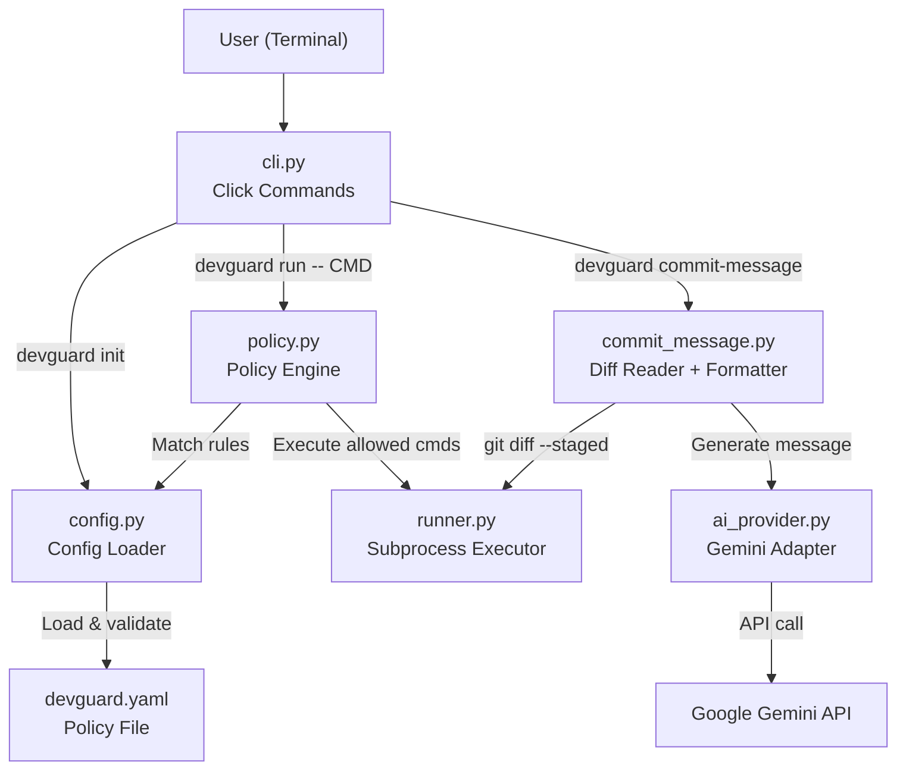

# DevGuard — Implementation Plan

> A lightweight, local-first CLI that enforces command permission policies and generates AI-assisted commit messages.

---

## 1. Repository Findings & Applicable Instructions

### Files Inspected

| File | Key Takeaways |
|:---|:---|
| [README.md](file:///Users/pushkar.pawar/GDG/open-source-agents/README.md) | Monorepo for AI agents & tools. Two top-level dirs: `agents/`, `tools/`. Framework- and language-agnostic. MIT license. |
| [CONTRIBUTING.md](file:///Users/pushkar.pawar/GDG/open-source-agents/CONTRIBUTING.md) | 12-step fork-and-PR workflow. Lowercase kebab-case dirs. Self-contained projects. Manifest file required. No root-level dependency changes. |
| [tools/README.md](file:///Users/pushkar.pawar/GDG/open-source-agents/tools/README.md) | Developer utilities, CLI tools, AI automation go here. Index table at the bottom. Each tool in `tools/<project-slug>/`. |
| [agents/README.md](file:///Users/pushkar.pawar/GDG/open-source-agents/agents/README.md) | For end-to-end autonomous agents — not applicable to DevGuard. |
| [template/README.md](file:///Users/pushkar.pawar/GDG/open-source-agents/template/README.md) | Documentation template we **must** follow (sections: Overview, Technical Stack, Architecture, Prerequisites, Installation, Config, How to Run, Example I/O, How to Test, Known Limitations, Security, Future Improvements, License). |
| [template/.env.example](file:///Users/pushkar.pawar/GDG/open-source-agents/template/.env.example) | Placeholder env file pattern — copy and adapt. |
| [template/.gitignore](file:///Users/pushkar.pawar/GDG/open-source-agents/template/.gitignore) | Per-project gitignore — copy verbatim. |
| [.github/PULL_REQUEST_TEMPLATE.md](file:///Users/pushkar.pawar/GDG/open-source-agents/.github/PULL_REQUEST_TEMPLATE.md) | PR checklist: directory naming, README, reproducible setup, tested functionality, examples, declared deps, no secrets, scope isolation. |
| [LICENSE](file:///Users/pushkar.pawar/GDG/open-source-agents/LICENSE) | MIT License © 2026 GDG Cloud Bengaluru Community. |
| [.gitignore](file:///Users/pushkar.pawar/GDG/open-source-agents/.gitignore) | Root ignores: `.env*`, `__pycache__/`, `.venv/`, `.pytest_cache/`, `*.egg-info/`, etc. |

### Additional Checks

- **No `AGENTS.md`, `CLAUDE.md`, or `GEMINI.md`** files exist anywhere in the repo.
- **No existing contributions** in `agents/` or `tools/` — we will be the first.
- **No duplicate functionality** to conflict with.
- **Python 3.14.0** and **pip 25.3** are available on the machine.
- **Single commit** on main: `b0ad2a4 Initialize repository structure`.

### Binding Constraints (from CONTRIBUTING.md & templates)

1. Project lives in `tools/devguard/` (lowercase kebab-case).
2. Must copy and complete `template/README.md`, `template/.gitignore`, `template/.env.example`.
3. All dependencies declared in a manifest inside the project directory (we'll use `pyproject.toml`).
4. No root-level file modifications except optionally adding one row to `tools/README.md` index.
5. No committed secrets. `.env.example` has placeholders only.
6. PR changes scoped to `tools/devguard/` (+ one-line index update).

---

## 2. Project Location

```
tools/devguard/
```

**Category**: AI Developer Utilities / AI-Powered Workflows & Automation  
**Rationale**: DevGuard is a reusable developer CLI utility, not an autonomous agent. Per `tools/README.md`, CLI utilities and AI automation helpers belong under `tools/`.

---

## 3. Directory & File Structure

```
tools/devguard/
├── README.md                     # Project documentation (from template)
├── .env.example                  # Env var placeholders for AI provider
├── .gitignore                    # Per-project ignores (from template)
├── pyproject.toml                # Project metadata, dependencies, CLI entry point
├── devguard_config.example.yaml  # Sample permission policy configuration
├── src/
│   └── devguard/
│       ├── __init__.py           # Package init, version string
│       ├── cli.py                # Click CLI — top-level commands (init, run, commit-message)
│       ├── config.py             # YAML config loader, validator, schema
│       ├── policy.py             # Policy engine — rule matching, precedence, decisions
│       ├── runner.py             # Subprocess executor — safe command execution
│       ├── commit_message.py     # Git diff reader + AI commit-message generator
│       └── ai_provider.py        # Minimal AI provider adapter (Google Gemini via API)
└── tests/
    ├── __init__.py
    ├── conftest.py               # Shared fixtures (tmp config files, mock git repos)
    ├── test_config.py            # Config loading, validation, error handling
    ├── test_policy.py            # Rule matching, precedence, default-deny
    ├── test_runner.py            # Safe subprocess execution
    ├── test_commit_message.py    # Diff parsing, message formatting, AI failure
    └── test_cli.py               # CLI integration tests via Click's test runner
```

**18 files total.** Every file has a single, clear responsibility.

---

## 4. Technology Stack & Dependencies

| Component | Choice | Justification |
|:---|:---|:---|
| **Language** | Python 3.10+ | Repo is language-agnostic; Python fits the 2-hour window and is the most common choice for AI tooling in this ecosystem. |
| **CLI Framework** | `click` (≥8.0) | Lightweight, mature, testable (`CliRunner`). No heavy framework overhead. |
| **Config Format** | YAML via `pyyaml` (≥6.0) | Clean syntax for policy rules, widely familiar. |
| **AI Provider** | `google-genai` (≥1.0) | Repository's template defaults to `gemini-2.5-flash`; the `google-genai` SDK is a single lightweight dependency. Matches the repo's GDG context. |
| **Testing** | `pytest` (≥7.0) | Standard Python testing. Already in root `.gitignore` (`.pytest_cache/`). |
| **Build System** | `pyproject.toml` (PEP 621) | Modern standard. No `setup.py` needed. Declares `[project.scripts]` for the `devguard` entry point. |

### Dependencies Summary

**Runtime** (3 packages):
- `click>=8.0`
- `pyyaml>=6.0`
- `google-genai>=1.0`

**Dev/Test** (1 package):
- `pytest>=7.0`

> [!NOTE]
> `google-genai` is imported lazily and only required for the `commit-message` command. The permission manager works with zero network calls and zero AI dependencies at runtime.

---

## 5. Architecture

### 5.1 Component Diagram



### 5.2 CLI Commands

| Command | Description |
|:---|:---|
| `devguard init` | Creates a `devguard.yaml` in the current directory with sensible defaults. Refuses to overwrite unless `--force` is given. |
| `devguard run -- <command> [args...]` | Loads `devguard.yaml`, evaluates the command against the policy engine, then allows/asks/denies execution. |
| `devguard commit-message` | Reads `git diff --staged`, sends to AI provider (or generates a deterministic fallback), prints a conventional commit message for the user to copy. |

### 5.3 Policy Engine (`policy.py`)

**Data model:**

```
@dataclass
class PolicyRule:
    command_prefix: tuple[str, ...]  # e.g., ("git", "status")
    decision: Decision               # ALLOW | ASK | DENY

@enum
class Decision:
    ALLOW, ASK, DENY
```

**Matching algorithm:**

1. Parse the incoming command as a list of arguments (already split — no shell parsing needed).
2. Iterate all rules. A rule **matches** if the command's argument list starts with the rule's `command_prefix` tuple (structured prefix matching — never raw string startswith).
3. Collect all matching rules. Apply **precedence**:
   - **Longest prefix match first** (most specific rule wins).
   - Among equal-length matches: **DENY > ASK > ALLOW** (explicit deny always wins).
4. If **no rule matches**, apply `default_policy` from config (which itself defaults to `"deny"` if unset — fail-closed).
5. Return a `PolicyResult(decision, matched_rule, reason_string)`.

**Why this is correct:**
- `["git", "reset"]` will NOT match a rule for `["git"]` allowing all git — unless such a broad rule is explicitly configured.
- `["git", "reset", "--hard"]` DENY rule will beat `["git", "reset"]` ASK rule because it is more specific (longer prefix).
- A rule `["git"]` ALLOW will never implicitly allow `["rm", "-rf"]` — structured matching, not string matching.

### 5.4 Command Runner (`runner.py`)

```python
def execute_command(args: list[str]) -> CommandResult:
    """Run a command as a list of args via subprocess.run(). No shell=True."""
    result = subprocess.run(args, capture_output=True, text=True, timeout=300)
    return CommandResult(
        exit_code=result.returncode,
        stdout=result.stdout,
        stderr=result.stderr,
    )
```

- Input is always `list[str]` — never a shell string.
- `shell=True` is never used.
- Captures stdout, stderr, and exit code.
- Timeout of 300s prevents hangs (configurable in future).

### 5.5 Commit Message Generator (`commit_message.py`)

**Flow:**
1. Run `git diff --staged` via `runner.py`.
2. If diff is empty → print "No staged changes found." and exit.
3. If diff exceeds a size threshold (e.g., 8000 chars), truncate with a note.
4. Send diff to AI provider with a system prompt requesting a conventional commit message (`feat:`, `fix:`, `docs:`, `refactor:`, `test:`, `chore:`).
5. Print the generated message to stdout for the user to review and copy.
6. If AI provider fails (no API key, network error, API error), print a clear error message. Optionally fall back to a simple deterministic message: `"chore: update <N> file(s)"` derived from the diff stat.

### 5.6 AI Provider Adapter (`ai_provider.py`)

```python
class GeminiProvider:
    def __init__(self, api_key: str, model: str = "gemini-2.5-flash"):
        from google import genai
        self.client = genai.Client(api_key=api_key)
        self.model = model

    def generate(self, prompt: str) -> str:
        response = self.client.models.generate_content(
            model=self.model, contents=prompt
        )
        return response.text
```

- Lazily imports `google.genai` only when `commit-message` is called.
- API key read from `GEMINI_API_KEY` env var (via `.env` or export).
- Clear error if key is missing: `"Error: GEMINI_API_KEY not set. Set it in .env or export it."`

---

## 6. Implementation Checklist (Ordered)

### Phase 1: Project Scaffolding (15 min)

| # | Task | Time |
|:--|:-----|:-----|
| 1.1 | Create `tools/devguard/` directory | 1 min |
| 1.2 | Copy `template/README.md` → `tools/devguard/README.md` | 1 min |
| 1.3 | Copy `template/.gitignore` → `tools/devguard/.gitignore` | 1 min |
| 1.4 | Copy `template/.env.example` → `tools/devguard/.env.example`, customize for `GEMINI_API_KEY` and `GEMINI_MODEL` | 2 min |
| 1.5 | Create `pyproject.toml` with metadata, dependencies, `[project.scripts] devguard = "devguard.cli:main"` | 4 min |
| 1.6 | Create `src/devguard/__init__.py` with `__version__ = "0.1.0"` | 1 min |
| 1.7 | Create `devguard_config.example.yaml` with the sample policy from the spec | 3 min |
| 1.8 | Create empty `tests/__init__.py` and `tests/conftest.py` | 2 min |

**Acceptance**: Directory exists, `pip install -e .` would succeed (not run yet), and all template files are in place.

### Phase 2: Config Loader (`config.py`) (15 min)

| # | Task | Time |
|:--|:-----|:-----|
| 2.1 | Define `PolicyConfig` dataclass: `default_policy`, `allow_rules`, `ask_rules`, `deny_rules` | 3 min |
| 2.2 | Implement `load_config(path: str) -> PolicyConfig` — read YAML, validate structure, raise clear errors for missing/malformed fields | 7 min |
| 2.3 | Write `tests/test_config.py`: valid config, missing file, malformed YAML, missing fields, invalid policy values, empty rules | 5 min |

**Acceptance**: `pytest tests/test_config.py` passes. All error paths produce human-readable messages.

### Phase 3: Policy Engine (`policy.py`) (20 min)

| # | Task | Time |
|:--|:-----|:-----|
| 3.1 | Define `Decision` enum (ALLOW, ASK, DENY) and `PolicyResult` dataclass | 3 min |
| 3.2 | Implement `evaluate(command: list[str], config: PolicyConfig) -> PolicyResult` with structured prefix matching and precedence logic | 10 min |
| 3.3 | Write `tests/test_policy.py`: exact match, prefix match, longest-prefix wins, deny-beats-allow, default-deny, empty command, command not in any rule | 7 min |

**Acceptance**: `pytest tests/test_policy.py` passes. Policy never uses string startswith. DENY always beats ALLOW at same specificity.

### Phase 4: Command Runner (`runner.py`) (10 min)

| # | Task | Time |
|:--|:-----|:-----|
| 4.1 | Implement `execute_command(args: list[str]) -> CommandResult` with `subprocess.run`, no `shell=True`, capture output, timeout | 5 min |
| 4.2 | Write `tests/test_runner.py`: run `echo hello`, run a failing command, verify stdout/stderr/exit_code capture | 5 min |

**Acceptance**: `pytest tests/test_runner.py` passes. `shell=True` never appears in the codebase.

### Phase 5: CLI Skeleton (`cli.py`) — init + run (20 min)

| # | Task | Time |
|:--|:-----|:-----|
| 5.1 | Create Click group `main` with `--config` option (default `devguard.yaml`) | 3 min |
| 5.2 | Implement `devguard init` — write sample YAML, refuse to overwrite without `--force` | 5 min |
| 5.3 | Implement `devguard run` — load config, evaluate policy, handle ALLOW (execute + print output), ASK (prompt user, execute on "y"), DENY (print reason, exit 1) | 7 min |
| 5.4 | Write `tests/test_cli.py`: test init creates file, init refuses overwrite, run allowed command, run denied command, run ask command (simulated input) | 5 min |

**Acceptance**: `pytest tests/test_cli.py` passes. `devguard init` and `devguard run -- echo hello` work end-to-end.

### Phase 6: Commit Message Generator (20 min)

| # | Task | Time |
|:--|:-----|:-----|
| 6.1 | Implement `ai_provider.py` — `GeminiProvider` class with lazy import, generate method, clear error on missing key | 5 min |
| 6.2 | Implement `commit_message.py` — `get_staged_diff()`, `generate_commit_message(diff, provider)`, deterministic fallback | 8 min |
| 6.3 | Add `devguard commit-message` CLI command with `--fallback` flag | 2 min |
| 6.4 | Write `tests/test_commit_message.py`: empty diff handling, diff truncation, fallback message format, mock AI provider success/failure | 5 min |

**Acceptance**: `pytest tests/test_commit_message.py` passes. Command works with and without AI provider. Missing API key produces a clear error, not a stack trace.

### Phase 7: Documentation & Polish (20 min)

| # | Task | Time |
|:--|:-----|:-----|
| 7.1 | Complete `README.md` — fill all template sections: Overview, Technical Stack, Architecture diagram, Prerequisites, Installation, Config table, How to Run (all 3 commands with examples), Example I/O, How to Test, Known Limitations, Security & Privacy, Future Improvements, License | 12 min |
| 7.2 | Add security limitations section: document that this is a CLI policy layer, not a sandbox; subprocesses/scripts can bypass it | 3 min |
| 7.3 | Finalize `.env.example` with all placeholder variables | 2 min |
| 7.4 | Run full `pytest` suite, fix any remaining issues | 3 min |

**Acceptance**: README has all template sections completed. `pytest` passes with zero failures. No secrets committed. `.env.example` has only placeholders.

---

## 7. Time Budget

| Phase | Description | Minutes |
|:------|:------------|--------:|
| 1 | Project Scaffolding | 15 |
| 2 | Config Loader | 15 |
| 3 | Policy Engine | 20 |
| 4 | Command Runner | 10 |
| 5 | CLI (init + run) | 20 |
| 6 | Commit Message Generator | 20 |
| 7 | Documentation & Polish | 20 |
| **Total** | | **120** |

---

## 8. Acceptance Criteria by Phase

| Phase | Criterion |
|:------|:----------|
| 1 | `tools/devguard/` exists with all scaffolding files. `pip install -e ".[dev]"` installs cleanly. |
| 2 | `load_config()` parses valid YAML, rejects invalid input with clear errors. 6+ test cases pass. |
| 3 | `evaluate()` correctly matches rules by structured prefix, applies precedence (longest match, DENY > ASK > ALLOW), defaults to deny. 7+ test cases pass. |
| 4 | `execute_command()` runs commands without `shell=True`, captures output/exit code. 3+ test cases pass. |
| 5 | `devguard init` creates a config file. `devguard run -- echo hello` executes correctly per policy. 5+ test cases pass via Click's `CliRunner`. |
| 6 | `devguard commit-message` reads staged diff, generates conventional commit message (or clean fallback). Missing API key shows a clear error. 4+ test cases pass. |
| 7 | README covers all template sections. Full `pytest` suite passes. No secrets in tracked files. |

---

## 9. Automated Testing Strategy

### Test Framework
- **pytest ≥ 7.0** with standard assertions.
- No external test dependencies beyond pytest.

### Test Categories

| Category | File | Approach |
|:---------|:-----|:---------|
| Config validation | `test_config.py` | Write temp YAML files via `tmp_path` fixture, test load/error paths |
| Policy logic | `test_policy.py` | Pure unit tests — construct `PolicyConfig` in memory, assert `evaluate()` results |
| Command execution | `test_runner.py` | Run safe commands (`echo`, `python3 -c "..."`, `false`) — no mocking needed |
| CLI integration | `test_cli.py` | Use Click's `CliRunner` to invoke commands, assert exit codes and output |
| Commit messages | `test_commit_message.py` | Mock `subprocess.run` for git diff, mock AI provider, test fallback path |

### Key Test Cases (minimum 25+)

**Config:**
1. Valid config loads correctly
2. Missing file raises `FileNotFoundError` with message
3. Malformed YAML raises clear error
4. Missing `default_policy` defaults to `"deny"`
5. Invalid policy value (e.g., `"execute"`) raises error
6. Empty allow/ask/deny lists are valid

**Policy:**
7. Exact match returns correct decision
8. Prefix match works (rule `["git"]` matches `["git", "status"]`)
9. Longest prefix wins (specific DENY beats general ALLOW)
10. DENY beats ALLOW at same specificity
11. DENY beats ASK at same specificity
12. Default-deny when no rule matches
13. Empty command list returns default policy
14. Command with extra args beyond rule prefix still matches

**Runner:**
15. `echo hello` returns exit code 0 and "hello\n" on stdout
16. A failing command returns non-zero exit code
17. stderr is captured separately

**CLI:**
18. `init` creates `devguard.yaml`
19. `init` without `--force` refuses to overwrite
20. `init --force` overwrites existing file
21. `run -- echo hello` with allow rule succeeds
22. `run -- rm -rf /` with deny rule prints reason and exits 1
23. `run` with no config file prints helpful error

**Commit Message:**
24. Empty staged diff prints message and exits
25. Fallback generates `"chore: update N file(s)"` format
26. AI provider failure prints clear error, does not crash
27. Generated message follows conventional format

### Running Tests

```bash
cd tools/devguard
pip install -e ".[dev]"
pytest tests/ -v
```

---

## 10. Install, Run & Test Commands

```bash
# Navigate to project
cd tools/devguard

# Create virtual environment
python3 -m venv .venv
source .venv/bin/activate

# Install in editable mode with dev dependencies
pip install -e ".[dev]"

# Initialize a config file
devguard init

# Run a command through the policy engine
devguard run -- git status
devguard run -- git reset --hard    # should be denied

# Generate a commit message (requires GEMINI_API_KEY)
export GEMINI_API_KEY="your-key-here"
devguard commit-message

# Generate a commit message with deterministic fallback (no AI needed)
devguard commit-message --fallback

# Run the test suite
pytest tests/ -v
```

---

## 11. Blockers & Assumptions

### Assumptions

| # | Assumption |
|:--|:-----------|
| 1 | Python 3.10+ is the minimum version (compatible with 3.14 on this machine and older environments). |
| 2 | `git` is available on the system PATH for `commit-message` and for test commands using `git`. |
| 3 | The `google-genai` SDK is the appropriate lightweight client for Gemini API access. If unavailable at install time, only `commit-message` (without `--fallback`) is affected; the permission manager works fully offline. |
| 4 | We will use `pyproject.toml` (PEP 621) rather than `requirements.txt` as the dependency manifest. `pyproject.toml` is a standard manifest per CONTRIBUTING.md's list ("requirements.txt, pyproject.toml, or package.json"). |
| 5 | The sample config file (`devguard_config.example.yaml`) is separate from `.env.example` since it's application config, not secrets. |

### Potential Blockers

| # | Blocker | Mitigation |
|:--|:--------|:-----------|
| 1 | `google-genai` package installation may require network access. | The permission manager is fully functional without it. `commit-message --fallback` works offline. Test suite mocks the AI provider. |
| 2 | Python 3.14 may have minor compatibility quirks with older packages. | `click`, `pyyaml`, and `pytest` all support modern Python. Pin minimum versions, not exact versions. |
| 3 | No staged git changes on the test machine for `commit-message` demo. | Tests mock `git diff --staged`. Manual testing can stage a dummy file. |

---

## 12. Submission Readiness Checklist

> [!IMPORTANT]
> Complete every item before opening the Pull Request.

- [ ] Project lives in `tools/devguard/` — self-contained, no root-level changes except index row.
- [ ] Directory name is lowercase kebab-case: `devguard`.
- [ ] `README.md` is based on `template/README.md` with all sections completed.
- [ ] `.env.example` contains only placeholder values — no real API keys.
- [ ] `.gitignore` copied from `template/.gitignore`.
- [ ] `pyproject.toml` declares all runtime and dev dependencies.
- [ ] `devguard init` creates a valid sample config.
- [ ] `devguard run -- <cmd>` enforces policy correctly (allow/ask/deny).
- [ ] `devguard commit-message` generates a conventional commit message.
- [ ] `devguard commit-message --fallback` works without an API key.
- [ ] Policy engine uses structured prefix matching — never raw string `startswith`.
- [ ] `shell=True` is never used in `subprocess` calls.
- [ ] DENY rules always take precedence over ALLOW rules at equal specificity.
- [ ] Default policy is deny (fail-closed) when no rule matches and no default is set.
- [ ] Security limitations are documented: not a sandbox, subprocesses can bypass.
- [ ] `pytest tests/ -v` passes with 25+ test cases and zero failures.
- [ ] No secrets, `.env` files, `__pycache__`, or `.venv` directories are tracked.
- [ ] Example inputs and outputs in README reflect actual command behavior.
- [ ] Known limitations section is honest and complete.
- [ ] One row added to `tools/README.md` index table.
- [ ] PR follows [PULL_REQUEST_TEMPLATE.md](file:///Users/pushkar.pawar/GDG/open-source-agents/.github/PULL_REQUEST_TEMPLATE.md) checklist.
- [ ] Commit message follows repo convention: `feat(tools): add devguard with documentation and setup`.
- [ ] Branch name follows convention: `feat/devguard`.

---

## Key Design Decisions (Summary)

| Decision | Rationale |
|:---------|:----------|
| `tools/` not `agents/` | DevGuard is a reusable CLI utility, not an autonomous agent. |
| `pyproject.toml` not `requirements.txt` | Modern Python standard; repo explicitly allows it. |
| `click` not `argparse` | Better testability via `CliRunner`, cleaner subcommand support, minimal overhead. |
| Google Gemini not OpenAI | Matches the GDG ecosystem context; repo template defaults to Gemini; single dependency. |
| Lazy AI import | Permission manager works with zero AI dependencies at runtime. |
| Structured tuple matching not regex | Deterministic, testable, avoids regex injection and string-matching pitfalls. |
| Longest-prefix-first + DENY-wins | Unambiguous precedence, easy to reason about, fail-safe. |
| `--fallback` flag | Lets users without API keys still get value from the commit-message feature. |

---

*Plan complete. Ready for implementation on your signal.*
