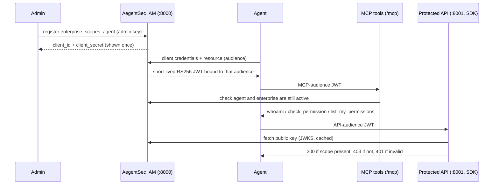

# AegentSec

> Identity and scoped access for AI agents: each agent gets its own credentials, administrator-approved scopes, and short-lived signed tokens that MCP tools and any backend API can verify and enforce.

---

## Overview

### Problem Statement & Intended Users
- **Problem**: AI agents increasingly call real systems, but they usually borrow a human's API key or share one service account. There is no per-agent identity, no least privilege, and no audit trail, so a misbehaving or prompt-injected agent can do whatever the shared key allows.
- **Intended Users**: Developers building agent integrations, platform and security engineers who need to control what agents may do, and reviewers exploring agent authorization patterns. This is a hackathon prototype for local use.

### Key Features
- **Per-agent identity**: An administrator registers enterprises and agents and receives each agent's client secret once. Secrets are stored only as Argon2 hashes.
- **Short-lived signed tokens**: Agents exchange client credentials (OAuth client-credentials style) for RS256 JWTs bound to one resource audience. The default lifetime is 15 minutes. A public JWKS endpoint publishes the verification key.
- **Admin-managed scope catalogue**: Scopes such as `inventory:read` are managed through the API, so new ones need no code change. Matching is exact, wildcards cannot be created, and unknown scopes are denied.
- **Authenticated MCP server**: `whoami`, `check_permission` and `list_my_permissions` over Streamable HTTP. Identity comes from the verified token, never from tool input, and agent and enterprise status is rechecked on every call.
- **Independent backend enforcement**: A Python SDK verifies tokens through JWKS and enforces scopes in any FastAPI API (401 for invalid tokens, 403 for insufficient scope), even if the agent previously called `check_permission`.
- **Lifecycle control and audit**: Administrators can deactivate or reactivate agents and enterprises and read an audit log of registrations, token issuance and denials. Secrets and tokens are never logged.
- **Deterministic demo**: A model-free walkthrough proves both permitted and denied actions across two running services.

---

## Technical Stack

- **Language & Runtime**: Python 3.12+, managed with `uv`
- **Agent Framework / Core Library**: Official Model Context Protocol (MCP) Python SDK (Streamable HTTP), FastAPI, PyJWT, Argon2
- **Models**: None. No LLM is required or used.
- **External APIs / Tools**: SQLite (local file, via aiosqlite). No hosted service, MongoDB or Docker is required.

---

## Architecture & Data Flow

The IAM service owns identity and permission rules. REST and MCP are interfaces to those rules, and external APIs verify tokens independently with the SDK.



```
Administrator --registers--> SQLite enterprise + agent records
Agent --client credentials--> AegentSec REST --signed JWT--> Agent
Agent --MCP audience JWT--> authenticated MCP tools
Agent --inventory audience JWT--> inventory API --AegentSec SDK--> allow / deny
                                     SDK --JWKS--> AegentSec public key
```

Code map: `src/aegentsec/` is the IAM service (`services.py` holds the business rules, `api.py` the REST routes, `mcp_server.py` the MCP interface, `tokens.py` signing and JWKS). `sdk/aegentsec_sdk/` is the standalone verifier. `examples/` holds the protected mock inventory API and the demo.

---

## Prerequisites

Before running this project, ensure you have:
- Python 3.12+
- [`uv`](https://docs.astral.sh/uv/) package manager
- No API keys or service accounts. The only secret is an `ADMIN_API_KEY` you generate yourself (see below).

---

## Installation & Setup

1. **Navigate to the project directory:**
   ```bash
   cd tools/aegentsec
   ```

2. **Install dependencies** (declared in `pyproject.toml`, locked in `uv.lock`):
   ```bash
   uv sync --extra dev
   ```

3. **Configure environment variables:**
   ```bash
   cp .env.example .env
   ```
   Edit `.env` and set `ADMIN_API_KEY` to a random value of at least 32 characters. Generate one with:
   ```bash
   python3 -c 'import secrets; print(secrets.token_urlsafe(48))'
   ```

4. **Generate the local signing key:**
   ```bash
   uv run --env-file .env python scripts/generate_keys.py
   ```
   The script refuses to overwrite an existing key. Keep the key between restarts so previously issued tokens remain verifiable. Keep `.env`, `keys/` and `data/` local; they are git-ignored.

---

## Configuration & Environment Variables

| Variable Name | Required | Default | Description |
| :--- | :--- | :--- | :--- |
| `ADMIN_API_KEY` | Yes | *None* | Admin secret, at least 32 characters. The app refuses to start with an empty, short or placeholder value |
| `DATABASE_PATH` | No | `./data/aegentsec.sqlite3` | SQLite database file |
| `IAM_ISSUER` | No | `http://localhost:8000` | Exact JWT issuer and REST origin |
| `IAM_PRIVATE_KEY_PATH` | No | `./keys/private.pem` | Local RSA PEM private key |
| `IAM_KEY_ID` | No | `aegentsec-key-001` | Stable JWKS key ID |
| `JWT_EXPIRATION_MINUTES` | No | `15` | Access token lifetime. Keep it short because SDK-protected APIs cannot revoke earlier tokens |
| `MCP_RESOURCE_URI` | No | `http://localhost:8000/mcp` | Exact audience for MCP tokens |
| `INVENTORY_API_AUDIENCE` | No | `http://localhost:8001` | Exact audience for inventory API tokens |
| `APP_NAME`, `APP_ENV` | No | `AegentSec`, `development` | Display name and environment label |

Never publish real secrets. `.env.example` contains only placeholders.

---

## How to Run

Start the IAM service and the example protected inventory API in two separate terminals from `tools/aegentsec/`:

```bash
uv run --env-file .env uvicorn aegentsec.main:app --host 127.0.0.1 --port 8000
```

```bash
uv run --env-file .env uvicorn inventory_backend:app --app-dir examples --host 127.0.0.1 --port 8001
```

The IAM OpenAPI UI is at `http://localhost:8000/docs`, MCP is at `http://localhost:8000/mcp`, and the JWKS is at `http://localhost:8000/.well-known/jwks.json`.

In a third terminal, run the complete, repeatable demo:

```bash
uv run --env-file .env python examples/demo.py
```

The demo creates two agents with distinct credentials, calls the three MCP tools, tries the inventory API with different tokens, creates a new scope, deactivates an agent, and prints the audit log. The operations return mock data and do not modify a real enterprise system.

### Manual usage

Set `ADMIN_API_KEY` in your shell to the same value as `.env`, then register an enterprise and an agent and request a token:

```bash
curl -X POST http://localhost:8000/api/v1/enterprises \
  -H "X-Admin-Api-Key: $ADMIN_API_KEY" -H 'Content-Type: application/json' \
  -d '{"name":"Acme Manufacturing"}'

curl -X POST http://localhost:8000/api/v1/agents \
  -H "X-Admin-Api-Key: $ADMIN_API_KEY" -H 'Content-Type: application/json' \
  -d '{"enterprise_id":"<enterprise_id>","name":"Inventory Agent","scopes":["inventory:read"]}'

curl -X POST http://localhost:8000/api/v1/auth/token \
  -u '<client_id>:<client_secret>' \
  -d 'grant_type=client_credentials' -d 'scope=inventory:read' \
  -d 'resource=http://localhost:8001'
```

The registration response is the only time the plaintext client secret is returned. Use `resource=http://localhost:8000/mcp` for an MCP token. An MCP token is rejected by the inventory API, and the reverse.

Manage the scope catalogue (a scope cannot be deleted while any agent holds it):

```bash
curl -X POST http://localhost:8000/api/v1/scopes -H "X-Admin-Api-Key: $ADMIN_API_KEY" \
  -H 'Content-Type: application/json' -d '{"scope":"ticket:create","description":"Open tickets"}'
curl http://localhost:8000/api/v1/scopes -H "X-Admin-Api-Key: $ADMIN_API_KEY"
curl -X DELETE http://localhost:8000/api/v1/scopes/ticket:create -H "X-Admin-Api-Key: $ADMIN_API_KEY"
```

Deactivate or reactivate an agent or enterprise, and read the audit log:

```bash
curl -X POST http://localhost:8000/api/v1/agents/<agent_id>/deactivate -H "X-Admin-Api-Key: $ADMIN_API_KEY"
curl -X POST http://localhost:8000/api/v1/agents/<agent_id>/activate -H "X-Admin-Api-Key: $ADMIN_API_KEY"
curl -X POST http://localhost:8000/api/v1/enterprises/<enterprise_id>/deactivate -H "X-Admin-Api-Key: $ADMIN_API_KEY"
curl "http://localhost:8000/api/v1/audit?limit=50" -H "X-Admin-Api-Key: $ADMIN_API_KEY"
```

### Connect an MCP client

```python
from mcp import ClientSession
from mcp.client.streamable_http import streamable_http_client
import httpx

async with httpx.AsyncClient(headers={"Authorization": f"Bearer {mcp_token}"}) as http:
    async with streamable_http_client(
        "http://localhost:8000/mcp", http_client=http
    ) as (read, write, _):
        async with ClientSession(read, write) as session:
            await session.initialize()
            print(await session.call_tool("whoami", {}))
```

MCP calls without a valid bearer token for the MCP audience receive HTTP 401.

### Protect another FastAPI API

```python
from fastapi import Depends, FastAPI
from aegentsec_sdk import AegentSecVerifier

app = FastAPI()
auth = AegentSecVerifier(
    issuer="http://localhost:8000",
    audience="http://localhost:8001",
    jwks_url="http://localhost:8000/.well-known/jwks.json",
)

@app.get("/inventory")
async def inventory(identity=Depends(auth.require_scope("inventory:read"))):
    return {"agent_id": identity.agent_id, "material": "RM-1001"}
```

The SDK returns 401 for missing or invalid tokens and 403 for valid tokens without the required scope. It takes the JWKS from the URL the API developer configures, never from token input.

---

## Example Input & Output

### Example Input
With both servers running:
```bash
uv run --env-file .env python examples/demo.py
```

### Example Output
Agent IDs and timestamps differ on every run. On later runs against the same database, `create scope ticket:create` prints `409` because the scope already exists.

```
whoami {'agent_id': 'agt_18f7...', 'enterprise_id': 'ent_16cd...', 'agent_name': 'Inventory Agent', 'status': 'active'}
check_permission {'allowed': False, 'resource': 'purchase', 'action': 'create', 'required_scope': 'purchase:create', 'reason': 'Required permission is absent'}
list_my_permissions {'agent_id': 'agt_18f7...', 'scopes': ['inventory:read']}
inventory read 200 {'material': 'RM-1001', 'quantity': 400}
inventory purchase denied 403 {'detail': 'Insufficient scope'}
purchase agent allowed 200 {'message': 'Purchase order created successfully', 'order_id': 'PO-001'}
wrong audience denied 401 {'detail': 'Invalid access token'}
invalid token denied 401 {'detail': 'Invalid access token'}
--- administrator adds a new scope with no code change ---
create scope ticket:create 201
ticket agent token scope ticket:create
wildcard scope registration denied 400
--- administrator deactivates the Inventory Agent ---
deactivated agent, existing MCP token 401
deactivated agent, new token request 401
deactivated agent, old API token (valid until expiry) 200 {'material': 'RM-1001', 'quantity': 400}
--- audit log (newest first) ---
2026-10-24T08:31:14+00:00 token_denied None {'reason': 'invalid_client', 'client_id': 'cli_0218...'}
2026-10-24T08:31:14+00:00 agent_deactivated agt_18f7... {}
2026-10-24T08:31:14+00:00 token_issued agt_0ac1... {'resource': 'http://localhost:8001', 'scopes': ['ticket:create']}
...
```

What it shows: the read-only Inventory Agent can read inventory but is denied a purchase order (403), the Purchase Agent succeeds, a token for the wrong audience or an invalid token is rejected (401), a new scope can be created without a code change while wildcards are refused, and a deactivated agent is blocked on MCP and from new tokens while its already issued API token works until it expires.

---

## How to Test

```bash
uv run --extra dev pytest -q
uv run --extra dev ruff check src sdk examples tests scripts
```

The automated suite (17 tests) covers exact scope rules, registration and client credentials, audience checks, JWT rejection of expired, wrong-issuer, wrongly signed and wrong-algorithm tokens, JWKS handling and refetch rate limiting, SDK verification, MCP authentication over real HTTP, agent and enterprise deactivation, the scope catalogue, and the audit log. For manual verification of the full flow across two running services, run the demo as described above.

---

## Known Limitations

- The administrator credential is a single global API key set in `.env`. There are no per-enterprise admin keys or key rotation.
- There is no dynamic revocation for SDK-protected backends. A token already issued stays valid until it expires, which is why the default lifetime is 15 minutes. The MCP server does check current agent and enterprise status on every call.
- Only the client-credentials grant, one signing key, two configured audiences, and a single global scope catalogue (not per enterprise) are supported. OAuth authorization code, PKCE, user consent, dynamic client registration and interactive MCP login are not implemented.
- The token endpoint has no rate limiting, and SQLite is used for local prototyping only.
- No HTTPS is configured. Run behind a TLS-terminating proxy before any real use.

---

## Security & Privacy Considerations

- **Secrets Handling**: Configuration is read from `.env`, which is git-ignored, and `.env.example` holds placeholders only. Agent client secrets are generated per agent, stored only as Argon2 hashes, and shown once at registration. The admin key must be at least 32 characters. Secrets are never placed in JWTs, logs, audit events or tool arguments. The private signing key lives in `keys/` and is git-ignored.
- **Token Checks**: Tokens are verified for signature, RS256 algorithm, key ID, issuer, expiry and exact audience. MCP tokens and inventory API tokens are never interchangeable. Token responses carry `Cache-Control: no-store`, and credential checks cost the same for known and unknown clients.
- **Data Privacy**: No data leaves the machine. There are no calls to external or hosted services, and no LLM is used.
- **Safety**: The service does not execute shell commands or arbitrary code. The `check_permission` MCP tool only reports on granted scopes and never performs the requested action. Real enforcement happens in the backend through the SDK.

---

## Future Improvements

- [ ] Per-enterprise admin keys and a platform-admin versus enterprise-admin role split.
- [ ] Key rotation and client secret rotation.
- [ ] Revocation for SDK-protected backends, for example introspection or a short-lived revocation list.
- [ ] Audit log retention and export, and rate limiting on the token endpoint.
- [ ] An LLM agent example (for example Google ADK with a local model) that uses the MCP tools.
- [ ] Per-tenant scope catalogues and richer policy administration.

---

## License

*This project is contributed under the repository's open-source license.*
