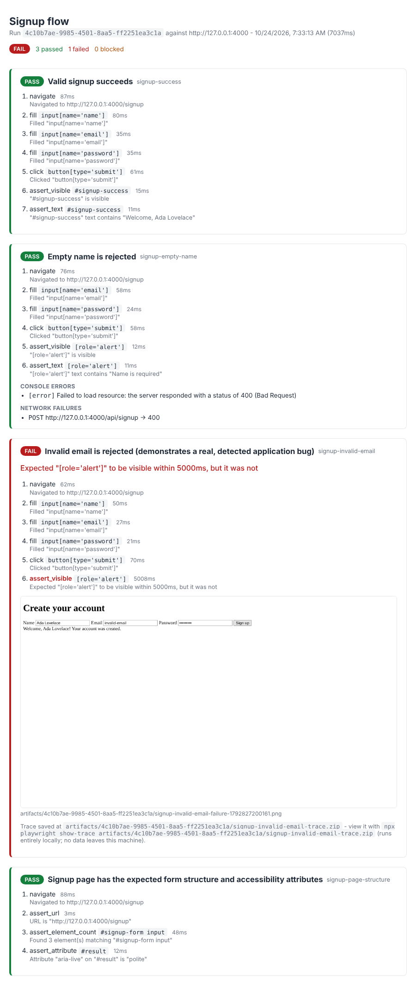

# Browser QA Agent

> An AI-accessible browser QA agent: executes structured test plans with Playwright, verifies outcomes with explicit assertions, and produces evidence-backed JSON reports — distinguishing a browser action succeeding from the application feature actually working.

---

## Overview

### Problem Statement & Intended Users

- **Problem**: Browser automation scripts are easy to write but easy to lie with — a click "succeeding" is not the same as the feature it triggers actually working. This project gives an AI assistant (or a developer) a way to run real browser QA checks where every reported result is backed by an explicit assertion and, on failure, concrete evidence (a screenshot, the exact selector/expected value, and a reproduction trace of steps).
- **Intended Users**: Frontend developers, AI coding assistants operating via MCP, and open-source maintainers who want reproducible, evidence-backed bug reports instead of "it looks broken."

### Key Features (implemented and verified in this release)

- A versioned, strictly-validated JSON test-plan schema (Zod) covering 13 P0 actions/assertions — no arbitrary JavaScript execution, filesystem access, or unrestricted browser commands.
- A deterministic Playwright-based runner: isolated browser context per test, explicit per-step timeouts, and three result statuses (`PASS` / `FAIL` / `BLOCKED`) that keep environmental/infrastructure failures distinct from real application bugs.
- An assertion engine decoupled from Playwright (`AssertablePage` interface) so pass/fail semantics are unit-testable without a browser.
- A target policy that blocks navigation to loopback/private-network/link-local addresses (including the `169.254.169.254` cloud metadata address) unless explicitly opted into, and can restrict to an allow-list of origins.
- **Evidence collection**: console errors/warnings, failed/error-status network requests, a screenshot on every assertion failure, and a Playwright trace (`.zip`) for every failed or blocked test — all sanitized (secrets redacted from URLs/text) before being written to `artifacts/<runId>/`.
- **A working MCP server** (`src/mcp/`) exposing five tools — `run_qa_test`, `inspect_page`, `get_run_report`, `get_failure_evidence`, `plan_qa_test` — built on the same runner/assertion/security services the CLI uses, with no separate "MCP version" of the browser logic. Verified with a real MCP client/server round trip in `tests/integration/mcp-server.test.ts` (not just type-checked).
- **An optional AI test planner** (`src/planner/llm-planner.ts`): converts a natural-language request into a test plan via an LLM, then validates it through the exact same schema a hand-written plan goes through. A plan that uses an unsupported action, or whose `baseUrl` the model tried to change, is rejected rather than silently run. **Two providers are supported — Anthropic and Gemini** — selected via environment variables, with no hard dependency on either (see [AI Planner: Model & Pricing Choice](#ai-planner-model--pricing-choice)).
- **Optional evidence-based failure diagnosis** (`src/diagnosis/failure-analyzer.ts`): with no API key configured, returns only the factual evidence (no causal claim). With one configured, attaches a model-generated hypothesis explicitly flagged `isModelGenerated: true` — never conflated with a verified result.
- A demo signup application (`fixtures/demo-app/`) with one deliberately introduced bug, and an example test plan (`examples/signup-flow.json`) that reliably catches it — exercised through both the CLI and the MCP server.
- **A self-contained HTML report viewer** (`src/reports/html-reporter.ts`): color-coded PASS/FAIL/BLOCKED status per test, the full step-by-step timeline, console/network evidence, and embedded (base64 inline, no broken links) screenshots in one file you can open, email, or attach anywhere. Every piece of text that didn't originate in this codebase — console messages, network URLs, assertion errors, test-plan selectors — is HTML-escaped before being written, with dedicated tests proving a malicious `<script>` in any of those fields can't execute when the report is opened. Generate it with `--html report.html` on a run, or convert an existing `report.json` with `npm run report:html`.

### Not yet implemented (see [Known Limitations](#known-limitations) and [Future Improvements](#future-improvements))

Full DNS-rebinding protection. The policy now resolves DNS and vets every redirect hop and subrequest, but Chromium resolves names again on its own, so a rebinding race is still possible. Network-level egress filtering is required for untrusted users (see [Known Limitations](#known-limitations)).

---

## Do I Need an API Key?

**No.** The entire deterministic engine — the CLI, the test-plan schema, the Playwright runner, the assertion engine, the target policy, evidence collection, and all four non-planning MCP tools (`run_qa_test`, `inspect_page`, `get_run_report`, `get_failure_evidence`) — runs with zero API keys and zero network calls to any model provider. This was verified directly: see [How to Test](#how-to-test) for the exact command that runs the full example plan with `ANTHROPIC_API_KEY`/`GEMINI_API_KEY`/`LLM_PROVIDER` all explicitly unset.

| Component | API key needed? | Notes |
| :--- | :--- | :--- |
| TypeScript / Node.js / Playwright / Chromium | No | The actual browser execution |
| MCP SDK (`run_qa_test`, `inspect_page`, `get_run_report`, `get_failure_evidence`) | No | Reuses the same services as the CLI |
| Console/network capture, screenshots, traces | No | Pure Playwright + local filesystem |
| Natural-language test planning (`plan_qa_test`) | **Yes, optional** | Needs `ANTHROPIC_API_KEY` or `GEMINI_API_KEY` |
| Failure diagnosis hypothesis (`get_failure_evidence` with `diagnose: true`) | **Yes, optional** | Same two keys; omit the flag (or the key) and you get the factual evidence with no hypothesis attached, not an error |

A key is required only if you want a natural-language request turned into a test plan for you, or a model's causal hypothesis attached to a failure. Hand-write the JSON test plan instead (see [Test Plan Format](#test-plan-format) and `examples/signup-flow.json`) and the project needs nothing beyond Node and a browser — exactly the "build the deterministic MVP first, add AI as an optional layer after" order this project was built in, not retrofitted onto.

---

## Technical Stack

- **Language & Runtime**: TypeScript 5 / Node.js 20+
- **Core Library**: [Playwright](https://playwright.dev/) for browser automation, [Zod](https://zod.dev/) for schema validation, [`@modelcontextprotocol/sdk`](https://github.com/modelcontextprotocol/typescript-sdk) for the MCP server
- **Models**: None required for deterministic execution or the MCP server's core tools. `plan_qa_test` and diagnosis (`diagnose: true` on `get_failure_evidence`) are optional and call either the Anthropic Messages API or the Gemini API directly via `fetch` (no provider SDK dependency) — see [AI Planner: Model & Pricing Choice](#ai-planner-model--pricing-choice).
- **External APIs / Tools**: Anthropic's or Google's API, only for the two optional AI features above, and only one of the two per deployment. The demo app (`fixtures/demo-app/server.js`) uses only Node's built-in `http` module.

---

## Architecture & Data Flow

```
                 [MCP client]                           [CLI: src/index.ts]
                       |                                          |
                       v                                          v
              [MCP server: src/mcp/]  --- both call the SAME services below ---
                       |
   run_qa_test  inspect_page  get_run_report  get_failure_evidence  plan_qa_test(*)
                       |
                       v
[Test plan JSON] --> [Zod schema validation] --> [Target policy check on baseUrl]
                                                          |
                                                          v
                             [BrowserManager: isolated context per test, tracing started]
                                                          |
             +------------------------------+-------------+-------------+------------------------------+
             |                              |                                                           |
     [Action executor]              [Assertion engine]                            [Evidence collectors]
  (navigate/click/fill/...)   (assert_visible/text/url/...)              (console errors, failed/4xx+ requests,
             |                              |                              screenshot-on-fail, trace-on-fail)
             +------------------------------+-------------+-------------+------------------------------+
                                                          |
                                                          v
                      [TestResult: PASS | FAIL | BLOCKED + steps + sanitized evidence + artifact paths]
                                                          |
                                                          v
                    [RunResult JSON --> artifacts/<runId>/report.json, also stdout/--out for the CLI]
                                                          |
                                                          v
                          [get_failure_evidence] --(diagnose: true, optional)--> [failure-analyzer.ts](*)

(*) plan_qa_test and diagnose:true are the only paths that touch an LLM, and only when ANTHROPIC_API_KEY
    is set. Everything else above executes and determines PASS/FAIL/BLOCKED with zero model involvement.
```

A step is routed to the action executor (performs a browser operation) or the assertion engine (checks an actual outcome) based solely on whether its `action` name starts with `assert_`. Only the assertion engine can turn a test `FAIL`; a successful action never implies success on its own. The MCP server and the CLI are both thin callers of `runTestPlan()` — there is exactly one implementation of the browser logic.

### Core Architecture Decisions

- **Assertions are decoupled from Playwright.** `src/assertions/assertion-engine.ts` only depends on a minimal `AssertablePage` interface, implemented against a real browser by `PlaywrightAssertablePage` (`src/runner/playwright-page-adapter.ts`). This means assertion pass/fail logic is unit-tested (`tests/unit/assertion-engine.test.ts`) with an in-memory fake — no browser, no flakiness, sub-second test runs.
- **Deterministic execution has no LLM dependency.** Nothing in `src/runner`, `src/assertions`, or `src/security` imports a model client. The optional AI planner (`src/planner/llm-planner.ts`) sits strictly in front of this engine, emitting the same validated JSON schema a human would write by hand — it can never bypass validation or the target policy.
- **Three result statuses, not two.** `BLOCKED` is distinct from `FAIL` so a browser crash, a launch failure, or a target-policy rejection is never misreported as "the application is broken."
- **One browser process per run, one context per test.** `BrowserManager` launches Chromium once in `runTestPlan` and hands out a fresh `BrowserContext` per test via `openTestSession()`/`closeTestSession()` — isolation comes from the context (separate cookies/storage/state), not from relaunching the whole browser process for every test in a plan.

---

## Prerequisites

- Node.js 20 or later
- npm (or another Node package manager)
- No API keys are required for the current feature set.

---

## Installation & Setup

1. **Navigate to the project directory:**
   ```bash
   cd tools/browser-qa-mcp
   ```

2. **Install dependencies:**
   ```bash
   npm install
   ```

3. **Install a Playwright browser** (one-time; downloads Chromium):
   ```bash
   npx playwright install chromium
   ```
   In a sandboxed/CI environment with no network access to Playwright's CDN but a pre-installed Chromium binary, skip this step and point `PLAYWRIGHT_CHROMIUM_PATH` at that binary instead (see below).

4. **Configure environment variables (optional):**
   ```bash
   cp .env.example .env
   ```

---

## Configuration & Environment Variables

| Variable Name | Required | Default | Description |
| :--- | :--- | :--- | :--- |
| `PLAYWRIGHT_CHROMIUM_PATH` | No | *(Playwright's own managed browser)* | Absolute path to a pre-installed Chromium binary, for environments where `npx playwright install` cannot reach the network. |
| `PORT` | No | `4000` | Port the demo app (`fixtures/demo-app/server.js`) listens on. |
| `QA_ARTIFACTS_DIR` | No | `./artifacts` | Base directory runs are written under (one subdirectory per `runId`). The CLI and MCP server must point at the same directory to share run reports via `get_run_report`/`get_failure_evidence`. |
| `QA_ARTIFACTS_MAX_RUNS` | No | `50` | Keep at most this many run directories; older ones are deleted after each run. `0` = unlimited. |
| `QA_ARTIFACTS_MAX_AGE_DAYS` | No | `7` | Delete run directories older than this after each run. `0` = unlimited. |
| `ANTHROPIC_API_KEY` | No | *(unset)* | Enables the AI planner/diagnosis via Anthropic. |
| `ANTHROPIC_MODEL` | No | `claude-haiku-5-5` | Anthropic model for planner/diagnosis calls. |
| `GEMINI_API_KEY` | No | *(unset)* | Enables the AI planner/diagnosis via Gemini. |
| `GEMINI_MODEL` | No | `gemini-2.5-flash-lite` | Gemini model for planner/diagnosis calls. |
| `LLM_PROVIDER` | No | *(unset)* | `"anthropic"` or `"gemini"`. Required only if **both** API keys above are set, to disambiguate which one is used — see below. |

The deterministic test runner itself takes no environment-variable configuration; target restrictions (`--allow-local-dev`/`allowLocalDev`, an allowed-origin list) are passed as CLI flags / tool arguments instead, so a test run's security posture is explicit at the call site rather than hidden in `.env`.

### AI Planner: Model & Pricing Choice

Both `plan_qa_test` and `get_failure_evidence`'s `diagnose: true` do one thing: turn a short natural-language request or a small evidence bundle into a few hundred to low-thousands of tokens of structured JSON output. That is squarely a "classification/extraction/short-generation" workload, not one that benefits from a frontier-tier reasoning model — so both supported providers default to their **cheapest, fastest tier**, not their flagship:

| Provider | Default model | Input $/1M tokens | Output $/1M tokens |
| :--- | :--- | :--- | :--- |
| Anthropic | `claude-haiku-5-5` | $0.10 | $0.50 |
| Gemini | `gemini-2.5-flash-lite` | $0.10 | $0.40 |

Anthropic pricing is from Anthropic's own current rate card (first-party API). Gemini pricing is **not** confirmed from `ai.google.dev` directly — that domain wasn't reachable from this project's development sandbox — so it's cross-checked against several independent third-party trackers that all agree on $0.10/$0.40 for `gemini-2.5-flash-lite` as of October 2026 ([morphllm.com](https://www.morphllm.com/gemini-api-pricing), [llm-stats.com](https://llm-stats.com/models/gemini-2.5-flash), [pricepertoken.com](https://pricepertoken.com/pricing-page/model/google-gemini-2.5-flash)). **Verify current Gemini pricing at [ai.google.dev/gemini-api/docs/pricing](https://ai.google.dev/gemini-api/docs/pricing) before relying on it for budgeting.**

At this size and volume, the two cheapest tiers are close enough (±20% on output, identical on input) that the real decision driver is usually **which provider you already have a key for**, not the per-token rate. That's why the provider is a runtime choice, not a hardcoded one: set whichever key you have, and both AI-assisted MCP tools work. For a materially more capable (and more expensive) planner on a harder natural-language request, override `ANTHROPIC_MODEL`/`GEMINI_MODEL` to a larger model — but for the planner/diagnosis workloads here, the cheap tier has been sufficient in this project's own testing (the fake-provider-injected unit tests in `tests/unit/llm-planner.test.ts` and `tests/unit/failure-analyzer.test.ts` exercise the logic independent of model choice).

---

## How to Run

**1. Start the demo app** (in one terminal):
```bash
npm run demo:app
# Demo signup app listening on http://127.0.0.1:4000
```

**2. Run the example test plan against it** (in another terminal):
```bash
npm run run:plan -- examples/signup-flow.json --allow-local-dev --html report.html
```

`--allow-local-dev` is required because `127.0.0.1` is a loopback address and the target policy blocks loopback/private targets by default (see [Security & Privacy Considerations](#security--privacy-considerations)). Add `--out report.json` to write the JSON report to a file instead of stdout, and/or `--html report.html` to also render the self-contained HTML viewer — open it in a browser to see color-coded PASS/FAIL/BLOCKED results, the step timeline, and embedded screenshots for any failure.

Already have a `report.json` (e.g. saved from the MCP server's `get_run_report` output) and just want the HTML view? `npm run report:html -- report.json [out.html]` converts it without re-running anything.

---

## MCP Server

Run it directly for a quick check:

```bash
npm run mcp
```

It speaks MCP over stdio, so to use it from a client, point the client at the dev command (or `node dist/mcp/index.js` after `npm run build`). Example configuration (Claude Desktop / any MCP client using this config shape):

```json
{
  "mcpServers": {
    "browser-qa": {
      "command": "npx",
      "args": ["tsx", "/absolute/path/to/tools/browser-qa-mcp/src/mcp/index.ts"],
      "env": {
        "QA_ARTIFACTS_DIR": "/absolute/path/to/tools/browser-qa-mcp/artifacts"
      }
    }
  }
}
```

Add `ANTHROPIC_API_KEY` (or `GEMINI_API_KEY`) to `env` if you want `plan_qa_test` and diagnosis enabled — see [AI Planner: Model & Pricing Choice](#ai-planner-model--pricing-choice) for picking between them.

### Tools

| Tool | Purpose |
| :--- | :--- |
| `run_qa_test` | Validates and executes a test plan, returns the full `RunResult` (PASS/FAIL/BLOCKED per test, with evidence references). |
| `inspect_page` | Read-only: loads a page and returns its title, URL, and a bounded list of interactive elements with selector hints — useful for writing a plan's selectors. |
| `get_run_report` | Retrieves a previous run's full report by `runId`. |
| `get_failure_evidence` | Sanitized console/network evidence, screenshot/trace paths, and reproduction steps for a run's failing tests; optionally attaches a labeled AI hypothesis (`diagnose: true`). |
| `plan_qa_test` | Optional: converts a natural-language request into a validated test plan (requires `ANTHROPIC_API_KEY`). Never executes anything itself. |

A typical AI-assisted session: `plan_qa_test` → `run_qa_test` → (if it fails) `get_failure_evidence` with `diagnose: true`. All four non-planning tools work with zero API keys.

This was verified with a real MCP client/server round trip (not a mock) in `tests/integration/mcp-server.test.ts`, using the SDK's own `InMemoryTransport` and a real `Client` instance calling every tool.

---

## Example Input & Output

### Example Input

`examples/signup-flow.json` runs four tests against the demo app, exercising all 13 supported actions/assertions across them: a valid signup, an empty required field, an invalid email address, and a page-structure check (`assert_url`, `assert_element_count`, `assert_attribute`). The demo app's email check has one deliberate bug — it only checks the value's length, not its shape — so the third test is expected to fail.

### Example Output (abridged; full JSON has one entry per step)

```json
{
  "runId": "4c10b7ae-9985-4501-8aa5-ff2251ea3c1a",
  "planName": "Signup flow",
  "baseUrl": "http://127.0.0.1:4000",
  "status": "FAIL",
  "tests": [
    { "id": "signup-success", "name": "Valid signup succeeds", "status": "PASS", "...": "..." },
    { "id": "signup-empty-name", "name": "Empty name is rejected", "status": "PASS", "...": "..." },
    {
      "id": "signup-invalid-email",
      "name": "Invalid email is rejected (demonstrates a real, detected application bug)",
      "status": "FAIL",
      "error": "Expected \"[role='alert']\" to be visible within 5000ms, but it was not",
      "screenshotPaths": ["./artifacts/4c10b7ae-.../signup-invalid-email-failure-....png"]
    },
    { "id": "signup-page-structure", "name": "Signup page has the expected form structure and accessibility attributes", "status": "PASS", "...": "..." }
  ]
}
```

This was captured from an actual run in this repository's development environment (Node 22, pre-installed Chromium) — not a hand-written mock.

### Example HTML Report

The same run, rendered by `--html report.html`. The failing test's embedded screenshot shows the actual seeded bug: the app displays "Welcome, Ada Lovelace!" instead of the expected validation alert.



---

## How to Test

```bash
npm test          # unit + integration tests (includes a real browser run and a real MCP client/server round trip)
npm run build      # TypeScript type-check / compile
```

`npm test` runs 87 tests across 11 files: schema validation, assertion semantics, the target policy (including IPv4/IPv6 edge cases), sanitization, failure-evidence extraction, the provider-selection logic in `src/llm/client.ts`, the LLM planner/diagnosis modules (with an injected fake provider — no network calls), `RunStore`, the HTML reporter (including dedicated XSS-escaping tests for malicious console/network/selector/error text), and `tests/integration/mcp-server.test.ts`, which spins up the real demo app, launches a real Chromium via Playwright, and drives all five MCP tools through a real `Client`/`McpServer` pair. All 87 passed as of this writing (`PLAYWRIGHT_CHROMIUM_PATH` set to a pre-installed Chromium in this repo's development container).

Manual end-to-end verification (also actually run, against the CLI, with `ANTHROPIC_API_KEY`/`GEMINI_API_KEY`/`LLM_PROVIDER` unset to confirm the zero-API-key path — see [Do I Need an API Key?](#do-i-need-an-api-key)):
```bash
npm run demo:app &
unset ANTHROPIC_API_KEY GEMINI_API_KEY LLM_PROVIDER
npm run run:plan -- examples/signup-flow.json --allow-local-dev
# Expect: signup-success -> PASS, signup-empty-name -> PASS, signup-invalid-email -> FAIL,
# signup-page-structure -> PASS, plus console/network evidence in the report and a trace .zip
# under artifacts/<runId>/ for the failing test.
```

---

## Test Plan Format

A test plan is a JSON document validated against a strict Zod schema (`src/planner/schema.ts`) before any browser is launched:

```json
{
  "version": 1,
  "name": "Signup flow",
  "baseUrl": "http://127.0.0.1:4000",
  "tests": [
    {
      "id": "signup-invalid-email",
      "name": "Reject invalid email",
      "steps": [
        { "action": "navigate", "url": "/signup" },
        { "action": "fill", "selector": "input[name='email']", "value": "invalid-email" },
        { "action": "click", "selector": "button[type='submit']" },
        { "action": "assert_visible", "selector": "[role='alert']" }
      ]
    }
  ]
}
```

**Rules:**
- `baseUrl` is the origin test steps' relative `url`s resolve against (`new URL(step.url, baseUrl)`).
- Every field is validated with `.strict()` — an unrecognized field rejects the whole plan rather than being silently ignored.
- Each `action` has required fields enforced before execution (e.g. `fill` requires both `selector` and `value`); see `REQUIRED_FIELDS` in `src/planner/schema.ts` for the full map.
- Limits: up to 20 tests per plan, 30 steps per test, and a 30-second ceiling on any single step's `timeoutMs` (default 5 seconds) — enforced by the schema itself, before any plan reaches the browser.
- Supported actions: `navigate`, `click`, `fill`, `select_option`, `check`, `uncheck`, `wait_for_element`, `capture_screenshot`.
- Supported assertions: `assert_visible`, `assert_text`, `assert_url`, `assert_element_count`, `assert_attribute`.
- No action exists for running arbitrary JavaScript, reading/writing the filesystem, or issuing raw browser/CDP commands — by design, not by omission.

---

## Known Limitations

- **Target policy is application-level, not a network boundary.** Every browser request (each redirect hop, every subresource, WebSocket upgrades) is checked by `src/security/network-guard.ts`, and hostnames are DNS-resolved and rejected if any address is loopback/private/link-local/CGNAT/multicast. Service workers are blocked so nothing bypasses interception. Chromium still does its own DNS lookup after this check, so a DNS-rebinding attacker with a tiny TTL can race it. **Before exposing this to untrusted users, run it behind network-level egress restrictions** (a firewall, egress proxy, or container network policy that denies private ranges and cloud metadata).
- **Screenshots and trace files are not themselves redacted.** Text-based evidence (console messages, captured URLs) is sanitized (see below), but a screenshot or a Playwright trace can still visually contain whatever was on screen. Don't point this at a page that renders real secrets.
- **Artifact retention** is applied after every run: only the newest `QA_ARTIFACTS_MAX_RUNS` (default 50) run directories are kept, and any older than `QA_ARTIFACTS_MAX_AGE_DAYS` (default 7) are deleted. Set either to `0` to disable that limit. Only UUID-named directories are ever deleted. `RunStore`'s in-memory cache is capped at 100 runs.
- **The AI planner/diagnosis prompts are not adversarially hardened.** Output is always schema-validated and the planner's `baseUrl` is pinned (see below), so a malicious plan can't execute — but a sufficiently adversarial natural-language request has not been fuzz-tested against the planner.
- Tested on Linux (this repository's development container, Node 22) with Chromium only; Firefox/WebKit and other platforms are untested.
- The demo app's "bug" is intentional and documented above — it exists to prove the runner detects real defects, not as an example of production-quality input validation.

---

## Security & Privacy Considerations

- **No arbitrary code execution**: the test-plan schema exposes a fixed set of 13 actions/assertions. There is no "run this JavaScript" or "execute this shell command" action, and none is planned for the deterministic engine. This holds even for AI-generated plans — `plan_qa_test`'s output goes through the identical schema validation as a hand-written plan.
- **Target policy (`src/security/target-policy.ts`)**: navigation is denied by default to loopback (`127.0.0.1`, `localhost`, `::1`), RFC 1918 private ranges (`10.0.0.0/8`, `172.16.0.0/12`, `192.168.0.0/16`), and link-local/cloud-metadata addresses (`169.254.0.0/16`, which includes `169.254.169.254`) unless the caller explicitly passes `allowLocalDev`. An optional exact-origin allow-list can further restrict navigation. See [Known Limitations](#known-limitations) for what this does *not* yet cover (DNS rebinding, redirect revalidation).
- **The AI planner cannot redirect execution to a different origin**: `planTestFromDescription` rejects the generated plan outright if its `baseUrl` differs from the one the caller explicitly asked to test, even though the model was told what the baseUrl is. The target policy above is still enforced independently at run time regardless.
- **Run IDs are validated**: `get_run_report`/`get_failure_evidence` reject anything that is not a UUID before building a path, and the resolved path must stay inside the artifacts directory.
- **Isolated browser contexts**: every test runs in its own `BrowserContext`, closed immediately after the test finishes (in a `finally` block, so a crashed test still cleans up).
- **Evidence sanitization (`src/security/sanitization.ts`)**: before console messages, error text, or captured request URLs are written to a report, `Bearer` tokens and common sensitive query-string parameters (`password`, `token`, `apikey`, `secret`, `session`, etc.) are redacted. This is pattern-based, not exhaustive — see [Known Limitations](#known-limitations) for what it doesn't cover.
- **Diagnosis output is explicitly labeled**: `FailureDiagnosis.isModelGenerated` is `false` whenever no model was involved (the default), and the hypothesis field is only ever populated when a model actually ran — a caller can never mistake a guess for a verified finding by accident.
- **Authenticated/production targets**: this release has no concept of authentication at all, and the target policy is deny-by-default for anything that isn't an explicitly-allowed public origin. Do not point this tool at a production environment; it has not been evaluated for that use case.

---

## Future Improvements

- [x] DNS resolution + redirect-chain and subrequest revalidation in the target policy
- [ ] Pin Chromium's DNS to the vetted addresses to close the rebinding race without external egress rules
- [ ] Redaction for captured screenshots/traces (today only text-based evidence is sanitized)
- [ ] Adversarial testing of the AI planner's prompt against deliberately tricky natural-language requests
- [ ] Additional browser engines (Firefox/WebKit) and non-Linux platform verification

---

## License

This project is contributed under the repository's open-source license (MIT).
