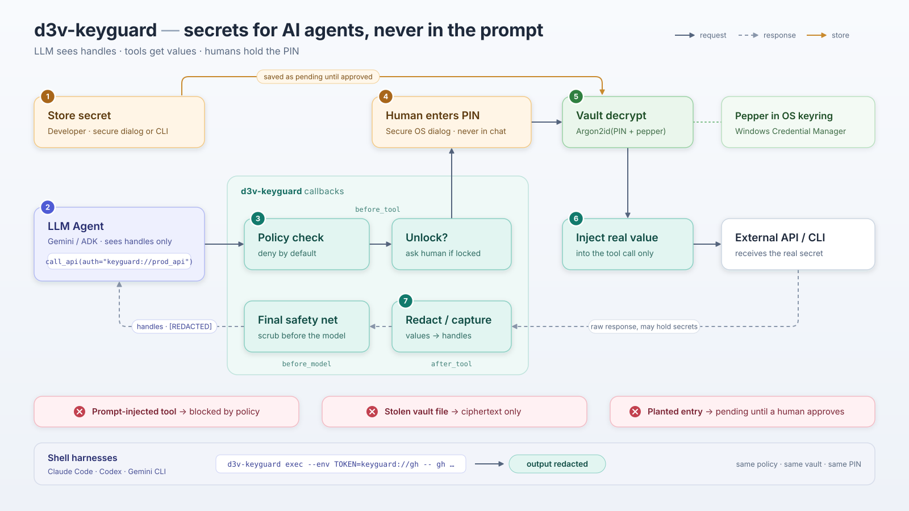

# d3v-keyguard

> A PIN-protected local secret vault for LLM agents. Agents can store and use passwords, API keys, tokens and session ids without the model ever seeing the plaintext. The PIN/passphrase needs 6+ characters (numeric PINs allowed); a longer passphrase is much stronger (see [Known Limitations](#known-limitations)).

---

## Overview

### Problem Statement & Intended Users
- **Problem**: Agents need credentials to call APIs, log in, and run commands. The usual approaches (pasting secrets into chat, `.env` files the agent can read, secrets echoed back in tool output) put plaintext into the model context, logs and transcripts, where prompt injection can exfiltrate it.
- **Intended Users**: Developers building agents with Google ADK (primary target), and users of shell-based agent harnesses (Claude Code, Codex, Gemini CLI) that support Agent Skills.

### Key Features
- **Handles, not values**: the LLM only sees `keyguard://<name>` handles and masked previews. Real values are substituted at tool-call time, outside the model, into a private copy of the arguments, so ADK plugins, telemetry spans and error events only ever see the handle.
- **Store without the passphrase, use with it**: entries are sealed to the vault's public key, so an agent can save a new secret while the vault is locked. Using a secret requires unlocking with the passphrase.
- **Secure passphrase entry**: never typed into the chat. A masked tkinter dialog opens in an isolated subprocess. A hidden terminal prompt is used only when no GUI is available (clicking Cancel is final). The dialog shows who is asking and which secrets, then every tool argument on its own line (destination-like names such as `url`, `host`, `cmd` first), or for `exec` the resolved program path and every argument. Long values keep their head and tail, and anything cut is marked `[... N chars hidden - do not approve unless you expected this ...]`; nothing is cut silently.
- **Per-entry pending approval**: entries stored while locked stay unusable until the user reviews them at the next unlock. Each entry is shown with a masked preview, when it was stored, its source (description or `captured from tool ...`) and a `REPLACES an existing ACTIVE secret` warning. The user picks Approve, Reject or Decide later for each one, and approval is bound to the exact content reviewed. A locked store never destroys an active secret: the new value waits in a separate pending slot.
- **Deny-by-default policy**: each tool may receive only the secrets you allow, e.g. `Policy({"call_api": ["prod_*"]})`. `exec` can be restricted the same way with `exec:<command>` rules.
- **Output capture and scrubbing**: session tokens returned by tools (for example a `login` tool) are sealed into the vault and replaced with handles. Echoed secret values are scrubbed from results of any type: results that are not plain JSON data (dataclasses, sets, bytes, pydantic models, custom objects) are converted to JSON data first, then scrubbed. Exception messages and values a tool writes to session state are scrubbed too. A final redaction pass runs on every outbound LLM request, including after the vault locks.
- **Guess detection**: the model never sees a secret, so a stored value in model-written content means it is guessing. That covers its text, tool-call names and arguments, code, and the output of other agents (sub-agent turns that ADK re-presents as user context, `AgentTool` results). keyguard does not redact such content in place, because that would tell the model which guess was right. Instead it locks the vault and stops that session with a fixed notice. Other sessions keep running.
- **`exec` for shell harnesses**: `d3v-keyguard exec --env VAR=keyguard://name -- cmd` injects secrets into a child process environment and redacts them from its output (a safety net, not a boundary).
- **Tamper and rollback detection**: the whole vault file (entries, pending entries, failed-attempt counters) is authenticated, and its generation counter is mirrored in the OS keyring. Edits, deleted entries and restored old copies are detected.
- **Lockout**: backoff after 3 wrong passphrases. After 10, agent-driven unlocks are refused until a human runs `d3v-keyguard reset-lockout` at a terminal.

---

## Technical Stack

- **Language & Runtime**: Python 3.10+
- **Agent Framework / Core Library**: Google ADK (`google-adk>=2.13`, optional `[adk]` extra); Agent Skills standard (`skills/d3v-keyguard/SKILL.md`)
- **Crypto / OS integration**: `cryptography>=44` (Argon2id, X25519, HKDF-SHA256, AES-256-GCM, HMAC), `keyring>=25` (Windows Credential Manager/DPAPI, macOS Keychain, Linux Secret Service)
- **Models**: model-agnostic. The demo uses `gemini-2.5-flash` by default.
- **UI**: tkinter (masked passphrase/secret input and per-entry review dialogs)

---

## Architecture & Data Flow



Demo video: [gdg-d3v-keyguard-demo.mp4](gdg-d3v-keyguard-demo.mp4)

Key layout:

```
                    +------------------ OS keyring ------------------+
                    |  32-byte random pepper + generation (per vault) |
                    +----------------------+-------------------------+
                                           |
 passphrase (secure dialog) --> Argon2id(passphrase, salt, secret=pepper) = KEK
                                           |
                    KEK AES-256-GCM-unwraps: X25519 private key,
                    pinned public key, endorsement key
                                           |
 store (no passphrase): value --seal to public key--> vault.json "pending" slot
 review at unlock      : user approves -> entry endorsed (HMAC) -> "entries" (active)
 use   (passphrase)    : entry --open with private key--> plaintext in process memory only

 ADK flow (agent callbacks or runner-wide plugin):
 [LLM] --tool call with keyguard://name--> before_tool_callback
            (guess check, your before-tool guardrails, policy check,
             confirmation gate, unlock dialog,
             call the tool with a PRIVATE copy of the args holding the real value,
             capture + scrub a copy of the result) --> ADK sees handles + scrubbed result only
 [other tools] --result--> after_tool_callback (capture token fields, scrub any result type)
 [tool exception] --> on_tool_error_callback (scrub the message)
 [outbound LLM request] --> before_model_callback (guess check on model-authored parts and
                            on every agent-authored session event, final redaction of
                            everything else)
```

**Crypto details**
- Pepper: 32 random bytes in the OS keyring (on Windows stored with `CRED_PERSIST_LOCAL_MACHINE`, so it does not roam with a domain profile). Insecure keyring backends are refused.
- KEK: Argon2id (RFC 9106, pepper passed as the secret), 16-byte salt, 64 MiB, 3 iterations, 4 lanes. KDF parameters are validated strictly, and values weaker than the defaults are rejected as a downgrade.
- Entries: ephemeral X25519 + HKDF-SHA256 + AES-256-GCM. The AAD binds the format version, vault id, entry name and key fingerprint, so entries cannot be swapped or renamed.
- Integrity: approved entries carry an HMAC endorsement tag (its key is only available after unlock). A state MAC keyed from the pepper covers the *whole* file, including pending entries and the failed-attempt counters, plus a generation counter that is also stored in the keyring. Offline edits, deletions and rollback to an older copy are detected, even while locked. Public-key substitution is detected at unlock against the pinned copy.
- Passphrase change (`change-pin`) rotates everything: new pepper, new X25519 key pair, new endorsement key, every entry re-sealed. Old copies of the file (backups, OneDrive versions) no longer verify, and secrets stored after the change cannot be read with the old passphrase. An old copy still holds the secrets it contained, readable with the old passphrase *and* the old pepper. Another process that is still unlocked with the old keys (for example a running `adk web`) notices the rotation on its next vault access and locks itself: it never seals to the revoked key. A store from that process lands in the pending slot, sealed to the new key, and the agent's next secret use asks for the new passphrase.
- Concurrency: every read-modify-write holds an exclusive lock file (`vault.json.lock`, via `msvcrt.locking` / `flock`). Windows sharing errors caused by antivirus, the indexer or OneDrive are retried. Anything persistent becomes a clean `VaultIOError`.
- Session: unlocked keys exist only in process memory. A timer wipes them after 300 s idle and after 3600 s total, even if nothing touches the vault.

---

## Prerequisites

- Python 3.10+ and pip
- A working OS keyring (Windows Credential Manager, macOS Keychain, or a Linux Secret Service such as GNOME Keyring or KWallet)
- tkinter for the GUI prompts (optional; a hidden terminal prompt is used otherwise)
- For the ADK demo: a `GOOGLE_API_KEY`

---

## Installation & Setup

1. **Navigate to the project directory:**
   ```bash
   cd tools/d3v-keyguard
   ```

2. **Set up the virtual environment and install dependencies:**
   ```bash
   python -m venv .venv
   # Windows:
   .venv\Scripts\activate
   # Linux/macOS:
   source .venv/bin/activate

   pip install -r requirements.txt
   # or, from the repository root (editable, with ADK support):
   pip install -e "tools/d3v-keyguard[adk]"
   ```

3. **Create the vault** (you choose a passphrase in a secure dialog):
   ```bash
   d3v-keyguard init
   ```

4. **Install the Agent Skill** (optional, for skill-aware harnesses):
   ```bash
   # Claude Code, per user:
   cp -r skills/d3v-keyguard ~/.claude/skills/
   # or per project:
   cp -r skills/d3v-keyguard <project>/.claude/skills/
   ```
   For other Agent-Skills harnesses, copy the `skills/d3v-keyguard` folder into that harness's skills directory.

5. **For the ADK demo**, store the Gemini key in the vault (`d3v-keyguard add google_api_key`) and start `adk web` through `exec` (see How to Run). Alternatively, create a plaintext `examples/adk_demo_agent/.env`:
   ```bash
   GOOGLE_API_KEY=your-key-here
   MODEL_NAME=gemini-2.5-flash
   ```

---

## Configuration & Environment Variables

| Variable Name | Required | Default | Description |
| :--- | :--- | :--- | :--- |
| `KEYGUARD_VAULT_PATH` | No | OS data dir (see below) | Path of `vault.json` |
| `KEYGUARD_PROMPT` | No | `auto` | Prompt mode for the ADK layer *and* the CLI: `auto` (GUI dialog, terminal only if no GUI), `gui`, `tty` |
| `KEYGUARD_IDLE_TIMEOUT` | No | `300` | Seconds of inactivity before auto-lock |
| `KEYGUARD_MAX_SESSION` | No | `3600` | Maximum unlocked session length in seconds |
| `KEYGUARD_POLICY_FILE` | No | *None* | JSON policy file mapping tool names (and `exec:<command>`) to allowed secret name patterns |
| `KEYGUARD_ALLOW_LLM_VALUES` | No | `0` | `1` adds a `value` parameter to `store_secret` so the LLM can pass values. Not recommended; rotate any such secret. |
| `KEYGUARD_STORE_REQUIRES_UNLOCK` | No | `0` | `1` = strict mode: storing also requires an unlocked vault |
| `GOOGLE_API_KEY` | Demo only | *None* | Gemini API key for the ADK demo |
| `MODEL_NAME` | Demo only | `gemini-2.5-flash` | Model used by the ADK demo |

Default vault location:
- Windows: `%LOCALAPPDATA%\d3v-keyguard\vault.json`
- macOS: `~/Library/Application Support/d3v-keyguard/`
- Linux: `$XDG_DATA_HOME/d3v-keyguard/` (usually `~/.local/share/d3v-keyguard/`)

Example policy file:
```json
{ "call_api": ["prod_*"], "deploy": ["deploy_token"], "exec:gh": ["github_token"], "exec:npm": ["npm_token"] }
```
`exec:<command>` keys use the program name without directory or extension, in lower case. Such a bare-name rule only covers programs found through `PATH`. A program given as a path (`.\build.cmd`, `C:\tools\gh.exe`) needs a rule keyed by its full path, e.g. `"exec:C:\\tools\\gh.exe"`. As soon as the file has one `exec:` key, `exec` is deny-by-default for every command and secret not listed.

Tool rules match by tool name only. Every tool with that name, in any agent, sub-agent or toolset (including MCP toolsets), gets the same secrets, so use distinctive names for tools that receive secrets.

---

## How to Run

### CLI (`d3v-keyguard` or `python -m d3v_keyguard`)

```bash
d3v-keyguard init                         # create a vault and choose a passphrase
d3v-keyguard add github_token --description "GitHub PAT"   # value + passphrase in secure prompts; stored ACTIVE
d3v-keyguard add github_token --force     # replace an existing secret
d3v-keyguard add ci_token --no-unlock     # store without the passphrase (PENDING until reviewed)
d3v-keyguard list                         # handles, status (active/pending/tampered), descriptions
d3v-keyguard status                       # locked/unlocked, pending count, lockout state
d3v-keyguard approve                      # review PENDING entries one by one (approve / reject / later)
d3v-keyguard reject ci_token              # discard a pending entry (an active value with that name is kept)
d3v-keyguard rm github_token              # deleting an ACTIVE secret asks for the passphrase; permanent
d3v-keyguard change-pin                   # new passphrase + key and pepper rotation
d3v-keyguard reset-lockout                # human-only, interactive terminal
d3v-keyguard reveal github_token          # interactive terminal only; warns, asks you to type the name
d3v-keyguard lock                         # no-op note: each CLI process locks on exit

# Run a command with secrets injected into its environment:
d3v-keyguard exec --env GITHUB_TOKEN=keyguard://github_token -- gh repo list
```

`exec` notes:
- The passphrase dialog shows the resolved program path (for example `C:\Program Files\GitHub CLI\gh.exe`), every argument on its own line, and which secret goes into which variable. Check it before you type the passphrase. Each CLI call is a separate process, so each one asks.
- Programs given by bare name are looked up only in absolute `PATH` entries, never in the current directory (unlike `cmd.exe`/PowerShell on Windows), so a `gh.cmd` planted in a cloned repository is not run. To run a program from the current directory, give its path (`.\build.cmd`); `exec:` policy rules then need its full path. `PATHEXT` is honoured, so Windows `.cmd`/`.bat` shims (`npm`, `az`, `gcloud`) work. Shell builtins (`echo`, `dir`) need `cmd /c ...` or `sh -c ...`. A missing command exits with 127 and Ctrl+C with 130; otherwise the child's exit code is returned.
- The child's stdout/stderr are pipes, not a terminal. Output is passed through line by line (no colours or progress bars), byte-exact unless a line contained a secret.
- Output redaction is a best-effort safety net, not a security boundary: a hostile command can print the value reversed, split or encoded. Only run commands you trust, and restrict them with `exec:` policy rules.

### Google ADK

```python
import os
from google.adk.agents import Agent
from d3v_keyguard.adk import KeyguardADK
from d3v_keyguard.policy import Policy

API_BASE = "https://api.example.com"   # fixed in code: the model cannot redirect the secret

def call_api(path: str, authorization: str) -> dict:
    """Call the API. authorization: 'Bearer keyguard://<name>'."""
    ...  # receives the real value here; send it to API_BASE + path only

kg = KeyguardADK(
    policy=Policy({"call_api": ["demo_*"]}),
    capture={"login": {"session_token": "demo_session"}},
)

root_agent = Agent(
    name="demo",
    model=os.getenv("MODEL_NAME", "gemini-2.5-flash"),
    instruction="Use keyguard:// handles for credentials. Never ask for secrets in chat.",
    tools=[call_api, login, *kg.tools],
    **kg.callbacks(),   # before_tool, after_tool, on_tool_error and before_model callbacks
)
```

Or wire it runner-wide as a plugin, which also covers sub-agents. Register it **first**, so it runs before any logging or tracing plugin:
```python
from google.adk.apps import App
app = App(name="demo", root_agent=root_agent, plugins=[kg.plugin(), *other_plugins])
```

The policy is per tool, not per argument. A tool that lets the model choose the URL or command can send an allowed secret anywhere, so fix the destination inside the tool, as above, or add a standard ADK `before_tool_callback` guardrail that checks the arguments. `**kg.callbacks()` already sets `before_tool_callback`, so don't pass a second one next to it (Python raises `TypeError`). Use one of these forms:
```python
def guard(tool, args, tool_context):   # sees handles only, never values
    if not str(args.get("path", "")).startswith("/v1/"):
        return {"status": "error", "error": "path not allowed"}
    return None

# agent callbacks: list keyguard first, then your guardrail
root_agent = Agent(..., **{**kg.callbacks(), "before_tool_callback": [kg.before_tool_callback, guard]})
# or plugin mode: keyguard as a plugin, your guardrail on the agent
root_agent = Agent(..., before_tool_callback=guard)
app = App(name="demo", root_agent=root_agent, plugins=[kg.plugin()])
```

How keyguard fits into ADK's callback pipeline:
- For a call that carries handles, keyguard calls the tool itself and returns the result, and ADK then skips the remaining before-tool hooks. keyguard therefore runs those hooks itself *before* it unlocks or injects anything: in plugin mode every later plugin's `before_tool_callback` and the agent's `before_tool_callback`s, in agent mode the agent callbacks listed after keyguard's. They see the handles, never the values, and a non-`None` result from them answers the call (nothing is unlocked or injected).
- When keyguard changes a result (capture or scrub), it returns a scrubbed *copy*; the tool's own dict is never modified. ADK would then skip the remaining after-tool hooks, so keyguard runs them on the copy.
- An exception raised by a tool that received a secret becomes a scrubbed error result. `on_tool_error_callback` hooks (for example `ReflectAndRetryToolPlugin`) do not see it; after-tool hooks see the error dict.
- If the agent calls `unlock_vault` first, the unlock dialog cannot show a tool or arguments, so the first secret use after it opens a confirm dialog with the tool, the secrets and the arguments.
- The guess guard is per ADK session. When it trips, that session gets the fixed notice instead of model turns, and the vault locks (it is shared by the whole process, so other sessions are asked for the passphrase again on their next secret use). To recover, start a new session, or have the developer call `kg.reset_guard(session_id)` (`kg.reset_guard()` for all sessions) after reviewing the conversation. The offending model output is then replaced by a fixed notice in later requests, never redacted in place, so the same history does not trip again. `kg.is_tripped(session_id)` and `kg.tripped_sessions()` show the state. The acknowledgement is in memory only: a restarted process that resumes a persisted session trips again after its first unlock, and needs `reset_guard` again.

Run the offline end-to-end demo (real ADK `InMemoryRunner`, scripted stand-in model, no API key needed):
```bash
cd tools/d3v-keyguard
python examples/offline_adk_demo.py
```

Run the live demo agent with Gemini:
```bash
d3v-keyguard add demo_api --description "demo API key"     # any test value
d3v-keyguard add google_api_key --description "Gemini API key"
cd tools/d3v-keyguard/examples
# The Gemini key itself stays in the vault instead of a plaintext .env file:
d3v-keyguard exec --env GOOGLE_API_KEY=keyguard://google_api_key -- adk web   # or: ... -- adk run adk_demo_agent
```
A plain `examples/adk_demo_agent/.env` with `GOOGLE_API_KEY=...` also works, but that file is plaintext.

See [skills/d3v-keyguard/references/adk-integration.md](skills/d3v-keyguard/references/adk-integration.md) for full wiring details.

### Plain Python

```python
from d3v_keyguard import Vault
from d3v_keyguard.prompt import default_prompt

vault = Vault()  # default per-user path, or Vault("path/to/vault.json")
vault.unlock(default_prompt().ask_secret("d3v-keyguard", "Vault passphrase:"))  # secure dialog
secret = vault.get("github_token")   # SecretValue; str()/repr() are masked
headers = {"Authorization": f"Bearer {secret.reveal()}"}
```

---

## Example Input & Output

This is the **genuine, unedited output** of `python examples/offline_adk_demo.py` on Windows 11, Python 3.13, google-adk 2.13.0. It drives a real ADK `InMemoryRunner` with the real keyguard callbacks. Three things are scripted so it runs offline with no side effects, and the script says so:
- the model, which replays a fixed sequence of tool calls;
- the human's answers in the passphrase and review dialogs;
- the OS keyring, which is in-memory.

The script records every request sent to the model, plus the persisted session history, and checks both for plaintext.

### Example Input
```
User: Log me in as alice and call /v1/me.
(Before the run, the developer stored demo_api = a fake API key while the vault was LOCKED.)
Policy: {"call_api": ["demo_*"]}    Capture: {"login": {"session_token": "demo_session"}}
```

### Example Output
```
1) Developer stores demo_api while the vault is LOCKED (no passphrase): pending
2) Agent run (what the LLM and session history see):
  LLM  -> login({"username": "alice"})
  tool -> login: {"status": "success", "user": "alice", "session_token": "keyguard://demo_session"}
  LLM  -> list_secrets({})
  tool -> list_secrets: {"status": "success", "secrets": [{"name": "demo_api", "status": "pending", "metadata": {"description": "demo API key"}, "created": 1792836218, "handle": "keyguard://demo_api"}, {"name": "demo_session", "status": "pending", "metadata": {"captured_from": "login"}, "created": 1792836221, "handle": "keyguard://demo_session"}]}
  LLM  -> call_api({"path": "/v1/me", "authorization": "Bearer keyguard://demo_api"})
  [secure dialog] d3v-keyguard: unlock vault
    Requested by: tool 'call_api'
    Secrets: demo_api
    Arguments:
      path = "/v1/me"
      authorization = "Bearer keyguard://demo_api"
    
    Check the request above. Enter your vault passphrase only if you expected it.
    Never type it into the chat.
  [secure dialog] d3v-keyguard: review entries stored while locked
    demo_api  sk-****[24 chars]  stored 2026-10-24 15:33 | description (unverified): demo API key  -> user picks Approve
    demo_session  ****[21 chars]  stored 2026-10-24 15:33 | captured from tool 'login' (unverified)  -> user picks Approve
  tool -> call_api: {"result": "200 OK from https://api.example.com/v1/me; sent Authorization: Bearer [REDACTED:keyguard://demo_api]"}
  LLM  -> lock_vault({})
  tool -> lock_vault: {"status": "success", "unlocked": false}
  LLM  : Done: logged in, called the API with your demo_api key (by handle), and locked the vault.
3) Verification:
  call_api received the real key        : True
  login token captured into the vault   : ['demo_api', 'demo_session']
  vault locked by the lock_vault tool   : True
  plaintext in any model request        : False
  plaintext in persisted session history: False
  plaintext in vault file on disk       : False
```

What this shows:
- **Capture:** the session token from `login` was sealed into the vault and replaced by a handle before the model saw it.
- **Injection:** `call_api` received the real key, substituted in-process and allowed by the policy. The unlock dialog showed the tool, the secret and the arguments.
- **Redaction:** `call_api` returns a plain string that echoes the key. It was redacted before it reached the event stream.
- **Approval:** both entries were stored while locked, so they were *pending*. Each was shown to the user with a masked preview and its source, and only became usable once approved.
- **Lock:** the model locked the vault, and the request that followed was still scrubbed.
- **No leaks:** no plaintext appears in model requests, session history, or the vault file.

---

## How to Test

```bash
cd tools/d3v-keyguard
pip install -r requirements.txt     # installs the package (editable) + google-adk + pytest
pytest -v                           # 104 tests, offline, ~25 s
python examples/offline_adk_demo.py # end-to-end ADK run; all three "plaintext in ..." lines must be False
```

Verified result (Windows 11, Python 3.13.9, google-adk 2.13.0, cryptography 50.0.2): **104 passed**.

| Area | Tests (`tests/`) |
| :--- | :--- |
| Vault crypto & lifecycle | storing while locked gives *pending*, which becomes usable after approval; no plaintext on disk; the PIN rule is enforced (6+ characters, numeric allowed; sequences, repeats and common values rejected); passphrase change rotates keys and revokes old file copies; a process still unlocked with the old keys locks itself after a `change-pin` elsewhere (get/review/approve refuse, stores go pending under the new key, the ADK layer re-prompts); idle auto-lock (lazy and timer-based); invalid and huge timeout values; re-unlocking wipes the previous keys; `status()` reports whether entries were verified |
| Tamper resistance | public-key substitution, swapped ciphertext, edited counters, deleted entries, rollback to an older copy, an older vault restored after a re-init, downgraded Argon2 settings, truncated/empty/garbage/invalid-UTF-8 files: all raise `TamperDetected` |
| Pending approval | a locked store cannot silently replace an active secret; per-entry approve/reject with the source shown (marked unverified; the `captured_from` key cannot be set through metadata); approval bound to the reviewed content (an entry swapped during review is not approved) |
| Brute force & IO | backoff after 3 wrong passphrases, lockout after 10, human reset; an attempt that cannot be recorded is refused; concurrent writers; retry while another program holds the file (Windows); a busy vault gives a clean error |
| Redaction & prompts | hex, base64 at every alignment (Basic auth), URL- and JSON-escaped variants; short values match whole words only (`admin` does not match `administrator`); bytes, sets, dataclasses and custom objects; masked previews reveal no secret characters; consent text is never cut silently and lists destination-like arguments first; Ctrl+C/EOF at a terminal prompt is a cancel; a GUI cancel does not fall back to the terminal, an unavailable GUI does |
| ADK | injection into a private copy (ADK `args` keep the handle); policy denial; str/list/tuple, dataclass, set and bytes results scrubbed (no plaintext and no base64 form in model requests or history, with the plugin and with agent callbacks), also after `lock_vault`; tool exceptions and `state_delta` scrubbed; system instruction scrubbed; capture; a model that writes a stored value (guessing, e.g. 10 000 PIN candidates) trips the guard: the vault locks and the model gets no further turn; so does an invented tool name full of candidates (plugin and agent mode), a sub-agent's candidates re-presented to the root agent as user content, and an `AgentTool` result; the guard is per session, and after `reset_guard` the same session continues without re-tripping and the model sees a fixed notice, not a placeholder; values the model was given do not trip it, also in a new process; `store_secret` declares no `value` parameter by default and a passed value is refused; agent `before_tool_callback` guardrails run for handle-bearing calls in plugin and agent mode; the plugin never modifies the tool's own result dict, and later plugins still run; first use after `unlock_vault` asks for confirmation; no passphrase dialog when locked out; no tool returns plaintext; tools return errors on a corrupt vault; the prompt does not block the event loop; `FunctionTool` declarations build; full `InMemoryRunner` with `kg.plugin()` and an observer plugin that never sees plaintext; offline demo end to end |
| CLI | `exec` injects env vars, redacts output, shows the resolved program and every argument in the dialog (a destination after long padding stays visible) and propagates the exit code; a program planted in the current directory is never run (Windows), and an explicit `.\x.cmd` does not match a bare-name `exec:` rule; non-ASCII child output on a strict cp1252 stdout; missing command gives 127; `.cmd` shims on Windows; `exec:` policy denial; `add` stores active and needs `--force` to replace; `rm` of an active secret needs the passphrase; `reject`; `list` shows handles only; `reveal` refused when piped, and in a terminal it warns that it will print the plaintext and needs the typed secret name; `KEYGUARD_PROMPT` is honoured even with a terminal; bad `--env` rejected |

The tests use an in-memory keyring and scripted prompts. A low Argon2 cost is passed through the constructor only, and production defaults can't be weakened through environment variables.

Manual check with the real OS keyring and dialog (run in your own terminal; this creates a `d3v-keyguard` entry in your OS credential store):
1. `d3v-keyguard init`, then `d3v-keyguard add demo_key` (you type the value, then the passphrase).
2. `d3v-keyguard list` shows `keyguard://demo_key	active`. With `add --no-unlock` it shows `pending` until you run `d3v-keyguard approve`.
3. `d3v-keyguard exec --env K=keyguard://demo_key -- python -c "import os; print(os.environ['K'])"` prints `[REDACTED:keyguard://demo_key]`, not the plaintext.

---

## Known Limitations

- **Threat model.** The tool protects against theft of the vault file alone, against edits or rollback of the file by anyone who cannot read the OS keyring, and against the LLM ever seeing values. It does **not** protect against a same-user process that reads both the keyring entry and the vault file. On Windows, any process running as you can read Credential Manager entries without a prompt. A prompt-injected shell agent could copy both and **brute-force the passphrase offline**, where lockout and backoff do not apply. Each guess costs one Argon2id run (about 0.1-0.2 s on one laptop core). Numeric PINs of 6+ digits are accepted by design for convenience, but in this scenario a 6-digit PIN would fall in a few hours on an 8-core laptop; use a long passphrase (for example four random words) if same-user malware is in your threat model. Even an 8-character passphrase can still be guessed offline. **Use a long passphrase** (4 or more random words). Binding the key to a TPM or Windows Hello is future work.
- An attacker who has the pepper can also recompute the state MAC, and so reset the failed-attempt counter or roll back entries. The counters and generation only stop offline edits by someone without keyring access. `unlock(human_reset=True)` is advisory at the API level; only the CLI `reset-lockout` requires an interactive terminal.
- Active malware running as the same user (keyloggers, reading process memory while the vault is unlocked) is out of scope.
- Zeroizing Python memory is best-effort. Copies of plaintext may stay in memory until garbage collection. `KeyguardADK` deliberately keeps the values it has used for its own lifetime, so session history stays scrubbed after a lock.
- Redaction is a safety net, not a guarantee. Values shorter than 4 characters, case changes, and reversed or split output are not caught. Values shorter than 12 characters only match as a whole word: `admin` is caught in `user=admin;` but not inside `administrator` or `xadminx` (encoded forms such as base64 still match anywhere). A resumed session in a new process is only scrubbed for secrets this process has used, or that were active at its first unlock.
- **Redaction can confirm guesses.** A placeholder appears exactly where a known value was. keyguard closes the direct route: a stored value in model-written content (the model's text, tool-call names and arguments, code, other agents' turns and `AgentTool` results) is never redacted in place; it trips a guard that locks the vault and stops that session. Recovery: start a new session, or call `kg.reset_guard(session_id)` after reviewing the conversation (see the ADK section). The model still learns one bit (the guard fired). Guesses that arrive through other content are still redacted in place, and the model could see which candidate matched: for example a web page listing candidates that a tool returns, or the output of a code-execution tool running code the model wrote (the code itself is checked, its output is not). Low-entropy secrets (short PINs, dictionary words) are the ones at risk; prefer long random values. A secret whose value is a common word may also trip the guard by accident, as can a model that echoed a value the user pasted into the chat before storing it with `store_secret`.
- **Restored backups are refused.** Any write to the vault bumps a generation counter that is also kept in the OS keyring, so an older copy (backup, OneDrive version, disk image) raises "rollback detected" and cannot be used, and backups taken before a `change-pin` no longer verify at all. Any write to one copy of the vault file invalidates every other copy. The keyring also records which vault was last created at each path, so an older vault restored over a re-created one is refused too. There is no human-only "accept restore" command yet. Re-creating a vault does not delete the old vault's keyring entries (`d3v-keyguard` pepper/generation accounts); remove them by hand in the OS credential store if you are sure the old file is gone.
- While the vault is locked, `list`/`status` cannot check endorsement tags (that key needs the passphrase), so `active` then only means the key fingerprint matches and the `tampered` count is complete only while unlocked (`status()["verified"]`). Using a secret always checks its tag.
- **TTY checks do not prove a human is present.** `reveal` and `reset-lockout` refuse pipes, but some agent harnesses run shell commands in a pseudo-terminal whose output the model reads (for example Gemini CLI's interactive shell). There, these checks pass. `reveal` therefore always warns that it will print the plaintext and asks you to type the secret name, and all CLI prompts follow `KEYGUARD_PROMPT` (by default an out-of-band GUI dialog, not the terminal). Never confirm a `reveal` you did not start yourself.
- `rm` of an active secret asks for the passphrase and cannot be undone. Entries that are only pending can be removed (`rm`, `reject`) without it.
- Values a tool puts into ADK session state (`state_delta`) are scrubbed of known values, but tools must not store received secrets in state, artifacts or memory at all.
- Losing the OS keyring entry (new machine, profile reset) means losing the vault. There is no recovery key yet.
- If the vault lives in a synced folder (OneDrive), old synced copies keep the secrets they held, readable with the passphrase and pepper of that time. `init` warns about this.
- The CLI asks for the passphrase on every invocation. An ssh-agent style unlock broker is future work.
- The policy is per tool, not per argument, and matches tool names only (a same-named tool in another agent or an MCP toolset gets the same secrets). Keep tools that receive secrets narrow (fixed hosts, fixed commands), give them distinctive names, and use `before_tool_callback` guardrails for argument checks.
- Tested on Windows only. macOS and Linux are untested.
- The ADK flow is verified end to end with a scripted stand-in model (`examples/offline_adk_demo.py`). The live Gemini demo agent (`examples/adk_demo_agent`) has not been run against a real model yet.
- The real tkinter dialogs and OS keyring are exercised only by the manual check above, not by the automated tests.
- Vaults in the earlier `d3v-keyguard/1` file format cannot be read by this version; re-create them.

---

## Security & Privacy Considerations

- **Secrets Handling**: Secrets are encrypted at rest (sealed to an X25519 public key, with a private key wrapped by an Argon2id-derived KEK that also depends on a pepper in the OS keyring). Plaintext exists only in process memory, and only reaches tools that the policy allows, through a private copy of the tool arguments. Offline strength rests on the passphrase: see the threat model under Known Limitations.
- **Data Privacy**: The LLM provider receives handles and masked previews only (a masked preview shows the length and, for documented token formats such as `ghp_` or `sk-`, only that public prefix). `before_model_callback` redacts known secret values from every outbound request as a safety net, including after the vault locks. Plugins and telemetry spans see handles, not values. If you use content-capturing logging or tracing plugins, still register `kg.plugin()` first so tool results are captured and scrubbed before those plugins see them. The vault itself makes no network calls.
- **Safety**: `exec` runs the command you give it with secrets in its environment, so only run commands you trust. The dialog shows the resolved program path and every argument, programs are never taken from the current directory unless you give a path, and `exec:` policy rules can restrict them. `reveal` refuses non-interactive use so agents cannot read values through a pipe, and in a terminal it warns that it prints the plaintext and needs the typed secret name (a pseudo-terminal harness can pass the terminal check; see Known Limitations). LLM-supplied secret values are disabled by default. Entries stored while the vault is locked need explicit per-entry approval, and a locked store never replaces an active secret. Tools that require ADK confirmation are confirmed before the vault is unlocked, and keyguard handles are refused for agent tools and long-running tools. After 10 failed passphrases, agent unlocks are refused until a human resets the lockout.

---

## Future Improvements

- [ ] MCP server so non-ADK agents get the same handle-based tools
- [ ] Unlock broker daemon (ssh-agent style) so CLI calls share one session
- [ ] TPM / Windows Hello / Secure Enclave binding of the pepper, so a same-user process cannot read it silently
- [ ] Offline recovery key
- [ ] Per-argument policy constraints (e.g. an allowed URL prefix per secret)
- [ ] Cloud KMS backends
- [ ] macOS and Linux test coverage; live-tested ADK demo

---

## License

*This project is contributed under the repository's open-source license.*
