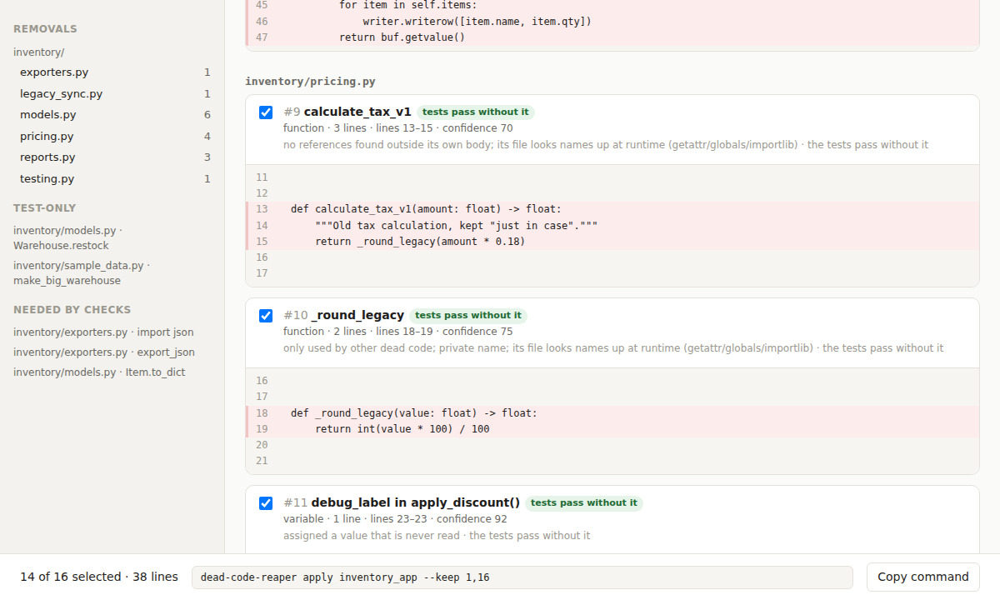
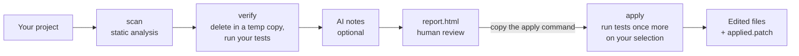

# dead-code-reaper

> Finds dead Python code, proves each deletion is safe by running your tests without it, and lets you review everything in a browser before a single line is removed.



---

## Overview

### Problem Statement & Intended Users

- **Problem**: Every codebase collects dead code: old versions of functions, helpers nobody calls, imports left behind by refactors, whole modules for features that were retired. It slows down reading, reviews, and onboarding, but nobody deletes it, because nobody can be sure it's really unused. Python makes this worse: code can be called by name at runtime, by a decorator, by a framework hook, or from a config file, so "nothing references it" is not proof. Existing tools stop at a list of suspects and leave the risky part, deciding what is actually safe to delete, to you.
- **Intended Users**: Python developers and teams who want to clean up an application's codebase without breaking it, and tech leads planning a cleanup or a refactor.

### Key Features

- **Five kinds of dead code**: unused functions, classes, and methods; unused imports (including single names in a multi-name import); unused local variables; unused modules; and unreachable code (after `return`/`raise`, or inside `if False:`).
- **Finds dead code hiding behind dead code**: a helper used only by an unused function is dead too, and so are the imports only they used. Each one is linked to what it depends on.
- **Proves every removal against your tests**: deletions are made in a temporary copy of your project and kept only if your test suite still passes. Batches are split in half on failure, so a whole project usually takes only a few test runs.
- **Conservative by design**: anything that could be used invisibly is protected (decorated functions, framework hooks, overridden methods, names that appear in strings or config files, entry points), and code that is looked up by name at runtime gets a low confidence score so it starts unticked.
- **Browsable HTML report**: a single self-contained file with a folder tree, dead lines highlighted in each file, and a checkbox per removal. Unticking something also keeps everything it depends on.
- **Optional AI notes**: with a Gemini, Anthropic, or OpenAI-compatible API key, each removal gets a one-line note on what the code did, and a risk warning if it looks like a framework hook or plugin. AI never decides what is dead.
- **Nothing changes until you say so, and then it's checked again**: `apply` runs your tests once more on exactly what you selected, then edits the files and saves a patch you can undo with `git apply -R`.
- **Test-only code** (used by tests and nothing else) is listed separately and never removed.
- **Zero runtime dependencies**: standard-library Python only.

---

## Technical Stack

- **Language & Runtime**: Python 3.9+ (tested on Python 3.12)
- **Agent Framework / Core Library**: Vanilla Python. Static analysis uses the standard library's `ast` module; verification runs your own test command in a subprocess.
- **Models**: Optional. Gemini via Google's OpenAI-compatible endpoint (default model `gemini-flash-latest`), Anthropic (default `claude-haiku-5-5`), or any OpenAI-compatible API, including local models through Ollama (default `gpt-5-mini`). Override any default with `REAPER_MODEL`.
- **External APIs / Tools**: Your project's test runner (pytest by default). The report is plain HTML, CSS, and JavaScript with nothing loaded from the internet.

---

## Architecture & Data Flow



1. **Scan** (`analyzer.py`) parses every `.py` file with `ast` and records every definition, import, and reference, plus every identifier in config files (`pyproject.toml`, YAML, JSON, shell scripts, Makefiles, HTML templates). A definition becomes a candidate only if nothing outside its own body refers to it. This repeats until nothing changes, so code used only by other dead code is found too. Protection rules and confidence scores are applied here.
2. **Verify** (`verifier.py`) copies the project to a temporary directory and tries removing candidates in batches, running your tests each time. A batch that passes is accepted in one run; a batch that fails is split in half until the culprits are isolated. Removals used by low-confidence ones are batched with them, so one likely failure doesn't split the confident batch. Each run has a time limit and the total number of runs is capped. Projects without tests get a compile-and-import check instead, and those removals are marked unverified.
3. **AI notes** (`ai.py`, optional) send only the verified removals' code, in batches of 8, to the configured provider and add a note and, if needed, a risk warning to each.
4. **Report** (`report.py`) writes `reaper-out/report.html`, `report.json`, and `state.json` (what was checked, and a fingerprint of every file).
5. **Apply** (`cli.py`) refuses to continue if any file changed since `run`, adds anything your kept items depend on, runs your tests once on exactly the final selection, and only then edits the files and writes `applied.patch`.

**Why AI doesn't detect the dead code**: an AI judgment that code is unused can't be checked, and a wrong deletion breaks your project. Static analysis plus your test suite produces evidence instead. AI is used where it's genuinely good, explaining code to the person reviewing it, and it can only make a removal *more* cautious (start unticked), never cause one. See [`docs/adr/0001-ai-assists-human-review-not-detection.md`](docs/adr/0001-ai-assists-human-review-not-detection.md). The project's terms are defined in [`docs/GLOSSARY.md`](docs/GLOSSARY.md).

---

## Prerequisites

Before running this project, ensure you have:
- Python 3.9 or newer
- pip
- A project to clean up whose test suite passes (dead-code-reaper refuses to start if the tests fail before anything is changed)
- Optional: a Gemini, Anthropic, or OpenAI-compatible API key for AI notes

---

## Installation & Setup

1. **Navigate to the project directory:**
   ```bash
   cd tools/dead-code-reaper
   ```

2. **Set up the virtual environment / install dependencies:**
   ```bash
   python -m venv .venv
   # Windows:
   .venv\Scripts\activate
   # Linux/macOS:
   source .venv/bin/activate

   pip install -r requirements.txt   # pytest, for the tests and the example
   pip install -e .                  # installs the `dead-code-reaper` command
   ```
   Without installing, `python -m dead_code_reaper` works the same from this directory.

3. **Configure Environment Variables (optional, only for AI notes):**
   ```bash
   cp .env.example .env
   ```
   Then uncomment one API key. The tool reads `.env` from the directory you run it in.

---

## Configuration & Environment Variables

All variables are optional. With none set, everything works except AI notes.

| Variable Name | Required | Default | Description |
| :--- | :--- | :--- | :--- |
| `GEMINI_API_KEY` | No | *None* | Turns on AI notes using Gemini. Used first if several keys are set. |
| `ANTHROPIC_API_KEY` | No | *None* | Turns on AI notes using Anthropic. |
| `OPENAI_API_KEY` | No | *None* | Turns on AI notes using OpenAI or another OpenAI-compatible API. |
| `OPENAI_BASE_URL` | No | `https://api.openai.com/v1` | Base URL for an OpenAI-compatible API, e.g. `http://localhost:11434/v1` for Ollama (no key needed). |
| `REAPER_AI_PROVIDER` | No | first key found | `gemini`, `anthropic`, or `openai`, when several keys are set. |
| `REAPER_MODEL` | No | per provider (see Technical Stack) | Model to use for AI notes. |
| `ANTHROPIC_BASE_URL` | No | `https://api.anthropic.com` | Alternative Anthropic-compatible endpoint. |

---

## How to Run

```bash
# 1. Look: find dead code by reading the project. Runs none of your code, changes nothing.
dead-code-reaper scan path/to/project

# 2. Prove: verify every removal against your tests and write the HTML report.
dead-code-reaper run path/to/project

# 3. Review: open path/to/project/reaper-out/report.html, untick anything you want to keep,
#    and copy the command at the bottom. It looks like:
dead-code-reaper apply path/to/project --keep 3,7-9
```

Each command asks whether your project is an **application** (anything unused is dead) or a **library** that other projects install (public names are assumed to be used elsewhere and are never removed), with a guess based on your packaging files. Pass `--app` or `--library` to skip the question.

| Option | Commands | What it does |
| :--- | :--- | :--- |
| `--app` / `--library` | scan, run | How to treat public names (see above). Without a terminal, library mode is assumed because it's the safe choice. |
| `--exclude GLOB` | scan, run | Skip matching paths, e.g. `--exclude "scripts/*"`. Repeatable. |
| `--test-cmd CMD` | run | Your test command. Default: `python -m pytest -q -x`. |
| `--timeout SECONDS` | run | Time limit per test run. Default: 600. |
| `--max-test-runs N` | run | Cap on test runs. Removals not reached are marked unverified. Default: 60. |
| `--no-ai` | run | Don't send code to an AI provider this run, even if a key is set. |
| `--keep SPEC` | apply | What to keep: numbers (`5`), ranges (`3-7`), files (`pricing.py`), names (`calculate_tax_v1`), or `none`. Default: whatever starts unticked in the report. |
| `--dry-run` | apply | Run the final check and write the patch, but change no files. |
| `--out DIR` | all | Where to write output. Default: `<project>/reaper-out`. |

Add `reaper-out/` to your project's `.gitignore`.

---

## Example Input & Output

### Example Input

`examples/inventory_app` is a small inventory application written for this demo. It contains 14 pieces of dead code of every kind, plus 10 traps that look unused but aren't: functions called by name through `globals()` and `getattr()`, a decorator-registered report, a `json.JSONEncoder` hook, a pytest plugin, and an entry point declared in `pyproject.toml`. Its tests pass.

### Example Output

These are real runs, copied from the terminal.

```text
$ dead-code-reaper scan inventory_app --app
Scanned 12 files in app mode.
19 removals (1 class, 5 functions, 5 imports, 3 methods, 2 modules, 2 unreachable blocks, 1 variable), 54 lines
Test-only code: 2
Report: inventory_app/reaper-out/report.html

$ dead-code-reaper run inventory_app --app
Scanned 12 files in app mode: 19 candidates, 2 test-only, 17 protected.
Baseline check: tests
  ok: 14 removals
  a batch of 5 failed; splitting it
  a batch of 2 failed; splitting it
  needed: inventory/exporters.py::import json@2
  needed: inventory/models.py::Item.to_dict
  a batch of 3 failed; splitting it
  needed: inventory/exporters.py::export_json
  ok: 2 removals
Checked in 9 runs (4.5s).
16 removals (1 class, 4 functions, 4 imports, 2 methods, 2 modules, 2 unreachable blocks, 1 variable), 49 lines
  ticked by default: 14 (38 lines)
  needed by the checks (not removable): 3
Test-only code: 2
Report: inventory_app/reaper-out/report.html
Review it, then copy the command at the bottom of the report, or run:
  dead-code-reaper apply inventory_app

$ dead-code-reaper apply inventory_app --keep 1,16
Checking 14 removals (38 lines) with the tests...
Check passed. Removed 14 pieces of dead code (38 lines) in 4 files, 1 deleted.
Patch saved to inventory_app/reaper-out/applied.patch (undo with: git apply -R <patch>)

$ python -m pytest -q
9 passed in 0.02s
```

What happened: static analysis flagged 19 items. The tests showed that 3 of them (`export_json`, which is called by name, plus `Item.to_dict` and `import json`, which it uses) are needed. Of the 16 removals that passed, 2 start unticked because their names suggest they're called at runtime (`export_xml`, matching the `"export_" + fmt` lookup, and `testing.py`, which defines a pytest hook). That's the `--keep 1,16` the report generated. The other 14 are exactly the dead code planted in the example.

An excerpt of the generated patch, showing a partial import rewrite and a cascade (`_round_legacy` was only used by `calculate_tax_v1`):

```diff
-import csv
-import io
-import os
 from dataclasses import dataclass, field
-from typing import Dict, List, Optional
+from typing import List, Optional
...
-def calculate_tax_v1(amount: float) -> float:
-    """Old tax calculation, kept "just in case"."""
-    return _round_legacy(amount * 0.18)
-
-
-def _round_legacy(value: float) -> float:
-    return int(value * 100) / 100
```

### On real open-source projects

| Project (commit) | Mode | Files | Scan time | Findings | Result |
| :--- | :--- | :--- | :--- | :--- | :--- |
| [HTTPie](https://github.com/httpie/cli) (`5b604c3`) | app | 133 | 0.5s | 13 | Checked by hand: 11 are genuinely unused, including a 105-line `to_help_message()` in `rich_help.py`, the helper only it used, and 6 imports only they used. The other 2 are a PyInstaller hook, which starts unticked. `run` verified all 13 against HTTPie's test suite (about 1,000 tests) in 3 runs, 261s. `apply --dry-run` passed and produced a patch removing 173 lines from 4 files that applies cleanly with `git apply`. |
| [humanize](https://github.com/python-humanize/humanize) (`a2006ea`) | library | 13 | 0.10s | 0 | No dead code. |
| [python-tabulate](https://github.com/astanin/python-tabulate) (`268615a`) | library | 13 | 0.19s | 0 | No dead code. |
| [itsdangerous](https://github.com/pallets/itsdangerous) (`672971d`) | library | 15 | 0.07s | 0 | No dead code. |

For HTTPie, three of its tests fail on an unchanged checkout in the Linux sandbox used for testing (one expects a non-root user; two depend on character-set detection, which guesses differently with the installed library versions), so they were excluded with `--test-cmd "python3 -m pytest -q -x -p no:cacheprovider tests --deselect tests/test_config.py::test_config_file_inaccessible -k 'not big5'"`. Without that, dead-code-reaper stops at the baseline check, as it should.

AI notes are not shown in these examples: they were developed without an API key and tested against a stand-in provider (see *How to Test*). Run with a key set to see them in the report.

---

## How to Test

```bash
# The tool's own tests (30 tests, about 10 seconds, no API key or network needed)
python -m pytest

# Accuracy against the hand-labelled example (writes eval/results.md)
python eval/run_eval.py
```

The tests cover each kind of dead code and each protection rule, the source edits (spacing, `pass` insertion, import rewrites), verification (including projects with no tests, a failing baseline, the run cap, and an editable install that could shadow the copy being tested), the full `run` and `apply` flow, `--keep`, refusing to apply after files change, AI response parsing, and provider selection.

`eval/run_eval.py` compares three stages with `eval/ground_truth.json`, which lists by hand what is dead in the example and which traps aren't. Latest result ([`eval/results.md`](eval/results.md)):

| Stage | Flagged | Dead code found | Precision | Wrongly flagged | Tests pass after deleting |
|---|---|---|---|---|---|
| 1. Static scan only | 19 | 14/14 (100%) | 74% | 5 | **no** |
| 2. Verified against tests | 16 | 14/14 (100%) | 88% | 2 | n/a |
| 3. Ticked by default | 14 | 14/14 (100%) | 100% | 0 | yes |

Deleting everything static analysis flags would break the example's tests. Verification removes three of the five wrong flags, and confidence scoring removes the other two. The example was written alongside the tool, so treat these numbers as a demonstration of the design rather than a benchmark; the HTTPie results above are the independent check.

---

## Known Limitations

- **Only as safe as your tests.** A removal "passes" if your tests pass without it. Code that runs only in production paths your tests don't cover (a cron job, a rarely used CLI flag) can be verified as removable. The report shows why each item was flagged; read it before applying.
- **Names, not types.** References are matched by name, so a method is considered used if anything anywhere accesses an attribute with that name. This misses some dead code, but it only ever errs toward keeping code.
- **Code called from outside the repository** isn't visible: other projects importing a library (use `--library`), scripts on servers, or names built from user input. Low-confidence items start unticked, but nothing can see everything.
- **Some frameworks aren't recognized yet.** Plain function names that a framework discovers by convention may be flagged. Functions with registering decorators are always protected, and many conventions are handled (pytest hooks, `main`, `handler`, `hook`, Django-style module names, `visit_*` methods), but not all.
- **Unused variables** are found only inside functions, and only when the value has no side effects (`x = 5`, not `x = compute()`).
- **Rewritten import statements** lose their original line breaks and comments.
- **Test files are never changed**, so a test that imports otherwise-dead code keeps it alive (it's listed as test-only).
- **Tested on Linux (Ubuntu) with Python 3.12.** Written for Python 3.9+ and to be portable, but macOS and Windows are untested.
- **Large projects with slow test suites** take one full test run per batch; use `--test-cmd` to run a faster subset you trust, and `--max-test-runs` to cap the total.

---

## Security & Privacy Considerations

- **Secrets Handling**: API keys are read only from environment variables or a `.env` file in the directory you run the command from, are never logged, and are sent only to the provider they belong to. `.env` is in `.gitignore`.
- **Data Privacy**: Without an API key, nothing leaves your machine. With a key set, `run` prints which provider and model it will use and how many removals it's sending before it sends anything, and sends only the code of the dead code it found (up to 40 lines each, with the file's import lines), never whole files or anything else. `--no-ai` turns this off for a run. Roughly one API request per 8 removals.
- **Safety**: `run` executes your project's test command, which runs your own code, so run it only on projects you trust. All edits during `run` happen in a temporary copy, which is deleted afterwards. Your files change only when you run `apply`, which first refuses if anything changed since `run`, then re-runs your tests on exactly your selection, and saves a patch so the change can be undone. Every test run has a time limit, and the number of runs is capped. dead-code-reaper also checks that the tests import the temporary copy rather than an installed original, and stops if they don't.

---

## Future Improvements

- [ ] Recognize more framework conventions (Django, Flask, Celery, FastAPI, Click) out of the box.
- [ ] Type-aware reference matching, to find dead methods whose names are reused elsewhere.
- [ ] Optionally report test-only code together with the tests that use it, as a combined removal.
- [ ] A `check` command for CI, with a baseline so only new dead code fails a build.
- [ ] Run only the tests affected by each removal, to make verification faster on large projects.
- [ ] JavaScript and TypeScript support.

---

## License

*This project is contributed under the repository's open-source license (MIT).*
