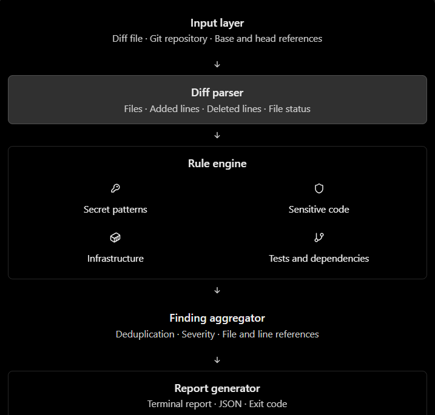

# PR Risk Analyzer

A lightweight, local-first Python CLI that analyzes Git diffs and highlights potential pull request review risks.

## Overview



PR Risk Analyzer examines unified Git diffs using configurable heuristic rules. It helps reviewers identify changes that may deserve additional attention before merging.

It is a review aid, not a security scanner or an automated PR approval system.

| [PR Risk Analyzer](./pr-risk-analyzer/) | Local Python CLI that analyzes Git diffs and flags potential review risks. |

## Features

- Analyze a saved unified diff or compare two Git refs.
- Flag potential hard-coded credentials in added lines.
- Highlight changes to configured sensitive paths.
- Detect infrastructure, deployment, and dependency manifest changes.
- Flag removed lines in recognized test files.
- Identify unusually large diffs using configurable thresholds.
- Generate terminal or JSON reports.
- Use configurable rules and CI-friendly exit codes.
- Run locally without an API key or external service.

## Requirements

- Python 3.10 or newer
- Git installed and available on `PATH` when using `--repo`
- `pytest` to run tests

## Setup

From the project directory:

```bash
python -m venv .venv
```

Activate the environment.

Windows PowerShell:

```powershell
.\.venv\Scripts\Activate.ps1
```

Git Bash or Linux/macOS:

```bash
source .venv/bin/activate
```

Install development dependencies:

```bash
python -m pip install -r requirements.txt
```

## Usage

Analyze a saved unified diff:

```bash
python main.py --diff-file tests/fixtures/risky.diff
```

Compare two Git refs:

```bash
python main.py --repo .. --base main --head HEAD
```

Use a custom configuration:

```bash
python main.py --diff-file tests/fixtures/risky.diff --config config.json
```

Produce JSON output:

```bash
python main.py --diff-file tests/fixtures/risky.diff --format json
```

Save a JSON report:

```bash
python main.py --diff-file tests/fixtures/risky.diff --format json --output report.json
```

Fail a CI step when a high-or-critical finding is present:

```bash
python main.py --diff-file tests/fixtures/risky.diff --fail-on high
```

Display default configuration:

```bash
python main.py --show-config
```

View all arguments:

```bash
python main.py --help
```

## Configuration

The `config.json` file supports:

- `rules`: enable or disable individual rules.
- `thresholds.max_changed_files`: maximum changed-file count before a size warning.
- `thresholds.max_added_lines`: maximum added-line count before a size warning.
- `sensitive_paths`: path terms that trigger a review signal.

A threshold of `0` disables that size check. Tune the defaults to fit your repository; they are not universal risk boundaries.

## Findings

Each finding contains:

- Rule ID and title
- Severity
- Explanation
- File path and line number when available
- Redacted evidence when applicable
- Recommended review action
- Confidence indicator

## Exit codes

| Code | Meaning |
|---|---|
| `0` | Analysis completed without meeting the configured failure threshold |
| `1` | A finding met the `--fail-on` severity threshold |
| `2` | Invalid input, configuration, or analysis error |

By default, `--fail-on never` means findings are informational and do not fail the command.

## Tests

Run from this directory:

```bash
python -m pytest -q
```

## Safety and privacy

- Diff analysis is performed locally.
- The tool does not call an LLM or external API.
- Credential-like evidence is redacted in findings.
- Only added lines are checked for newly introduced secret-like patterns.
- The tool does not execute commands found in source code or diffs.
- Do not use real credentials in test fixtures.
- A redacted finding does not replace secret scanning, credential rotation, or incident response.

## Limitations

- Pattern-based credential detection can produce false positives and miss unfamiliar credential formats.
- Sensitive-path and infrastructure rules identify areas for review, not confirmed vulnerabilities.
- Dependency changes are detected, but dependency vulnerability databases are not queried.
- Removed test lines do not prove that test coverage decreased.
- Binary diffs cannot be inspected for source-level risks.
- The tool does not access pull request metadata, approve PRs, or merge code.

## Future improvements

- SARIF output
- More robust parsing for complex rename and binary cases
- Additional rules for dangerous permission and workflow changes
- CI integration examples
- Optional integrations with approved vulnerability scanners

## License

Use the license specified by the parent repository.
