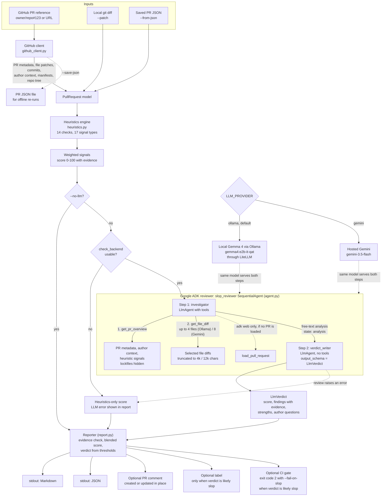
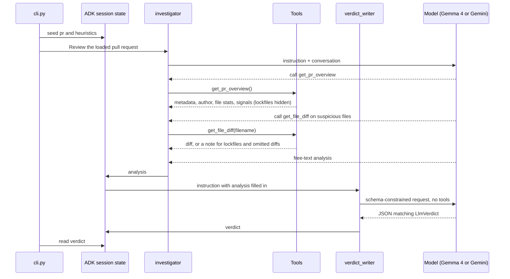
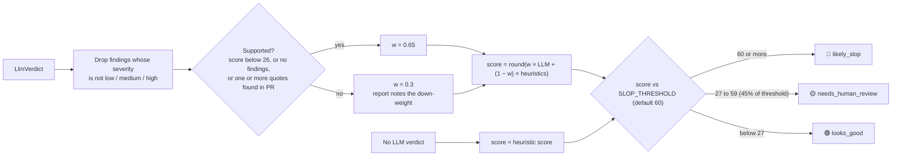

# PR Slop Detector Architecture

This document describes how PR data moves through the detector, how the optional model review is integrated, how the final score is computed, and which outputs the CLI can produce.

## System flow

## Components

| Component | Responsibility |
| :--- | :--- |
| `slop_detector/cli.py` | Parses CLI options, selects an input source, runs the heuristics and (optionally) the review, prints results, and performs GitHub writes. |
| `slop_detector/github_client.py` | Parses PR references; fetches PR metadata, changed-file patches, commits, author context, dependency manifests, and the repository tree; parses local diffs; upserts the report comment and adds labels. |
| `slop_detector/models.py` | Shared Pydantic models: `PullRequest`, `ChangedFile`, `AuthorInfo`, `Signal` / `HeuristicReport`, `LlmVerdict` / `LlmFinding`, and `FinalReport`. |
| `slop_detector/heuristics.py` | Deterministic, network-free checks that return weighted signals with evidence. |
| `slop_detector/agent.py` | The two-step Google ADK reviewer (investigator + verdict writer), its tools, backend selection (`LLM_PROVIDER`), the backend health check, and tolerant verdict parsing. Also exposes `root_agent` for `adk web`. |
| `slop_detector/report.py` | Verifies quoted evidence, blends the model and heuristic scores, maps the score to a verdict, and renders the Markdown report. |
| `examples/pr-slop-check.yml` | A GitHub Actions workflow that runs the CLI on incoming PRs (see [Deployment](#deployment-github-actions)). |

## Data and review behavior

1. **Load.** The CLI loads a PR from the GitHub API, a local diff, or previously saved JSON into the shared `PullRequest` model. GitHub input also provides:
   - commit messages
   - the author's account age, their association with the repo, and how many PRs they opened across GitHub in the last 14 days (via GitHub search, skipped quietly if rate-limited)
   - dependency manifests (`requirements.txt`, `pyproject.toml`, `package.json`, `go.mod`, `Cargo.toml`) from the repo root and from up to 3 directory levels of each touched path
   - every module and directory name in the repository tree, so imports of local code aren't flagged

   Local diffs and saved JSON carry no author context, so the author checks don't fire for them.
2. **Heuristics.** The heuristics engine runs 14 checks that emit 17 signal types (listed in the README). The score is the sum of signal weights, capped at 100. No single signal can flag a PR alone. Bot authors (`*[bot]`) skip the author, description-size, emoji-heading, and commit checks.
3. **Backend check.** Unless `--no-llm` is set, `check_backend` verifies the selected backend before any model call:
   - **Ollama:** the server is reachable, and the model has been pulled.
   - **Gemini:** an API key is set.

   If the check fails, the run continues heuristics-only and the report explains why (for example, "run `ollama pull gemma4:e2b-it-qat`").
4. **Two-step review.** The CLI seeds an ADK session with the PR and heuristic results, then runs a `SequentialAgent` (see [Review agent](#review-agent)). The `investigator` uses tools and writes a free-text analysis. The `verdict_writer` has no tools and converts that analysis into an `LlmVerdict`.
5. **Reporting.** The reporter filters and verifies the model's findings, blends the scores, and picks the verdict (see [Scoring and verdict](#scoring-and-verdict)). Review failures appear in the report instead of suppressing the heuristic result.
6. **Output.**
   - The CLI prints Markdown or JSON. The JSON output omits the raw patches and manifests.
   - For a GitHub PR, `--post-comment` creates the report comment, or edits the previous one in place. It finds the previous comment by a hidden `<!-- pr-slop-detector -->` marker, so re-runs don't spam the thread.
   - `--label` is applied only when the verdict is `likely_slop`.

## Review agent

**Why two steps:** keeping tools and the output schema in separate steps lets the model server enforce the JSON schema itself (Ollama constrained decoding, Gemini response schema). Small local models need this. In testing, a single-step Gemma 4 E2B agent that had both tools and an output schema answered in prose and failed schema validation.

| Aspect | investigator | verdict_writer |
| :--- | :--- | :--- |
| Tools | `get_pr_overview`, `get_file_diff`, `load_pull_request` | none |
| Input | user prompt + tool results | only `{analysis}` from state (`include_contents="none"`) |
| Output | free text → `state["analysis"]` | `LlmVerdict` JSON → `state["verdict"]` |
| Temperature | 0.2 | 0.0 |
| File budget | 4 diffs × 4,000 chars (Ollama), 8 × 12,000 (Gemini) | – |

**Tool behavior that prevents known false positives:**
- `get_pr_overview` leaves lockfiles and generated files (`uv.lock`, `package-lock.json`, `*.min.js`, `*.map`, …) out of the file list. They appear only as names under `generated_files_hidden`.
- `get_file_diff` returns an explanatory note instead of a diff:
  - for those lockfiles and generated files
  - for files whose diff GitHub omitted (binary or very large), stating explicitly that this is normal and not evidence

  The live run that motivated this: a real Flask maintainer PR scored 🟡 55 because the model treated the omitted `uv.lock` diff as suspicious.
- `load_pull_request` is used only from `adk web`, where no PR is preloaded. It fetches from GitHub and runs the heuristics.

**Reading the verdict:** the CLI first reads `state["verdict"]`. If that's missing, `parse_verdict` extracts the first JSON object from the final text, tolerating the code fences and preambles that small models add.

**Model backends:**

| `LLM_PROVIDER` | Model object | Default model | Notes |
| :--- | :--- | :--- | :--- |
| `ollama` (default) | `LiteLlm("ollama_chat/<model>")` | `gemma4:e2b-it-qat` (4.3 GB) | `OLLAMA_API_BASE`, `OLLAMA_NUM_CTX` (16384) |
| `gemini` | model id string | `gemini-3.5-flash` | needs `GOOGLE_API_KEY` |

`MODEL_NAME` or `--model` overrides the model for either provider. Plain `gemma4:e2b` resolves to a 7.5 GB MLX build on Apple Silicon, so the default pins the 4.3 GB QAT build.

## Scoring and verdict

- **Evidence check:** a quote counts only if it occurs verbatim, ignoring whitespace and case, in the PR's title, description, commit messages, or diff. Bare file names and strings shorter than 4 characters don't count. The report shows only quotes that pass.
- **Final verdict:** it comes from the **blended score**. The LLM's own `verdict` field is not used directly, so neither layer can flag a PR alone.
- **Example:** in the live runs, the synthetic slop fixture still scored 🔴 96 after its unsupported LLM score (85) was down-weighted, because the heuristic evidence was strong (100). The Flask PR scored 🟢 13 once the model quoted real lines (LLM 20, heuristics 0).

## Failure handling and exit codes

| Situation | Behavior | Exit code |
| :--- | :--- | :---: |
| Unparseable PR reference | `error: Could not parse PR reference …` on stderr | 1 |
| `--post-comment` / `--label` without a GitHub PR or `GITHUB_TOKEN` | error on stderr, nothing fetched | 1 |
| Backend unavailable (Ollama down, model not pulled, no Gemini key) | heuristics-only report with the reason | 0 |
| Model or parsing error during review | heuristics-only report with a one-line error | 0 |
| GitHub search rate-limited | `pr-spray` signal skipped, nothing else changes | 0 |
| Verdict `likely_slop` with `--fail-on-slop` | report printed (and posted, if requested) | 2 |

## Deployment: GitHub Actions

`examples/pr-slop-check.yml` runs the CLI on `pull_request_target` events (opened, reopened, synchronize, edited):

- **Skips trusted authors:** OWNER, MEMBER, and COLLABORATOR PRs are skipped.
- **Default backend:** it installs Ollama on the runner, caches `~/.ollama/models` keyed by model name, pulls Gemma, and runs with no secrets. Commented lines show how to switch to Gemini with a `GOOGLE_API_KEY` secret.
- **Permissions:** `contents: read`, `pull-requests: write`, and `issues: write` (for labels).
- **Security model:** `pull_request_target` gives fork PRs a write token. That's safe only because the workflow checks out the **base** branch to get the tool, and reads the PR purely through the GitHub API. The PR's code is never checked out or executed. Adding `ref: head.sha` to the checkout step would break this guarantee.
- **Status:** the workflow has not yet been run on a real GitHub runner.

## Data boundary

- The detector never executes PR code.
- **GitHub API:** contacted when a PR reference is given, and by `load_pull_request` in `adk web`. Local patch and saved-JSON modes make no GitHub calls. GitHub writes require a PR reference.
- **Ollama (default):** model review runs on the local machine (or wherever `OLLAMA_API_BASE` points). No PR content goes to a hosted model.
- **Gemini:** each review sends Google's API:
  - the title, and the description (up to 6,000 characters)
  - author context: login, account age, association, recent PR counts
  - up to 30 commit messages (300 characters each)
  - the changed-file list, and the heuristic signals with their evidence
  - up to 8 file diffs of 12,000 characters each
- **Disk:** nothing is written, except the file you name with `--save-json`.
